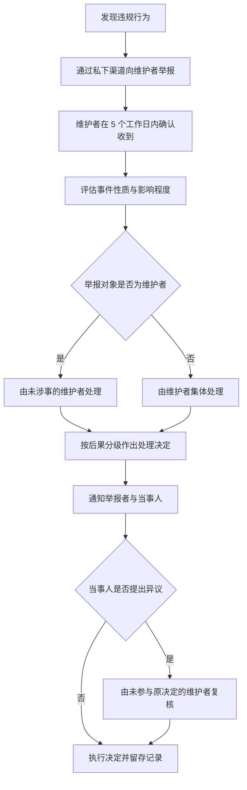

# 贡献者行为准则

本文档采用 Contributor Covenant 2.1 的结构与条款，中文表述由本项目维护者翻译整理；条款含义以英文原版为准。原版地址：<https://www.contributor-covenant.org/version/2/1/code_of_conduct/>。

## 1. 我们的承诺

作为成员、贡献者与维护者，我们承诺让每一位参与者都能获得不受骚扰的体验，不因年龄、体型、可见或不可见的残障、族裔、性别特征、性别认同与表达、经验水平、教育程度、社会经济状况、国籍、外貌、种族、种姓、肤色、宗教或性取向与性别认同而受到区别对待。

我们承诺以有助于建设开放、友善、多元、包容与健康社区的方式行事与互动。

## 2. 适用范围

本准则适用于所有项目空间，包括 Issue、Pull Request、代码评审、讨论区、Wiki、提交信息与代码注释；当个人以官方身份代表本项目出现在公开场合时同样适用，例如使用项目官方账号发言、以项目代表身份参加线上或线下活动。

本准则同样适用于项目维护者在执行本准则时的行为。

## 3. 期望行为

- 对他人表现出同理心与善意。
- 尊重不同的意见、观点与经验。
- 给予建设性反馈，并得体地接受他人的建设性反馈。
- 对自己的错误负责，向受影响的人致歉，并从经历中学习。
- 关注什么对社区整体最有利，而不仅仅是对个人最有利。

## 4. 不可接受的行为

- 使用带有性意味的语言或图像，以及任何形式的性关注或性挑逗。
- 挑衅、侮辱或贬损性评论，以及人身攻击或政治攻击。
- 公开或私下的骚扰。
- 未经明确许可发布他人的隐私信息，例如住址或电子邮箱地址。
- 其他在专业场合可以被合理认定为不当的行为。
- 对善意举报违规行为的人进行报复。

## 5. 执行责任

项目维护者负责解释并执行本准则，对认定为不当、具有威胁性、冒犯性或有害的行为采取适当且公正的纠正措施。

维护者有权也有责任删除、编辑或拒绝不符合本准则的评论、提交、代码、Wiki 编辑、Issue 与其他贡献，并在适当时说明处理理由。

## 6. 举报方式

如果你经历或目击了违反本准则的行为，请通过私下渠道联系项目维护者：

1. 通过 GitHub 联系仓库所属账号：<https://github.com/tktogether/subforge>。请优先使用该账号公开资料页中列出的联系方式。
2. 若资料页未列出联系方式，可先创建一个只包含“需要就行为准则问题私下沟通”的 Issue 以获取私下渠道，**不要**在该 Issue 中描述事件细节或涉及他人身份的信息。
3. 若违规行为同时属于 GitHub 平台层面的滥用行为，可以一并向 GitHub 官方举报。

请勿通过公开渠道披露事件细节、当事人身份或举报内容。所有举报都会被及时、公正地审阅与调查，维护者有义务尊重举报者的隐私与安全。若举报对象是维护者本人，由未涉事的其他维护者处理；若无法组成未涉事的处理方，举报者可直接向 GitHub 官方举报。

## 7. 处理流程与时限

维护者的目标处理节奏为：收到举报后 5 个工作日内确认收到，确认后 10 个工作日内给出处理决定。以上时限是维护者尽力而为的目标，不构成服务等级承诺；涉及多方核实或需要征求第三方意见时，时限会相应顺延，维护者会向举报者同步进展。

## 8. 后果分级

维护者依据事件的影响程度，按下表逐级确定处理方式。

| 级别 | 适用情形 | 处理方式 |
| --- | --- | --- |
| 更正 | 使用不当语言，或其他被认定为不专业、不受欢迎的行为 | 由维护者发出私下书面警告，说明违规性质与不当原因，可要求公开致歉 |
| 警告 | 单次事件或一系列行为构成违规 | 警告并说明继续违规的后果；在规定期限内不得与相关人员互动，包括主动联系执行本准则的维护者，也不得在社区空间与社交媒体等外部渠道接触 |
| 临时封禁 | 严重违反社区标准，或持续存在不当行为 | 在规定期限内禁止与社区进行任何形式的互动或公开沟通，期间不得与相关人员公开或私下互动；违反将升级为永久封禁 |
| 永久封禁 | 形成违规模式，包括持续不当行为、骚扰特定个人，或攻击、贬损特定群体 | 永久禁止在社区内进行任何形式的公开互动 |

处理决定会以书面形式说明依据的条款与事实，并留存记录。当事人可在收到通知后提出异议，由未参与原决定的维护者复核；复核期间原决定继续有效，除非维护者另行决定暂缓执行。

## 9. 来源与许可

本文档改编自 Contributor Covenant 2.1 版，原版与其许可信息见 <https://www.contributor-covenant.org/version/2/1/code_of_conduct/>。后果分级参考了 Mozilla 的行为准则执行阶梯 <https://github.com/mozilla/diversity>。Contributor Covenant 的常见问题解答见 <https://www.contributor-covenant.org/faq>，其他语言的译本见 <https://www.contributor-covenant.org/translations>。

参与本项目即表示你同意遵守本准则；本准则与 [`CONTRIBUTING.md`](CONTRIBUTING.md) 中的贡献流程同时适用，涉及安全漏洞的报告方式见 [`SECURITY.md`](SECURITY.md)。
