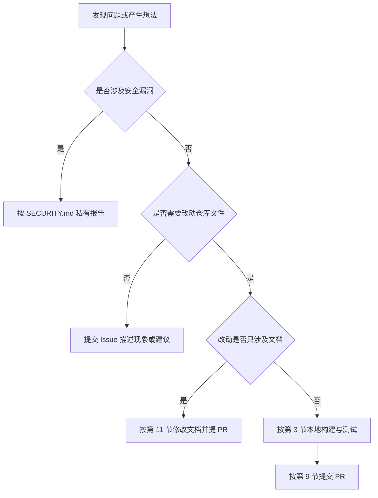
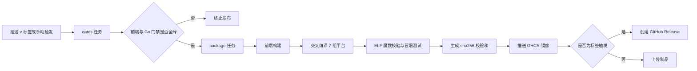

# SubForge 贡献与维护规范

本文档规定参与 SubForge 项目的标准流程，涵盖缺陷报告、功能建议、代码提交、文档维护与规则源协作，面向首次提交改动的贡献者与长期维护本仓库的维护者。

文档中的命令、目标名、检查项与阈值均以仓库当前源码为准并标注来源（文件与行号），与源码不一致时以源码为准。文档写作另有规范，见 [`docs/style-guide.md`](docs/style-guide.md)，修改任何对外文档前必须先阅读该规范。

## 1. 贡献方式总览

SubForge 接受五类贡献，选择依据是问题所处的位置。

| 贡献类型 | 适用场景 | 入口 |
| --- | --- | --- |
| 缺陷报告 | 功能行为与文档描述不符、程序报错、产物格式异常 | [`.github/ISSUE_TEMPLATE/bug_report.yml`](.github/ISSUE_TEMPLATE/bug_report.yml) |
| 功能建议 | 希望新增能力、调整现有行为、扩展输出格式 | [`.github/ISSUE_TEMPLATE/feature_request.yml`](.github/ISSUE_TEMPLATE/feature_request.yml) |
| 代码贡献 | 修复缺陷、实现功能、补充测试、调整构建脚本 | 按第 9 节提交 Pull Request |
| 文档贡献 | 修正错误描述、补充示例、整理 Wiki 源文件 | 按第 11 节执行 |
| 规则源协作 | 规则集来源、规则工厂 manifest、规则反馈建议 | 按第 1.2 节执行 |



### 1.1 各类贡献的基本要求

| 类型 | 必须做到 | 常见退回原因 |
| --- | --- | --- |
| 缺陷报告 | 给出输入、期望输出、实际输出三部分，并附 `subforge version` 的真实输出 | 只写“转换失败”，无法复现 |
| 功能建议 | 先说明需求背景，再给方案；背景决定实现方式，不可省略 | 只有结论，没有使用场景 |
| 代码贡献 | 一个 PR 只做一件事；行为变更同时更新测试与文档 | 修复与重构混在一个 PR |
| 文档贡献 | 遵守 [`docs/style-guide.md`](docs/style-guide.md)，改 Wiki 必须改仓库源文件 | 在 Wiki 网页端直接编辑 |
| 规则源协作 | 只提交解析与聚合逻辑的改动 | 把具体规则条目或订阅地址提交进仓库 |

提交缺陷报告前，请先在 Issue 列表中检索是否已有相同问题。

### 1.2 规则源协作的边界

规则集内容属于运行时数据，通过控制台或 `/api/rule-sources` 接口在部署实例内管理，不随仓库分发，因此具体的规则条目、规则集地址、单个实例的 INI 模板与覆盖层文件都不需要提交 PR。需要提交 PR 的是规则解析、规则集读写与规则工厂聚合的逻辑缺陷（`internal/ruleset/`、`internal/manifest/`、`internal/ini_rules/`），以及 Rule-Bot 的检测与建议逻辑（`internal/rulebot/`）。

## 2. 开发环境准备

### 2.1 工具链版本要求

| 工具 | 版本要求 | 来源 |
| --- | --- | --- |
| Go | 1.26.0 | `go.mod:3` |
| Node.js | >= 20.19.0 | `web/package.json:8` |
| pnpm | 11.28.5 | `web/package.json:6` |
| Make | 支持 `.PHONY` 与多行 shell 的版本 | `Makefile:16-18` |
| git | 用于版本号注入与提交 | `Makefile:4` |
| Docker | 可选，仅构建容器镜像时需要 | `Makefile:38-40` |

Go 版本由 `go.mod` 的 `go` 指令约束，Node 版本由 `web/package.json` 的 `engines` 字段约束，pnpm 版本由 `packageManager` 字段约束，使用 Corepack 时会自动切换到该版本。

### 2.2 验证安装结果

```bash
go version
node -v
pnpm -v
make --version
```

`docker --version` 可以失败，只有构建容器镜像时才需要 Docker。

### 2.3 获取源码与依赖

```bash
git clone https://github.com/tktogether/subforge.git
cd subforge
pnpm -C web install --frozen-lockfile
```

Go 依赖已 vendored 入库，构建使用 `-mod=vendor`（`Makefile:12`），Go 侧不需要联网下载依赖。前端依赖不在仓库内，必须执行上述安装命令（等价于 `make web-install`，`Makefile:54-55`）。

前端构建是硬前置：`internal/api/web/dist` 由前端构建产出，并通过 `//go:embed all:web/dist` 嵌入二进制（`internal/api/embed.go:12-15`）。该模式至少需要匹配一个文件，因此仓库用 `internal/api/web/dist/.gitkeep` 占位：干净 clone 上 `go build ./...` 可以完成，但控制台页面不可用。若占位文件缺失（例如前端构建被中断），编译会报 `pattern all:web/dist: no matching files found`（`web/scripts/ensure-dist-placeholder.mjs:1-5`），执行 `make web-build` 可补回占位文件。

### 2.4 Windows 环境

仓库提供 Windows 批处理校验脚本 `scripts/verify.cmd`，步骤与 `make verify` 对齐（`scripts/verify.cmd:11-63`）。无法使用 `make` 时执行 `scripts\verify.cmd`。该脚本优先使用 `pnpm`，当 `pnpm.exe` 不在 PATH 中时回退到 `web\node_modules\.bin` 下的可执行文件（`scripts/verify.cmd:6-9`、`scripts/verify.cmd:42-46`）。

## 3. 本地构建与测试

构建与测试入口全部收敛在 `Makefile` 中。下表逐条对应 `Makefile` 的实际命令，未做改写。

| 目标 | 实际执行的命令 | 说明 |
| --- | --- | --- |
| `make build` | `CGO_ENABLED=0 go build $(GOFLAGS) -o bin/subforge ./cmd/subforge` | 构建本机二进制（`Makefile:20-21`） |
| `make test` | `go test ./... -count=1` | 全量测试，禁用结果缓存（`Makefile:23-24`） |
| `make vet` | `go vet ./...` | 静态检查（`Makefile:26-27`） |
| `make cross` | 按 7 组 `GOOS/GOARCH` 循环构建 | linux/amd64、linux/arm64、linux/arm、windows/amd64、darwin/amd64、darwin/arm64、freebsd/amd64（`Makefile:29-36`） |
| `make docker` | `docker build -t subforge:$(VERSION) .` 与 `docker build -f Dockerfile.alpine -t subforge:alpine-$(VERSION) .` | Debian 系与 Alpine 两个镜像（`Makefile:38-40`） |
| `make release` | 先 `cross`，再把 `bin/subforge-*` 打包为 `dist/*.tar.gz` | 发行产物（`Makefile:42-47`） |
| `make clean` | `rm -rf bin/ dist/` | 清理构建产物（`Makefile:49-50`） |
| `make web-install` | `pnpm -C web install --frozen-lockfile` | 安装前端依赖（`Makefile:54-55`） |
| `make web-dev` | `pnpm -C web run dev` | 启动 Vite 开发服务器（`Makefile:57-58`） |
| `make web-typecheck` | `pnpm -C web run typecheck` | 执行 `vue-tsc --noEmit`（`Makefile:60-61`） |
| `make web-test` | `pnpm -C web run test` | 执行 `vitest run`（`Makefile:63-64`） |
| `make web-coverage` | `pnpm -C web run coverage` | 执行 `vitest run --coverage`（`Makefile:66-67`） |
| `make web-build` | `pnpm -C web run build` | `vue-tsc --noEmit`、`vite build`、`node scripts/ensure-dist-placeholder.mjs`（`Makefile:69-70`） |
| `make coverage` | `go test -coverprofile=coverage.out -covermode=atomic ./internal/... -count=1` | 生成 Go 覆盖率数据（`Makefile:74-75`） |
| `make coverage-gate` | 先 `coverage`，再 `coveragegate -min 80 -min-func 100` 与 `condgate -engine=profile -min 80` | 质量门禁 A（`Makefile:77-79`） |
| `make condition-gate` | 先 `coverage`，再 `condgate -engine=gobco -packages ./internal/... -min 80` | 质量门禁 B 准层，不进 `verify`（`Makefile:81-83`） |
| `make verify` | `build vet test coverage-gate web-typecheck web-coverage web-build` | 本机一次性全绿校验（`Makefile:87-89`） |
| `make docs-check` | `node scripts/check-docs.mjs` | 文档自检，独立门禁，不进 `verify`（`Makefile:91-96`） |

版本信息通过 `-ldflags -X` 注入 `internal/buildinfo`，变量为 `VERSION`（默认 `dev`）、`COMMIT`（`git rev-parse --short HEAD`）与 `DATE`（UTC ISO8601），定义见 `Makefile:3-10`。因此从源码构建的二进制执行 `subforge version` 时，提交号与构建时间来自构建环境而非源码常量。

## 4. 质量门禁

### 4.1 判定对象

Go 侧覆盖率门禁的判定对象是 `./internal/...`，即全部内部包；`cmd/`、`pkg/`、`vendor/` 不在统计范围（`Makefile:75`）。前端侧门禁的判定对象是 `web/` 下的单元测试，阈值配置在 `web/vitest.config.ts`（`scripts/verify.cmd:49`）。覆盖率数据文件默认为仓库根目录的 `coverage.out`，可用 `COVERAGE_OUT` 变量覆盖（`Makefile:14`）。

### 4.2 门禁 A：语句覆盖率与函数覆盖率

| 指标 | 阈值 | 实现 |
| --- | --- | --- |
| 语句覆盖率 | ≥ 80% | `coveragegate -min 80` |
| 函数覆盖率 | 100% | `coveragegate -min-func 100` |

对应命令为 `go run ./internal/tools/coveragegate -profile coverage.out -min 80 -min-func 100`（`Makefile:78`、`scripts/verify.cmd:28`、`.github/workflows/ci.yml:153`）。函数覆盖率 100% 的含义是 `./internal/...` 中每个函数都必须被至少一个测试执行到，因此新增函数后必须补充调用它的测试。

### 4.3 门禁 B：条件覆盖率

| 层 | 引擎 | 命令 | 触发时机 |
| --- | --- | --- | --- |
| 快层 | `-engine=profile` | `condgate -engine=profile -profile coverage.out -min 80` | 每次 `make verify` 与每次 CI（`Makefile:79`、`ci.yml:155`） |
| 准层 | `-engine=gobco` | `condgate -engine=gobco -packages ./internal/... -min 80` | 仅手动触发与 nightly（`Makefile:81-83`、`ci.yml:181`） |

准层不进 `verify`：gobco 真条件覆盖需要额外安装 `github.com/rillig/gobco@v1.3.4`（`.github/workflows/ci.yml:179`），且执行时间显著长于快层（`Makefile:81`）。

### 4.4 提交前的门禁要求

提交 PR 前必须在本机执行 `make verify` 并全绿。该目标依次执行构建、静态检查、全量测试、门禁 A、前端类型检查、前端覆盖率与前端构建（`Makefile:88`）。仅运行 `go test` 不足以通过 CI，因为 CI 会独立执行覆盖率门禁与前端检查。

## 5. 代码规范

### 5.1 Go 代码

- **注释与错误信息使用中文。** 这是仓库现状：渲染器注册表的中文注释与 `errors.New("不支持的输出格式")` 见 `internal/render/registry/registry.go:22-24`，测试失败信息同样为中文，见 `internal/render/registry/registry_test.go:33`。
- **格式化由 `gofmt` 强制。** CI 在 Linux 上执行 `test -z "$(gofmt -l cmd internal pkg)"`，只要有文件未格式化即失败（`.github/workflows/ci.yml:72-74`）。提交前执行 `gofmt -w cmd internal pkg`。
- **测试文件命名为 `*_test.go`**，与包同目录，优先使用表驱动写法，例如 `internal/api/routes_test.go:29` 的 `routeCases` 表。
- **错误必须可判定。** 使用哨兵错误或包装错误以便 `errors.Is` 与 `errors.As` 判定，例如 `registry.ErrUnsupportedFormat`（`internal/render/registry/registry.go:24`），不要用字符串比较判断错误类型。

### 5.2 前端代码

类型检查必须通过（`vue-tsc --noEmit`，`web/package.json:15`）；单元测试使用 Vitest（`web/package.json:16`），覆盖率由 `pnpm -C web run coverage` 统计（`web/package.json:18`）。前端构建产物输出到 `internal/api/web/dist` 并被 Go 侧嵌入，不要手工编辑该目录内容。

### 5.3 提交内容要求

不提交构建产物（`bin/`、`dist/`、`coverage.out`）；不提交真实订阅地址、令牌与 UUID，示例统一使用 `<YOUR_TOKEN>`、`<UUID>` 与 `example.com` 占位（`docs/style-guide.md:131-133`）；修改依赖时同步更新 `go.mod`、`go.sum` 与 `vendor/`，保证离线构建可用。

## 6. 目录职责表

| 路径 | 职责 |
| --- | --- |
| `cmd/subforge/` | CLI 入口与各子命令实现 |
| `internal/` | 内部实现，不允许被仓库外部导入（各包职责见下表） |
| `pkg/subforge/` | 公开库入口；当前仓库内无引用 |
| `web/` | Vue 3 与 Vuetify 前端工程，源码位于 `web/src/` |
| `docs/` | 项目文档：`adr/`、`design/`、`reports/`、`wiki/` 与顶层文档 |
| `deploy/` | systemd 单元与 OpenWrt 打包文件 |
| `scripts/` | 构建与校验脚本，含 `verify.cmd`、`check-docs.mjs`、`publish-wiki.ps1` |
| `testdata/` | 测试夹具 |
| `vendor/` | vendored 依赖，保证离线构建 |
| `.github/workflows/` | `ci.yml` 与 `release.yml` |

`internal/` 各包职责如下，包名即 `internal/` 下的目录名：

| 包 | 职责 | 包 | 职责 |
| --- | --- | --- | --- |
| `api` | HTTP 服务、路由、管理 API、Web 静态资源嵌入 | `manifest` | 规则工厂 manifest 聚合与版本化 |
| `buildinfo` | 版本号注入（`Version`、`Commit`、`Date`） | `mcp` | MCP 包；已实现但未接入入口 |
| `config` | INI 模板解析、覆盖层 DSL | `model` | 领域模型 |
| `convert` | 参数解析、管线组装、转换引擎 | `mrs` | MRS 规则集离线生成 |
| `fetch` | 上游订阅抓取、磁盘缓存、请求头 | `parse` | 分享链接、Base64、Clash YAML 解析 |
| `ini_rules` | INI 规则流解释 | `render` | 渲染器族与注册表 |
| `rulebot` | 规则反馈闭环（异常检测与建议队列） | `ruleset` | 规则集读写 |
| `runtime` | 运行时装配 | `scheduler` | 定时任务与告警通道 |
| `store` | 持久化（SQLite） | `subforge` | 订阅管理领域逻辑（机场、分组、节点、令牌） |
| `subscheck` | 订阅测活；默认关闭，需显式开启 | `template` | 模板解析 |
| `tools` | `coveragegate` 与 `condgate` 覆盖率门禁工具 | `traffic` | 流量策略与用量统计 |
| `transform` | 节点变换管线：filter、type、node_pref、rename、emoji、dedupe、sort | — | — |

## 7. 新增一个输出格式（渲染器）

渲染器把内部模型转换为某种客户端格式。新增渲染器需要改动四类位置，漏改任何一类都会导致“列得出来但转换报错”或“能转换但测试红”。

### 7.1 实现渲染器接口

渲染器必须实现 `render.Renderer`（`internal/render/render.go:79-84`）：

```go
type Renderer interface {
    Name() string
    Render(req Request) ([]byte, error)
}
```

若渲染过程会跳过无法表达的节点，还需实现 `render.WarningReporter`（`internal/render/render.go:90-93`），把跳过项回传给调用方，不得静默丢弃。

### 7.2 在真源表中登记 target 名

target 名单的真源表位于 `internal/render/targets.go`：`LinkTargets`（`targets.go:18`，只输出分享链接）、`ClashYAMLTargets`（`targets.go:48`）、`ClashJSONTargets`（`targets.go:65`）、`SingboxTargets`（`targets.go:77`）、`TargetAliases`（`targets.go:105`，多写法归一）、`LineFormTargets`（`targets.go:130`，一行一节点族）。这些表同时被 `convert` 与 `registry` 读取，是判断 target 是否合法的唯一依据（`internal/render/targets.go:13-15`），不要新增第二份名单。

### 7.3 接入注册表

`registry.Lookup` 按 target 名构造渲染器，分支结构见 `internal/render/registry/registry.go:29-62`。属于已有族（Clash、分享链接、一行一节点、sing-box）时在对应分支补充判断即可；属于别名时把别名登记到 `TargetAliases` 并在 `aliasRenderer` 中补构造分支（`registry.go:67-82`），别名必须归一到规范渲染器名，产物头与文件名都从 `Name()` 派生；属于一行一节点新语法时在 `lineFormFormat` 中补映射（`registry.go:86-101`）。

### 7.4 同步更新 `Available()` 与测试断言

`registry.Available()` 返回当前支持的 target 名，用于错误信息与控制台下拉框（`registry.go:103-153`）。它先手写一份常用写法（顺序有意义，`registry.go:107-112`），再从各真源表展开；来自 map 的部分必须排序，否则 `/api/targets` 的尾段顺序会在每次请求间变化（`registry.go:135-136`，排序辅助函数见 `registry.go:169` 与 `registry.go:178`）。

新增 target 后必须确认下列测试仍通过（均位于 `internal/render/registry/registry_test.go`）：`TestAvailable_ContainsEveryTarget`（`:280`，覆盖全部真源表 target 与别名）、`TestLinkTargets_AllResolvable`（`:19`）、`TestLinkTargets_NarrowingIsPreserved`（`:40`）、`TestLineFormTargets_AllAliasesResolvable`（`:88`）、`TestTargetAliases_AllResolvable`（`:127`）、`TestClashJSONTargets_AllAliasesResolvable`（`:148`）、`TestSingboxTargets_AllResolvable`（`:173`）、`TestClashYAMLOutputsYAML`（`:203`）、`TestSsSubBase64Toggle`（`:229`）与 `TestLookup_Unsupported`（`:267`）。

### 7.5 验收清单

依次执行 `go test ./internal/render/... -count=1` 与 `make verify`，两者均须通过（含函数覆盖率 100% 门禁）。涉及输出编码时补充 golden 测试，保证产物字节级稳定；对用户可见时更新 [`README.md`](README.md) 的格式列表与 `docs/wiki/渲染器与输出格式.md`。

## 8. 新增一个 HTTP 端点

### 8.1 路由注册位置

全部路由集中在 `internal/api/server.go` 的 `Routes()` 方法内，范围为 `server.go:119-283`。注册前先确认中间件顺序，它决定鉴权与超时行为。

| 顺序 | 中间件 | 行号 | 作用 |
| --- | --- | --- | --- |
| 1 | `chimw.RequestID` | `server.go:122` | 注入请求 ID |
| 2 | `requestLogger` | `server.go:123` | 访问日志 |
| 3 | `chimw.Recoverer` | `server.go:124` | panic 恢复 |
| 4 | `authExceptSubscribe` | `server.go:127` | 令牌鉴权，`/subscribe` 豁免 |
| 5 | `chimw.Timeout` | `server.go:128` | 请求超时 |
| 6 | `responseHeaders` | `server.go:129` | 产物响应头 |

顶层端点直接注册在根路由上，例如 `/sub`、`/profile`、`/render` 指向同一个处理函数（`server.go:140-142`）；`/api` 下的端点使用 `r.Route` 分组注册（`server.go:147`、`server.go:164`）；`/debug/pprof/*` 见 `server.go:266-276`。

### 8.2 处理函数放置约定

转换与订阅相关处理函数放在 `internal/api/handlers.go`，例如 `handleConvert`（`handlers.go:46`）、`handleGetRuleset`（`handlers.go:119`）与 `handleInspect`（`handlers.go:258`）；管理 API 按领域拆分文件，例如 target 列表在 `internal/api/web.go:109`；路由未命中统一由 `handleNotFound` 处理（`server.go:345`，注册于 `server.go:281`）。

### 8.3 必须补充的测试

`internal/api/routes_test.go` 用表驱动方式保证“注册的路由真的可达”：新增端点需要在 `routeCases` 表（`routes_test.go:29`）补一行，由 `TestRoutesAllRegistered`（`routes_test.go:53`）逐条发起请求。判定逻辑在 `assertRouteReached`（`routes_test.go:76`）：路由层 404 的正文是 `"404: 路径不存在"`（`routes_test.go:66`），业务层 404 则是 JSON 错误体，因此返回业务 404 不算失败，只有落到 `handleNotFound` 才算未注册。涉及真实资源的分支参考 `TestRoutesAllRegisteredWithSeededAirport`（`routes_test.go:93`），用 `httptest` 充当上游以避免依赖外网。新增端点至少补充成功路径与失败路径两类用例。

### 8.4 验收清单

依次执行 `go test ./internal/api/... -count=1` 与 `make verify`，两者均须通过。端点对用户可见时，同步更新 `docs/wiki/HTTP-API-参考.md` 与本仓库 README 的端点表（`README.md:403-493`）。

## 9. 提交与 Pull Request 流程

### 9.1 分支命名

| 前缀 | 用途 | 示例 |
| --- | --- | --- |
| `feat/` | 新功能 | `feat/singbox-rule-set` |
| `fix/` | 缺陷修复 | `fix/airport-refresh-timeout` |
| `docs/` | 文档改动 | `docs/contributing-renderer-steps` |
| `refactor/` | 不改变行为的重构 | `refactor/registry-lookup` |
| `test/` | 仅测试改动 | `test/routes-coverage` |
| `chore/` | 构建、依赖、脚本 | `chore/bump-chi` |

分支名使用小写英文与连字符，不使用中文与空格。

### 9.2 提交信息格式

提交信息采用 Conventional Commits 风格：`<type>(<scope>): <描述>`，描述使用中文祈使句且不以句号结尾。常用 type：`feat`（新增功能）、`fix`（修复缺陷）、`docs`（文档）、`refactor`（重构，不改变外部行为）、`test`（测试）、`perf`（性能）、`build`（构建与依赖）、`ci`（CI 配置）、`chore`（杂项）与 `revert`（回滚）。

```text
feat(render): 新增 sing-box rule_set 输出支持
fix(api): 修正机场刷新在超时后的状态残留
docs(contributing): 补充新增端点的路由注册步骤
```

### 9.3 提交前检查与 PR 描述

提交前依次确认：`make verify` 全绿（`Makefile:88`）；改动只做一件事，未混入无关格式化或重构；文档已同步更新（规则见 [`docs/style-guide.md`](docs/style-guide.md) 第 8 节“文档维护责任”，对应关系见本文第 11.4 节）；未提交真实订阅地址、令牌、UUID 与本地构建产物。

PR 描述使用仓库模板 [`.github/PULL_REQUEST_TEMPLATE.md`](.github/PULL_REQUEST_TEMPLATE.md)，必须包含变更类型、关联 Issue、变更说明、测试方式、文档更新情况与自检清单。审查者会依据自检清单逐项核对。

## 10. CI 检查项与发布流程

### 10.1 CI 触发条件

`.github/workflows/ci.yml` 在三种情况下触发：推送到 `main` 分支、任意 Pull Request 与手动触发（`ci.yml:3-7`）。工作流权限为只读（`ci.yml:9-10`），环境变量 `CGO_ENABLED=0`（`ci.yml:12-13`）。

文档改动由独立工作流 `.github/workflows/docs.yml` 检查，它只在 Markdown、`docs/**`、`scripts/check-docs.mjs` 或该工作流自身变化时运行，不占用代码工作流的执行时间；检查内容与本地自查方式见第 11.3 节。

### 10.2 CI 任务清单

| 任务名（`name`） | 运行环境 | 依赖 | 关键步骤 |
| --- | --- | --- | --- |
| `web` | ubuntu-latest | 无 | 安装 pnpm 11 与 Node 22、`pnpm install --frozen-lockfile`、`pnpm run typecheck`、`pnpm run coverage`、`pnpm run build`，上传 `web-dist`（`ci.yml:16-45`） |
| `test (ubuntu-latest)` 与 `test (windows-latest)` | 矩阵：ubuntu 与 windows | `web` | `go build ./...`、`go vet ./...`、`go test ./... -count=1`，Linux 上额外执行 `gofmt` 检查（`ci.yml:47-74`） |
| `cross-build` | ubuntu-latest | `web` | 执行 `make cross`，验证 7 组目标平台可编译（`ci.yml:76-92`） |
| `benchmark` | ubuntu-latest | `web` | 执行 `go test -count=1 -bench=. -benchmem -run=^$ ./internal/... ./pkg/...` 并上传结果（`ci.yml:94-115`） |
| `docker-build` | ubuntu-latest | `web` | 构建 scratch 与 alpine 镜像，并执行 `docker run --rm subforge:ci-scratch version` 验证二进制可运行（`ci.yml:117-133`） |
| `coverage` | ubuntu-latest | `web` | 生成覆盖率，执行 `coveragegate -min 80 -min-func 100` 与 `condgate -engine=profile -min 80`，上传覆盖率文件（`ci.yml:135-160`） |
| `condition-audit (manual)` | ubuntu-latest | `web` | 仅 `workflow_dispatch` 触发：安装 `gobco@v1.3.4`，执行 `condgate -engine=gobco -packages ./internal/... -min 80` 并上传报告（`ci.yml:162-186`） |

除 `web` 外的全部任务都依赖 `web` 产物，因为 Go 侧通过 `go:embed` 嵌入前端构建结果（`ci.yml:44`、`ci.yml:61-65`）。前端类型检查或构建失败时，后续任务不会启动。

### 10.3 发布流程

`.github/workflows/release.yml` 在推送 `v*` 标签时触发，也支持手动触发并指定 ref（`release.yml:3-12`）。权限为 `contents: write` 与 `packages: write`，用于创建 Release 与推送镜像（`release.yml:14-16`）。流程分两个任务：`gates` 执行前端 `typecheck`、`test` 与 `go vet ./...`、`go test ./... -count=1`，任一步失败即终止发布（`release.yml:22-48`）；`package` 依赖 `gates`，依次执行下列步骤。

1. 构建前端产物供 Go 侧嵌入（`release.yml:68-71`）。
2. 按 7 组平台交叉编译到 `dist/`，版本号取标签名，手动触发时取 `snapshot`（`release.yml:78-91`）。
3. 校验 linux/amd64 产物的 ELF 魔数是否为 `7f454c46`（`release.yml:92-95`）。
4. 执行 `./dist/subforge-linux-amd64 version` 冒烟测试（`release.yml:96-97`）。
5. 生成 `dist/sha256sums.txt` 校验和（`release.yml:98-102`）。
6. 通过 Buildx 构建镜像并推送到 `ghcr.io`，标签为标签名与 `latest`（`release.yml:105-121`）。
7. 标签触发时用 `softprops/action-gh-release` 创建 Release 并附带 `dist/*`；手动触发时改为上传 `subforge-packages` 制品（`release.yml:124-136`）。

本地等价流程为 `make release`（`Makefile:42-47`），它先执行 `make cross` 再打包 `dist/*.tar.gz`；容器镜像与校验和文件只在发布工作流中生成。



## 11. 文档贡献

### 11.1 文档源文件位置

| 文档 | 位置 | 说明 |
| --- | --- | --- |
| 中文主文档 | [`README.md`](README.md) | 项目定位、安装与快速上手 |
| 英文文档 | [`README_en.md`](README_en.md) | 中文主文档的完整镜像，结构一一对应 |
| 项目文档 | `docs/**` | 设计文档、ADR、兼容性说明与报告 |
| Wiki 源文件 | `docs/wiki/**` | 文件名即 Wiki 页面标题 |
| 文档索引 | [`docs/README.md`](docs/README.md) | 新增文档后必须在此登记 |

### 11.2 写作规范

所有对外文档必须遵守 [`docs/style-guide.md`](docs/style-guide.md)：不简略，每个功能点至少讲清“是什么、为什么、怎么用、注意什么”（`docs/style-guide.md:46-65`）；官方化，使用书面语，不出现口语与网络用语（`docs/style-guide.md:26-33`）；术语统一，使用规范用词表，例如“订阅地址”而非“订阅链接”、“覆盖层”而非“覆写”（`docs/style-guide.md:68-94`）；事实核验，不编造参数、端点、默认值与日期，未实现的功能按统一措辞标注为 `尚未实现`、`已实现但未接入` 或 `实验性`（`docs/style-guide.md:188-200`）；涉及多阶段数据流转的内容必须配 Mermaid 图（`docs/style-guide.md:137-160`）。

### 11.3 文档自检命令

文档类 PR 必须执行仓库自检脚本 `scripts/check-docs.mjs`（零依赖，需要 Node.js ≥ 20，用 `node --version` 确认）。

```bash
node scripts/check-docs.mjs
node scripts/check-docs.mjs --quiet
```

该脚本检查代码围栏闭合性、Mermaid 图类型合法性与高危写法、Markdown 链接可达性（仓库内相对路径链接与 Wiki 页面名链接）、Wiki 页面 H1 与文件名一致性及必备小节。退出码语义：`0` 表示无错误，`1` 表示存在错误；警告不影响退出码。CI 会在文档改动时自动运行同一脚本（`.github/workflows/docs.yml`，只读权限，Node 22），本地可先执行 `make docs-check`（等价于 `node scripts/check-docs.mjs`，`Makefile:95-96`）自查，再提交 PR。因此提交文档 PR 前必须执行该命令并保证退出码为 0，再逐项核对 [`docs/style-guide.md`](docs/style-guide.md) 第 7 节的提交前自检清单。

### 11.4 Wiki 发布方式与文档同步

Wiki 源文件保存在 `docs/wiki/`，通过 `scripts/publish-wiki.ps1` 发布（`docs/style-guide.md:221-226`）。**禁止在 GitHub Wiki 网页端直接编辑**：下一次发布会以仓库文件为准，网页端改动会被覆盖。Wiki 页面之间的链接使用页面标题，例如 `[快速上手教程](快速上手教程)`（`docs/style-guide.md:125`）。

修改功能行为时必须在同一次提交内更新受影响的文档，这是 [`docs/style-guide.md`](docs/style-guide.md) 第 8 节“文档维护责任”的硬性要求（`docs/style-guide.md:221-226`），对应关系如下。

| 改动内容 | 需要同步的文档 |
| --- | --- |
| CLI 命令、参数与默认值 | `README.md`、`docs/wiki/快速上手教程.md` |
| HTTP 端点与请求响应字段 | `docs/wiki/HTTP-API-参考.md` |
| 输出格式与渲染器 | `README.md`、`docs/wiki/渲染器与输出格式.md` |
| 配置项、INI 模板与覆盖层 | `docs/wiki/INI-模板配置详解.md`、`docs/wiki/覆盖层-Override-详解.md` |
| 构建、测试与门禁 | 本文档、`docs/wiki/开发与测试指南.md` |

## 12. 问题反馈与讨论渠道

| 渠道 | 适用内容 | 注意事项 |
| --- | --- | --- |
| GitHub Issues | 缺陷报告与功能建议 | 使用对应模板；先在已有 Issue 中检索 |
| Pull Request | 代码与文档改动 | 按第 9 节填写描述与自检清单 |
| 私有漏洞报告 | 安全漏洞 | 见 [`SECURITY.md`](SECURITY.md)，不得在公开 Issue 中披露 |

[`.github/ISSUE_TEMPLATE/bug_report.yml`](.github/ISSUE_TEMPLATE/bug_report.yml) 要求填写：问题描述、复现步骤、期望行为、实际行为、SubForge 版本（`subforge version` 输出）、部署方式、操作系统与架构、源码构建时的 Go 与 Node 版本、脱敏后的配置片段、日志与错误信息；其中问题描述、复现步骤、期望行为、实际行为、版本与部署方式为必填项。[`.github/ISSUE_TEMPLATE/feature_request.yml`](.github/ISSUE_TEMPLATE/feature_request.yml) 要求填写：需求背景、期望方案、替代方案与影响范围（CLI、API、控制台、渲染器或规则）。

安全问题不进入公开 Issue 流程，请按 [`SECURITY.md`](SECURITY.md) 描述的私有渠道报告，并避免在修复发布前公开细节。参与本项目的所有互动均须遵守 [`CODE_OF_CONDUCT.md`](CODE_OF_CONDUCT.md)。
