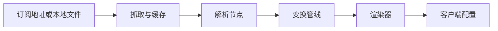

# SubForge

SubForge 是一个用 Go 编写的订阅转换与分流编排引擎。它读取机场订阅、自建节点与 subconverter
风格的 INI 模板，输出 Clash / mihomo、sing-box、Surge、Quantumult X、Loon、Surfboard 等客户端
可直接加载的配置，同时提供规则工厂、定时任务、流量策略与 Web 控制台。

项目面向自建代理的个人与小团队。交付形态是单个静态二进制，不使用 CGO，不依赖外部运行时。
订阅解析内核直接嵌入 mihomo，SubForge 自身负责参数解析、节点变换管线与格式渲染。

[](https://github.com/tktogether/subforge/actions/workflows/ci.yml)
[](LICENSE)
[](https://github.com/tktogether/subforge/releases)
[](go.mod)

## 特性

- **多协议解析**：自动识别分享链接、整段 Base64 与 Clash YAML，不需要手工指定输入格式。
- **可编排的变换管线**：filter / type / node_pref / rename / emoji / dedupe / sort 七个阶段，阶段顺序与每阶段错误策略可用 `[pipeline:<名>]` 自定义。
- **多目标格式渲染**：同一份内部模型可渲染为 Clash / mihomo、sing-box、Surge、Quantumult X、Loon、Surfboard 等配置。
- **subconverter 模板兼容**：沿用 `[common]`、`[node_pref]`、`[rename]`、`[emoji]`、`[clash_proxy_group]`、`[ruleset]` 段落语义，已有模板与规则集可直接复用。
- **覆盖层与脚本**：用本地 override 文件调整分组、规则与节点，不需要改动模板；goja 沙箱脚本不能访问网络与文件系统。
- **规则工厂**：规则集聚合、版本化与回滚，支持离线生成 MRS。
- **运维能力**：定时任务与失败重试、Telegram / DingTalk 告警、流量策略、订阅测活。
- **Web 控制台**：Vue 3 单页应用，产物通过 `embed` 打进二进制，不需要单独部署前端。
- **CLI 与 HTTP 同源**：命令行与 HTTP 入口共用同一套参数解析与转换引擎。

## 快速开始

以下三种方式任选一种，装完后执行 `subforge version` 确认二进制可用。

### 方式一：下载预编译二进制

从 [Releases](https://github.com/tktogether/subforge/releases) 页面下载对应平台的可执行文件
（不是压缩包），赋予执行权限后运行：

```sh
chmod +x subforge-linux-amd64
./subforge-linux-amd64 version
```

安装到系统路径：

```sh
sudo install -o root -g root -m 0755 subforge-linux-amd64 /usr/local/bin/subforge
subforge version
```

### 方式二：使用容器镜像

镜像已预设监听地址与数据目录，启动时必须挂载数据目录并设置访问令牌：

```sh
docker run -d --name subforge \
  -p 25500:25500 \
  -v "$(pwd)/data:/data" \
  -e SUBFORGE_TOKEN=<YOUR_TOKEN> \
  ghcr.io/tktogether/subforge:latest
```

各参数的用途：

| 参数 | 作用 |
| --- | --- |
| `-p 25500:25500` | 把容器内的 25500 端口发布到宿主机 |
| `-v "$(pwd)/data:/data"` | 把数据目录挂载到宿主机 `./data`，SQLite 与规则源缓存保存在这里 |
| `-e SUBFORGE_TOKEN=<YOUR_TOKEN>` | 设置访问令牌；对外提供服务时必须设置 |

镜像内已设置 `SUBFORGE_LISTEN=0.0.0.0:25500` 与 `SUBFORGE_DATA_DIR=/data`，因此不需要再传
`-listen` 与 `-data-dir`。备份或迁移时复制宿主机上的 `./data` 目录即可。

`:latest` 基于 alpine 运行层，包含根证书与时区数据，支持 `linux/amd64` 与 `linux/arm64`。
`:latest-scratch` 体积更小，但不含根证书，只能访问 `http://` 上游或本地文件。自行构建镜像：

```sh
docker build -f Dockerfile.alpine \
  --build-arg VERSION=v0.1.5 \
  --build-arg COMMIT=$(git rev-parse --short HEAD) \
  --build-arg DATE=$(date -u +%Y-%m-%dT%H:%M:%SZ) \
  -t subforge:local .
```

`v0.1.4` 之前的标签没有预设这两个环境变量，启动时需要显式传入
`-listen 0.0.0.0:25500 -data-dir /data`。

### 方式三：从源码构建

需要 Go 1.26.0（以 [go.mod](go.mod) 为准），依赖已放入 `vendor/`，构建过程不需要联网：

```sh
make build
./bin/subforge version
```

`go build -o bin/subforge ./cmd/subforge` 与 `make build` 等价，但不会注入提交号与构建时间。
`make cross` 一次产出完整交付矩阵：linux/amd64、linux/arm64、linux/arm、windows/amd64、
darwin/amd64、darwin/arm64、freebsd/amd64。

## 使用

### 本地转换

给出订阅地址与目标格式，把结果写入文件：

```sh
bin/subforge convert \
  -url "https://sub.example.com/api/v1/client/subscribe?token=<YOUR_TOKEN>" \
  -format clash.meta \
  -out config.yaml
```

转换过程依次经过以下阶段：



### 启动 HTTP 服务

```sh
bin/subforge serve \
  -listen 127.0.0.1:25500 \
  -token <YOUR_TOKEN> \
  -data-dir ./data
```

启动后，客户端中的订阅地址写法如下：

```text
http://127.0.0.1:25500/sub?target=clash.meta&token=<YOUR_TOKEN>&url=<订阅地址>
```

`-data-dir` 用于启用订阅管理（SQLite），目录不存在时会自动创建。不指定 `-data-dir` 时，
管理类接口返回 `503`，启动日志会提示启用方式。设置 `-token` 后鉴权对所有端点生效，
`/healthz` 与 `/version` 同样需要携带令牌。令牌可放在 `Authorization: Bearer <YOUR_TOKEN>`、
`X-Token` 请求头或 `?token=` 查询参数中。

`url` 参数本身是一条 URL。多个订阅源用 `;` 分隔，不能用 `?` 分隔，否则订阅地址自带的查询串
会被截断。

常用参数：

| 参数 | 说明 |
| --- | --- |
| `-url` / `-file` | 订阅地址或本地文件，至少提供一个，均可重复 |
| `-format` | 目标格式，默认 `clash.meta` |
| `-config` | subconverter 风格的 INI 模板 |
| `-include` / `-exclude` | 按节点名正则保留或排除 |
| `-sort` | 排序键：`name`、`type`、`server`、`port`、`original` |
| `-listen` / `-token` | `serve` 的监听地址与访问令牌 |

## 配置

配置优先级从高到低：URL 与命令行参数 > 用户覆盖层 > 远程 INI 模板 > 内置默认值。
`serve -config` 会监听模板文件，改动后自动重新加载，不需要重启；`token` 与 `mixed_port`
同样支持热重载。模板段落与覆盖层写法见 [INI 模板配置详解](docs/wiki/INI-模板配置详解.md)。

`serve` 的选项可以用环境变量提供默认值，容器与 systemd 部署不需要每次传参：

| 环境变量 | 等价选项 |
| --- | --- |
| `SUBFORGE_LISTEN` | `-listen` |
| `SUBFORGE_TOKEN` | `-token` |
| `SUBFORGE_CONFIG` | `-config`（指向 INI 文件，不是目录） |
| `SUBFORGE_DATA_DIR` | `-data-dir` |
| `SUBFORGE_ALLOW_PRIVATE_NETWORK` | `-allow-private-network`（允许拉取私网与回环地址，默认关闭） |

优先级从低到高是环境变量 < 命令行参数 < INI 的 `[subforge]` 同名项。仓库内的 Dockerfile
预设了 `SUBFORGE_LISTEN` 与 `SUBFORGE_DATA_DIR`。旧变量名 `SUBFORGE_DATA` 已废弃，程序不会
读取，也不会报错，效果等同于未启用订阅管理。

出于 SSRF 防护，服务端默认只拉取公网 http/https 地址。本地测试文件、内网订阅或局域网规则源
需要显式加 `-allow-private-network`，或设置 `SUBFORGE_ALLOW_PRIVATE_NETWORK=1`。远程模板、
规则集与告警 webhook 使用同一策略。

拉取上游订阅时的 User-Agent 可以用 `SUBFORGE_USER_AGENT` 覆盖，默认值为
`mihomo/1.19.31 SubForge/<版本> (+https://github.com/tktogether/subforge)`。默认请求缺少流量响应头时，
程序会用 `clash.meta/1.18.0` 补取一次。机场通常按 User-Agent 决定返回内容：识别为 Clash 内核时返回带
`Subscription-Userinfo` 的完整配置，否则只返回节点链接清单。

## 支持的目标格式

| 族 | 代表 target | 说明 |
| --- | --- | --- |
| Clash / mihomo | `clash.meta` | YAML，别名 `clash`、`mihomo`、`yaml` |
| Clash / mihomo JSON | JSON 变体 | 与 YAML 版同一批别名，target 名以 `.json` 结尾 |
| sing-box | `sing-box` | JSON，别名 `singbox` |
| Surge | `surge` | 行式配置，别名 `surge2`、`surge3`、`surge4` |
| Quantumult X | `quanx` | 行式配置，别名 `quan`、`quantumultx` |
| Loon / Surfboard / Mellow | `loon`、`surfboard`、`mellow` | 行式配置 |
| 分享链接列表 | `list` | 文本列表，别名 `sub`、`subscription` |
| 混合订阅 | `mixed` | 整体 Base64 包裹的订阅文本；`ss`、`ssr`、`trojan`、`v2ray` 等写法在此基础上按协议过滤 |

完整的目标格式与别名清单见 [渲染器与输出格式](docs/wiki/渲染器与输出格式.md)。

## HTTP API

| 端点 | 说明 |
| --- | --- |
| `GET /sub` | 主转换入口，另有 `/profile`、`/render` 两个别名 |
| `GET /getruleset` | 规则集输出，六种 `type` |
| `GET /inspect` | 回显解析后的参数，用于排障 |
| `GET /subscribe` | 按令牌聚合输出订阅，需启用订阅管理 |
| `POST /api/convert` | JSON 转换接口 |
| `GET /version`、`/healthz` | 版本信息与存活探针 |
| `GET /api/targets`、`/api/rulesets` | 目标格式与模板规则集列表 |
| `GET /api/stats`、`/api/metrics` | 转换统计与运行时指标 |
| `/api/airports`、`/api/rules`、`/api/tasks` | 订阅管理与运维接口，需启用订阅管理 |

完整的端点、请求与响应定义见 [HTTP API 参考](docs/wiki/HTTP-API-参考.md)。

## 文档

| 文档 | 内容 |
| --- | --- |
| [Wiki 首页](docs/wiki/Home.md) | 完整手册：安装部署、模板详解、架构原理、故障排查 |
| [docs/README.md](docs/README.md) | 仓库文档总索引与按角色的阅读路径 |
| [发布验证报告](docs/reports/) | 各版本的构建、镜像与运行验证记录 |
| [CONTRIBUTING.md](CONTRIBUTING.md)、[SECURITY.md](SECURITY.md) | 贡献指南与安全策略 |
| [设计文档](docs/design/subforge-design.md) | 架构决策与设计期方案 |

## 开发

```sh
make build    # 构建到 bin/subforge
make test     # go test ./... -count=1
make vet      # go vet ./...
make verify   # build + vet + test + 覆盖率门禁 + 前端检查
```

覆盖率门禁：语句覆盖率 80%，函数覆盖率 100%。前端工程位于 [web/](web/)，使用 Vue 3 +
Vuetify + Vite，包管理器为 pnpm，Node.js 20.19 及以上版本。前端构建产物由 Go 的 `embed`
打进二进制，具体命令见 [开发与测试指南](docs/wiki/开发与测试指南.md)。

## 项目结构

| 目录 | 职责 |
| --- | --- |
| `cmd/subforge/` | CLI 入口与各子命令 |
| `internal/api/` | HTTP 服务、路由、中间件与内嵌前端产物 |
| `internal/convert/`、`internal/config/` | 参数解析、管线组装、INI 模板与覆盖层 |
| `internal/parse/`、`internal/fetch/` | 订阅解析与上游抓取缓存 |
| `internal/transform/`、`internal/render/` | 节点变换管线与各目标格式渲染器 |
| `internal/store/`、`internal/subforge/` | SQLite 持久化与订阅管理领域逻辑 |
| `internal/scheduler/`、`internal/traffic/`、`internal/rulebot/` | 定时任务、流量策略与规则建议闭环 |
| `web/`、`docs/`、`deploy/` | 前端工程；文档；systemd、OpenWrt、Compose 等部署文件 |

## 已知限制

- `:latest-scratch` 镜像不含根证书，只能访问 `http://` 上游或本地文件。
- `subscheck` 订阅测活默认关闭，需要显式执行 `subforge subscheck`。
- MCP 服务与 `pkg/subforge` 公开库已实现，但没有调用入口。
- SMTP 告警通道尚未实现，请使用 Telegram 或 DingTalk。
- 不指定 `-data-dir`（或 `SUBFORGE_DATA_DIR`）时，订阅管理与运维类接口返回 `503`；
  仓库内 Dockerfile 构建的镜像已预设数据目录，不受影响。
- `condition-gate` 条件覆盖准层只在夜间任务或手动触发时运行，不进入 `make verify`。
- mips 与 mipsle 不在交付矩阵内，`modernc.org/sqlite` 不支持这两个平台。
- OpenWrt 的 `/etc/config/subforge` 选项当前不会被读取，init 脚本使用 procd 环境变量。
  需要 INI 配置时，把 `SUBFORGE_CONFIG` 指向真实存在的文件，指向目录会导致服务启动失败。

## 许可证与致谢

代码以 MIT 许可证发布，详见 [LICENSE](LICENSE)。规则与模板数据在运行时拉取，不静态打包进发行物。

INI 模板语义与 HTTP 入口设计参考 [subconverter](https://github.com/tindy2013/subconverter)，
节点变换语义参考 [Sub-Store](https://github.com/sub-store-org/Sub-Store)，解析内核使用
[mihomo](https://github.com/MetaCubeX/mihomo)。
