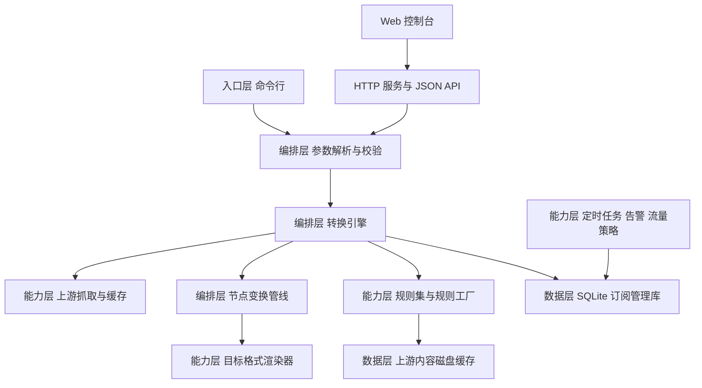
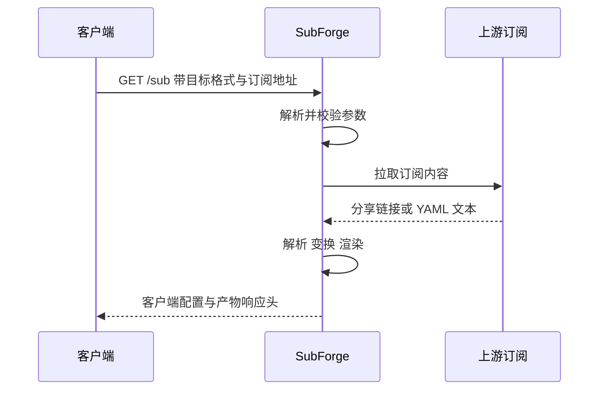
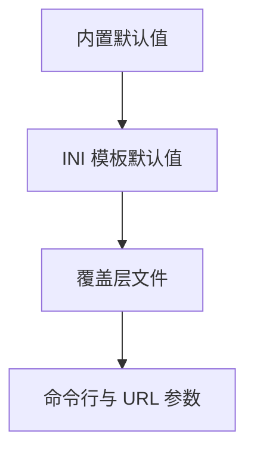
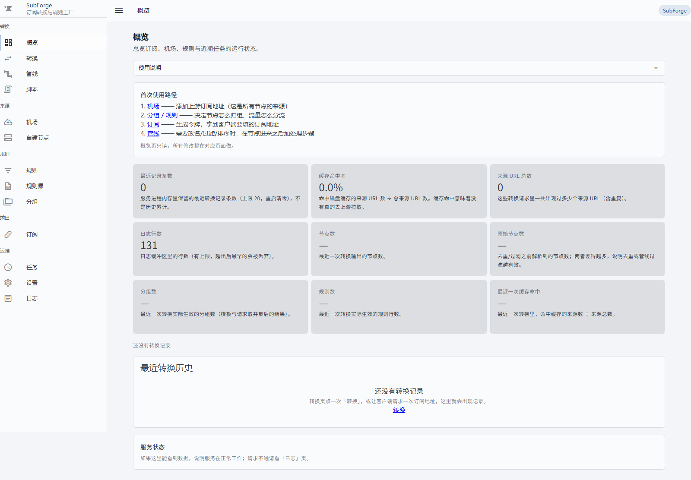
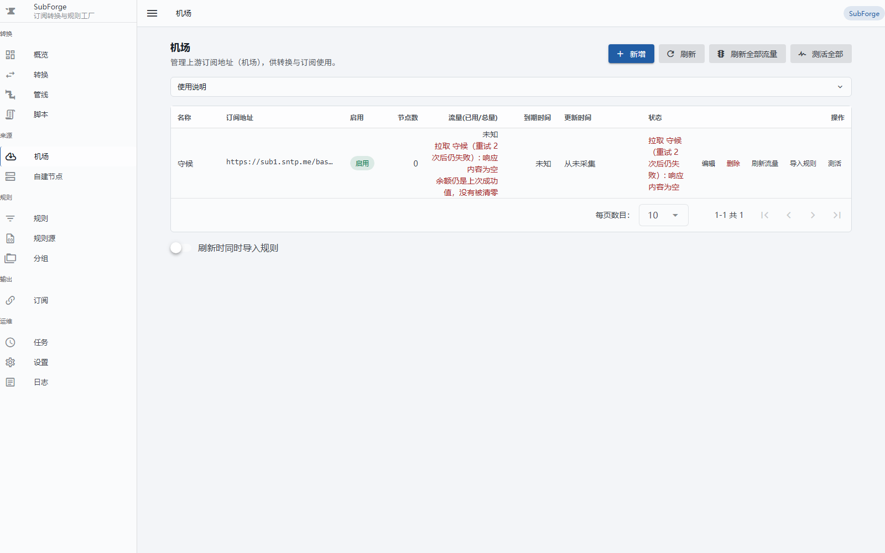

# SubForge

[](LICENSE)
[](go.mod)
[](https://github.com/tktogether/subforge/actions/workflows/ci.yml)

> SubForge 是一套用 Go 编写的**订阅转换与分流规则一体化引擎**：把机场订阅、自建节点、
> subconverter 风格的 INI 模板，转换成 Clash / mihomo、Surge、Quantumult X、Loon、
> Surfboard、sing-box 等客户端可直接使用的配置，并内置规则工厂、定时任务、流量策略、
> Rule-Bot 建议等运维能力，同时提供 HTTP API 与 Web 控制台。

## 目录

- [1. 项目简介](#1-项目简介) · [2. 工作原理](#2-工作原理) · [3. 快速开始](#3-快速开始) · [4. 安装与部署](#4-安装与部署)
- [5. 命令行参考](#5-命令行参考) · [6. HTTP API 概览](#6-http-api-概览) · [7. 配置体系](#7-配置体系) · [8. Web 控制台](#8-web-控制台)
- [9. 目标格式支持矩阵](#9-目标格式支持矩阵) · [10. 项目目录结构](#10-项目目录结构) · [11. 开发与测试](#11-开发与测试) · [12. 文档导航](#12-文档导航)
- [13. 已知限制与未完成项](#13-已知限制与未完成项) · [14. 许可证与致谢](#14-许可证与致谢)

## 1. 项目简介

### 1.1 解决什么问题

自建代理的用户通常同时面对三件事：从多家机场和个人服务器收集节点、把节点整理成客户端能读的格式、
再按自己的习惯把流量分成不同的出口。市面上的工具往往只覆盖其中一段：有的负责转换却不擅长分流定制，
有的擅长分流却要额外依赖一套运行时。SubForge 把这三件事收进一个静态二进制：

- **收集**：支持分享链接、整体 Base64、Clash YAML 三类上游内容，自动识别，无需手工指定格式。
- **整理**：内置节点变换管线，按名称、协议类型、去重指纹、排序键对节点做确定性处理。
- **分流**：兼容 subconverter 的 INI 模板语义，用户既有的模板与规则集可以继续使用。
- **交付**：一个不依赖 CGO、不需要外部运行时的可执行文件，可直接运行在服务器、NAS 或软路由上。

**术语速读**：*订阅*指上游提供的一批节点；*节点*是单条代理服务器配置；*分享链接*是 `ss://`、
`vmess://` 这类单节点的分享链接；*模板*是写满规则的 INI 配置文件；*产物*是转换后生成的客户端配置内容。

### 1.2 与 subconverter、Sub-Store 的关系与差异

SubForge 在**行为语义**上向两个既有生态对齐，在**实现形态**上另作选择。

与 [subconverter](https://github.com/tindy2013/subconverter) 的关系：INI 模板按 subconverter
语义解释，`[common]`、`[node_pref]`、`[rename]`、`[emoji]`、`[clash_proxy_group]`、`[ruleset]`
段落可直接沿用；HTTP 入口沿用 `/sub`，并把 `/profile`、`/render` 作为别名注册，老配置换过来不必
改路径；`/version` 返回兼容的纯文本，`sort`、`filename`、`emoji`、`list` 等 sub-web 参数均被接受，
因此 sub-web 界面可以直连本服务。差异在于 subconverter 以 C++ 实现且依赖外部运行时，SubForge 是
Go 单二进制；已知行为差异逐条记录在 [docs/compatibility.md](docs/compatibility.md)。

与 [Sub-Store](https://github.com/sub-store-org/Sub-Store) 的关系：节点去重按 `server`、`port`、
`type` 三个字段的组合判重，**与节点名称无关**，对齐 Sub-Store 的 `op.dedupe` 语义，因此两个名称
不同但指向同一台服务器的节点会被合并；排序参数同时接受布尔写法与排序键写法，兼顾两种调用习惯。

### 1.3 核心特性一览表

| 能力 | 说明 | 状态 |
| --- | --- | --- |
| 多协议解析与变换 | 分享链接、整体 Base64、Clash YAML 自动识别；filter / type / node_pref / rename / emoji / dedupe / sort 七级管线 | 已实现 |
| 模板与管线定制 | subconverter 段落语义、`[custom]` 内联规则，以及 `[pipeline:<名>]` 自定义步骤与每步错误策略 | 已实现 |
| 目标格式渲染 | Clash / mihomo、sing-box、Surge、Quantumult X、Loon、Surfboard 等 | 已实现 |
| 分层覆盖与脚本 | `groups` / `rules.prepend\|append` / `proxies` 三级覆盖（YAML 与 INI 双解析）；goja 沙箱脚本，无网络与文件系统 | 已实现 |
| 规则能力 | `/getruleset` 六种形态、规则工厂 manifest 聚合与回滚、MRS 离线生成 | 已实现 |
| 运维能力 | 定时任务与失败重试、流量策略、订阅测活（默认关闭）、Rule-Bot 建议闭环 | 已实现 |
| 告警通道 | Telegram、DingTalk 已实现；SMTP 为占位实现 | 部分实现 |
| Web 控制台 | Vue 3 单页应用，随二进制嵌入 | 已实现 |
| MCP 服务 | `internal/mcp` 包已实现，无 CLI 或 HTTP 入口接入 | 已实现但未接入 |

## 2. 工作原理

### 2.1 系统架构

SubForge 分为四层：入口层接收命令行与 HTTP 请求；编排层把请求归一成参数对象并驱动管线；能力层提供
抓取、解析、渲染、规则集、调度等具体功能；数据层保存订阅管理数据与磁盘缓存。



**为什么这样分层**：命令行与 HTTP 两条入口共用同一套参数解析与引擎代码，因此行为不会漂移——同一个
请求无论来自 `subforge convert` 还是 `GET /sub`，走的都是同一条执行路径。

### 2.2 一次转换请求的时序

以 HTTP 入口为例，一次转换请求经过参数解析、上游抓取、解析、变换、渲染五个阶段，最终把产物与元信息
一起返回。



**注意什么**：参数校验发生在拉取订阅之前。正则写错、排序键拼错、目标格式不支持，都会在发出上游请求
之前就返回错误，不会白拉一遍订阅。

### 2.3 节点变换管线

默认管线由七级组成，顺序固定；只有显式给出 `sort` 且取值不是 `original` 时，最后一级才会追加。


**为什么 `node_pref` 排在 `rename` 与 `emoji` 之前**：前缀按协议类型添加，而 `include`、`exclude`
按节点名判定。如果先改名，名称判定基准就发生漂移，本该被加上前缀的节点会被静默漏掉；subconverter
同样在改名之前处理前缀。**去重依据**是 `server`、`port`、`type` 三个字段的组合，与名称无关。
**自定义顺序**可通过 INI 模板的 `[pipeline:<名>]` 段落实现，并用 `-pipeline` 或 `pipeline=` 选中。

### 2.4 分层覆盖与优先级

同一个参数可能同时出现在命令行、覆盖层文件与 INI 模板中，SubForge 按固定层次决定谁最终生效：



箭头由低优先级指向高优先级，越靠后的层越优先；排查"某个参数为什么没生效"时按此顺序逐层核对。
覆盖层的写法与合并规则见第 7.2 节。

## 3. 快速开始

### 3.1 获取程序

从源码构建（需要 Go 1.26.0，版本以 [go.mod](go.mod) 为准）：

```sh
go build -o bin/subforge ./cmd/subforge
go run ./cmd/subforge version
go run ./cmd/subforge doctor
```

等价目标是 `make build`。仓库已用 `vendor/` 全量锁定依赖，构建过程不需要访问网络；本机没有 Go 环境
时，可直接使用[第 4 节](#4-安装与部署)给出的容器或发行产物方式。

### 3.2 第一次转换

最小可用命令是一条订阅地址加一个目标格式：

```sh
bin/subforge convert -url "https://sub.example.com/api/v1/client/subscribe?token=<YOUR_TOKEN>" -format clash.meta -out config.yaml
```

只要分享链接清单、不要客户端配置，把 `-format` 换成 `-list`；用本地 INI 模板控制节点处理方式，并只
保留特定地区、按名称排序（把 `./my-template.ini` 换成你自己的模板路径）：

```sh
bin/subforge convert -file ./nodes.txt -config ./my-template.ini -include "香港|HK" -exclude "过期|试用" -sort name -out config.yaml
```

**注意什么**：`-url` 与 `-file` 至少要给一个，两者都不给时程序打印用法并报错退出；参数校验在拉取
订阅之前完成；`-list` 决定输出形态，优先级高于 `-format`，两者同时给出时会提示忽略 `-format`。

### 3.3 启动 HTTP 服务

```sh
bin/subforge serve -listen 127.0.0.1:25500 -token <YOUR_TOKEN> -data-dir ./data -cache-dir ./cache
```

`-data-dir` 用于启用订阅管理（机场、分组、规则、令牌等），不传则不启用 SQLite。服务启动后，
`GET /healthz` 返回存活状态，`GET /version` 返回版本与运行时长，`GET /api/stats` 返回转换统计，
`GET /api/targets` 返回可用目标格式；浏览器打开 `http://127.0.0.1:25500/` 进入
[Web 控制台](#8-web-控制台)。

**注意什么**：默认只监听 `127.0.0.1:25500`，即只有本机能访问；`-token` 为空表示不鉴权，若要监听
全部网卡必须先设置令牌，程序在"绑定所有网卡且未设置令牌"时会打印警告，提示同网段任何主机都能使用
本服务；未传 `-data-dir` 时，订阅管理类接口会返回 503 并说明对应能力未启用。

### 3.4 在客户端中导入

把下面的地址填入客户端（Clash / mihomo 类客户端选择"订阅"或"配置文件 URL"）：

```text
http://127.0.0.1:25500/sub?target=clash.meta&url=https%3A%2F%2Fsub.example.com%2Fapi%2Fv1%2Fclient%2Fsubscribe%3Ftoken%3D<YOUR_TOKEN>
```

设置了服务端令牌时，在地址末尾追加 `&token=<YOUR_TOKEN>`；令牌也可以通过 `Authorization: Bearer
<YOUR_TOKEN>` 或 `X-Token` 请求头传递，三种方式都受支持。

**注意什么**：`url` 参数的值本身是一条 URL，因此**不能**用 `?` 作为多个订阅地址的分隔符，否则会把
后面那段 `?token=...` 丢掉。多个订阅地址请用 `;` 分隔。

## 4. 安装与部署

### 4.1 二进制

交付矩阵由 `make cross` 覆盖，产物写入 `bin/`：linux/amd64、linux/arm64、linux/arm、windows/amd64、
darwin/amd64、darwin/arm64、freebsd/amd64。编译参数为 `CGO_ENABLED=0`、`-trimpath`、`-mod=vendor`
与 `-s -w`，产物是静态链接的单文件；`make release` 会在 `make cross` 之后把 `bin/` 下的产物打包成
`dist/*.tar.gz`。

v0.1.0 Release 上七个资产的实测体积落在 35.4–38.2 MiB：linux/amd64 40,046,754 字节（38.2 MiB）、
linux/arm64 36.2 MiB、linux/arm 36.5 MiB、windows/amd64 37.0 MiB、darwin/amd64 37.2 MiB、
darwin/arm64 35.4 MiB、freebsd/amd64 36.3 MiB；systemd 空载常驻内存约 26.8 MiB。逐目标字节数、
测量口径与资源占用记录在 [deploy/README.md](deploy/README.md)。

**注意什么**：① Release 页面上的资产是**裸可执行文件，不是压缩包**——`release.yml:84-91` 用
`-o dist/subforge-<系统>-<架构>` 直接输出可执行文件，只有本地 `make release` 才会额外产出
`dist/*.tar.gz`（`Makefile:42-47`）。② 实际体积已超出设计书给出的 15~25MB 预算
（`docs/design/subforge-design.md:15`），按 40 MB 量级规划镜像、分区或下载预算。
③ mips 与 mipsle 不在交付矩阵内，原因是 `modernc.org/sqlite` 没有这两个平台的构建支持。

### 4.2 Docker 与 docker-compose

| 文件 | 基础镜像 | 说明 |
| --- | --- | --- |
| [Dockerfile](Dockerfile) | 构建阶段 `golang:1.26-bookworm`，运行阶段 `scratch` | 最小镜像，只含静态二进制与许可证 |
| [Dockerfile.alpine](Dockerfile.alpine) | 构建阶段 `golang:1.26-bookworm`，运行阶段 `alpine:3.20` | 额外安装 `ca-certificates` 与 `tzdata` |

```sh
docker build -t subforge:latest .
docker run -d --name subforge -p 25500:25500 -v subforge-data:/data subforge:latest
docker run --rm -v subforge-data:/data subforge:latest convert -file /data/nodes.txt -format sing-box -out /data/cfg.json
docker compose up -d
```

容器默认命令是 `serve`；覆盖命令即可执行 `convert`、`version`、`doctor` 等其他子命令。compose 文件
已把 `25500` 端口映射到宿主机，并把 `subforge-data` 卷挂到 `/data`、`./config` 只读挂到 `/config`。

**实测结果**（2026-10-20，WSL2 Ubuntu 22.04、Docker 29.1.3、overlayfs 存储驱动、内核
5.10.16.3-microsoft-standard-WSL2）：

| 验证项 | 实测结果 |
| --- | --- |
| `docker build -f Dockerfile .`（scratch 运行层） | 成功，退出码 0，镜像 56.1 MB |
| `docker build -f Dockerfile.alpine .` | 成功，退出码 0，镜像 71.7 MB |
| 两个镜像内的二进制 | `ELF 64-bit LSB executable, x86-64, statically linked, stripped`，各 40,091,810 字节；`ldd` 报 `not a dynamic executable` |
| 容器内 `version` / `serve` / `convert` | 全部成功；`convert` 产出 12 个节点，Clash YAML 与 sing-box JSON 均可被解析器接受 |
| 已发布镜像 `ghcr.io/tktogether/subforge:v0.1.0` | 可拉取（digest `sha256:418f7ef0…`，`linux/amd64`）、可启动、探活通过 |

**注意什么**：compose 没有覆盖容器命令，容器内的 `serve` 仍按默认值监听 `127.0.0.1:25500`。
该默认值与 `ports: 25500:25500` 的端口发布**并不匹配**——实测从宿主机访问返回 `HTTP 000`
（curl 报 `Recv failure: Connection reset by peer`），而在容器网络内部访问 `127.0.0.1:25500`
返回 `200`。因此 `docker-compose.yml` 已显式补上 `command: [serve, -listen, 0.0.0.0:25500]`，
使端口发布真正可达；若要让局域网内的其他设备访问，还应追加 `-token <YOUR_TOKEN>`。
compose 与 Dockerfile 中的 `SUBFORGE_DATA`、`SUBFORGE_CONFIG` 只用于声明路径，`serve` 不读取
这两个变量；全程序读取环境变量的位置只有三处：`SUBFORGE_DATA_DIR`（`cmd/subforge/doctor.go`）、
`SUBFORGE_DEBUG`（`internal/api/pprof.go`）、`TELEGRAM_CHAT_ID`（`cmd/subforge/scheduler.go`）。
监听地址、令牌等参数仍以命令行参数与 INI 配置文件为准。

### 4.3 systemd

仓库提供单元文件 [deploy/subforge.service](deploy/subforge.service)：

```sh
sudo install -o root -g root -m 0755 bin/subforge-linux-amd64 /usr/local/bin/subforge
sudo install -o root -g root -m 0640 deploy/subforge.service /etc/systemd/system/
sudo systemctl daemon-reload
sudo systemctl enable --now subforge
```

单元的关键配置：`ExecStart` 为 `/usr/local/bin/subforge serve --config /etc/subforge/subforge.ini
--cache-dir /var/lib/subforge/cache --listen 127.0.0.1:25500 --timeout 30 --shutdown 10`；
`User` 与 `Group` 为 `subforge`，需要先创建同名系统用户；`Restart=on-failure` 配合 `RestartSec=3s`
在异常退出后自动重启；`StateDirectory=subforge` 在 `ProtectSystem=full` 下自动可写。

**注意什么**：单元里**没有**写 `--token`，默认只监听本机时这样是安全的；一旦把 `--listen` 改成
`0.0.0.0:25500`，必须先设置令牌，否则程序只会打印警告而不会拒绝启动。配置热重载由文件时间戳轮询
驱动，改 INI 不需要 `SIGHUP`；`StartLimitIntervalSec` 与 `StartLimitBurst` 属于 `[Unit]` 段落，
systemd 229 起从 `[Service]` 移出，放错段落会被忽略。

### 4.4 OpenWrt

OpenWrt 打包定义位于 [deploy/openwrt/](deploy/openwrt/)，由三个文件组成：

| 文件 | 作用 |
| --- | --- |
| [deploy/openwrt/Makefile](deploy/openwrt/Makefile) | 包定义：包名 `subforge`、版本 `1.0.0`、分类 Network、依赖 `ca-bundle`，负责把二进制、init 脚本与 UCI 配置装到目标路径，并在安装后自动启用并启动服务 |
| [deploy/openwrt/files/subforge.init](deploy/openwrt/files/subforge.init) | procd 服务脚本：`START=99`、`USE_PROCD=1`，以 respawn 方式托管 `subforge serve` |
| [deploy/openwrt/files/subforge.conf](deploy/openwrt/files/subforge.conf) | `/etc/config/subforge` 的 UCI 模板：启用开关、端口、数据目录、配置目录与日志级别 |

**前置条件**：这个包只负责打包**预编译好的静态二进制**，SDK 端不会重新编译 Go 源码。打包前必须先把
目标架构的二进制放到 `deploy/openwrt/bin/subforge`（该文件不属于源码树，已被 `.gitignore` 排除）：

```sh
CGO_ENABLED=0 GOOS=linux GOARCH=amd64 go build -trimpath -mod=vendor -ldflags "-s -w" \
    -o deploy/openwrt/bin/subforge ./cmd/subforge
```

**打包步骤**（以官方 SDK 为例）：

```sh
SDK=/opt/sdk-x86            # 解压后的 OpenWrt SDK 目录
mkdir -p "$SDK/package/subforge/bin"
cp -a deploy/openwrt/Makefile "$SDK/package/subforge/"
cp -a deploy/openwrt/files    "$SDK/package/subforge/"
cp -a deploy/openwrt/bin/subforge "$SDK/package/subforge/bin/"
cd "$SDK" && make package/subforge/compile V=s
```

产物落在 `bin/packages/<PKGARCH>/base/`，例如 `bin/packages/x86_64/base/subforge_1.0.0-r1_x86_64.ipk`。

**实测结果**（官方 OpenWrt SDK 24.10.4，2026-10-20）：

| 目标架构 | 产物 | 体积 |
| --- | --- | --- |
| `x86/64` | `subforge_1.0.0-r1_x86_64.ipk` | 15,451,470 字节 |
| `bcm27xx/bcm2711`（树莓派 4） | `subforge_1.0.0-r1_aarch64_cortex-a72.ipk` | 14,264,239 字节 |

两个包的结构都完整（`usr/bin/subforge` 权限 755、`etc/init.d/subforge` 755、`etc/config/subforge` 644），
`control` 元数据与 Makefile 声明逐项一致，解包出来的二进制可以直接执行 `version` 且退出码为 0，
`ldd` 报 `not a dynamic executable`。注意 `.ipk` 是 **gzip 压缩的 tar 归档**（不是 `ar` 归档），
查看内容要用 `gunzip -c <包>.ipk | tar -tf -`。

**两个必须知道的事实**：

1. 早期版本的 `deploy/openwrt/Makefile` 没有声明 `Build/Prepare` 与 `Build/Compile`，在标准 SDK 里
   `make package/subforge/compile` 会直接失败（`No targets specified and no makefile found`，退出码 2）。
   原因是该包没有 `PKG_SOURCE`，SDK 默认的 `Build/Prepare` 不会被定义，`$(PKG_BUILD_DIR)` 是空目录。
   当前 Makefile 已补上这两个步骤。
2. `files/subforge.conf` 里的五个 UCI 选项目前**不会被 init 脚本读取**（脚本中没有任何 `config_load`
   调用），init 里声明的 `SUBFORGE_DATA` 与 `SUBFORGE_CONFIG` 也不会被 `serve` 读取——`serve` 只接受
   命令行参数。要让数据目录与配置文件真正生效，需要把 init 脚本的 `command` 改成显式传参，例如
   `/usr/bin/subforge serve -config /etc/subforge/subforge.ini -data-dir /var/lib/subforge`。

> **尚未验证**：以上结论止于「打包成功且包内二进制可运行」。本项目没有在真实 OpenWrt 设备上执行过
> `opkg install`，因此 `postinst` 的实际行为、rc.d 链接生成、procd 拉起服务、`opkg` 对 `ca-bundle`
> 依赖的解析与对 gzip 外层归档的接受度，都还没有实机结论。

## 5. 命令行参考

### 5.1 顶层命令

| 命令 | 用途 |
| --- | --- |
| `version` / `doctor` | 输出版本信息；环境与运行时自检，参数 `-config` 指定配置文件 |
| `convert` | 本地把订阅转换成客户端配置 |
| `diff` | 预览覆盖层对模板默认值的改动 |
| `manifest` | 规则工厂 manifest 聚合，子命令 `update` / `versions` / `rollback` |
| `mrs` | MRS 离线生成，子命令 `generate` / `cached` |
| `subscheck` | 订阅测活，默认关闭，需显式开启 |
| `scheduler` | 定时任务与告警，子命令 `test-alert` / `run` |
| `rulebot` | 规则反馈闭环，子命令 `analyze` / `pending` / `stats` |
| `serve` | 启动 HTTP 服务 |

不带参数运行会打印用法并以退出码 2 结束；未知命令打印 `未知命令` 并同样以退出码 2 结束；子命令执行
失败时打印 `subforge: <错误信息>` 并以退出码 1 结束。

### 5.2 `convert`

| 参数 | 取值 | 默认值 | 说明 |
| --- | --- | --- | --- |
| `-url` | 订阅地址 | — | 可重复；分享链接、整体 Base64、Clash YAML 自动识别 |
| `-file` | 文件路径 | — | 可重复；本地订阅或配置文件 |
| `-config` | 文件路径或 URL | — | subconverter 风格 INI 模板；命令行参数优先级更高 |
| `-pipeline` | 名称 | — | 选中模板中的 `[pipeline:<名>]` 命名管线 |
| `-include` / `-exclude` | 正则 | — | 节点名白名单与黑名单，可重复 |
| `-type` | 协议名 | — | 仅保留指定协议类型，可重复 |
| `-rename` / `-emoji` | `正则,替换` 与 `正则,emoji` | — | 名称正则替换与加图标，均可重复 |
| `-sort` | `original` / `name` / `type` / `server` / `port` | — | 排序键 |
| `-format` | 目标格式 | 模板 `[common]` 的 `target`，再退回 `clash.meta` | 按目标格式渲染 |
| `-list` | 布尔 | `false` | 输出分享链接清单，优先于 `-format` |
| `-out` | 文件路径 | 标准输出 | 产物文件路径 |
| `-mixed-port` / `-cache-dir` / `-timeout` | 端口 / 目录 / 秒 | `7890` / 不缓存 / `30` | 产物的 `mixed-port`、缓存目录、上游超时 |
| `-name` / `-header` / `-override` | 字符串 / `K: V` / 文件路径 | — | 产物注释头中的配置名；附加请求头；覆盖层文件（YAML 或 INI） |

### 5.3 `serve`

| 参数 | 取值 | 默认值 | 说明 |
| --- | --- | --- | --- |
| `-listen` | `主机:端口` | `127.0.0.1:25500` | 监听地址 |
| `-token` | 字符串 | 空，表示不鉴权 | 访问令牌 |
| `-config` | 文件路径 | — | INI 配置文件，改动后自动热重载 |
| `-mixed-port` / `-timeout` / `-shutdown` | 端口 / 秒 / 秒 | `7890` / `30` / `10` | 产物 `mixed-port`、请求超时、优雅关闭时长 |
| `-cache-dir` / `-data-dir` | 目录 | 不缓存 / 不启用 | 上游内容磁盘缓存；订阅管理数据目录（SQLite） |
| `-name` | 字符串 | — | 产物注释头中的配置名，启动时固定 |

### 5.4 其余子命令

| 命令 | 参数 | 说明 |
| --- | --- | --- |
| `diff` | `-override <文件>` 必填，`-config <模板>` 可选，`-v` 显示未变组 | 预览覆盖层改动 |
| `manifest` / `mrs` | `update <manifest.yaml>`、`versions\|rollback <dir> <name> <ext>`；`generate <behavior> <format> <src> <dst>`、`cached <src> <cacheDir> <behavior> <format>` | 规则集版本更新、列举与回滚；生成 MRS 或命中缓存并打印字节数 |
| `subscheck` / `scheduler` | `-file <列表文件>`（每行一个地址）、`-timeout` 默认 `15s`；`test-alert <telegram\|dingtalk> <target>`、`run` | 订阅测活；测试告警通道或前台启动调度器调试 |
| `rulebot` | `analyze <日志文件>`、`pending`、`stats` | 分析异常、列出待确认建议、输出统计 |

## 6. HTTP API 概览

服务默认监听 `127.0.0.1:25500`。下表是入口级清单，用于快速判断"某个能力走哪个路径"，不是完整接口
参考；请求体字段与响应结构请以源码 `internal/api/` 为准。

鉴权说明：设置 `-token` 后，除 `/subscribe` 外的所有请求都要带令牌。令牌可以放在
`Authorization: Bearer <YOUR_TOKEN>` 请求头、`X-Token` 请求头，或 `token` 查询参数中，其中
`Authorization` 请求头优先级最高；校验失败返回 `401`，并带上 `WWW-Authenticate: Bearer` 响应头。

### 6.1 转换与产物

| 方法 | 路径 | 说明 | 依赖 `-data-dir` |
| --- | --- | --- | --- |
| GET | `/sub`、`/profile`、`/render` | 订阅转换主入口与两个别名，subconverter 兼容 | 否 |
| GET | `/getruleset` | 规则集输出，支持六种形态 | 否 |
| GET | `/inspect` | 回显解析后的参数，用于排查 | 否 |
| GET | `/subscribe` | 按订阅令牌聚合输出订阅，返回纯文本 | 是 |
| POST | `/api/convert`、`/api/diff` | 转换接口（JSON）与覆盖层改动预览 | 否 |

`/getruleset` 的 `type` 参数取值：`1` 为 Surge list，`2` 为 Quantumult X，`3` 为 Clash domain
provider，`4` 为 Clash ipcidr provider，`5` 为 Surge DOMAIN-SET，`6` 为 Clash classical。类型取值
优先级为 URL 参数高于模板 `[ruleset]` 段落；规则内容优先级为 `rules` 参数、`list` 参数、模板
`[common]` 的 `rules`、`url` 远程拉取。缺少 `name` 返回 `400`，有 `name` 但推不出类型返回 `404`。

`/sub` 支持的查询参数（解析实现位于 `internal/convert/params.go`）：

| 参数 | 语义 | 关键细节 |
| --- | --- | --- |
| `target` | 目标格式 | 空值回落 `clash.meta` |
| `url` / `insert` | 订阅地址与额外插入的地址 | `url` 的值本身是 URL，不能拿 `?` 当分隔符；多来源用 `;` 分隔 |
| `include` / `exclude` | 节点名正则白名单与黑名单 | `;` 分隔；解析时即编译校验，写错在拉订阅前报错 |
| `type` | 仅保留的协议类型 | 逗号与分号都接受 |
| `rename` / `emoji` | 名称正则替换与加图标 | 形如 `正则,替换`；正则首尾空格有语义，不做裁剪 |
| `sort` | 排序 | 兼容布尔写法与 `name` / `type` / `server` / `port` / `original` 排序键 |
| `list` / `udp` / `tfo` / `scv` / `tls13` | 清单模式与节点开关 | 布尔取值：`1`、`true`、`yes`、`on` 为真 |
| `config` / `pipeline` | 模板名与命名管线名 | `pipeline` 引用模板中的 `[pipeline:<名>]` |
| `rules` / `ruleset` / `filename` | 内联规则、规则集选择、下载文件名 | `rules` 形如 `GEOIP,CN,DIRECT`；`ruleset` 形如 `ruleset:<名称>:<类型>`；`filename` 只影响 `Content-Disposition` |

未知参数不会报错，而是原样保留在参数集合中，便于排查与透传；解析结果可用 `GET /inspect` 回显。

### 6.2 探针与运行时

| 方法 | 路径 | 说明 | 依赖 `-data-dir` |
| --- | --- | --- | --- |
| GET | `/version`、`/healthz`、`/api/version` | subconverter 兼容的纯文本版本信息；存活探针；API 版本与运行时长 | 否 |
| GET | `/api/stats`、`/api/history`、`/api/logs` | 转换统计与最近一次快照、转换历史、结构化日志 | 否 |
| GET | `/api/metrics` | 运行时指标，返回 JSON：内存、GC、协程数、CPU | 否 |
| GET | `/api/targets`、`/api/rulesets`、`/api/configs`、`/api/pipelines` | 目标格式、模板规则集、可用配置与命名管线列表 | 否 |
| GET | `/debug/pprof/*` | 性能分析端点，仅在调试模式下注册 | 否 |

`/debug/pprof/*` 只在调试模式下可用：请求带 `?debug=1`，或进程启动时设置了环境变量
`SUBFORGE_DEBUG=1`。其余情况下这些路径返回 `404`，生产环境默认不暴露性能分析入口。

### 6.3 订阅管理与运维

以下端点由 `-data-dir` 提供的 SQLite 支撑。未传 `-data-dir` 时，它们返回 `503`，并在响应中说明是
哪一项能力未启用（例如"订阅管理未启用""调度器未启用"）。

| 方法 | 路径 | 说明 |
| --- | --- | --- |
| GET / POST | `/api/airports`、`/api/airports/{id}`、`/api/airports/refresh`、`/check`、`/check/last`、`/api/airports/{id}/refresh`、`/import-rules` | 机场增删改查、刷新、订阅测活与最近结果、规则导入 |
| GET / POST / PUT / DELETE | `/api/groups`、`/api/rules`、`/api/rules/bulk`、`/api/tokens`、`/api/self-nodes`、`/api/pipelines` 及其 `{id}` 或 `{token}` 子路径 | 分组、规则（含批量启停）、订阅令牌、自建节点与命名管线的管理 |
| GET / POST / PUT / DELETE | `/api/scripts`、`/api/scripts/test`、`/api/scripts/{id}`；`/api/traffic/strategy`、`/api/traffic/refresh`、`/api/traffic/preview` | 脚本库、试运行与增删改；流量策略读取与更新、流量刷新与试算 |
| GET / PUT / POST | `/api/tasks`、`/api/alert-channels`、`/api/alert-channels/test` | 定时任务执行历史；告警通道配置与连通性测试 |
| GET / POST | `/api/suggestions`、`/api/suggestions/apply`、`/api/suggestions/{index}/confirm`、`/reject` | Rule-Bot 建议队列、应用、确认与拒绝 |
| GET / POST / PUT | `/api/rule-providers`、`/api/rule-providers/{id}/enabled`、`/api/settings`、`/api/template`、`/api/override` | 规则提供者启停；设置、模板与覆盖层读写 |
| POST | `/api/rule-sources/init`、`/update`、`/update-one`、`/rollback`、`/mrs`、`/remove` | 规则源初始化、更新、回滚、MRS 生成与移除（列表见 `GET /api/rule-sources`） |

静态资源由 `/*` 承载：命中真实文件时按文件返回；带扩展名却找不到返回 `404`；其余无扩展名路径回落到
前端入口页，供单页应用的前端路由使用。

## 7. 配置体系

### 7.1 INI 模板段落

模板按 subconverter 语义解释，段落含义如下：

| 段落 | 作用 |
| --- | --- |
| `[common]` | 通用设置，例如默认 `target`、内联 `rules`、`include` 等 |
| `[node_pref]` / `[rename]` / `[emoji]` | 节点偏好（名称前缀）、名称正则替换、名称加图标 |
| `[clash_proxy_group]` / `[ruleset]` | 代理组定义；规则集名称与类型映射，供 `/getruleset` 使用 |
| `[pipeline:<名>]` / `[custom]` | 命名管线（步骤顺序与每步错误策略）；内联规则行 |
| `[subforge]` | 本项目专有设置：`token`、`mixed_port`、`name` |

`[subforge]` 段落中，`token` 与 `mixed_port` 支持热重载，`name` 需要重启生效；`token` 也可以写在
subconverter 风格的 `[common]` 段落中。

### 7.2 覆盖层

覆盖层是一个本地文件，支持 YAML 与 INI 两种写法，用于在不改动模板的前提下微调产物：`groups` 用于
改已有组或新增组；`rules.prepend` 与 `rules.append` 用于把规则插入列表头部或尾部；`proxies` 用于
按名称正则替换节点的 `server` 与 `port`。合并语义是"数组追加、标量替换"。

用 `subforge diff -override <文件> -config <模板>` 可在真正转换之前预览改动：代理组显示改、新增、
未变三种状态，未变组默认隐藏；规则以 `+P` 与 `+A` 前缀标出 prepend 与 append；节点列出被替换的
`server` 与 `port`。

**为什么覆盖层放在模板之后、管线之前**：管线的去重与排序必须基于最终值。如果覆盖层在管线之后应用，
两个原本 `server` 与 `port` 相同的节点可能在覆盖后变得不同，或者在覆盖后才变得相同却已经错过了去重。

### 7.3 优先级与热重载

优先级从高到低为：URL 参数与命令行参数、覆盖层文件、INI 模板默认值、程序内置默认值（见图 2.4）。
`serve -config` 指定的 INI 文件支持热重载：改动文件后，`token` 与 `mixed_port` 立即对后续请求生效，
`name` 需要重启；模板本身同样从内存快照读取，因此修改 `[node_pref]`、`[clash_proxy_group]` 等段落
也会即时反映到后续产物。

## 8. Web 控制台

控制台是 Vue 3 单页应用（Vuetify 3 组件库，Vite 构建），产物由 Go 的 `embed` 打进二进制，服务启动后
访问 `http://127.0.0.1:25500/` 即可使用。导航按用途分为五组：

| 分组 | 页面与路径 | 用途 |
| --- | --- | --- |
| 转换 | 概览 `/`、转换 `/convert`、管线 `/pipelines`、脚本 `/scripts` | 状态概览与最近转换，来源与目标格式选择，管线与脚本库管理 |
| 来源 | 机场 `/airports`、自建节点 `/self-nodes` | 机场订阅的增删改、流量刷新与测活，自建节点管理 |
| 规则 | 规则 `/rules`、规则源 `/rule-sources`、分组 `/groups` | 规则集与批量启停、规则源更新回滚、代理组定义 |
| 输出 | 订阅 `/subscriptions` | 对外订阅令牌与输出地址管理 |
| 运维 | 任务 `/tasks`、设置 `/settings`、日志 `/logs` | 定时任务执行历史、服务端设置项、结构化日志与过滤 |





控制台通过 `/api/targets`、`/api/convert`、`/api/diff` 等 JSON 端点工作。部署在局域网或服务器上时，
需要在界面中填入访问令牌，或直接以 `?token=<YOUR_TOKEN>` 访问。

## 9. 目标格式支持矩阵

目标格式由 `internal/render/targets.go` 注册，别名一律归一到规范渲染器名。

| 家族 | 规范目标 | 别名 | 产物形态 |
| --- | --- | --- | --- |
| Clash / mihomo | `clash.meta` | `clash`、`clashmeta`、`mihomo`、`yaml`、`clashr` | YAML |
| Clash / mihomo | `clash.meta.json` | `clash.json`、`clashmeta.json`、`clash-json`、`clashmeta-json`、`mihomo.json` | JSON |
| sing-box | `sing-box` | `singbox` | JSON |
| Surge | `surge` | `surge2`、`surge3`、`surge4`、`suri` | 行式配置 |
| Quantumult 系列 | `quan`、`quanx` | `quantumult`、`quantumultx` | 行式配置 |
| Loon / Surfboard / Mellow | `loon`、`surfboard`、`mellow` | `mellow-ios` | 行式配置 |
| 分享链接清单 | `list` | `sub`、`subscription` | 文本清单 |
| 混合订阅 | `mixed` | `ss`、`ssd`、`shadowsocks`、`ssr`、`shadowsocksr`、`trojan`、`v2ray` | 按类型过滤后的订阅 |
| Shadowsocks 专用 | `ss-sub` | `ss-sub-json`、`ss-sub-b64`、`ssjson`、`sssub` | 订阅文本 |

不支持的目标会返回"不支持的输出格式"错误，并附带当前支持的清单。产物元信息通过响应头回传，常用的是
`X-Convert-Format`（规范化后的目标名）、`X-Node-Count`、`X-Ruleset-Count`、`X-Convert-Skipped`
与 `X-Convert-Warning`（跳过与告警）、`Subscription-Userinfo`（流量与到期信息）。不同客户端支持的
协议集合并不相同，同一个节点可能被某个目标格式跳过，原因会体现在 `X-Convert-Skipped` 响应头中。

## 10. 项目目录结构

```text
subforge/
├── cmd/subforge/             CLI 入口与各子命令实现
├── internal/
│   ├── api/ web 嵌入        HTTP 服务、路由、中间件与各类 API、前端产物 embed
│   ├── convert/ config/     参数解析、管线组装与转换引擎；INI 模板解析与覆盖层 DSL
│   ├── parse/ fetch/        分享链接、Base64 与 Clash YAML 解析；上游抓取与磁盘缓存
│   ├── transform/ render/   节点变换管线；渲染器族与目标格式注册表
│   ├── manifest/ mrs/       规则工厂 manifest 聚合与版本化；MRS 规则集离线生成
│   ├── scheduler/ rulebot/  定时任务与告警通道；规则反馈闭环
│   ├── store/ subforge/     持久化（SQLite）与订阅管理领域逻辑
│   └── traffic/ buildinfo/ mcp/ tools/  流量策略与用量统计、版本号注入；MCP 包（尚未接入入口）；覆盖率门禁工具
├── pkg/subforge/ web/       公开库入口；Vue 3 + Vuetify 前端工程
├── docs/ deploy/            设计文档、ADR、报告与 Wiki 源文件；systemd 单元与 OpenWrt 打包
├── testdata/ vendor/        测试夹具与金测快照；vendored 依赖，离线可构建
└── Makefile                 构建入口；Dockerfile 与 docker-compose.yml 同处根目录
```

**注意什么**：`internal/mcp` 包已实现，但 `cmd/` 与 `internal/api/` 中没有任何地方引用它，因此当前
不存在 MCP 服务入口。`pkg/subforge` 是公开库入口，仓库内没有其他包 import 它。

## 11. 开发与测试

构建与测试统一由 [Makefile](Makefile) 驱动，表内命令为 Makefile 中实际执行的命令。

| 目标 | 说明 |
| --- | --- |
| `make build` / `make test` / `make vet` | `CGO_ENABLED=0 go build` 产物写入 `bin/subforge`；`go test ./... -count=1`；`go vet ./...` |
| `make cross` / `make release` / `make docker` | 交付矩阵交叉编译；打包成 `dist/*.tar.gz`；构建 scratch 与 Alpine 镜像 |
| `make coverage` / `make coverage-gate` | `go test -coverprofile=coverage.out -covermode=atomic ./internal/... -count=1`；`coveragegate -min 80 -min-func 100` 加 `condgate -engine=profile -min 80` |
| `make condition-gate` | `condgate -engine=gobco -packages ./internal/... -min 80`，条件覆盖准层 |
| `make web-install` / `make web-dev` | 安装前端依赖（`pnpm -C web install --frozen-lockfile`）；启动前端开发服务器 |
| `make web-typecheck` / `make web-test` / `make web-coverage` / `make web-build` | 前端类型检查、单元测试、覆盖率与构建（对应 `pnpm -C web run typecheck`、`test`、`coverage`、`build`） |
| `make verify` | 依次执行 `build`、`vet`、`test`、`coverage-gate`、`web-typecheck`、`web-coverage`、`web-build` |

**覆盖率门禁**：语句覆盖率不低于 **80%**，函数覆盖率为 **100%**。条件覆盖准层
（`condition-gate`，基于 gobco 的真实条件覆盖）不进入 `make verify`，只在夜间任务或手动触发时运行。

前端工程位于 [web/](web/)，技术栈为 Vue 3.5、Vuetify 3.13、Vite 8、TypeScript 5.9 与 vue-router 4，
包管理器为 pnpm，要求 Node 20.19.0 及以上；构建产物输出到 `internal/api/web/dist/`，再由 Go 的
`embed` 打进二进制。

CI 由 [.github/workflows/ci.yml](.github/workflows/ci.yml) 定义，共七个作业：`web` 负责前端安装、类型
检查、测试、覆盖率与构建；`test` 在 Ubuntu 与 Windows 上执行 `go build`、`go vet`、`go test`，Linux
额外做 `gofmt` 检查；`cross` 验证交付矩阵；`bench` 运行基准测试；`docker` 构建两种镜像并验证二进制
可执行；`coverage` 生成报告并执行两层门禁；`condition-nightly` 在手动触发时安装 gobco 并运行条件
覆盖审计。

## 12. 文档导航

仓库文档按用途分四层：本文件提供项目定位、快速开始、命令行与 API 摘要；[docs/README.md](docs/README.md)
是全部文档的总索引，按角色给出阅读路径；[docs/wiki/Home.md](docs/wiki/Home.md) 起是面向使用者的完整
手册，发布到 GitHub Wiki，覆盖安装部署、INI 模板详解、覆盖层详解、系统架构、转换流水线、规则引擎、
Web 控制台、定时任务与流量策略等主题；`docs/design/` 与 `docs/adr/` 记录设计期方案与架构决策。

| 文档 | 内容 |
| --- | --- |
| [docs/style-guide.md](docs/style-guide.md) | 文档写作规范：语气、术语表、Mermaid 约束与自检清单 |
| [docs/compatibility.md](docs/compatibility.md) | 与 subconverter 的已知行为差异对照 |
| [deploy/README.md](deploy/README.md) / [CONTRIBUTING.md](CONTRIBUTING.md) | 交付方式与实机验证记录；开发环境、提交规范与测试要求 |

**总原则**：源码是唯一事实来源。任何文档与实现不一致时，以源码为准，并欢迎提交 Issue 或 Pull Request
修正文档。设计类文档记录的是当时的决策过程，不保证与当前实现同步。

## 13. 已知限制与未完成项

本节如实列出当前版本尚未完成或有明确边界的能力，不做美化。

| 项 | 状态 | 说明 |
| --- | --- | --- |
| SMTP 告警通道 | 尚未实现 | 通道类型已占位，调用时返回"SMTP 通道尚未实现，请使用 Telegram 或 DingTalk" |
| MCP 服务与 `pkg/subforge` 公开库 | 已实现但未接入 | 两个包都存在，但 `cmd/`、`internal/api/` 及仓库内其他包均无任何引用，没有可用入口 |
| `subscheck` 订阅测活 | 默认关闭 | 需显式调用 `subforge subscheck` 开启 |
| `-data-dir` 订阅管理 | 默认不启用 | 不指定时数据库与相关接口均不启用，管理类端点返回 `503` |
| Docker 镜像与 mips | 部分受限 | 两个 Dockerfile 均已在真实 Docker 上完成构建、启动与 `convert` 实测（见 4.2 节实测表）；mips 与 mipsle 因 `modernc.org/sqlite` 无该平台构建而移出交付矩阵 |
| 发布流水线的镜像产物 | 有已知缺陷 | `release.yml` 的 build-push 步骤未传 `build-args`，已发布镜像自报版本为 `dev (commit none, built unknown)`；`file:` 只指向 `./Dockerfile`，`Dockerfile.alpine` 从未被构建或推送，且未声明 `platforms:`，镜像只有 `linux/amd64` 一个架构 |
| 镜像仓库范围 | 仅 GHCR | 推镜像使用 Actions 自动注入的 `GITHUB_TOKEN`（`permissions: packages: write`），打包流水线不依赖任何自建 Secret；Docker Hub 属可选扩展，需自行配置 `DOCKERHUB_USERNAME` 与 `DOCKERHUB_TOKEN` |
| OpenWrt 打包 | 可打包，需前置步骤 | 官方 SDK 24.10.4 实测可产出 `.ipk`（x86/64 与 aarch64_cortex-a72 双目标），但需要预编译好的 `bin/subforge`；UCI 配置文件中的五个 option 当前不会被 init 脚本读取 |
| `condition-gate` 条件覆盖准层 | 不进主流程 | 只跑夜间任务或手动触发，不进入 `make verify` |
| GitHub Wiki 远端仓库 | 尚不存在 | 按本次文档工程的实测记录，远端 Wiki 仓库未创建；源文件在 `docs/wiki/`，发布脚本为 `scripts/publish-wiki.ps1` |
| 项目阶段标注 | 文案滞后 | `cmd/subforge/main.go` 的用法文本仍写着"M1 开发中"，实际功能范围已超出该描述 |

## 14. 许可证与致谢

代码以 MIT 许可证发布，详见 [LICENSE](LICENSE)。规则与模板数据**一律运行时拉取**，不静态打包进发行物，
以规避上游许可证（GPL、CC-BY-SA 等）的约束。嵌入依赖 mihomo 以 MIT 许可证嵌入，用于订阅解析；
sing-box 仅以子进程方式调用，不进行链接，以规避 GPL 传染。测试夹具中的第三方内容已注明出处，不进入
发行物。

致谢：本项目的 INI 模板语义与 HTTP 入口设计参考了
[subconverter](https://github.com/tindy2013/subconverter)，节点变换语义参考了
[Sub-Store](https://github.com/sub-store-org/Sub-Store)，解析内核使用了
[mihomo](https://github.com/MetaCubeX/mihomo)。
