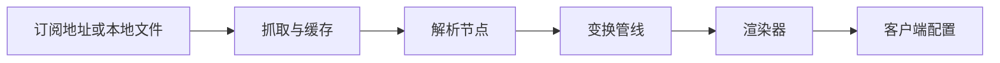

# SubForge

SubForge 是一个用 Go 编写的**订阅转换与分流编排引擎**：把机场订阅、自建节点与 subconverter 风格的
INI 模板，转换成 Clash / mihomo、sing-box、Surge、Quantumult X、Loon、Surfboard 等客户端可以直接
加载的配置，并提供规则工厂、定时任务、流量策略与 Web 控制台。

面向自建代理的个人与小团队。交付形态是单个静态二进制，无 CGO、无外部运行时；订阅解析内核直接嵌入
mihomo，SubForge 自身只负责参数解析、节点变换管线与格式渲染这一层编排。

[](https://github.com/tktogether/subforge/actions/workflows/ci.yml)
[](LICENSE)
[](https://github.com/tktogether/subforge/releases)
[](go.mod)

## 特性

- **多协议解析** —— 分享链接、整段 Base64 与 Clash YAML 自动识别，不需要手工指定输入格式。
- **可编排的变换管线** —— filter / type / node_pref / rename / emoji / dedupe / sort 七个阶段，阶段顺序与每阶段错误策略可用 `[pipeline:<名>]` 自定义。
- **多目标格式渲染** —— 同一份内部模型渲染出 Clash / mihomo、sing-box、Surge、Quantumult X、Loon、Surfboard 等配置。
- **subconverter 模板兼容** —— 沿用 `[common]`、`[node_pref]`、`[rename]`、`[emoji]`、`[clash_proxy_group]`、`[ruleset]` 段落语义，已有模板与规则集可直接复用。
- **覆盖层与脚本** —— 用本地 override 文件调整分组、规则与节点，不必改动模板；goja 沙箱脚本不访问网络与文件系统。
- **规则工厂** —— 规则集聚合、版本化与回滚，支持离线生成 MRS。
- **运维能力** —— 定时任务与失败重试、Telegram / DingTalk 告警、流量策略、订阅测活。
- **Web 控制台** —— Vue 3 单页应用，产物由 `embed` 打进二进制，不需要单独部署前端。
- **CLI 与 HTTP 同源** —— 命令行与 HTTP 入口共用同一套参数解析与转换引擎，行为一致。

## 快速开始

**一、下载预编译二进制**：从 [Releases](https://github.com/tktogether/subforge/releases) 下载对应平台的
**裸可执行文件**（不是压缩包），加执行权限即可使用：

```sh
chmod +x subforge-linux-amd64 && ./subforge-linux-amd64 version
```

**二、使用公开镜像**：

```sh
docker run -d --name subforge -p 25500:25500 \
    ghcr.io/tktogether/subforge:latest serve -listen 0.0.0.0:25500 -token <YOUR_TOKEN>
```

`-listen 0.0.0.0:25500` 不能省：容器内 `serve` 默认只监听 `127.0.0.1:25500`，端口发布对它无效。
`:latest` 基于 alpine 运行层、双架构、自带版本号与根证书；`:latest-scratch` 体积更小但没有根证书，
只能配合 `http://` 上游或本地文件。

**三、从源码构建**：`go build -o bin/subforge ./cmd/subforge`（等价于 `make build`）。需要 Go 1.26.0
（以 [go.mod](go.mod) 为准），依赖已 vendored，构建不需要联网。`make cross` 一次产出完整交付矩阵：
linux/amd64、linux/arm64、linux/arm、windows/amd64、darwin/amd64、darwin/arm64、freebsd/amd64。

## 使用

一次最小转换：给出订阅地址与目标格式。

```sh
bin/subforge convert -url "https://sub.example.com/api/v1/client/subscribe?token=<YOUR_TOKEN>" \
    -format clash.meta -out config.yaml
```



启动 HTTP 服务后，客户端里的订阅地址写成 `http://127.0.0.1:25500/sub?target=clash.meta&url=<订阅地址>`：

```sh
bin/subforge serve -listen 127.0.0.1:25500 -token <YOUR_TOKEN> -data-dir ./data
```

`-data-dir` 用于启用订阅管理（SQLite），不指定时管理类接口返回 `503`。设置了 `-token` 后鉴权是**全局**的：
`/healthz`、`/version` 同样需要携带令牌，可以用 `Authorization: Bearer <YOUR_TOKEN>`、`X-Token` 请求头
或 `?token=` 查询参数。`url` 参数本身是一条 URL，多个订阅源请用 `;` 分隔，不能用 `?`。

常用参数：

| 参数 | 说明 |
| --- | --- |
| `-url` / `-file` | 订阅地址或本地文件，至少给一个，均可重复 |
| `-format` | 目标格式，默认 `clash.meta` |
| `-config` | subconverter 风格的 INI 模板 |
| `-include` / `-exclude` | 按节点名正则保留 / 排除 |
| `-sort` | 排序键：`name`、`type`、`server`、`port`、`original` |
| `-listen` / `-token` | `serve` 的监听地址与访问令牌 |

## 配置

优先级从高到低：**URL 与命令行参数 > 用户覆盖层 > 远程 INI 模板 > 内置默认值**。`serve -config` 会监听
模板文件，改动后一秒内生效，不需要重启；`token` 与 `mixed_port` 同样热重载。模板段落与覆盖层写法见
[INI 模板配置详解](docs/wiki/INI-模板配置详解.md)。

## 支持的目标格式

| 族 | 代表 target | 说明 |
| --- | --- | --- |
| Clash / mihomo | `clash.meta` | YAML，别名 `clash`、`mihomo`、`yaml` |
| Clash / mihomo JSON | `clash.meta.json` | JSON，别名 `clash.json`、`mihomo.json` |
| sing-box | `sing-box` | JSON，别名 `singbox` |
| Surge | `surge` | 行式配置，别名 `surge2`、`surge3`、`surge4` |
| Quantumult X | `quanx` | 行式配置，别名 `quan`、`quantumultx` |
| Loon / Surfboard / Mellow | `loon`、`surfboard`、`mellow` | 行式配置 |
| 分享链接列表 | `list` | 文本列表，别名 `sub`、`subscription` |
| 混合订阅 | `mixed` | 整体 Base64 包裹的订阅文本；`ss`、`ssr`、`trojan`、`v2ray` 等写法在此基础上按协议过滤 |

完整的 target 与别名清单见 [渲染器与输出格式](docs/wiki/渲染器与输出格式.md)。

## HTTP API

| 端点 | 说明 |
| --- | --- |
| `GET /sub` | 主转换入口，另有 `/profile`、`/render` 两个别名 |
| `GET /getruleset` | 规则集输出，六种 `type` |
| `GET /inspect` | 回显解析后的参数，用于排障 |
| `GET /subscribe` | 按令牌聚合输出订阅，需 `-data-dir` |
| `POST /api/convert` | JSON 转换接口 |
| `GET /version`、`/healthz` | 版本信息与存活探针 |
| `GET /api/targets`、`/api/rulesets` | 目标格式与模板规则集列表 |
| `GET /api/stats`、`/api/metrics` | 转换统计与运行时指标 |
| `/api/airports`、`/api/rules`、`/api/tasks` | 订阅管理与运维接口，需 `-data-dir` |

完整的端点、请求与响应定义见 [HTTP API 参考](docs/wiki/HTTP-API-参考.md)。

## 文档

| 文档 | 内容 |
| --- | --- |
| [Wiki 首页](docs/wiki/Home.md) | 完整手册：安装部署、模板详解、架构原理、故障排查 |
| [docs/README.md](docs/README.md) | 仓库文档总索引与按角色的阅读路径 |
| [v0.1.2 发布验证报告](docs/reports/v0.1.2-release-verification.md) | 发布产物的验证过程与原始数据 |
| [CONTRIBUTING.md](CONTRIBUTING.md)、[SECURITY.md](SECURITY.md) | 贡献指南与安全策略 |
| [设计文档](docs/design/subforge-design.md) | 架构决策与设计期方案 |

## 开发

```sh
make build    # 构建到 bin/subforge
make test     # go test ./... -count=1
make vet      # go vet ./...
make verify   # build + vet + test + 覆盖率门禁 + 前端检查
```

覆盖率门禁：语句覆盖率 80%、函数覆盖率 100%。前端工程在 [web/](web/)（Vue 3 + Vuetify + Vite，pnpm，
Node 20.19+），构建产物由 Go 的 `embed` 打进二进制；具体命令见
[开发与测试指南](docs/wiki/开发与测试指南.md)。

## 项目结构

| 目录 | 职责 |
| --- | --- |
| `cmd/subforge/` | CLI 入口与各子命令 |
| `internal/api/` | HTTP 服务、路由、中间件与内嵌前端产物 |
| `internal/convert/`、`internal/config/` | 参数解析、管线组装、INI 模板与覆盖层 |
| `internal/parse/`、`internal/fetch/` | 订阅解析与上游抓取缓存 |
| `internal/transform/`、`internal/render/` | 节点变换管线与各目标格式渲染器 |
| `internal/store/`、`internal/subforge/` | SQLite 持久化与订阅管理领域逻辑 |
| `internal/scheduler/`、`internal/traffic/`、`internal/rulebot/` | 定时任务、流量策略与规则建议闭环 |
| `web/`、`docs/`、`deploy/` | 前端工程；文档；systemd、OpenWrt、Compose 等部署文件 |

## 已知限制

- `:latest-scratch` 镜像不含根证书，只能配合 `http://` 上游或本地文件。
- `subscheck` 订阅测活默认关闭，需要显式执行 `subforge subscheck`。
- MCP 服务与 `pkg/subforge` 公开库已实现但未接入，没有调用入口。
- SMTP 告警通道尚未实现，请使用 Telegram 或 DingTalk。
- 不指定 `-data-dir` 时，订阅管理与运维类接口返回 `503`。
- `condition-gate` 条件覆盖准层只在夜间任务或手动触发时运行，不进入 `make verify`。
- mips 与 mipsle 不在交付矩阵内，`modernc.org/sqlite` 没有这两个平台的构建支持。
- `SUBFORGE_DATA`、`SUBFORGE_CONFIG` 环境变量与 OpenWrt 的 `/etc/config/subforge` 选项当前都不被读取，
  启用订阅管理需要在命令里显式传 `-data-dir`。

## 许可证与致谢

代码以 MIT 许可证发布，详见 [LICENSE](LICENSE)。规则与模板数据一律运行时拉取，不静态打包进发行物。

INI 模板语义与 HTTP 入口设计参考 [subconverter](https://github.com/tindy2013/subconverter)，节点变换语义
参考 [Sub-Store](https://github.com/sub-store-org/Sub-Store)，解析内核使用
[mihomo](https://github.com/MetaCubeX/mihomo)。
