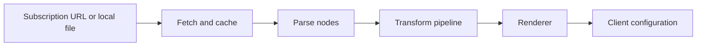

# SubForge

SubForge is a **subscription conversion and routing orchestration engine** written in Go. It turns provider
subscriptions, self-hosted nodes and subconverter-style INI templates into configurations that Clash /
mihomo, sing-box, Surge, Quantumult X, Loon and Surfboard can load directly, and adds a ruleset factory,
scheduled tasks, traffic policies and a web console on top.

It targets individuals and small teams running their own proxies. It ships as a single static binary with no
CGO and no external runtime; the subscription parser is mihomo embedded directly, so SubForge itself only
owns parameter parsing, the node transformation pipeline and format rendering.

[](https://github.com/tktogether/subforge/actions/workflows/ci.yml)
[](LICENSE)
[](https://github.com/tktogether/subforge/releases)
[](go.mod)

## Features

- **Multi-protocol parsing** — share links, whole Base64 blobs and Clash YAML are detected automatically, with no input format to declare.
- **Configurable pipeline** — seven stages (filter / type / node_pref / rename / emoji / dedupe / sort) whose order and per-stage error policy are set by `[pipeline:<name>]`.
- **Multiple target formats** — one internal model renders Clash / mihomo, sing-box, Surge, Quantumult X, Loon and Surfboard configurations.
- **subconverter template compatibility** — the `[common]`, `[node_pref]`, `[rename]`, `[emoji]`, `[clash_proxy_group]` and `[ruleset]` sections keep their semantics, so existing templates and rulesets carry over.
- **Override layers and scripts** — tune groups, rules and nodes from a local override file without editing the template; goja sandbox scripts reach neither the network nor the filesystem.
- **Ruleset factory** — aggregate, version and roll back rulesets, and generate MRS offline.
- **Operations** — scheduled tasks with retries, Telegram / DingTalk alerts, traffic policies and subscription health checks.
- **Web console** — a Vue 3 single-page app embedded into the binary with `embed`, so the front end needs no separate deployment.
- **One engine for CLI and HTTP** — both entry points share the same parameter parsing and conversion engine, so behaviour never drifts.

## Quick Start

**1. Download a prebuilt binary**: grab the **bare executable** for your platform from
[Releases](https://github.com/tktogether/subforge/releases) (not an archive) and make it executable:

```sh
chmod +x subforge-linux-amd64 && ./subforge-linux-amd64 version
```

**2. Use the published image**:

```sh
docker run -d --name subforge -p 25500:25500 \
    ghcr.io/tktogether/subforge:latest serve -listen 0.0.0.0:25500 -token <YOUR_TOKEN>
```

`-listen 0.0.0.0:25500` is not optional: inside a container `serve` listens on `127.0.0.1:25500` by
default, which published ports cannot reach. `:latest` uses an alpine runtime layer, ships both
`linux/amd64` and `linux/arm64`, and carries the version string and root certificates; `:latest-scratch` is
smaller but has no root certificates and only works with `http://` upstreams or local files.

**3. Build from source**: `go build -o bin/subforge ./cmd/subforge` (equivalent to `make build`). Go 1.26.0
is required (see [go.mod](go.mod)); dependencies are vendored, so the build needs no network access.
`make cross` produces the whole delivery matrix in one run: linux/amd64, linux/arm64, linux/arm,
windows/amd64, darwin/amd64, darwin/arm64 and freebsd/amd64.

## Usage

A minimal conversion takes a subscription URL and a target format.

```sh
bin/subforge convert -url "https://sub.example.com/api/v1/client/subscribe?token=<YOUR_TOKEN>" \
    -format clash.meta -out config.yaml
```



With the HTTP service running, point the client at
`http://127.0.0.1:25500/sub?target=clash.meta&url=<subscription URL>`:

```sh
bin/subforge serve -listen 127.0.0.1:25500 -token <YOUR_TOKEN> -data-dir ./data
```

`-data-dir` enables subscription management (SQLite); without it the management endpoints return `503`.
Once `-token` is set, authentication is **global**: `/healthz` and `/version` need the token too, supplied
through `Authorization: Bearer <YOUR_TOKEN>`, the `X-Token` header or the `?token=` query parameter. The
`url` parameter is itself a URL, so separate multiple subscriptions with `;`, never with `?`.

Common parameters:

| Parameter | Description |
| --- | --- |
| `-url` / `-file` | Subscription URL or local file; at least one is required, both may repeat |
| `-format` | Target format, `clash.meta` by default |
| `-config` | subconverter-style INI template |
| `-include` / `-exclude` | Keep or drop nodes by name regex |
| `-sort` | Sort key: `name`, `type`, `server`, `port` or `original` |
| `-listen` / `-token` | Listen address and access token for `serve` |

## Configuration

Precedence, highest first: **URL and command-line parameters > user override > remote INI template >
built-in defaults**. `serve -config` watches the template file and applies changes within a second, with no
restart; `token` and `mixed_port` reload the same way. Template sections and override syntax are covered in
[INI template reference](docs/wiki/INI-模板配置详解.md).

## Supported Target Formats

| Family | Representative target | Notes |
| --- | --- | --- |
| Clash / mihomo | `clash.meta` | YAML; aliases `clash`, `mihomo`, `yaml` |
| Clash / mihomo JSON | `clash.meta.json` | JSON; aliases `clash.json`, `mihomo.json` |
| sing-box | `sing-box` | JSON; alias `singbox` |
| Surge | `surge` | Line-based config; aliases `surge2`, `surge3`, `surge4` |
| Quantumult X | `quanx` | Line-based config; aliases `quan`, `quantumultx` |
| Loon / Surfboard / Mellow | `loon`, `surfboard`, `mellow` | Line-based config |
| Share-link list | `list` | Text list; aliases `sub`, `subscription` |
| Mixed subscription | `mixed` | Base64-wrapped subscription text; `ss`, `ssr`, `trojan`, `v2ray` and similar add a per-protocol filter |

The full target and alias list lives in
[Renderers and output formats](docs/wiki/渲染器与输出格式.md).

## HTTP API

| Endpoint | Description |
| --- | --- |
| `GET /sub` | Main conversion entry point; `/profile` and `/render` are aliases |
| `GET /getruleset` | Ruleset output with six `type` values |
| `GET /inspect` | Echoes the parsed parameters, for troubleshooting |
| `GET /subscribe` | Token-scoped aggregated subscription; requires `-data-dir` |
| `POST /api/convert` | JSON conversion endpoint |
| `GET /version`, `/healthz` | Version information and liveness probe |
| `GET /api/targets`, `/api/rulesets` | Target formats and template rulesets |
| `GET /api/stats`, `/api/metrics` | Conversion statistics and runtime metrics |
| `/api/airports`, `/api/rules`, `/api/tasks` | Management and operations endpoints; require `-data-dir` |

Full endpoint, request and response definitions are in the
[HTTP API reference](docs/wiki/HTTP-API-参考.md).

## Documentation

| Document | Contents |
| --- | --- |
| [Wiki home](docs/wiki/Home.md) | Complete manual: installation, template details, architecture, troubleshooting |
| [docs/README.md](docs/README.md) | Repository documentation index with reading paths by role |
| [v0.1.2 release verification](docs/reports/v0.1.2-release-verification.md) | Verification process and raw data for the release artifacts |
| [CONTRIBUTING.md](CONTRIBUTING.md), [SECURITY.md](SECURITY.md) | Contribution guide and security policy |
| [Design document](docs/design/subforge-design.md) | Architecture decisions and design-phase plans |

## Development

```sh
make build    # build into bin/subforge
make test     # go test ./... -count=1
make vet      # go vet ./...
make verify   # build + vet + test + coverage gates + front-end checks
```

Coverage gates: 80% statement coverage and 100% function coverage. The front end lives in [web/](web/)
(Vue 3 + Vuetify + Vite, pnpm, Node 20.19+) and its build output is embedded into the binary with Go's
`embed`; see the [development and testing guide](docs/wiki/开发与测试指南.md) for the commands.

## Project Structure

| Directory | Responsibility |
| --- | --- |
| `cmd/subforge/` | CLI entry point and subcommands |
| `internal/api/` | HTTP server, routing, middleware and the embedded front-end assets |
| `internal/convert/`, `internal/config/` | Parameter parsing, pipeline assembly, INI templates and override layers |
| `internal/parse/`, `internal/fetch/` | Subscription parsing and upstream fetching with caching |
| `internal/transform/`, `internal/render/` | Node transformation pipeline and the per-format renderers |
| `internal/store/`, `internal/subforge/` | SQLite persistence and subscription-management domain logic |
| `internal/scheduler/`, `internal/traffic/`, `internal/rulebot/` | Scheduled tasks, traffic policies and the rule-suggestion loop |
| `web/`, `docs/`, `deploy/` | Front-end project; documentation; systemd, OpenWrt and Compose deployment files |

## Known Limitations

- The `:latest-scratch` image carries no root certificates and only works with `http://` upstreams or local files.
- `subscheck` subscription health checks are off by default and must be invoked as `subforge subscheck`.
- The MCP server and the `pkg/subforge` public library are implemented but not wired to any entry point.
- The SMTP alert channel is not implemented; use Telegram or DingTalk.
- Without `-data-dir`, subscription management and operations endpoints return `503`.
- The `condition-gate` tier runs only in the nightly job or on manual dispatch, never as part of `make verify`.
- mips and mipsle are outside the delivery matrix because `modernc.org/sqlite` has no build support for them.
- The `SUBFORGE_DATA` and `SUBFORGE_CONFIG` environment variables and the OpenWrt `/etc/config/subforge`
  options are currently not read; enable subscription management by passing `-data-dir` explicitly.

## License and Acknowledgements

Released under the MIT licence; see [LICENSE](LICENSE). Rule and template data is always fetched at
runtime and never bundled into releases.

The INI template semantics and HTTP entry-point design follow
[subconverter](https://github.com/tindy2013/subconverter), the node transformation semantics follow
[Sub-Store](https://github.com/sub-store-org/Sub-Store), and the parsing core is
[mihomo](https://github.com/MetaCubeX/mihomo).
