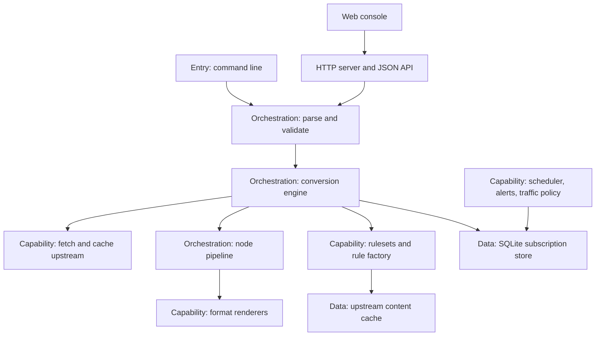
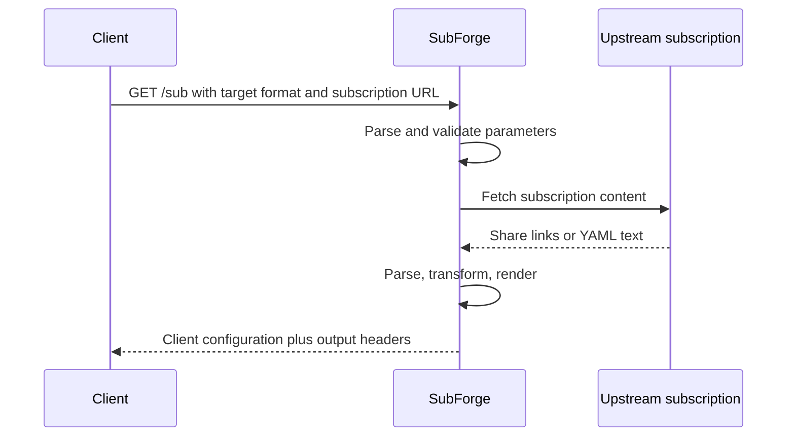
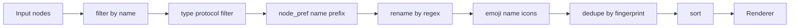
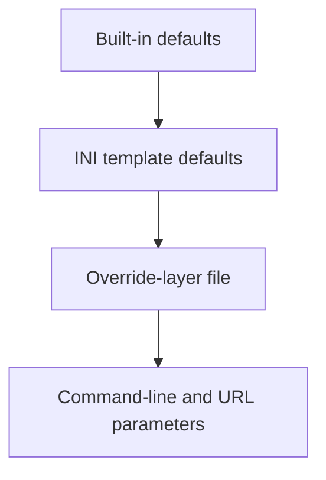

# SubForge

[](LICENSE)
[](go.mod)
[](https://github.com/tktogether/subforge/actions/workflows/ci.yml)

> SubForge is an **all-in-one subscription conversion and rule-based routing engine** written in Go.
> It turns airport subscriptions, self-hosted nodes and subconverter-style INI templates into
> configurations that Clash / mihomo, Surge, Quantumult X, Loon, Surfboard and sing-box clients can
> load directly, and ships operational tooling such as a rule factory, scheduled tasks, traffic
> policies and Rule-Bot suggestions behind both an HTTP API and a web console.

## Table of Contents

- [1. Overview](#1-overview) · [2. How It Works](#2-how-it-works) · [3. Quick Start](#3-quick-start) · [4. Installation and Deployment](#4-installation-and-deployment)
- [5. Command-Line Reference](#5-command-line-reference) · [6. HTTP API Overview](#6-http-api-overview) · [7. Configuration Model](#7-configuration-model) · [8. Web Console](#8-web-console)
- [9. Target Format Matrix](#9-target-format-matrix) · [10. Repository Layout](#10-repository-layout) · [11. Development and Testing](#11-development-and-testing) · [12. Documentation Map](#12-documentation-map)
- [13. Known Limitations and Unfinished Work](#13-known-limitations-and-unfinished-work) · [14. License and Acknowledgements](#14-license-and-acknowledgements)

## 1. Overview

### 1.1 What Problem It Solves

Anyone running a self-hosted proxy setup usually faces three jobs at once: collecting nodes from several
airports and personal servers, reshaping them into a format the client can read, and splitting traffic
across different outbounds. Most existing tools cover only one of those jobs — some convert but are
awkward at routing, others route well but drag in a separate runtime. SubForge folds all three into one
static binary:

- **Collect**: share links, whole-body Base64 and Clash YAML are detected automatically, with no manual
  format flag.
- **Reshape**: a built-in node pipeline processes nodes deterministically by name, protocol type,
  deduplication fingerprint and sort key.
- **Route**: subconverter's INI template semantics are honoured, so existing templates and rulesets keep
  working.
- **Deliver**: a single executable that needs neither CGO nor an external runtime, ready to run on a
  server, a NAS or a soft router.

**Terminology at a glance**: a *subscription* is a batch of nodes provided upstream; a *node* is one
proxy server entry; a *share link* is a single-node link such as `ss://` or `vmess://`; a *template* is
an INI file full of rules; the *output* is the generated client configuration.

### 1.2 Relationship to subconverter and Sub-Store

SubForge aligns with two existing ecosystems on **behavioural semantics** while choosing a different
**implementation shape**.

Relationship to [subconverter](https://github.com/tindy2013/subconverter): INI templates are interpreted
with subconverter semantics, so the `[common]`, `[node_pref]`, `[rename]`, `[emoji]`,
`[clash_proxy_group]` and `[ruleset]` sections carry over as-is; the HTTP entry point keeps `/sub` and
registers `/profile` and `/render` as aliases, so existing configurations do not need new paths;
`/version` returns the compatible plain-text payload, and sub-web parameters such as `sort`, `filename`,
`emoji` and `list` are accepted, which means the sub-web front end can talk to this service directly.
The difference is that subconverter is C++ with an external runtime dependency, whereas SubForge is a
single Go binary. Known behavioural differences are listed one by one in
[docs/compatibility.md](docs/compatibility.md).

Relationship to [Sub-Store](https://github.com/sub-store-org/Sub-Store): nodes are deduplicated on the
combination of `server`, `port` and `type`, **independently of the node name**, matching Sub-Store's
`op.dedupe` semantics — two differently named nodes pointing at the same server are merged. The sort
parameter accepts both the boolean form and the sort-key form, so either calling convention works.

### 1.3 Feature Summary

| Capability | Description | Status |
| --- | --- | --- |
| Multi-protocol parsing and transforms | Share links, whole-body Base64 and Clash YAML are auto-detected; a seven-stage pipeline runs filter / type / node_pref / rename / emoji / dedupe / sort | Implemented |
| Template and pipeline customisation | subconverter section semantics, `[custom]` inline rules, and `[pipeline:<name>]` for custom step order and per-step error policy | Implemented |
| Target format rendering | Clash / mihomo, sing-box, Surge, Quantumult X, Loon, Surfboard and more | Implemented |
| Layered overrides and scripts | `groups` / `rules.prepend\|append` / `proxies` overrides (parsed from both YAML and INI); goja sandbox scripts with no network or filesystem access | Implemented |
| Rule tooling | Six `/getruleset` shapes, rule-factory manifest aggregation with rollback, offline MRS generation | Implemented |
| Operations | Scheduled tasks with retries, traffic policies, subscription health checks (off by default), the Rule-Bot suggestion loop | Implemented |
| Alert channels | Telegram and DingTalk are implemented; SMTP is a placeholder | Partial |
| Web console | Vue 3 single-page application embedded in the binary | Implemented |
| MCP server | The `internal/mcp` package exists but no CLI or HTTP entry point wires it up | Implemented, not wired |

## 2. How It Works

### 2.1 System Architecture

SubForge has four layers: the entry layer accepts command-line and HTTP requests; the orchestration layer
normalises a request into a parameter object and drives the pipeline; the capability layer provides
fetching, parsing, rendering, rulesets and scheduling; the data layer stores subscription-management data
and the on-disk cache.



**Why the layers**: the command line and the HTTP entry point share one parameter parser and one engine.
The practical benefit is that behaviour cannot drift — the same request travels the same execution path
whether it arrives through `subforge convert` or `GET /sub`.

### 2.2 Sequence of a Conversion Request

Taking the HTTP entry point as the example, a conversion request passes through parameter parsing,
upstream fetching, parsing, transformation and rendering, and finally returns the output together with
its metadata.



**What to watch for**: parameter validation happens before the subscription is fetched. A malformed
regular expression, a misspelled sort key or an unsupported target format all fail before any upstream
request is issued, so a bad request never pulls the subscription for nothing.

### 2.3 The Node Transformation Pipeline

The default pipeline has seven stages in a fixed order; the final stage is appended only when `sort` is
given explicitly and is not `original`.



**Why `node_pref` runs before `rename` and `emoji`**: prefixes are added per protocol type, while
`include` and `exclude` match on the node name. Renaming first would move the matching baseline and
silently drop nodes that should have received a prefix; subconverter likewise handles prefixes before
renaming. **Deduplication** keys on the combination of `server`, `port` and `type`, never on the name.
**A custom order** can be expressed with the INI `[pipeline:<name>]` section and selected through
`-pipeline` or `pipeline=`.

### 2.4 Layered Overrides and Precedence

The same parameter can appear on the command line, in an override-layer file and in the INI template at the
same time. SubForge resolves the conflict with a fixed hierarchy:



Arrows point from lower to higher precedence: the later the layer, the higher it wins. When a parameter
"does not take effect", check the layers in that order. Override syntax and merge rules are in section 7.2.

## 3. Quick Start

### 3.1 Getting the Binary

Build from source (Go 1.26.0 is required; the version in [go.mod](go.mod) is authoritative):

```sh
go build -o bin/subforge ./cmd/subforge
go run ./cmd/subforge version
go run ./cmd/subforge doctor
```

The equivalent target is `make build`. Dependencies are fully pinned in `vendor/`, so the build needs no
network access. Without a local Go toolchain, use the container or release-artifact route described in
[section 4](#4-installation-and-deployment).

### 3.2 Your First Conversion

The smallest useful command is one subscription URL plus one target format:

```sh
bin/subforge convert -url "https://sub.example.com/api/v1/client/subscribe?token=<YOUR_TOKEN>" -format clash.meta -out config.yaml
```

Swap `-format` for `-list` to get a plain share-link list instead of a client configuration; to control
node handling with a local INI template and keep only one region, sorted by name (replace
`./my-template.ini` with your own template path):

```sh
bin/subforge convert -file ./nodes.txt -config ./my-template.ini -include "Hong Kong|HK" -exclude "expired|trial" -sort name -out config.yaml
```

**What to watch for**: at least one of `-url` and `-file` must be given — with neither, the program prints
usage and exits with an error. Validation happens before the subscription is fetched. `-list` decides the
output shape and outranks `-format`; when both are given, a notice says that `-format` is ignored.

### 3.3 Starting the HTTP Service

```sh
bin/subforge serve -listen 127.0.0.1:25500 -token <YOUR_TOKEN> -data-dir ./data -cache-dir ./cache
```

`-data-dir` enables subscription management (airports, groups, rules, tokens and so on); without it,
SQLite is not enabled. Once the service is up, `GET /healthz` reports liveness, `GET /version` reports the
version and uptime, `GET /api/stats` reports conversion statistics and `GET /api/targets` lists the
available target formats; opening `http://127.0.0.1:25500/` in a browser loads the
[web console](#8-web-console).

**What to watch for**: by default the service listens only on `127.0.0.1:25500`, so only the local machine
can reach it. An empty `-token` means no authentication; binding all interfaces requires setting a token
first, and when the service binds all interfaces without one it prints a warning that any host on the same
network can use it. Without `-data-dir`, subscription-management endpoints return 503 and state which
capability is not enabled.

### 3.4 Importing Into a Client

Paste the following address into your client (Clash / mihomo clients: choose "subscription" or "remote
configuration file URL"):

```text
http://127.0.0.1:25500/sub?target=clash.meta&url=https%3A%2F%2Fsub.example.com%2Fapi%2Fv1%2Fclient%2Fsubscribe%3Ftoken%3D<YOUR_TOKEN>
```

When a server token is configured, append `&token=<YOUR_TOKEN>`; the token can also be sent through the
`Authorization: Bearer <YOUR_TOKEN>` or `X-Token` header. All three forms are supported.

**What to watch for**: the value of `url` is itself a URL, so `?` **cannot** be used to separate several
subscription addresses — doing so drops the trailing `?token=...` part. Separate multiple addresses with
`;` instead.

## 4. Installation and Deployment

### 4.1 Binaries

The delivery matrix is covered by `make cross`, with artifacts written to `bin/`: linux/amd64,
linux/arm64, linux/arm, windows/amd64, darwin/amd64, darwin/arm64 and freebsd/amd64. The build uses
`CGO_ENABLED=0`, `-trimpath`, `-mod=vendor` and `-s -w`, producing a statically linked single file;
`make release` runs `make cross` and then packages the artifacts under `bin/` into `dist/*.tar.gz`.

The seven assets published for v0.1.0 measure 35.4–38.2 MiB: linux/amd64 is 40,046,754 bytes
(38.2 MiB), linux/arm64 36.2 MiB, linux/arm 36.5 MiB, windows/amd64 37.0 MiB, darwin/amd64 37.2 MiB,
darwin/arm64 35.4 MiB and freebsd/amd64 36.3 MiB; an idle systemd service holds roughly 26.8 MiB of
resident memory. Per-target byte counts, the measurement method and resource usage are recorded in
[deploy/README.md](deploy/README.md).

**What to watch for**: (1) The assets on the Release page are **bare executables, not archives** —
`release.yml:84-91` writes them directly with `-o dist/subforge-<os>-<arch>`; only a local
`make release` additionally produces `dist/*.tar.gz` (`Makefile:42-47`). (2) The real size already
exceeds the 15~25MB budget stated in the design document (`docs/design/subforge-design.md:15`), so
size images, partitions and download budgets in the 40 MB range. (3) mips and mipsle are not in the
delivery matrix because `modernc.org/sqlite` has no build support for those platforms.

### 4.2 Docker and docker-compose

There are two usable paths to a container image: **pull the published image** (fastest, good for a first
run) and **build it yourself** (recommended for real deployments, because you can bake in version
information and choose a runtime layer that carries root certificates). They differ mainly in the runtime
layer and in platform support:

| Path | Runtime layer | Can fetch HTTPS upstreams | Platform |
| --- | --- | --- | --- |
| Pull the published image `ghcr.io/tktogether/subforge` | `scratch` | **No** (no root certificates in the image — see the measurement below) | `linux/amd64` only |
| Build [Dockerfile.alpine](Dockerfile.alpine) yourself | `alpine:3.20` + `ca-certificates` + `tzdata` | Yes | The architecture of the build machine |
| Build [Dockerfile](Dockerfile) yourself | `scratch` | **No** (upstreams must be `http://` or local files) | The architecture of the build machine |

#### Path one: pull the published image

```sh
docker pull ghcr.io/tktogether/subforge:latest
docker run -d --name subforge -p 25500:25500 -v subforge-data:/data \
    ghcr.io/tktogether/subforge:latest serve -listen 0.0.0.0:25500 -token <YOUR_TOKEN>
```

- The registry is public, so **anonymous pulls work** (measured). The available tags are `v0.1.0` and
  `latest`; the digest of `v0.1.0` is
  `sha256:418f7ef051dae9d1323f3be52c099c09a4d7d0cc752f4d35ddf6aef3c942909c`.
- **Only the `linux/amd64` platform is available**: the image manifest is an OCI image index that, apart
  from the attestation, contains a single amd64 entry — the build-push step in `release.yml:113-121` sets
  no `platforms:`.
- **The image reports itself as `subforge dev (commit none, built unknown)`**: `release.yml:113-121`
  passes no `build-args`, so `VERSION`, `COMMIT` and `DATE` stay at the Dockerfile defaults
  (`Dockerfile:25-27`).
- **The published image uses the `scratch` runtime layer and contains no root certificates at all, so
  fetching an HTTPS subscription URL fails outright.** Measured with a scratch image isomorphic to the
  runtime layer in `Dockerfile:47-61`, fetching an HTTPS upstream reported
  `tls: failed to verify certificate: x509: certificate signed by unknown authority` (exit code 1);
  an alpine runtime layer isomorphic to `Dockerfile.alpine:13-14` fetched the same URL successfully
  (12 nodes). The published image is therefore only suitable for `http://` upstreams or local file input —
  **to fetch HTTPS subscription URLs, build the alpine variant via path two**.

#### Path two: build it yourself

| File | Base images | Notes |
| --- | --- | --- |
| [Dockerfile.alpine](Dockerfile.alpine) | build stage `golang:1.26-bookworm`, runtime stage `alpine:3.20` | Additionally installs `ca-certificates` and `tzdata`; **recommended for real deployments** |
| [Dockerfile](Dockerfile) | build stage `golang:1.26-bookworm`, runtime stage `scratch` | Smallest image, holding only the static binary and the licence; **no root certificates** |

```sh
# Recommended: alpine runtime layer with root certificates, version info baked into the binary
docker build -f Dockerfile.alpine \
    --build-arg VERSION=v0.1.0 \
    --build-arg COMMIT=$(git rev-parse --short HEAD) \
    --build-arg DATE=$(date -u +%Y-%m-%dT%H:%M:%SZ) \
    -t subforge:alpine .

# Optional: smallest possible scratch runtime layer
docker build -f Dockerfile -t subforge:latest .

docker run -d --name subforge -p 25500:25500 -v subforge-data:/data \
    subforge:alpine serve -listen 0.0.0.0:25500 -token <YOUR_TOKEN>
docker run --rm -v subforge-data:/data subforge:alpine convert -file /data/nodes.txt -format sing-box -out /data/cfg.json
docker compose up -d
```

The container's default command is `serve`; override it to run `convert`, `version`, `doctor` or any other
subcommand. `-listen 0.0.0.0:25500` is not optional: `serve` listens on `127.0.0.1:25500` by default,
which inside a container is the container's own loopback interface, so publishing the port has no effect
(see the measurement below).

The compose file maps port `25500` to the host, mounts the `subforge-data` volume at `/data` and mounts
`./config` read-only at `/config`. It also builds `Dockerfile.alpine` (`docker-compose.yml:6` — precisely
because of the root certificates) and explicitly appends
`command: [serve, -listen, 0.0.0.0:25500]` after `container_name` (`docker-compose.yml:9-16`) so that the
published port is actually reachable. To expose the service to the LAN, append `-token <YOUR_TOKEN>` too.

**Measured results** (2026-10-20, WSL2 Ubuntu 22.04, Docker 29.1.3, overlayfs storage driver,
kernel 5.10.16.3-microsoft-standard-WSL2):

| Check | Result |
| --- | --- |
| `docker build -f Dockerfile .` (scratch runtime layer) | Success, exit code 0, 40s, image 56.1 MB |
| `docker build -f Dockerfile.alpine .` | Success, exit code 0, 60s, image 71.7 MB |
| Binary inside both images | `ELF 64-bit LSB executable, x86-64, statically linked, stripped`, 40,091,810 bytes each; `ldd` reports `not a dynamic executable` |
| `version` / `serve` / `convert` inside the container | All succeed; `convert` produced 12 nodes, and both the Clash YAML and the sing-box JSON were accepted by a parser |
| Published image `ghcr.io/tktogether/subforge:v0.1.0` | Anonymous pull works (digest `sha256:418f7ef0…`, `linux/amd64`) and it starts; with a token configured, probes return 401, and with `X-Token` they return 200 |
| Fetching an HTTPS upstream from the published image | **Fails**: `x509: certificate signed by unknown authority`; the same URL succeeds on the alpine runtime layer |
| Published port after adding `command` | `curl http://127.0.0.1:25500/healthz` from the host → `HTTP=200`, `{"status":"ok"}` |

**What to watch for**: the `SUBFORGE_DATA` and `SUBFORGE_CONFIG` variables in the compose file and
Dockerfiles only declare paths — `serve` does not read them. Only three places in the whole program read
an environment variable: `SUBFORGE_DATA_DIR` (`cmd/subforge/doctor.go`), `SUBFORGE_DEBUG`
(`internal/api/pprof.go`) and `TELEGRAM_CHAT_ID` (`cmd/subforge/scheduler.go`). Listen address, token and
similar parameters still come from the command line and the INI file. If the compose file did not override
the container command, `serve` would fall back to `127.0.0.1:25500` inside the container, which does
**not** match `ports: 25500:25500`: reaching the published port from the host returned `HTTP 000` (curl
reported `Recv failure: Connection reset by peer`), while reaching `127.0.0.1:25500` from inside the
container network returned `200`. That is why the compose file has to set `command` explicitly.

### 4.3 systemd

The repository ships a unit file at [deploy/subforge.service](deploy/subforge.service):

```sh
sudo install -o root -g root -m 0755 bin/subforge-linux-amd64 /usr/local/bin/subforge
sudo install -o root -g root -m 0640 deploy/subforge.service /etc/systemd/system/
sudo systemctl daemon-reload
sudo systemctl enable --now subforge
```

Key unit settings: `ExecStart` is `/usr/local/bin/subforge serve --config /etc/subforge/subforge.ini
--cache-dir /var/lib/subforge/cache --listen 127.0.0.1:25500 --timeout 30 --shutdown 10`; `User` and
`Group` are `subforge`, so a system user of that name must exist first; `Restart=on-failure` with
`RestartSec=3s` restarts the service after an abnormal exit; `StateDirectory=subforge` keeps the state
directory writable under `ProtectSystem=full`.

**What to watch for**: the unit sets **no** `--token`, which is safe while it listens only on the loopback
address; once `--listen` is changed to `0.0.0.0:25500` a token must be set, otherwise the program only
prints a warning instead of refusing to start. Configuration hot reload is driven by polling the file
timestamp, so editing the INI needs neither `SIGHUP` nor a restart. `StartLimitIntervalSec` and
`StartLimitBurst` belong to the `[Unit]` section — systemd moved them out of `[Service]` in version 229,
and they are ignored in the wrong section.

### 4.4 OpenWrt

The OpenWrt packaging definition lives in [deploy/openwrt/](deploy/openwrt/) and consists of three files:

| File | Role |
| --- | --- |
| [deploy/openwrt/Makefile](deploy/openwrt/Makefile) | Package definition: name `subforge`, version `1.0.0`, category Network, dependency `ca-bundle`; installs the binary, the init script and the UCI configuration, then enables and starts the service after installation |
| [deploy/openwrt/files/subforge.init](deploy/openwrt/files/subforge.init) | procd service script: `START=99`, `USE_PROCD=1`, supervising `subforge serve` in respawn mode |
| [deploy/openwrt/files/subforge.conf](deploy/openwrt/files/subforge.conf) | UCI template for `/etc/config/subforge`: enable switch, port, data directory, configuration directory and log level |

**Prerequisite**: this package only bundles a **pre-compiled static binary**; the SDK never rebuilds the Go
sources. Before packaging, place the binary for the target architecture at `deploy/openwrt/bin/subforge`
(that file is not part of the source tree and is excluded by `.gitignore`):

```sh
CGO_ENABLED=0 GOOS=linux GOARCH=amd64 go build -trimpath -mod=vendor -ldflags "-s -w" \
    -o deploy/openwrt/bin/subforge ./cmd/subforge
```

**Packaging steps** (using an official SDK):

```sh
SDK=/opt/sdk-x86            # an extracted OpenWrt SDK directory
mkdir -p "$SDK/package/subforge/bin"
cp -a deploy/openwrt/Makefile "$SDK/package/subforge/"
cp -a deploy/openwrt/files    "$SDK/package/subforge/"
cp -a deploy/openwrt/bin/subforge "$SDK/package/subforge/bin/"
cd "$SDK" && make package/subforge/compile V=s
```

The artifact lands in `bin/packages/<PKGARCH>/base/`, for example
`bin/packages/x86_64/base/subforge_1.0.0-r1_x86_64.ipk`.

**Measured results** (official OpenWrt SDK 24.10.4, 2026-10-20):

| Target architecture | Artifact | Size |
| --- | --- | --- |
| `x86/64` | `subforge_1.0.0-r1_x86_64.ipk` | 15,451,470 bytes |
| `bcm27xx/bcm2711` (Raspberry Pi 4) | `subforge_1.0.0-r1_aarch64_cortex-a72.ipk` | 14,264,239 bytes |

Both packages have a complete structure (`usr/bin/subforge` mode 755, `etc/init.d/subforge` 755,
`etc/config/subforge` 644), the `control` metadata matches the Makefile declarations item by item, and the
extracted binary runs `version` with exit code 0 while `ldd` reports `not a dynamic executable`. Note that an
`.ipk` is a **gzip-compressed tar archive** (not an `ar` archive); inspect it with
`gunzip -c <package>.ipk | tar -tf -`.

**Two facts worth knowing**:

1. Earlier revisions of `deploy/openwrt/Makefile` did not declare `Build/Prepare` and `Build/Compile`, so
   `make package/subforge/compile` failed outright on a stock SDK (`No targets specified and no makefile
   found`, exit code 2). The cause is that this package has no `PKG_SOURCE`, so the SDK's default
   `Build/Prepare` is never defined and `$(PKG_BUILD_DIR)` stays an empty directory. The current Makefile
   supplies both steps.
2. The five UCI options in `files/subforge.conf` are currently **not read by the init script** (the script
   contains no `config_load` call at all), and the `SUBFORGE_DATA` and `SUBFORGE_CONFIG` values declared in
   the init script are not read by `serve` either — `serve` only accepts command-line parameters. To make
   the data directory and configuration file effective, change the init script's `command` to pass them
   explicitly, for example
   `/usr/bin/subforge serve -config /etc/subforge/subforge.ini -data-dir /var/lib/subforge`.

> **Not yet verified**: the conclusions above stop at "the package builds and the binary inside it runs".
> This project has never run `opkg install` on a real OpenWrt device, so the actual behaviour of `postinst`,
> the generation of rc.d links, procd starting the service, `opkg` resolving the `ca-bundle` dependency and
> `opkg` accepting the gzip outer archive all remain without an on-device result.

## 5. Command-Line Reference

### 5.1 Top-Level Commands

| Command | Purpose |
| --- | --- |
| `version` / `doctor` | Print version information; environment and runtime self-check, with `-config` naming the configuration file |
| `convert` | Convert a subscription into a client configuration locally |
| `diff` | Preview how an override layer changes template defaults |
| `manifest` | Rule-factory manifest aggregation, with the `update` / `versions` / `rollback` subcommands |
| `mrs` | Offline MRS generation, with the `generate` / `cached` subcommands |
| `subscheck` | Subscription health checks, off by default and requiring explicit use |
| `scheduler` | Scheduled tasks and alerts, with the `test-alert` / `run` subcommands |
| `rulebot` | The rule feedback loop, with the `analyze` / `pending` / `stats` subcommands |
| `serve` | Start the HTTP service |

Running with no arguments prints usage and exits with status 2; an unknown command prints `未知命令`
("unknown command") and also exits with status 2; a failing subcommand prints `subforge: <error>` and
exits with status 1.

### 5.2 `convert`

| Flag | Values | Default | Notes |
| --- | --- | --- | --- |
| `-url` | subscription URL | — | Repeatable; share links, whole-body Base64 and Clash YAML are auto-detected |
| `-file` | file path | — | Repeatable; a local subscription or configuration file |
| `-config` | file path or URL | — | subconverter-style INI template; command-line flags take precedence |
| `-pipeline` | name | — | Selects the `[pipeline:<name>]` pipeline in the template |
| `-include` / `-exclude` | regular expression | — | Node-name allow list and deny list, both repeatable |
| `-type` | protocol name | — | Keep only the given protocol types, repeatable |
| `-rename` / `-emoji` | `regex,replacement` and `regex,emoji` | — | Regex renaming and name icons, both repeatable |
| `-sort` | `original` / `name` / `type` / `server` / `port` | — | Sort key |
| `-format` | target format | `target` from the template's `[common]`, then `clash.meta` | Rendered as the target format |
| `-list` | boolean | `false` | Emit a share-link list, outranking `-format` |
| `-out` | file path | standard output | Output file path |
| `-mixed-port` / `-cache-dir` / `-timeout` | port / directory / seconds | `7890` / no cache / `30` | The output's `mixed-port`, the cache directory, the upstream timeout |
| `-name` / `-header` / `-override` | string / `K: V` / file path | — | Configuration name in the output header; extra request headers; override-layer file (YAML or INI) |

### 5.3 `serve`

| Flag | Values | Default | Notes |
| --- | --- | --- | --- |
| `-listen` | `host:port` | `127.0.0.1:25500` | Listen address |
| `-token` | string | empty, meaning no authentication | Access token |
| `-config` | file path | — | INI configuration file, hot-reloaded after edits |
| `-mixed-port` / `-timeout` / `-shutdown` | port / seconds / seconds | `7890` / `30` / `10` | The output's `mixed-port`, request timeout, graceful shutdown window |
| `-cache-dir` / `-data-dir` | directory | no cache / not enabled | Upstream content cache; subscription-management data directory (SQLite) |
| `-name` | string | — | Configuration name in the output header, fixed at start-up |

### 5.4 Remaining Subcommands

| Command | Arguments | Notes |
| --- | --- | --- |
| `diff` | `-override <file>` required, `-config <template>` optional, `-v` shows unchanged groups | Preview override-layer changes |
| `manifest` / `mrs` | `update <manifest.yaml>`, `versions\|rollback <dir> <name> <ext>`; `generate <behavior> <format> <src> <dst>`, `cached <src> <cacheDir> <behavior> <format>` | Ruleset version updates, listing and rollback; MRS generation, or a cache hit printing the byte count |
| `subscheck` / `scheduler` | `-file <list file>` with one address per line, `-timeout` defaulting to `15s`; `test-alert <telegram\|dingtalk> <target>`, `run` | Subscription health checks; testing an alert channel or running the scheduler in the foreground for debugging |
| `rulebot` | `analyze <log file>`, `pending`, `stats` | Analyse anomalies, list suggestions awaiting confirmation, print statistics |

## 6. HTTP API Overview

The service listens on `127.0.0.1:25500` by default. The tables below are entry-level inventories meant to
answer "which path serves this capability" quickly; they are not a complete API reference — request bodies
and response shapes are defined by the source under `internal/api/`.

Authentication: once `-token` is set, every request except `/subscribe` must carry the token. It may travel
in the `Authorization: Bearer <YOUR_TOKEN>` header, the `X-Token` header or the `token` query parameter,
with the `Authorization` header taking precedence; a failed check returns `401` together with a
`WWW-Authenticate: Bearer` response header.

### 6.1 Conversion and Output

| Method | Path | Notes | Needs `-data-dir` |
| --- | --- | --- | --- |
| GET | `/sub`, `/profile`, `/render` | Main conversion entry point and its two aliases, subconverter-compatible | No |
| GET | `/getruleset` | Ruleset output in six shapes | No |
| GET | `/inspect` | Echoes the parsed parameters for troubleshooting | No |
| GET | `/subscribe` | Aggregates and serves a subscription by token, as plain text | Yes |
| POST | `/api/convert`, `/api/diff` | Conversion endpoint (JSON) and override-layer change preview | No |

`/getruleset` accepts these `type` values: `1` for Surge list, `2` for Quantumult X, `3` for a Clash domain
provider, `4` for a Clash ipcidr provider, `5` for a Surge DOMAIN-SET and `6` for Clash classical. The type
resolves from the URL parameter first and the template's `[ruleset]` section second; rule content resolves
in the order `rules` parameter, `list` parameter, the `[common]` section's `rules`, then a remote fetch from
`url`. A missing `name` returns `400`, and a `name` whose type cannot be inferred returns `404`.

Query parameters accepted by `/sub` (parsed in `internal/convert/params.go`):

| Parameter | Meaning | Key details |
| --- | --- | --- |
| `target` | Target format | Falls back to `clash.meta` when empty |
| `url` / `insert` | Subscription URLs and extra inserted URLs | The value of `url` is itself a URL, so `?` cannot separate entries; use `;` for several sources |
| `include` / `exclude` | Node-name regex allow list and deny list | Separated by `;`; compiled during parsing, so a typo fails before the subscription is fetched |
| `type` | Protocol types to keep | Both commas and semicolons are accepted |
| `rename` / `emoji` | Regex renaming and name icons | Written as `regex,replacement`; leading and trailing spaces in the regex are significant and are not trimmed |
| `sort` | Sorting | Accepts both the boolean form and the `name` / `type` / `server` / `port` / `original` keys |
| `list` / `udp` / `tfo` / `scv` / `tls13` | List mode and per-node switches | Boolean: `1`, `true`, `yes` and `on` are true |
| `config` / `pipeline` | Template name and named pipeline | `pipeline` references `[pipeline:<name>]` in the template |
| `rules` / `ruleset` / `filename` | Inline rules, ruleset selection, download filename | `rules` looks like `GEOIP,CN,DIRECT`; `ruleset` looks like `ruleset:<name>:<type>`; `filename` only affects `Content-Disposition` |

Unknown parameters are not an error: they are kept verbatim in the parameter set for troubleshooting and
pass-through, and the parsed result can be echoed with `GET /inspect`.

### 6.2 Probes and Runtime

| Method | Path | Notes | Needs `-data-dir` |
| --- | --- | --- | --- |
| GET | `/version`, `/healthz`, `/api/version` | subconverter-compatible plain-text version information; liveness probe; API version and uptime | No |
| GET | `/api/stats`, `/api/history`, `/api/logs` | Conversion statistics with the latest snapshot, conversion history, structured logs | No |
| GET | `/api/metrics` | Runtime metrics as JSON: memory, GC, goroutines, CPU | No |
| GET | `/api/targets`, `/api/rulesets`, `/api/configs`, `/api/pipelines` | Target formats, template rulesets, available configurations and named pipelines | No |
| GET | `/debug/pprof/*` | Profiling endpoints, registered only in debug mode | No |

`/debug/pprof/*` is available only in debug mode: either the request carries `?debug=1`, or the process was
started with `SUBFORGE_DEBUG=1` in its environment. Otherwise those paths return `404`, so profiling is not
exposed in production by default.

### 6.3 Subscription Management and Operations

The endpoints below are backed by the SQLite database enabled through `-data-dir`. Without `-data-dir` they
return `503` and state which capability is not enabled (for example "subscription management is not
enabled" or "the scheduler is not enabled").

| Method | Path | Notes |
| --- | --- | --- |
| GET / POST | `/api/airports`, `/api/airports/{id}`, `/api/airports/refresh`, `/check`, `/check/last`, `/api/airports/{id}/refresh`, `/import-rules` | Airport CRUD, refreshing, subscription health checks with the latest result, per-airport traffic refresh and rule import |
| GET / POST / PUT / DELETE | `/api/groups`, `/api/rules`, `/api/rules/bulk`, `/api/tokens`, `/api/self-nodes`, `/api/pipelines` and their `{id}` or `{token}` sub-paths | Management of groups, rules (including bulk enable/disable), subscription tokens, self-hosted nodes and named pipelines |
| GET / POST / PUT / DELETE | `/api/scripts`, `/api/scripts/test`, `/api/scripts/{id}`; `/api/traffic/strategy`, `/api/traffic/refresh`, `/api/traffic/preview` | Script library, test runs and CRUD; reading and updating the traffic policy, refreshing traffic, and dry-run calculation |
| GET / PUT / POST | `/api/tasks`, `/api/alert-channels`, `/api/alert-channels/test` | Scheduled-task execution history; alert-channel configuration and connectivity tests |
| GET / POST | `/api/suggestions`, `/api/suggestions/apply`, `/api/suggestions/{index}/confirm`, `/reject` | Rule-Bot suggestion queue, applying, confirming and rejecting |
| GET / POST / PUT | `/api/rule-providers`, `/api/rule-providers/{id}/enabled`, `/api/settings`, `/api/template`, `/api/override` | Enabling and disabling rule providers; reading and writing settings, templates and override layers |
| POST | `/api/rule-sources/init`, `/update`, `/update-one`, `/rollback`, `/mrs`, `/remove` | Initialising, updating, rolling back, generating MRS for and removing rule sources (list them with `GET /api/rule-sources`) |

Static assets are served under `/*`: a real file is returned as-is; a path with an extension that does not
exist returns `404`; any other path without an extension falls back to the front-end entry page for the
single-page application's client-side routing.

## 7. Configuration Model

### 7.1 INI Template Sections

Templates are interpreted with subconverter semantics, and the sections mean the following:

| Section | Purpose |
| --- | --- |
| `[common]` | General settings such as the default `target`, inline `rules` and `include` |
| `[node_pref]` / `[rename]` / `[emoji]` | Node preferences (name prefixes), regex renaming and name icons |
| `[clash_proxy_group]` / `[ruleset]` | Proxy-group definitions; ruleset names and their type mapping, used by `/getruleset` |
| `[pipeline:<name>]` / `[custom]` | Named pipelines (step order and per-step error policy); inline rules |
| `[subforge]` | Settings specific to this project: `token`, `mixed_port`, `name` |

Inside `[subforge]`, `token` and `mixed_port` are hot-reloaded while `name` needs a restart; `token` may
also live in the subconverter-style `[common]` section.

### 7.2 Override Layers

An override layer is a local file, written in either YAML or INI, that fine-tunes the output without
touching the template: `groups` modifies existing groups or adds new ones; `rules.prepend` and
`rules.append` insert rules at the head or the tail of the list; `proxies` replaces a node's `server` and
`port` by name regex. Merging is "append for arrays, replace for scalars".

`subforge diff -override <file> -config <template>` previews the changes before a real conversion: proxy
groups are reported as modified, added or unchanged, with unchanged groups hidden by default; rules are
marked `+P` and `+A` for prepend and append; replaced `server` and `port` values are listed per node.

**Why the override layer sits after the template but before the pipeline**: deduplication and sorting must
operate on final values. Were the override applied after the pipeline, two nodes that started with the same
`server` and `port` could diverge afterwards, or could become identical only after the point where
deduplication had already run.

### 7.3 Precedence and Hot Reload

Precedence runs, highest first: URL and command-line parameters, the override-layer file, INI template
defaults, then built-in defaults (see section 2.4). The INI file named by `serve -config` is hot-reloaded: after an edit,
`token` and `mixed_port` apply to subsequent requests immediately while `name` needs a restart. The
template itself is also read from an in-memory snapshot, so changes to `[node_pref]`, `[clash_proxy_group]`
and similar sections show up in later output right away.

## 8. Web Console

The console is a Vue 3 single-page application (Vuetify 3 components, built with Vite) whose artifacts are
embedded into the binary through Go's `embed`; once the service runs, open `http://127.0.0.1:25500/`. The
navigation is grouped by purpose into five areas:

| Group | Pages and paths | Purpose |
| --- | --- | --- |
| Convert | Overview `/`, Convert `/convert`, Pipelines `/pipelines`, Scripts `/scripts` | Status overview and recent conversions, source and target selection, pipeline and script-library management |
| Sources | Airports `/airports`, Self-hosted nodes `/self-nodes` | Airport subscription CRUD with traffic refresh and health checks; self-hosted node management |
| Rules | Rules `/rules`, Rule sources `/rule-sources`, Groups `/groups` | Ruleset with bulk enable/disable, rule-source updates and rollback, proxy-group definitions |
| Output | Subscriptions `/subscriptions` | Outbound subscription tokens and output addresses |
| Operations | Tasks `/tasks`, Settings `/settings`, Logs `/logs` | Scheduled-task history, server settings, structured logs and filtering |


The console works through JSON endpoints such as `/api/targets`, `/api/convert` and `/api/diff`. When it is
deployed on a LAN or a server, enter the access token in the interface or open it with
`?token=<YOUR_TOKEN>`.

## 9. Target Format Matrix

Target formats are registered in `internal/render/targets.go`, and every alias normalises to a canonical
renderer name.

| Family | Canonical target | Aliases | Output shape |
| --- | --- | --- | --- |
| Clash / mihomo | `clash.meta` | `clash`, `clashmeta`, `mihomo`, `yaml`, `clashr` | YAML |
| Clash / mihomo | `clash.meta.json` | `clash.json`, `clashmeta.json`, `clash-json`, `clashmeta-json`, `mihomo.json` | JSON |
| sing-box | `sing-box` | `singbox` | JSON |
| Surge | `surge` | `surge2`, `surge3`, `surge4`, `suri` | Line-based configuration |
| Quantumult family | `quan`, `quanx` | `quantumult`, `quantumultx` | Line-based configuration |
| Loon / Surfboard / Mellow | `loon`, `surfboard`, `mellow` | `mellow-ios` | Line-based configuration |
| Share-link list | `list` | `sub`, `subscription` | Text list |
| Mixed subscription | `mixed` | `ss`, `ssd`, `shadowsocks`, `ssr`, `shadowsocksr`, `trojan`, `v2ray` | Subscription filtered by type |
| Shadowsocks-specific | `ss-sub` | `ss-sub-json`, `ss-sub-b64`, `ssjson`, `sssub` | Subscription text |

An unsupported target returns an "unsupported output format" error together with the list of supported
formats. Output metadata travels back in response headers, most commonly `X-Convert-Format` (the
normalised target name), `X-Node-Count`, `X-Ruleset-Count`, `X-Convert-Skipped` and `X-Convert-Warning`
(skips and warnings), and `Subscription-Userinfo` (traffic and expiry). Clients differ in the protocols
they support, so the same node may be skipped by one target format; the reason shows up in the
`X-Convert-Skipped` header.

## 10. Repository Layout

```text
subforge/
├── cmd/subforge/            CLI entry point and subcommand implementations
├── internal/
│   ├── api/ web embedding   HTTP server, routing, middleware and the various APIs; embedded front end
│   ├── convert/ config/     Parameter parsing, pipeline assembly and the engine; INI parsing, override DSL
│   ├── parse/ fetch/        Share-link, Base64 and Clash YAML parsing; upstream fetching and disk cache
│   ├── transform/ render/   Node transformation pipeline; renderer family and target registry
│   ├── manifest/ mrs/       Rule-factory manifest aggregation and versioning; offline MRS generation
│   ├── scheduler/ rulebot/  Scheduled tasks and alert channels; the rule feedback loop
│   ├── store/ subforge/     Persistence (SQLite) and subscription-management domain logic
│   └── traffic/ buildinfo/ mcp/ tools/  Traffic policies and usage statistics, version injection; the MCP package (not wired to an entry point); coverage-gate tooling
├── pkg/subforge/ web/       Public library entry point; Vue 3 + Vuetify front-end project
├── docs/ deploy/            Design documents, ADRs, reports and Wiki sources; systemd unit and OpenWrt packaging
├── testdata/ vendor/        Test fixtures and golden snapshots; vendored dependencies for offline builds
└── Makefile                 Build entry point; Dockerfile and docker-compose.yml live at the root
```

**What to watch for**: the `internal/mcp` package is implemented, but nothing under `cmd/` or
`internal/api/` references it, so no MCP server entry point exists today. `pkg/subforge` is a public library
entry point that no other package in the repository imports.

## 11. Development and Testing

Builds and tests are driven by [Makefile](Makefile); the commands in the table are the ones the Makefile
actually runs.

| Target | Notes |
| --- | --- |
| `make build` / `make test` / `make vet` | `CGO_ENABLED=0 go build` writing `bin/subforge`; `go test ./... -count=1`; `go vet ./...` |
| `make cross` / `make release` / `make docker` | Cross-compile the delivery matrix; package `dist/*.tar.gz`; build the scratch and Alpine images |
| `make coverage` / `make coverage-gate` | `go test -coverprofile=coverage.out -covermode=atomic ./internal/... -count=1`; `coveragegate -min 80 -min-func 100` plus `condgate -engine=profile -min 80` |
| `make condition-gate` | `condgate -engine=gobco -packages ./internal/... -min 80`, the condition-coverage tier |
| `make web-install` / `make web-dev` | Install front-end dependencies (`pnpm -C web install --frozen-lockfile`); start the front-end dev server |
| `make web-typecheck` / `make web-test` / `make web-coverage` / `make web-build` | Front-end type checking, unit tests, coverage and build (`pnpm -C web run typecheck`, `test`, `coverage`, `build`) |
| `make verify` | Runs `build`, `vet`, `test`, `coverage-gate`, `web-typecheck`, `web-coverage` and `web-build` in order |

**Coverage gates**: statement coverage must stay at or above **80%**, and function coverage at **100%**.
The condition-coverage tier (`condition-gate`, real condition coverage via gobco) is not part of
`make verify` and runs only in the nightly job or on manual dispatch.

The front-end project lives in [web/](web/) and uses Vue 3.5, Vuetify 3.13, Vite 8, TypeScript 5.9 and
vue-router 4 with pnpm, requiring Node 20.19.0 or newer; its build output goes to `internal/api/web/dist/`
and is then embedded into the binary by Go's `embed`.

CI is defined in [.github/workflows/ci.yml](.github/workflows/ci.yml) and has seven jobs: `web` installs
front-end dependencies, type-checks, tests, reports coverage and builds; `test` runs `go build`, `go vet`
and `go test` on Ubuntu and Windows, with an extra `gofmt` check on Linux; `cross` verifies the delivery
matrix; `bench` runs benchmarks; `docker` builds both images and checks that the binary runs; `coverage`
produces reports and enforces the two gates; `condition-nightly` installs gobco and runs the
condition-coverage audit when triggered manually.

## 12. Documentation Map

Repository documentation is organised in four layers: this file covers positioning, quick start and
summaries of the CLI and API; [docs/README.md](docs/README.md) is the master index and offers reading paths
by role; starting at [docs/wiki/Home.md](docs/wiki/Home.md), the full user manual is published to the GitHub
Wiki and covers installation and deployment, the INI template in depth, override layers in depth, system
architecture, the conversion pipeline, the rule engine, the web console, scheduled tasks and traffic
policies; `docs/design/` and `docs/adr/` record design proposals and architecture decisions.

| Document | Contents |
| --- | --- |
| [docs/style-guide.md](docs/style-guide.md) | Documentation style rules: tone, terminology, Mermaid constraints and the self-check list |
| [docs/compatibility.md](docs/compatibility.md) | Known behavioural differences from subconverter |
| [deploy/README.md](deploy/README.md) / [CONTRIBUTING.md](CONTRIBUTING.md) | Delivery routes and on-hardware verification records; development environment, commit conventions and test requirements |

**The governing rule**: source code is the only source of truth. Whenever documentation and implementation
disagree, the source wins — and an issue or pull request correcting the documentation is welcome. Design
documents record the decisions of their time and are not guaranteed to match the current implementation.

## 13. Known Limitations and Unfinished Work

This section states plainly what the current version has not finished or where its boundaries lie, without
embellishment.

| Item | Status | Notes |
| --- | --- | --- |
| SMTP alert channel | Not implemented | The channel type is a placeholder and calls return "SMTP 通道尚未实现，请使用 Telegram 或 DingTalk" |
| MCP server and `pkg/subforge` public library | Implemented, not wired | Both packages exist, but nothing under `cmd/`, `internal/api/` or any other package in the repository references them, so no entry point is available |
| `subscheck` health checks | Off by default | Must be invoked explicitly as `subforge subscheck` |
| `-data-dir` subscription management | Not enabled by default | Without it neither the database nor the related endpoints are enabled, and management endpoints return `503` |
| Docker images and mips | Partly constrained | Both Dockerfiles have now been built, started and exercised with `convert` on real Docker (see the measurement table in section 4.2); mips and mipsle left the delivery matrix because `modernc.org/sqlite` has no build support for them |
| Runtime layer of the published image | Clear boundary | The published image uses the `scratch` runtime layer and carries no root certificates: fetching an HTTPS subscription URL reports `x509: certificate signed by unknown authority` (measured). Build `Dockerfile.alpine` yourself, or deploy the plain binary, when you need HTTPS upstreams |
| Release pipeline image artifacts | Known defects | The build-push step in `release.yml` passes no `build-args`, so the published image reports `dev (commit none, built unknown)`; `file:` points only at `./Dockerfile`, so `Dockerfile.alpine` has never been built or pushed, and with no `platforms:` declared the image is `linux/amd64` only |
| Image registry scope | GHCR only | Pushing uses the `GITHUB_TOKEN` that Actions injects automatically (`permissions: packages: write`), so the packaging pipeline needs no self-managed secret; measured against `hub.docker.com`, the `tktogether/subforge` repository does not exist (the API returns 404) and no workflow contains a Docker Hub step — it is an optional extension that requires configuring `DOCKERHUB_USERNAME` and `DOCKERHUB_TOKEN` |
| OpenWrt packaging | Buildable, with a prerequisite | An official SDK 24.10.4 produced `.ipk` packages for both x86/64 and aarch64_cortex-a72, but a pre-compiled `bin/subforge` is required; the five options in the UCI configuration file are currently not read by the init script |
| `condition-gate` tier | Not in the main flow | Runs only in the nightly job or on manual dispatch, never as part of `make verify` |
| GitHub Wiki remote | Does not exist yet | As measured during this documentation effort, the remote Wiki repository has not been created; sources live in `docs/wiki/` and the publishing script is `scripts/publish-wiki.ps1` |
| Project-stage wording | Stale | The usage text in `cmd/subforge/main.go` still says "M1 in development" although the implemented feature set has long outgrown that description |

## 14. License and Acknowledgements

The code is released under the MIT licence; see [LICENSE](LICENSE). Rule and template data is **always
fetched at runtime** and never bundled statically into releases, which avoids the constraints of upstream
licences such as GPL and CC-BY-SA. The mihomo dependency is embedded under the MIT licence for
subscription parsing, while sing-box is only invoked as a subprocess and never linked, avoiding GPL
propagation. Third-party content in test fixtures is attributed and never shipped.

Acknowledgements: this project's INI template semantics and HTTP entry-point design follow
[subconverter](https://github.com/tindy2013/subconverter), its node transformation semantics follow
[Sub-Store](https://github.com/sub-store-org/Sub-Store), and its parsing core uses
[mihomo](https://github.com/MetaCubeX/mihomo).
