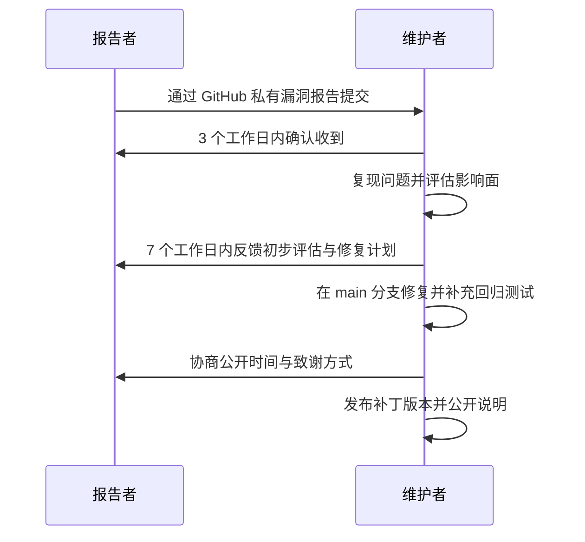

# 安全政策

SubForge 是一个订阅转换与分流规则服务：它接收订阅地址并抓取上游内容、把节点转换为多种客户端格式，并在启用订阅管理后持久化机场、分组、节点与访问令牌。因此本项目的安全边界涉及访问令牌、订阅地址、节点数据与本地数据目录。

本文档说明受支持的版本范围、漏洞报告的私有渠道、维护者的响应方式，以及部署 SubForge 时必须落实的安全配置。

## 1. 支持范围

| 版本 | 是否接受安全修复 | 说明 |
| --- | --- | --- |
| `main` 分支 | 是 | 所有修复首先进入 `main` 分支 |
| `v0.1.0` | 是 | 仓库当前唯一标签，修复后按需发布补丁标签 |
| 更早的提交、个人分支与派生分支 | 否 | 请先升级到 `main` 分支或最新标签后复测 |

仓库当前只有一个标签 `v0.1.0`，尚无长期支持版本。项目处于早期开发阶段（`cmd/subforge/main.go:13` 的用法文本标注为“M1 开发中”），命令行参数、HTTP 接口与配置文件结构仍可能变化，安全修复只保证在 `main` 分支与最新标签上提供。

从源码构建时，请记录实际构建的提交号：`subforge version` 输出的版本、提交与构建时间由构建时通过 `-ldflags -X` 注入（`Makefile:3-10`），而不是源码常量。

## 2. 漏洞报告方式

安全漏洞**不得**通过公开 Issue、Pull Request 或讨论区报告，也不要在公开渠道贴出复现细节、请求样本或受影响实例地址。公开披露会在他人在用的部署被修复前暴露攻击方法。

请使用 GitHub 的私有漏洞报告功能提交：

1. 打开仓库 `https://github.com/tktogether/subforge`。
2. 进入 **Security** 标签页。
3. 点击 **Report a vulnerability**，填写报告内容。

该渠道创建的私有安全公告仅对报告者与仓库维护者可见。如果因账号或权限原因无法使用该功能，可以在公开 Issue 中只说明“需要报告安全问题，请提供私下沟通渠道”，不要附带任何技术细节。

报告中建议包含以下内容，信息越完整，定位越快：

| 项目 | 说明 |
| --- | --- |
| 受影响版本 | `subforge version` 的完整输出，或标签名与提交号 |
| 部署方式 | 二进制、Docker、systemd、OpenWrt 等，以及是否置于反向代理之后 |
| 复现步骤 | 最小可复现步骤，包含请求方法、路径与必要请求头 |
| 影响面 | 能否读取或篡改他人数据、是否需要已认证、是否需要公网可达 |
| 概念验证 | 最小可复现输入或脚本；令牌与订阅地址用 `<YOUR_TOKEN>` 占位 |
| 披露情况 | 是否已告知其他方、是否已公开、期望的公开时间 |

请勿在报告中提交真实订阅地址、访问令牌、订阅令牌或数据库文件；如果问题必须依赖某个具体配置，请提供脱敏后的最小片段。

## 3. 响应流程与时限

维护者的目标响应节奏如下：

- 确认收到：**3 个工作日**内。
- 初步评估与修复计划：确认后 **7 个工作日**内。
- 修复发布：随下一个标签发布；影响面较大时提前发布补丁标签。

以上时限是维护者尽力而为的目标，不构成服务等级承诺。项目由志愿者维护，遇到需要上游依赖配合修复的情况，时限会相应顺延，维护者会在私有报告中同步进展。

## 4. 报告范围界定

以下问题属于本项目的处理范围：

- 访问令牌校验绕过、令牌泄露或鉴权中间件的路径豁免缺陷。
- 订阅地址抓取环节的请求伪造、内网地址探测与响应处理缺陷。
- 配置文件、模板、覆盖层与规则集解析中的注入或越权读写。
- 转换产物注入：构造的节点或规则内容在目标客户端中形成非预期配置。
- 本地数据目录、SQLite 数据库文件与缓存目录的越权访问。
- 管理 API 的越权操作，以及 pprof 等调试端点在非预期条件下可达。

以下问题不属于本项目源码缺陷，但仍欢迎通过公开 Issue 反馈：

- 部署方式不当造成的暴露，例如未设置访问令牌、把服务直接绑到所有网卡、缺少 HTTPS 或把管理 API 暴露到公网。
- 上游订阅提供方、第三方客户端与代理软件自身的安全问题。
- 仅影响已停止支持的旧提交或派生分支的问题。
- 拒绝服务类压测结果，以及需要物理接触或已完全控制宿主机的场景。
- 第三方依赖的已知漏洞：请同时向对应上游项目报告，并在本仓库开 Issue 提示升级。

**请勿测试他人部署的 SubForge 实例。** 验证漏洞请使用自己搭建的实例，并避免影响任何第三方服务。

## 5. 部署安全建议

### 5.1 必须开启访问令牌

`serve` 的 `-token` 默认为空，空值表示不鉴权（`cmd/subforge/serve.go:101`）。除纯本机自用外，部署时必须设置一个随机且足够长的令牌。

需要特别注意：监听所有网卡且未设置令牌时，当前实现只在启动时打印一行警告，**不会阻止启动**（`cmd/subforge/serve.go:121-125`）。`deploy/subforge.service:11` 的注释称该组合会拒绝启动，与当前源码不一致，因此不要把启动拦截当作安全防护，必须显式配置令牌。

令牌校验支持三种提交方式，优先级为 `Authorization: Bearer` 高于 `X-Token` 高于查询参数 `token`（`internal/api/middleware.go:79`、`internal/api/middleware.go:98-107`）；校验失败返回 `401` 并附带 `WWW-Authenticate: Bearer realm="subforge"`（`internal/api/middleware.go:92`）。查询参数方式会把令牌写入访问日志与浏览器历史，仅在客户端不支持请求头时使用。

### 5.2 认清 `/subscribe` 的鉴权差异

全局鉴权中间件对 `/subscribe` 做精确路径豁免（`internal/api/server.go:127`、`internal/api/server.go:291-303`），因为该端点使用订阅令牌而不是服务端访问令牌。这意味着订阅地址本身就是凭据：拿到订阅地址的任何人都能获取节点配置。请像保管密码一样保管订阅地址，不要在公开渠道分享、截图或提交进仓库。

### 5.3 不要把调试与管理接口暴露到公网

- `/debug/pprof/*` 仅在请求带 `?debug=1` 或进程环境变量 `SUBFORGE_DEBUG=1` 时才响应，其他情况返回 `404`（`internal/api/pprof.go:3-4`、`internal/api/pprof.go:16-26`、`internal/api/pprof.go:30-33`）。生产环境不要设置该环境变量。
- 即使处于调试模式，pprof 与管理 API 仍受全局令牌保护，但不应作为唯一防线：请通过反向代理限制来源，不要直接暴露 `/api/*` 与 `/debug/pprof/*`。
- 默认监听地址为 `127.0.0.1:25500`，只在本机可达（`cmd/subforge/serve.go:100`）。需要远程访问时，建议保持本机监听并由反向代理提供 HTTPS；`deploy/subforge.service:30-35` 的单元文件即按此方式配置。

### 5.4 限制数据目录权限

只有在指定 `-data-dir` 时才启用订阅管理，SQLite 数据库位于 `<data-dir>/subforge.db`（`cmd/subforge/serve.go:103`、`cmd/subforge/serve.go:158-159`）；不指定时不会创建该数据库。该目录包含机场、分组、节点与令牌数据，应当：

- 使用专用低权限用户运行服务，不要以 root 运行；`deploy/subforge.service:28-29` 使用 `subforge` 用户与用户组。
- 目录权限限制为服务用户可读写，例如 `StateDirectoryMode=0750`（`deploy/subforge.service:56-57`）。
- 备份数据库文件时按敏感数据处理，不要上传到公开位置。
- 参考单元文件中的加固项，例如 `NoNewPrivileges=true`、`ProtectSystem=full`、`PrivateTmp=true`（`deploy/subforge.service:42-57`）。

### 5.5 保护订阅地址与令牌

上游订阅地址通常内嵌访问令牌，泄露等同于泄露节点。请遵守以下约定：

- 不把真实订阅地址、访问令牌、订阅令牌或 UUID 提交进仓库、Issue、截图与日志。
- 文档与示例统一使用 `example.com`、`<YOUR_TOKEN>`、`<UUID>` 占位（`docs/style-guide.md:131-133`）。
- 分享复现步骤前先确认其中不含真实凭据；日志中的请求行可能包含查询参数形式的令牌。

### 5.6 保持依赖更新

Go 依赖已 vendored 入库以保证离线构建（`Makefile:12`），前端依赖由 `web/package.json` 声明并通过 `pnpm` 安装。升级依赖时请同步更新 `go.mod`、`go.sum` 与 `vendor/`，并执行 `make verify` 确认构建、测试与覆盖率门禁全部通过。

## 6. 公开披露与善意研究

维护者遵循协调披露原则：修复版本发布后，与报告者协商公开时间与公开范围，默认在发布说明中致谢；未经报告者同意不公开其身份信息。

对于遵循本政策、仅在自建实例上验证、不访问他人数据、不干扰他人服务的善意安全研究，维护者不会主动追究。本政策不构成法律豁免，也不授权对任何第三方部署实例的测试。

如果你不确定某项测试是否越界，请先通过第 2 节的私有渠道说明计划，再开始测试。
