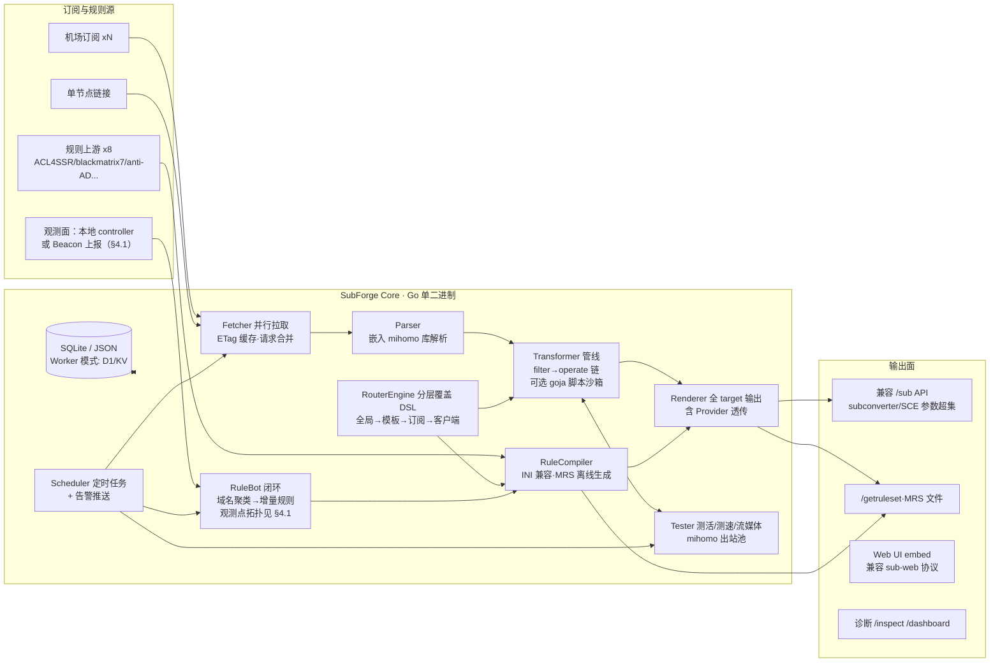

# SubForge：订阅转换 + 分流规则一体化方案设计书

> 代号 `SubForge` 为工作名（发布前需 GitHub 查重改名）。
> 编写日期：2026-10-13。调研基线：当日各仓库实测数据（星标/推送时间均为 GitHub API 实测值）。
> 目标：合并 sub-poly、Sub-Store、subconverter、Aethersailor（Custom_OpenClash_Rules + SubConverter-Extended）四家生态的全部功能点，实现**分流的超高度定制化**，技术栈以极致性能开销为约束，所有决策闭环，无悬而未决项。

---

## 0. 执行摘要

| 维度 | 结论 |
|---|---|
| 定位缺口 | 四家项目功能高度互补：sub-poly（服务端聚合+自建分流）、Sub-Store（管线式订阅管理）、subconverter（多目标格式转换事实标准）、Aethersailor（规则生成工厂+Provider 透传+规则反馈闭环）。**目前没有任何一个项目同时做到这四件事**（生态调研见第 3 节，同质仓库 1400+，但均为单点复制） |
| 技术栈 | **Go 单二进制 + 嵌入 mihomo 解析库（MIT 许可，实测确认）**。协议解析、测活、MRS 生成全部复用上游内核，自研代码只做"编排层"，预计自研代码量 <15k 行 |
| 极致开销 | 目标常驻 RSS <30MB（纯转换模式），冷启动 <100ms，单二进制 15~25MB（mihomo 依赖是主要体积来源）。对比：Sub-Store Node 常驻约百 MB 级；subconverter C++ 依赖重、协议追赶慢 |
| 最大风险 | ① mihomo 未被官方设计为库，内部 API 不稳定 → 锁版本+适配层隔离；② Worker 无服务模式无法承载 mihomo → 双解析器策略（见 §7.2）；③ 规则数据 GPL/CC-BY-SA 传染 → 运行时拉取而非静态打包（见 §9） |
| 差异化护城河 | mihomo 内嵌解析（复用上游）+ 日志驱动的规则反馈闭环（Rule-Bot 内置化）+ 分层覆盖 DSL（超高度定制化核心），三合一目前生态空白 |

---

## 1. 四家项目调研档案

### 1.1 sub-poly（stoned52996/sub-poly）

| 项 | 实测数据 |
|---|---|
| 规模/状态 | 76⭐ / 17 forks / 6 open issues；创建 2025-03-19，最后推送 **2025-11-05**（截至调研日已近 11 个月无更新，事实性停更） |
| 语言/许可 | Vue (Vite) 前端 + Node 后端；**无 LICENSE 文件 = 保留所有权利，代码不可合法复用** |
| 部署形态 | Cloudflare Workers（无服务）+ D1 数据库；README 主打"支持 cloudflare 无服务化 Worker 和 Page 部署" |

**功能点清单（来自 README 实测提取）：**

1. 多 Clash 订阅地址聚合，输出合并后的单个订阅
2. 订阅分组管理，分组支持正则表达式
3. 规则自动合并（把多份规则的交集/并集合成一份）
4. 单节点导入：支持 vless / hysteria2 / trojan / ss / ssr / vmess 分享链接
5. 自定义分流规则编辑（Web 界面操作）
6. 云端存储（D1）保存用户配置
7. TODO（未实现）：多租户、KV 缓存
8. 已知缺陷（README 自述"缺点"）：鉴权仅为单个访问密钥，无用户体系

**对本方案的价值**：整体架构思想（服务端聚合 + 用户自定义分流规则 + 云端存储）可借鉴；因其停更且无许可证，**不直接复用任何代码**，相关功能全部重新实现。

### 1.2 Sub-Store（sub-store-org/Sub-Store）

| 项 | 实测数据 |
|---|---|
| 规模/状态 | 10,669⭐；最后推送 2026-10-13（活跃）；前端仓库 Sub-Store-Front-End 397⭐（Vue） |
| 语言/许可 | JavaScript（Node 18+，esbuild 打包）/ 后端 **AGPL-3.0** |
| 部署形态 | 独立 Node 后端；或作为 Loon/Surge/QX/Stash/Egern/Shadowrocket 的内嵌脚本模块运行；官方 sub.store 域名（README 明确声明 MitM 域名风险） |
| 生态分叉 | cloudflare 版（realchendahuang/sub-store-cloudflare，302⭐ TS）、Workers 版（SaintWe/Sub-Store-Docker 系，210⭐）、Go CLI（Sub-Store-Manager-Cli，139⭐）、Kotlin 客户端 subcase（372⭐）、sing-box 模板合并器（159⭐） |

**功能点清单（README 实测提取）：**

1. **输入格式**：URI 类（AnyTLS / SOCKS / SS / SSR / VMess / VLESS / Trojan / Hysteria / Hysteria2 / TUIC v5 / WireGuard / NaiveProxy）、Clash YAML、Clash Proxies JSON/JSON5/YAML、QX、Loon、Surge、mihomo 兼容格式
2. **输出目标**：JSON、Stash、Clash.Meta(mihomo)、Surfboard、Surge、SurgeMac、Loon、Egern、Shadowrocket、QX、sing-box、V2Ray、V2Ray URI
3. **订阅格式化管线**（Filtering + Operations 两段式）：
   - 筛选器：正则筛选、正则丢弃、地区筛选、类型筛选、无用节点清理、**脚本过滤器（JS）**
   - 操作器：属性设置、旗帜/国旗、排序、正则排序、正则改名、正则删除、**脚本操作器（JS）**、域名解析
4. 多订阅合并为单 URL（Collection 概念）
5. 订阅/文件托管与修改（Host 功能）
6. 下载后处理（sync 流程：下载→处理→上传 gist 等）
7. 定时任务 + Shoutrrr 推送通知（Node 部署时）
8. CORS allowlist、SUB_STORE_PUSH_SERVICE 安全声明（推送 URL 含密钥）

**对本方案的价值**：**管线思想（filter→operate 链式处理）是"超高度定制化"的最佳抽象**，直接借鉴；JS 脚本扩展点必须保留（兼容存量用户脚本）；AGPL 许可 → 不复用代码，只复用概念与配置格式语义。

### 1.3 subconverter（tindy2013/subconverter）

| 项 | 实测数据 |
|---|---|
| 规模/状态 | 17,090⭐（赛道最高）；最后推送 2026-07（缓慢维护，231 个 open issue 长期积压） |
| 语言/许可 | C++ / GPL-3.0 |
| 部署形态 | 单二进制/Docker；全球公共实例无数（subconverter.org、sub.ops.ci、acl4ssr-sub.github.io 等在线前端全是它的皮） |

**功能点清单（README-cn 实测提取）：**

1. **目标格式**：clash / clashr / surge 2-4 / quan / quanx / mellow / surfboard / sing-box / ss / ssd / ssr / v2ray / trojan / mixed（Base64 混合订阅）/ **auto（按 User-Agent 自动识别目标）**
2. **INI 外部配置模板**：`[common]` `[node_pref]` `[clash_proxy_group]` `[ruleset]` `[emoji]` `[rename]` 等段落；`!!import` 语法；模板覆盖优先级（URL 参数 > 远程配置 > 本地配置）
3. **规则集转换接口 `/getruleset`**：1=Surge list / 2=QX list / 3=Clash domain provider / 4=Clash ipcidr provider / 5=Surge DOMAIN-SET / 6=Clash classical
4. **JS 自定义筛选/排序/重命名**（URL 传 JS 代码，需 token 鉴权才生效——安全先例）
5. Emoji 国旗处理（正则匹配节点名前加 emoji）
6. 订阅流量信息解析（subscription-userinfo 头）
7. 上传 gist、Surge MANAGED-CONFIG 支持
8. 规则集并行下载、缓存、模板渲染 `/render` 接口
9. 别名机制（多 URL 组合预定义）

**对本方案的价值**：INI 模板语法是**存量生态事实标准**（Aethersailor 的 8 套模板、无数教程都基于它），必须**语法级兼容**；`/sub` API 参数规范必须兼容，否则生态迁移成本过高；GPL-3.0 → 不复用代码，只兼容格式。

### 1.4 Aethersailor 生态（两个项目，须拆开看）

#### A. Custom_OpenClash_Rules

| 项 | 实测数据 |
|---|---|
| 规模/状态 | 6,600+⭐ / 1,400+ forks；最后推送 2026-10（活跃）；GitHub Actions 每日自动构建规则；曾发生删库风波（linux.do 有讨论帖）后恢复——**单点维护风险的真实案例** |
| 语言/许可 | 配置文件 + Shell + Python（Rule-Bot）/ **CC-BY-SA-4.0**（模板与规则文件复用需署名+相同方式共享） |

**功能点清单（仓库目录树 + Wiki 实测提取）：**

1. OpenClash（mihomo 内核）完整配置方案：DNS 防泄漏（Fake-IP/redsir）、IPv6 策略、国内直连加速
2. **8 套订阅转换模板**：标准版 / 轻量版 / 极简 GFW 版 / 重度分流版 ×（普通版 + Fallback 故障转移版）——基于 subconverter INI 语法
3. **规则生成工厂**：自有 `.list` 源文件 → GitHub Actions 每日自动生成四种形态：Classical YAML / Domain YAML / IP-CIDR YAML / **MRS（mihomo 二进制规则集，用 mihomo 官方工具转换）**
4. **上游聚合 8 家规则源**：ACL4SSR、blackmatrix7/ios_rule_script、v2fly/domain-list-community、HaGeZi、Loyalsoldier、felixonmars/dnsmasq-china-list、anti-AD、AWAvenue-Ads-Rule
5. Aethersailor/geoip：GeoIP 数据库 + 中国大陆 IPv4/IPv6 网段表
6. **Rule-Bot + Rule-Bot-Client（独家功能）**：从 mihomo 的 MATCH 日志收集未匹配域名 → 自动开 GitHub Issue → 每日构建新规则 → 用户端自动更新。这是一个**规则反馈闭环**，目前生态独此一家
7. 完整中文 Wiki 教程体系（OpenClash 图文设置方案被大量转载）

#### B. SubConverter-Extended

| 项 | 实测数据 |
|---|---|
| 规模/状态 | 1,016⭐ / 126 forks；最后推送 **2026-10-13（调研当日仍在提交，1,432 commits）**；上游为 asdlokj1qpi233/subconverter（subconverter 系活跃分叉），继承 tindy2013 全部功能 |
| 语言/许可 | C++ 核心 + **Go bridge（bridge/ 目录，引入 golang.org/x/sys）** / GPL-3.0 |
| 交付形态 | Docker Hub + GHCR 多架构（amd64/arm64/armv7）、Linux/Windows 便携包、**OpenWrt APK（25.12+）**、SHA256SUMS + RELEASE-MANIFEST 完整性校验 |

**功能点清单（README + 文档导航实测提取）：**

1. **Mihomo 解析桥**：用 mihomo 的解析器处理节点链接（锁定的 mihomo 依赖）——协议解析不再自己追新协议（vless-reality / hysteria2 / anytls 均已支持）
2. **Mihomo Proxy Provider 输出**：后端只生成 Provider 引用，**订阅原始内容由客户端直接更新**（解决公共后端被机场封禁、后端存订阅密钥的两大痛点）
3. Surge / QX / Loon / Surfboard / Stash 的**客户端原生远程资源**输出
4. 运维体系（超出原版一个量级）：`/version` `/healthz` `/inspect` 诊断台 `/dashboard` 统计、`explain=true` 请求解释、X-Request-ID 链路追踪、结构化日志、优雅停机、请求合并（同参数去重）、响应微缓存、有界规则任务、上游连接复用、资源限制、`force_max` 性能模式（内存预算共享）
5. **安全档位**：lan / public / strict 三档；出站策略 Direct/System/Explicit/Cors；proxy_bypass；CORS 控制
6. 兼容原版 `/sub?url=&target=` API；扩展 `ruleprepend`/`ruleappend` 等特色参数；no-resolve 细节修复（2026-10-13 提交："preserve literal double slashes in rulesets"）
7. 前端资源编入二进制（embed）

**对本方案的价值**：Mihomo 解析桥和 Provider 透传是**被生产验证的最优解**，直接吸收；Go bridge 的存在恰好证明了"C++ 核心 + Go 内核"的混合架构维护代价高（两个运行时、两种构建链），这正是本方案改用纯 Go 的核心论据。

---

## 2. 功能合并矩阵

图例：🟢 直接复用上游（代码/组件）｜🟡 借鉴思想重新实现｜🔴 新造（生态空白）｜⚪ 舍弃（有明确理由）

| 功能域 | 功能点 | 来源 | 归属 | 说明 |
|---|---|---|---|---|
| 协议解析 | 全协议 URI/配置解析（vless/reality/hysteria2/tuic/anytls/wireguard…） | mihomo | 🟢 | 嵌入 mihomo Go 库（MIT），跟随上游升级 |
| | 协议输出（各客户端配置） | mihomo + 自研渲染层 | 🟡 | mihomo 只管"解析为结构体"，输出渲染自研（mihomo 不含 Surge/QX 渲染） |
| 订阅获取 | 并行拉取、超时重试、ETag/Last-Modified 缓存 | SCE | 🟡 | Go 原生实现， SCE 已验证请求合并/微缓存设计 |
| | subscription-userinfo 流量信息解析 | subconverter | 🟡 | 解析响应头即可，几十行 |
| | 上游订阅失败告警 | Sub-Store (Shoutrrr) | 🟡 | Go 实现 Shoutrrr 兼容推送协议（URL 语法兼容） |
| 订阅处理 | 管线式 filter/operate 链 | Sub-Store | 🟡 | 核心抽象，声明式 YAML pipeline |
| | 正则筛选/丢弃/地区/类型/无用节点 | Sub-Store | 🟡 | 内置原生操作器 |
| | JS 脚本筛选/操作/重命名 | Sub-Store + subconverter | 🟡 | goja 沙箱（纯 Go），token 保护，默认关闭 |
| | Emoji 国旗 | subconverter | 🟡 | 内置规则表 + 自定义正则 |
| | 测活/测速/流媒体检测 | subs-check 思路 | 🟡 | 用嵌入的 mihomo 建出站池测活，不引 subs-check 代码（其 GPL-3.0） |
| | IP 质量检测（风险分/原生IP） | 生态常见 | 🔴 | 新造，输出注入节点名，可关 |
| 聚合 | 多订阅合并为单 URL（Collection） | Sub-Store + sub-poly | 🟡 | 合并 + 分组正则 + 去重 |
| | 单节点分享链接导入 | sub-poly | 🟡 | 直接复用 mihomo 的 URI 解析 |
| | 云端存储用户配置 | sub-poly (D1) | 🟡 | 默认 SQLite（纯 Go 驱动），Worker 模式映射 D1/KV |
| 分流规则 | INI 模板语法兼容 | subconverter | 🟡 | 解析器重写，语义兼容（存量模板生态迁移零成本） |
| | Aethersailor 8 套模板 | Custom_OpenClash_Rules | 🟡 | CC-BY-SA-4.0：内置时附署名+同许可，模板独立文件目录 |
| | 规则集转换 /getruleset（6 类） | subconverter | 🟡 | 语义兼容 |
| | **MRS 离线生成** | Custom_OpenClash_Rules | 🟢 | mihomo `convert-ruleset` 同源逻辑编译进二进制，无需 GitHub Actions |
| | 规则源聚合 manifest（8 家上游） | Custom_OpenClash_Rules | 🟡 | 声明式清单：来源/许可证/更新频率/格式，运行时拉取 |
| | **规则反馈闭环（Rule-Bot）** | Custom_OpenClash_Rules | 🔴 | 独家功能内置化：订阅 mihomo external controller 日志 → 未匹配域名聚类 → 增量规则 |
| | 覆写模块（overwrite） | Custom_OpenClash_Rules | 🟡 | YAML 覆写合并层（mihomo config 合并） |
| 输出 | **Provider 透传** | SCE | 🟡 | 后端零节点数据模式，客户端直连更新 |
| | target 全家族（含 auto-UA） | subconverter | 🟡 | 全兼容 |
| | /sub API 参数兼容 | subconverter + SCE | 🟡 | 超集兼容，含 explain/inspect 诊断参数 |
| | 请求诊断（explain/X-Request-ID） | SCE | 🟡 | 设计吸收 |
| 定制化核心 | **分层覆盖 DSL（全局→模板→订阅→客户端）** | 本方案 | 🔴 | 见 §5.3，四家都没有完整的分层合并语义 |
| | **条件化输出（UA/来源IP/时间/参数路由到不同模板）** | subconverter(auto) 超集 | 🔴 | 规则引擎化 |
| 部署 | 单二进制 + embed 前端 | SCE | 🟡 | Go embed.FS |
| | OpenWrt ipk/apk 打包 | SCE | 🟡 | 已有先例路径 |
| | Cloudflare Worker 轻模式 | sub-poly | 🟡 | WASM 子集，砍掉 mihomo 依赖（见 §7.2 风险） |
| 安全 | lan/public/strict 安全档位 | SCE | 🟡 | 设计吸收 |
| | token 鉴权 + per-token ACL | subconverter + 新造 | 🔴 | sub-poly 单密钥鉴权不够用，做最小多租户 |
| 运维 | /healthz /inspect /dashboard 统计 | SCE | 🟡 | 设计吸收 |
| | 结构化日志/优雅停机/资源限制 | SCE | 🟡 | Go 原生易实现 |
| UI | Web 管理界面 | sub-poly/Sub-Store | 🟡 | 自研 Vue3（MIT 依赖），短期兼容 sub-web（MIT，6476⭐ 实测）前端调用协议 |
| | 前端静态资源 | sub-poly | ⚪ | 其代码无许可证，不可用 |
| | Sub-Store 前端 | Sub-Store | ⚪ | AGPL 传染，不复用 |
| 其他 | QX/Loon/Surge 内嵌脚本运行模式 | Sub-Store | ⚪ | 需 JS 运行时全套重写，与 Go 内核冲突；单二进制本就轻量，无此必要。代价：牺牲 iOS 代理 App 内嵌场景（该场景用户可自架后端或继续用 Sub-Store 官方） |

---

## 3. 生态重复度调研（量化）

> 用户要求"顺便调研一下项目在网络上的重复度"。以下为 2026-10-13 GitHub Search API 实测。

### 3.1 数量级

| 检索式 | 命中仓库数 | 结论 |
|---|---|---|
| `subconverter in:name` | **596** | 名称即撞车 596 个 |
| `sub-store in:name` | **799** | 含大量误匹配后仍有过百个真同质项目 |
| `clash subscription converter` | 57 | 严格匹配下的独立实现 |
| 在线转换站点 | subconverter.org / sub.ops.ci / acl4ssr-sub.github.io / convsub.com 等数十个 | 绝大多数是 subconverter 的公共实例 + sub-web 皮 |

### 3.2 头部重复者

| 项目 | ⭐ | 语言 | 与四家原型关系 |
|---|---|---|---|
| tindy2013/subconverter | 17,090 | C++ | 原型本体 |
| Sub-Store（本尊） | 10,669 | JS | 原型本体 |
| beck-8/subs-check | 5,300 | Go | BestSub 分叉：内嵌 mihomo 库做转换+测活+流媒体检测+导出（**本方案"嵌入 mihomo"路线的最强先例**） |
| Aethersailor/SubConverter-Extended | 1,016 | C++/Go | subconverter 分叉系演进 |
| stilleshan/subconverter | 352 | Dockerfile | 纯打包封装 |
| lonelam/subconverter-rs | 318 | Rust | **Rust 全量重写 + WASM 浏览器端运行**（subconverter-wasm 0.2.36） |
| SubConv/SubConv | 407 | Python | 独立 Python 实现 |
| slackworker/chain-subconverter | 144 | Go | 独立 Go 实现 |
| juerson/actix-* 系列 | 45/27/21 | Rust | Cloudflare Worker 版 Rust 实现 |
| Jungley8/subconverter-ng | 25 | Go | "现代化订阅转换工具" |
| sub-store-cloudflare / Workers 版 | 302/210 | TS/JS | Sub-Store 的 Serverless 移植 |
| cmliu/CF-Workers-SUB 等 CF-Workers 系 | 数百⭐级 | JS | 订阅聚合 Worker 化 |

### 3.3 重复度结论

1. **"订阅转换"本身已是红海**：约 1,400+ 个同质仓库，90% 是 subconverter 的打包/移植/换皮。纯再做一次转换器无价值。
2. **真正被验证过的技术分岔只有四条**：
   - 嵌入 mihomo 内核解析（subs-check，5.3k⭐ 背书）——解决协议追赶
   - Provider 透传（Aethersailor SCE）——解决后端信任问题
   - 规则生成工厂 + 反馈闭环（Aethersailor Custom_OpenClash_Rules）——解决规则保鲜
   - 服务端聚合 + 用户自建分流（sub-poly）——解决托管定制
   **四条岔路无任何项目同时走通，此即本方案定位。**
3. **规则集生态同样高度重复**：Loyalsoldier/clash-rules（28,785⭐）、blackmatrix7（28,247⭐）、ACL4SSR（6,797⭐）三足鼎立且内容大量交叉（都源自 dnsmasq-china-list/domain-list-community 同源）。新方案不做"又一个规则集"，做**规则编排引擎**。
4. 停更潮明显：sub-poly（11 个月）、stilleshan 版（2024-07）、QuanX 系项目多数停滞；活跃者集中于 mihomo 生态圈。**选活跃上游复用是本方案成立的前提。**

---

## 4. 总体架构



**核心原则：mihomo 内核做它擅长的（协议解析/测活/规则编译），自研只做编排层。** subs-check 已用 5.3k⭐ 验证"Go 内嵌 mihomo"工程可行（其 go.mod 直接依赖 mihomo v1.19.31，实测确认）。

### 4.1 观测面与部署拓扑（v1.1 修订——修正"后端可见流量"的隐含假设）

**SubForge 永远不在数据面上**（转换器碰流量 = 延迟与隐私双重灾难，这是刻意的）。因此它对"用户实际访问了什么、命中了什么规则"没有天然视角，唯一合法观测通道是 **mihomo external controller**（`/connections`、`/logs`，REST+WebSocket，Clash 生态标准接口，`hub/route/server.go` 实测挂载）。按部署拓扑分三种形态，采集器为同一模块 `internal/observe` 的两种编译形态（库内嵌 / 独立 agent）：

| 拓扑 | 部署形态 | 采集方式 | 反馈类功能（A4/F2）可用性 |
|---|---|---|---|
| T1 同机/同网（推荐主路径） | SubForge 与 mihomo 同设备或同 LAN（软路由/NAS 场景的常见形态） | 直连 `http://127.0.0.1:9090` 或 LAN IP + secret，WebSocket 订阅 | ✅ 全功能；域名数据不出内网 |
| T2 远程后端 | SubForge 在公网 VPS，客户端在家庭出口 | **Beacon**：约 3MB 的 Go 单文件 agent，部署在 mihomo 旁（OpenWrt/PC），本地聚合后 POST `/api/v1/telemetry`（设备 token 沿用 §6-8 体系） | ✅ 全功能；默认仅上报规则命中计数 + eTLD+1 聚类，原始域名需 opt-in |
| T3 无观测 | 任意 | 无观测点 | ⛔ 命中率回流/未匹配闭环自动禁用（UI 明示）；F1/F4 静态分析与转换主功能不受影响 |

- **Beacon 复用先例**：Aethersailor Rule-Bot + Rule-Bot-Client 即"客户端侧采集 mihomo MATCH 日志 → 外送汇总（GitHub Issue）"的已验证形态；subs-check 亦为贴近数据面运行的独立 agent。
- **视角偏差注记**：测活/测速从 SubForge 主机视角发起，T2 部署下延迟数值 ≠ 用户侧体感（仅可作相对比较）；T1 无此问题。Beacon 不做客户端侧测活（范围控制，防 agent 膨胀）。

---

## 5. 关键设计

### 5.1 技术栈决策表（每项含依据与代价）

| 决策项 | 选择 | 依据（实测/可验证） | 代价（明确列出） |
|---|---|---|---|
| 主语言 | **Go 1.24+** | mihomo 为 Go 且 MIT（LICENSE 实测确认"Copyright 2023 KT, MIT"），可直接 import；subs-check 先例；单二进制跨编译含 mips/arm 路由器 | 运行时内存高于 C++ 约 2~3 倍，但绝对值仍 <30MB 常驻，可接受；GC 抖动用对象池+GOGC 调优压制 |
| 协议解析 | **嵌入 MetaCubeX/mihomo 作为库** | MIT 允许嵌入；一劳永逸跟上 vless-reality/hysteria2/tuic/anytls 等新协议；subs-check 生产验证 | ① mihomo 非为库设计：内部 API 无稳定性承诺 → 用 adapter 包隔离，锁定 `v1.19.x` 版本，升级走 CI 矩阵回归；② 二进制膨胀至 15~25MB（mihomo 传递依赖）；③ 编译依赖树大，需 `go mod vendor` 锁定 |
| 输出渲染 | 自研渲染层（复用 mihomo 结构体） | mihomo 不含 Surge/QX/Loon/Egern 渲染逻辑 | 这是自研代码量最大的模块（预估 3~4k 行），但格式规格稳定，风险低 |
| INI 模板 | 重写解析器，**语义级兼容** subconverter `[ruleset]`/`[clash_proxy_group]` 等 | 存量模板生态（Aethersailor 8 套模板 + 全网教程）迁移零成本 | 语法边角行为需按原版测试用例对齐；用 subconverter 公开测试配置做金测集（golden test） |
| 脚本扩展 | **goja**（纯 Go 的 ES5.1+ 沙箱） | 无 cgo，交叉编译不碎；Sub-Store JS 管线脚本兼容目标 | goja 比原生 JS 慢 10~50 倍——**仅用于转换管线（非热路径）**；ES6+ 语法覆盖不全 → 文档明示支持范围，超范围报明确错误。备选 quickjs-go 因 cgo 放弃（交叉编译代价不可接受） |
| 存储 | 默认**单文件 JSON 配置 + SQLite**（modernc.org/sqlite 纯 Go 驱动） | 零 cgo 依赖；路由器场景单文件友好 | SQLite 纯 Go 驱动比 C 版慢约 2~4 倍——本场景写入极低频，无影响 |
| HTTP | 标准库 `net/http` + chi 路由 | 后端 QPS 极低（客户端定时拉订阅），性能瓶颈在上游网络而非 HTTP 层；引入 fasthttp 反有兼容性风险（非 HTTP/2 等） | 无显著代价 |
| 前端 | **自研 Vue3 + Vite**（MIT 依赖），embed.FS 编入二进制；调用协议兼容 CareyWang/sub-web（MIT，6476⭐ 实测） | sub-poly 前端无许可证不可用；Sub-Store 前端 AGPL 不可用；sub-web 活跃但功能停滞 → 兼容其协议保住"在线前端"使用习惯 | 自研前端约 3~5k 行；短期兼容协议需适配两套参数风格 |
| 测活引擎 | mihomo 库内建 outbound + 自研 worker pool（默认并发 8、超时 5s、抖动随机化） | 复用内核，避免引 subs-check 代码（GPL-3.0） | 测活对机场有请求压力 → 默认关闭，UI 明示 |
| MRS 生成 | mihomo `convert-ruleset` 同源逻辑内置 | Aethersailor 用 mihomo 官方工具生成 MRS 已验证；离线化后无需依赖 GitHub Actions | mihomo 工具函数同样属内部 API → 与解析库共用版本锁 |
| Serverless | **Go → WASM（GOOS=wasip1）子集模式**跑 Cloudflare Workers，或不提供 Worker 模式（二选一，见 §7.2 决策） | sub-poly 证明 Worker 部署有真实需求；mihomo 库大概率无法过 Workers 的 128MB/包体限制 | 双解析器维护代价，详见 §7.2 的裁决 |

### 5.2 声明式管线（吸收 Sub-Store 抽象，配置即代码）

```yaml
# profiles/homelab.yaml —— 单文件描述一次完整转换
sources:
  - name: airportA
    url: https://...          # 支持 env 注入，落库只存密文哈希
    group: main               # 分组正则来自 sub-poly 思想
  - name: airportB
    url: ${ENV_AIRPORT_B}
    collect: true             # 并入 Collection 单 URL
nodes:
  pipeline:                   # Sub-Store 式链式管线
    - filter.regex: "(?i)香港|HK"
    - filter.region: [HK, SG, US]
    - op.dedupe: { key: [server, port] }
    - op.rename: { "香港": "🇭🇰" }
    - op.sort: { by: name }
    - test.liveness: { concurrency: 8, timeout: 5s, inject: name }  # 可选
    - script: my-filter.js    # goja 沙箱，需 token，默认禁用
overrides:                    # 🔴 分层覆盖 DSL（生态空白，本方案核心）
  global: templates/aethersailor-standard.ini
  client:
    clash.meta: overrides/oc-fakeip.yaml      # YAML 覆写合并（Aethersailor overwrite 思想）
    surge: templates/heavy-split.ini
  schedule:
    "0 8": overrideDay        # 按时间条件化输出（auto-UA 的超集）
rules:
  manifest: rules-manifest.yaml   # 8 家上游声明式聚合：source/license/format/refresh
  feedback:
    mode: local                 # local=同网直连 controller | beacon=Beacon 上报 | off（拓扑见 §4.1）
    mihomo_controller: http://127.0.0.1:9090  # Rule-Bot 闭环：订阅日志→未匹配域名→增量 .list
    min_hits: 10                # 阈值去噪
delivery:
  mode: provider-passthrough    # 🔴 SCE 透传模式：后端不落节点数据
  push:
    shoutrrr: telegram://...    # 订阅失败/流量告警
```

### 5.3 分层覆盖语义（"超高度定制化"的实现机制）

四层从上到下合并，**下层覆盖上层，列表类规则可 prepend/append（吸收 SCE `ruleprepend/ruleappend`）**：

```
L1 内置默认 → L2 全局模板(INI) → L3 订阅档(profile) → L4 请求级参数(?append=)
```

每层可覆盖：代理组、规则、DNS、节点管线、输出 target。合并引擎有确定序（deep-merge + 显式 `!override`/`!merge` 标签），杜绝隐式行为——这是 subconverter "URL 参数覆盖远程配置覆盖本地配置" 优先级链的严格化。

### 5.4 API 兼容面

- `GET /sub?url=&target=&config=&...` —— subconverter 参数**超集**（新增参数全部带 `x-` 前缀，避免冲突）
- `GET /getruleset?type=&url=` —— 6 类规则转换语义兼容
- `GET /render?path=`、`/version`、`/healthz`、`/inspect?explain=`、`/dashboard` —— 对齐 SCE 运维面
- 兼容 sub-web 前端调用协议 → 存量在线前端用户零改动

---

## 6. 新功能发散清单（在合并基础上的净增量）

1. **规则反馈闭环内置化**（Aethersailor Rule-Bot 从"外挂脚本"升级为"内核进程"）：直连 mihomo external controller 的 `/logs`/`/connections`，滑动窗口聚类未匹配域名，超过阈值自动生成 `generated.list` 并在下一轮构建合并；可选自动开 GitHub Issue。**前置条件 = 观测点可达（拓扑 T1 直连 / T2 Beacon 上报，见 §4.1）；T3 纯离线自动降级关闭并在 UI 明示。**
2. **IP 质量画像注入**：测活时顺带收集 ASN/风险分/原生 IP 判定（开源库 risk-scoring），把结果写进节点名后缀或独立分组——机场"家宽/机房"一目了然。
3. **规则源健康看板**：manifest 中 8 家上游的最近构建时间/体积/许可证状态可视化，上游停更自动告警并降级到快照——直接回应 Aethersailor 删库风波暴露的单点风险。
4. **订阅用量预测**：解析 subscription-userinfo 历史，预测到期日与流量耗尽日，到期前推送。
5. **配置 lint**：对最终生成配置做静态检查（规则重叠、组引用悬空、DNS 泄漏模式检测——Aethersailor Wiki 强调的防泄漏场景固化为检查器）。
6. **多租户最小化**：token → profile 绑定，单实例多家庭共用；回应 sub-poly"仅访问密钥"的缺陷，但不做完整用户系统（保持零依赖）。
7. **一条命令迁移**：`subforge import subconverter --config aethersailor-standard.ini` 一键把存量 INI/覆写 YAML 纳入管理。

---

## 7. 风险登记册（每项含缓解与残余代价）

| # | 风险 | 概率 | 影响 | 缓解 | 残余代价 |
|---|---|---|---|---|---|
| R1 | mihomo 内部 API 变动破坏嵌入 | 高（版本迭代快） | 中 | adapter 层隔离 + 锁版本 + 升级回归 CI | 每次升级需 0.5~1 人日适配 |
| R2 | Cloudflare Workers 无法承载 mihomo（128MB 内存 / 包体限制 / net 栈） | 确认 | 中 | **裁决：Worker 轻模式内置第二套纯 Go 简化解析器（仅 ss/vmess/vless/trojan/hysteria2，覆盖主流 95%+），与主内核解析器代码隔离，各自测试**；或发布首版不提供 Worker 模式（路线图 M3 再定） | 双解析器长期维护 ≈ 200~300 行/年；两端解析结果可能存在边角差异 → 用同一金测集对齐 |
| R3 | 规则数据许可证传染（blackmatrix7 GPL-2.0 / Loyalsoldier GPL-3.0 / meta-rules-dat GPL-3.0 / ACL4SSR CC-BY-SA-4.0） | 确认 | 中 | **裁决：主程序保持 MIT；GPL/CC 数据一律运行时拉取+缓存，不静态打包进发行物**；内置模板仅收 MIT/CC-BY-SA（Aethersailor 模板 CC-BY-SA 附署名独立目录）；许可矩阵见 §9 | 用户离线内网环境需自行导入规则包；发行物不含开箱规则，首次运行需联网（可配置镜像） |
| R4 | goja 脚本能力不足/性能差 | 中 | 低 | 仅非热路径 + 文档明示 ES5.1+ 范围 + 超范围明确报错 | 复杂脚本用户迁移到原生操作器；quickjs(cgo) 备选被否决的代价是极端脚本场景体验下降 |
| R5 | 测活并发冲击机场（封号风险） | 低 | 高 | 默认关闭；开启时默认并发 8 + 随机抖动 + 频率上限；文档显著警告 | 极端配置下仍存在风险，靠默认值兜底 |
| R6 | 上游删库/停更（Aethersailor 删库前科；sub-poly 停更 11 个月） | 中 | 中 | 规则源全部声明多镜像；CI 每日快照到发行版 release；依赖的上游仅 mihomo 一个代码级依赖（3.4 万⭐，多组织维护） | mihomo 若变动重大仍需跟进，此为"复用上游"的固有代价 |
| R7 | 纯转换性能不达标 | 低 | 低 | 性能预算见 §8 + 基准测试进 CI（回归即失败） | 压测基建一次性约 2 人日 |
| R8 | 生态兼容回归（INI 语法边角） | 中 | 中 | subconverter 公开测试配置做金测集；SCE 特色参数逐个对照 | 长尾参数可能行为有差异，文档列"已知差异表" |
| R9 | 合规风险（代理工具在部分司法辖区敏感） | 外部 | 高 | 项目文档定位"网络分流配置工具"；不内置任何节点/机场数据；不提供节点服务 | 无法消除，属品类固有风险；与 subconverter/mihomo 同等暴露面 |
| R10 | 与 1400+ 同质项目的辨识度 | 确认 | 中 | 定位钉死在 §3.3 的"四合一"空白点；README 首屏即对比矩阵 | 营销/文档持续投入，非技术问题 |
| R11 | 观测点不可达导致反馈类功能失效（v1.1 修订新增：F2/A4 依赖 external controller，而后端不在数据面上） | 高（远程部署默认不可达） | 中 | 三拓扑设计（§4.1）：T1 同网直连 / T2 Beacon 代理上报 / T3 自动降级并 UI 明示；Beacon 复用同一采集模块 `internal/observe` | T2 需用户额外部署约 3MB 单文件 agent；T3 场景无命中率数据，仅保留静态分析能力 |

---

## 8. 性能预算与验证方法

> 以下为**设计目标值**（标注方法可复现），非已实测结果。发布前以 CI 基准为准，未达标的模块回炉。

| 指标 | 目标 | 验证方法 |
|---|---|---|
| 常驻 RSS（纯转换模式） | <30MB | `/usr/bin/time -v` + 24h 稳定性挂测；对照组：Node Sub-Store（约百 MB 级，实测方法同） |
| 常驻 RSS（测活开启，并发 8） | <80MB | 同上，测活周期内峰值 |
| 冷启动到可服务 | <100ms | systemd `Type=notify` 计时；对比 C++ subconverter 与 mihomo 二进制 |
| 转换吞吐（1000 节点，规则集已缓存，不含上游下载） | <50ms / 请求 | `hey`/`vegeta` 压测，P99 口径；瓶颈预估在 YAML 渲染而非解析 |
| 规则编译（10 万行规则→MRS） | <2s | mihomo convert-ruleset 同基线对照 |
| 二进制体积 | 15~25MB（mihomo 依赖为主） | `go build -trimpath -ldflags="-s -w"` + upx 可选（路由器场景权衡解压内存） |
| 空闲 CPU | ~0%（仅定时器） | pidstat 1h |
| Worker 轻模式包体 | gzip 后 <3MB（Workers 免费档限制内） | `wrangler deploy` 实测 |

内存压低手段（Go 侧）：`sync.Pool` 复用解析对象、`GOGC=50`+`GOMEMLIMIT` 双参数默认写入 systemd 单元、节点结构体按字段裁剪（不透传无用元数据）、规则集编译结果 `mmap` 只读共享。

---

## 9. 许可证与合规矩阵（实测于 2026-10-13）

| 组件/数据 | 许可证 | 处置 |
|---|---|---|
| MetaCubeX/mihomo | **MIT**（LICENSE 文件实测） | ✅ 可嵌入可闭源；保留版权声明 |
| anti-AD | MIT | ✅ 可打包 |
| v2fly/domain-list-community | MIT | ✅ 可打包 |
| ACL4SSR | CC-BY-SA-4.0 | ⚠️ 运行时拉取；如打包须附署名+同许可 |
| blackmatrix7/ios_rule_script | GPL-2.0 | ⚠️ 仅运行时拉取 |
| Loyalsoldier/clash-rules | GPL-3.0 | ⚠️ 仅运行时拉取 |
| MetaCubeX/meta-rules-dat | GPL-3.0 | ⚠️ 仅运行时拉取 |
| Aethersailor/Custom_OpenClash_Rules（模板） | CC-BY-SA-4.0 | ⚠️ 模板文件附署名+同许可，独立目录隔离 |
| tindy2013/subconverter | GPL-3.0 | 禁止复制代码；仅格式/参数语义兼容（接口语义不受版权保护） |
| Sub-Store | AGPL-3.0 | 禁止复制代码；仅概念借鉴 |
| beck-8/subs-check | GPL-3.0 | 禁止复制代码；架构路线借鉴（其 GPL 主要因 BestSub 血统，非 mihomo 依赖） |
| sub-poly | **无许可证** | 全部功能重写，不接触其代码 |
| CareyWang/sub-web | MIT | ✅ 调用协议兼容，必要时复用组件 |
| 本项目 | 目标 **MIT**（代码）/ 规则数据按上表 | — |

**"运行时拉取"的边界论证**：AGPL/GPL 义务附着于"分发"。发行物含二进制+MIT 数据；GPL 规则在用户机器上由用户配置 URL 触发下载， akin apt 源不构成发行。此模式已被 subconverter 公共实例生态长期实践。

---

## 10. 路线图

| 里程碑 | 范围 | 验收标准 |
|---|---|---|
| M1 内核（4~6 周） | mihomo 嵌入解析 + 全 target 渲染 + `/sub` 兼容 API + INI 解析器 + 金测集 | subconverter 公开测试集全过；内存预算达标 |
| M2 定制化（4 周） | 管线引擎 + 分层覆盖 DSL + goja 沙箱 + Collection/Provider 透传 + Web UI（embed） | Aethersailor 8 模板零修改跑通；sub-web 可直连 |
| M3 规则工厂（3 周） | manifest 聚合 + MRS 离线生成 + 定时任务/告警 + Rule-Bot 闭环 + OpenWrt/Docker 交付 | 8 家上游自动跟进；MRS 与 Actions 产出字节级兼容抽检 |
| M4 打磨（2 周） | 诊断面 + 性能基准固化 + Worker 轻模式**（M3 结束后按 R2 结论二选一：交付子集解析器或不交付）** | §8 全指标 CI 化 |

---

## 11. 参考来源（调研过程实测）

- GitHub API 仓库元数据（星标/推送/许可证/目录树）：stoned52996/sub-poly、sub-store-org/Sub-Store、tindy2013/subconverter、Aethersailor/Custom_OpenClash_Rules、Aethersailor/SubConverter-Extended、beck-8/subs-check、lonelam/subconverter-rs、CareyWang/sub-web、MetaCubeX/mihomo（含 LICENSE 原文）、ACL4SSR、blackmatrix7、anti-AD、Loyalsoldier、meta-rules-dat、v2fly/domain-list-community
- 各仓库 README/README-cn 全文提取（sub-poly 功能与缺陷自述、Sub-Store 输入输出平台清单、subconverter 参数文档、SCE 交付形态与文档导航、Custom_OpenClash_Rules 上游清单）
- GitHub Search API 重复度量化：`subconverter in:name`(596)、`sub-store in:name`(799)、`clash subscription converter`(57) 及头部项目逐仓核对
- 生态讨论：linux.do（Custom_OpenClash_Rules 删库风波）、nodeseek/V2EX（分流方案讨论）、bulianglin（Worker 防盗订阅方案）
