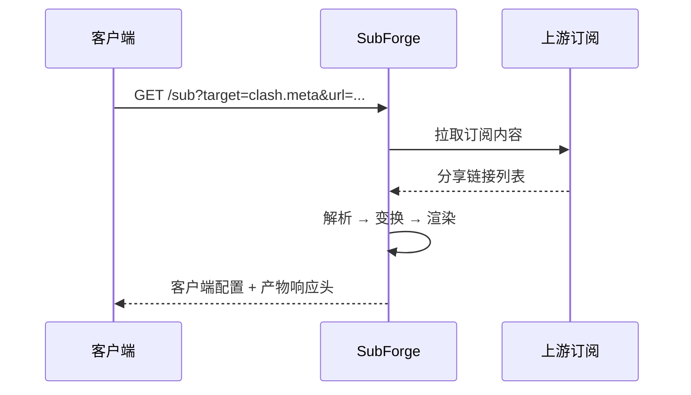

# SubForge 文档写作规范

本文档规定 SubForge 项目全部对外文档（`README.md`、`README_en.md`、`CONTRIBUTING.md`、
`docs/**`、GitHub Wiki）的写作标准。新增或修改文档时，请先阅读本文档。

规范的目的是保证三件事：

1. **一致性**：任何一位维护者写出来的文档，读起来像同一个人写的。
2. **可执行性**：读者照着文档能把事情做成，而不是"看懂了但不知道下一步点哪里"。
3. **可验证性**：文档里的每条命令、参数、端点都能在源码或实际运行中得到印证。

---

## 1. 读者与语气

### 1.1 目标读者

SubForge 的文档面向三类读者，写作时按以下优先级照顾：

| 优先级 | 读者 | 他们最关心 |
| --- | --- | --- |
| 高 | 有一定自建代理服务经验的使用者 | 怎么装、怎么配、出问题怎么查 |
| 高 | 第一次接触订阅转换工具的读者 | 这东西解决什么问题、概念是什么意思 |
| 中 | 二次开发与集成者 | HTTP API、目录结构、扩展点、测试方式 |

### 1.2 语气要求

- **使用书面语**。不出现"搞定""妥妥的""很简单""其实吧""咱们"这类口语与网络用语。
- **使用规范化官方表述**。功能说明用陈述句，操作说明用祈使句，禁止使用感叹号堆砌情绪。
- **不使用第一人称单数**。不写"我建议"，写"建议"或"推荐做法是"。
- **不使用模糊程度副词**。不写"非常快""性能很好"，改写可验证的事实或直接删去。
- **可以适当"小白化"，但不可以幼稚化**。允许为术语补一句通俗解释，
  不允许把技术内容简化到失真的程度。

正例：

> SubForge 会把订阅里的节点按名称去重，去重依据是 `server`、`port`、`type`
> 三个字段的组合，与节点名称无关。因此两个名称不同但指向同一台服务器的节点会被合并。

反例：

> SubForge 会自动帮你把重复的节点干掉，超方便，同名不同名的都能识别，反正就是很智能。

---

## 2. 内容完整性要求

**禁止"过于简略"。** 一个功能点或一个操作流程，至少回答清楚以下四问：

| 问题 | 说明 |
| --- | --- |
| 是什么 | 这个功能/参数/概念的准确定义 |
| 为什么 | 为什么这样设计、解决什么问题、与其他工具的行为差异 |
| 怎么用 | 可直接复制执行的命令、配置片段或界面操作步骤 |
| 注意什么 | 边界条件、常见误用、与预期不符时的表现 |

具体要求：

- **章节不得只写一句结论。** 如果一个小节只有一句话，要么补全，要么并入相邻小节。
- **参数必须成表。** 三个以上参数一律用 Markdown 表格列出：名称、类型/取值、默认值、说明。
- **流程必须成图。** 涉及多阶段数据流转（抓取 → 解析 → 变换 → 渲染 → 落盘）时，必须配 Mermaid 图。
- **示例必须完整可运行。** 命令示例给出完整的参数组合，不要用 `...` 省略关键参数；
  省略非关键部分时必须在正文中说明省略了什么。
- **对比要给出机制而非结论。** 写"与 subconverter 行为一致"时，要说明一致在哪一处语义上。

---

## 3. 术语与用词统一

| 统一用词 | 说明 | 不要写成 |
| --- | --- | --- |
| 订阅 | 上游提供的节点集合 | 订阅链接（指链接时用"订阅地址"） |
| 订阅地址 | 指向订阅的 URL | 订阅链接、机场链接 |
| 节点 | 单条代理服务器配置 | 服务器、线路 |
| 机场 | 提供订阅服务的第三方 | 商家、提供商 |
| 自建节点 | 用户自行搭建的节点 | 私有节点 |
| 分享链接 | `ss://`、`vmess://` 等单节点链接 | 节点链接 |
| 模板 | subconverter 风格的 INI 配置文件 | 配置模板（首次出现可写"INI 模板"） |
| 覆盖层 | Override，用户本地覆盖文件 | 覆写、override 文件 |
| 管线 | 节点变换流水线 | 管道、pipeline（首次出现可标注英文） |
| 渲染器 | 把内部模型转换为目标客户端格式的组件 | 输出器、生成器 |
| 目标格式 | target 参数对应的客户端配置格式 | 输出格式（两者可互换，同一文档内保持一致） |
| 规则集 | 一组分流规则的集合 | 规则库 |
| 规则源 | 规则集的来源（URL 或本地文件） | 规则地址 |
| 控制台 | 内置的 Web 管理界面 | 后台、面板、UI |
| 产物 | 转换生成的客户端配置内容 | 结果、输出文件 |

英文文档（`README_en.md`）使用对应英文术语：
subscription、subscription URL、node、provider、self-hosted node、share link、
template、override、pipeline、renderer、target、ruleset、rule source、console、artifact。

**专有名词大小写固定写法**：`SubForge`、`Clash`、`mihomo`、`Surge`、`Quantumult X`、
`Loon`、`Surfboard`、`sing-box`、`subconverter`、`Sub-Store`、`MRS`、`INI`、`YAML`、`JSON`、
`Go`、`Vue`、`Vuetify`、`SQLite`、`Docker`、`OpenWrt`、`systemd`、`pnpm`、`Makefile`。

---

## 4. 结构与排版

### 4.1 标题层级

- 每篇文档有且仅有一个一级标题（`#`）。
- 标题层级不得跳级：`#` → `##` → `###`。
- 标题不使用句号结尾，不使用"！""？"。
- 中文标题与编号之间不加空格：`## 3. 快速开始`。

### 4.2 段落与列表

- 列表项为完整句子时以句号结尾；为短语时统一不加标点，同一列表内保持一致。
- 有序列表用于**有先后顺序**的步骤（安装、部署、排错）；无序列表用于并列项。
- 嵌套列表不超过两层。

### 4.3 表格

- 表格首列通常是被说明的对象（参数名、字段名、目录名）。
- 参数表必须包含"默认值"列；无默认值的写 `—`。
- 单元格内不写多行内容，需要展开时改为正文小节。

### 4.4 链接

- 仓库内部链接一律使用**相对路径**，例如 `docs/design/subforge-design.md`、
  `deploy/README.md`；不要写 `https://github.com/.../blob/main/...` 这类绝对地址。
- 指向其他文档的锚点必须能在目标文档中找到，禁止写未经验证的锚点。
- 外部链接使用完整 URL，并在正文中说明该链接指向什么。
- Wiki 页面之间的链接使用页面标题，例如 `[快速上手教程](快速上手教程)`。

### 4.5 代码块

- 一律标注语言：`bash`、`powershell`、`ini`、`yaml`、`json`、`go`、`text`。
- 命令行示例不写提示符（不要 `$`、`PS>`），直接写命令本身。
- 命令中出现的路径使用仓库内真实存在的相对路径；示例域名使用 `example.com`、
  `sub.example.com` 这类保留域名，禁止使用真实第三方服务地址。
- 密钥、令牌、UUID 一律使用明显的占位符：`<YOUR_TOKEN>`、`<UUID>`。

---

## 5. Mermaid 图示规范

### 5.1 使用范围

以下内容**必须**配图：

- 系统总体架构与组件关系 → `flowchart`
- 一次转换请求的时序（客户端 → 服务 → 上游 → 渲染 → 返回）→ `sequenceDiagram`
- 节点变换管线的阶段顺序 → `flowchart LR`
- 状态机（如任务状态、建议队列状态）→ `stateDiagram-v2`
- 分层覆盖的优先级关系 → `flowchart`

### 5.2 语法约束

为保证在 GitHub 与各类 Markdown 渲染器中都能正常显示，遵守以下约束：

- 只使用 `flowchart`、`sequenceDiagram`、`stateDiagram-v2`、`erDiagram` 四类图。
- 不使用 `%%{init: ...}%%` 主题指令、不使用自定义 CSS、不使用 `click` 交互。
- 节点文本内**不使用**英文圆括号 `()`、方括号 `[]`、花括号 `{}`，避免与语法冲突；
  需要括注时改用中文全角括号 `（）`。
- 节点文本内不换行；过长时拆成两个节点。
- 节点 ID 使用简短英文或 `A1`、`B2` 形式，显示文本用中文。
- 连线标签统一使用 `-->|标签|` 形式，标签内不加标点。
- 同一篇文档内同类图的风格保持一致。

### 5.3 示例

---

## 6. 事实核验纪律

这是本文档最重要的一节。

1. **不得编造**任何参数名、端点、配置项、默认值、性能数字、发布日期、作者信息与路线图承诺。
2. 写命令前先实际执行一次；写端点前先确认它在路由注册中存在；
   写默认值前先看源码里的默认值定义。
3. 尚未实现的功能必须显式标注状态，使用统一措辞：
   - `尚未实现`：代码中不存在或明确返回未实现错误（如 `501`）。
   - `已实现但未接入`：包/组件存在，但没有调用入口。
   - `实验性`：可运行但接口可能变动。
4. 不确定的内容不要写进文档。宁可少写一节，不可写错一句。
5. 引用设计文档的结论时，注明来源文档路径，便于读者追溯。

---

## 7. 提交前自检清单

发布文档改动前逐项确认：

- [ ] 全文无口语、无网络用语、无感叹号堆砌。
- [ ] 每个功能点都说清了"是什么 / 为什么 / 怎么用 / 注意什么"。
- [ ] 所有命令、参数、端点、默认值都能在源码或实际运行中得到印证。
- [ ] 参数超过三个的地方使用了表格。
- [ ] 涉及流程的地方配有 Mermaid 图，且图能正常渲染。
- [ ] 仓库内链接使用相对路径，且目标文件真实存在。
- [ ] 示例中的域名、令牌、UUID 均为占位符，未出现真实第三方地址与凭证。
- [ ] 术语与第 3 节用词表一致，专有名词大小写正确。
- [ ] 中英文档结构一一对应（`README.md` 与 `README_en.md` 必须同步修改）。
- [ ] 未实现的功能已按第 6 节措辞显式标注状态。

---

## 8. 文档维护责任

- 修改功能行为时，**同一次提交内**更新受影响的文档（README、Wiki 源文件、设计文档）。
- Wiki 的源文件保存在仓库 `docs/wiki/` 目录，通过 `scripts/publish-wiki.ps1` 发布；
  请勿直接在网页端编辑 Wiki，否则下次发布会覆盖网页端的改动。
- 文档的目录索引位于 `docs/README.md`，新增文档后需要在该索引中登记。

---

## 9. 正文与实测数据分离

这是本文档的第二条硬纪律，与第 6 节同等重要。

参考主流开源项目的做法（如 [mihomo](https://github.com/MetaCubeX/mihomo)、
[Hono](https://github.com/honojs/hono)）：README 只回答"这是什么、能做什么、怎么开始用"，
细节交给文档站或 Wiki。把验证过程的原始数据写进正文，会让读者找不到重点。

### 9.1 正文只写"读者据此行动"的内容

一句话判据：**这句话删掉之后，读者会不会做出错误的操作或错误的选择？**
会，就留下；不会，就删掉。

- 留下：默认监听地址、必需参数、不这样做就会失败的前提条件。
- 留下：排障时用户会原样看到的报错文本（便于搜索）。
- 删掉：验证者跑了哪些命令、观察了多少次、耗时几秒。

### 9.2 禁止写进正文的内容清单

| 内容 | 应放在哪里 |
| --- | --- |
| 镜像 digest、层压缩大小、二进制字节数、sha256 | 发布验证报告（`docs/reports/`） |
| 构建耗时、测试耗时、单次请求延迟 | 发布验证报告 |
| 容器 ID、镜像 ID、临时探针脚本的执行过程 | 不写；提交信息里简述即可 |
| 逐条"我验证了什么"的清单式叙述 | 发布验证报告 |
| 同一事实在多处重复出现 | 只写一处，其余位置用链接指向 |

### 9.3 例外：影响用户决策的边界值

如果某个数字直接决定用户该选哪条路，可以写进正文，但只写一个数，不写测量过程。
例如"公开镜像基于 `scratch`，运行层不含根证书，抓取 HTTPS 订阅源会失败"——
这是必须写明的边界；而"镜像 56.1 MB、层压缩 15,961,905 字节、证书 0 个"属于报告内容。

### 9.4 版本相关数据的唯一归档位置

每次发布后的验证数据统一归档到 `docs/reports/`，命名形如
`v0.1.2-release-verification.md`，正文与 Wiki 只链接该报告，不复制其内容。

### 9.5 篇幅参考

| 文档 | 建议篇幅 | 说明 |
| --- | --- | --- |
| `README.md` / `README_en.md` | 150～260 行 | 超出说明该拆到文档里 |
| Wiki 单页 | 150～500 行 | 教程类可偏长，但不得含 9.2 节清单内容 |
| 发布验证报告 | 不限 | 数据可完整保留，这是它的职责 |
