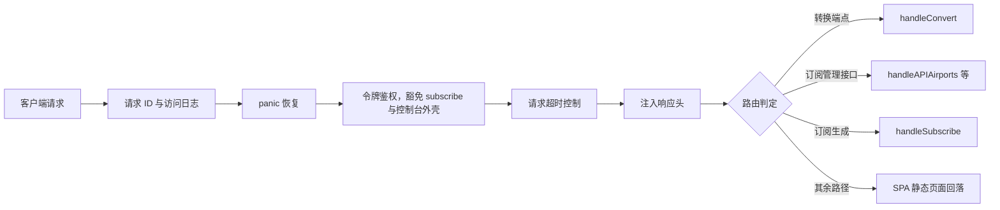
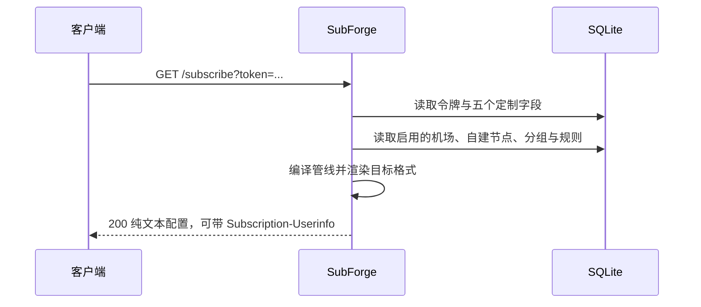
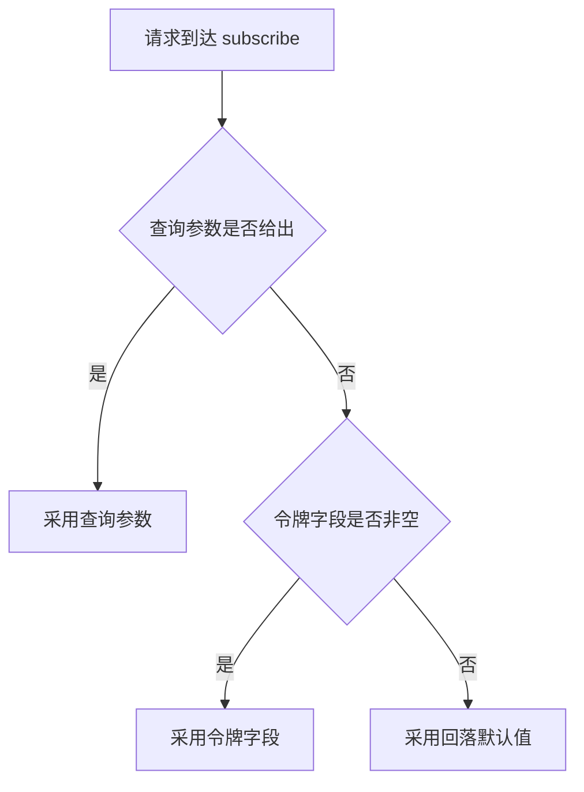

# HTTP-API-参考

本页是 SubForge HTTP 服务的完整接口参考，面向需要把 SubForge 接入自有系统、脚本或前端的集成者与运维人员。阅读本页前，建议先完成[快速上手教程](快速上手教程)中的一次转换，对订阅、节点、目标格式等术语建立直观认识。

本页按「服务与鉴权 → 转换端点 → 订阅管理端点 → 运维端点 → 订阅生成端点 → 调试端点」的顺序组织。所有路径、方法、字段名与状态码均以仓库源码为准，并在每处标注来源文件与行号；示例中的域名统一使用 `example.com`，令牌统一写作 `<YOUR_TOKEN>`。

## 1. 服务概览

HTTP 服务由 `subforge serve` 命令启动（`cmd/subforge/serve.go:108-113`），默认监听 `127.0.0.1:25500`。启动选项可以用环境变量提供默认值：`SUBFORGE_LISTEN`、`SUBFORGE_TOKEN`、`SUBFORGE_CONFIG`、`SUBFORGE_DATA_DIR` 分别对应 `-listen`、`-token`、`-config`、`-data-dir`，优先级为「环境变量 < 命令行参数 < INI 配置文件同名项」（`cmd/subforge/serve.go:123`）。三个参数决定了接口的行为边界：`-token` 为空时不鉴权；`-data-dir` 为空时不启用 SQLite 订阅管理，相关接口统一返回 503，而数据目录本身不要求预先存在，缺失时会自动创建（`cmd/subforge/serve.go:361`）；`-timeout` 默认为 30 秒，同时约束上游拉取与单请求。官方容器镜像（`v0.1.4` 及之后的标签）预设了 `SUBFORGE_DATA_DIR=/data` 与 `SUBFORGE_LISTEN=0.0.0.0:25500`，容器裸跑即可使用；更早的标签（`v0.1.3` 及以前）需要显式传参。完整启动参数见[安装与部署](安装与部署)。

### 1.1 请求处理链

每个请求依次经过请求 ID、访问日志、panic 恢复、令牌鉴权、超时与响应头注入六层中间件，再进入具体路由（`internal/api/server.go:122-129`）。



### 1.2 通用响应头与请求标识

所有响应都会带 `Cache-Control: no-store` 与 `Server: <服务名>`（`internal/api/middleware.go:17-25`）。访问日志中间件会回显 `X-Request-ID`（`internal/api/middleware.go:29-51`）：请求未带该头时服务端生成一个，并在日志行尾以 `rid=` 标注，便于把一次失败请求与日志对应起来。

### 1.3 错误响应约定

绝大多数 `/api` 端点的错误响应是 JSON 对象 `{"error":"..."}`（`internal/api/subscription.go:37-39`）。例外是三个纯文本端点：

- 未匹配到任何路由时返回 `404: 路径不存在`，`Content-Type: text/plain; charset=utf-8`（`internal/api/server.go:369-372`）。
- 令牌校验失败时返回 `401: 缺少或错误的访问令牌`（`internal/api/middleware.go:80-96`）。
- 调试模式未开启时访问 `/debug/pprof/*` 由标准库返回 `404 page not found`（`internal/api/pprof.go:29-125`）。

## 2. 鉴权

### 2.1 令牌传递方式

服务端令牌通过 `-token` 指定。令牌为空字符串时中间件直接放行，不做任何校验（`internal/api/middleware.go:80-96`）。令牌非空时，取值优先级为（`internal/api/middleware.go:99-111`）：

| 优先级 | 位置 | 写法 | 说明 |
| --- | --- | --- | --- |
| 1 | `Authorization` 请求头 | `Bearer <YOUR_TOKEN>` | `Bearer` 前缀大小写不敏感 |
| 1 | `Authorization` 请求头 | `<YOUR_TOKEN>` | 不带 `Bearer` 时整串视为令牌 |
| 2 | `X-Token` 请求头 | `<YOUR_TOKEN>` | 控制台使用该方式 |
| 3 | URL 查询参数 | `?token=<YOUR_TOKEN>` | 便于浏览器与简易脚本调用 |

```bash
# 推荐写法：Authorization 头
curl -H "Authorization: Bearer <YOUR_TOKEN>" "http://127.0.0.1:25500/api/version"
# 等价写法：X-Token 头，控制台使用该方式
curl -H "X-Token: <YOUR_TOKEN>" "http://127.0.0.1:25500/api/stats"
```

令牌比较使用 `crypto/subtle.ConstantTimeCompare`，避免比较耗时泄露信息（`internal/api/middleware.go:114-116`）。校验失败时响应同时带有 `WWW-Authenticate: Bearer realm="subforge"` 与 401 状态码。

### 2.2 豁免路径

全局鉴权中间件按路径豁免两类请求（`internal/api/server.go:295-328`）：

- `GET /subscribe`：使用订阅令牌（sub_token）自鉴权。如果该端点也被全局令牌拦住，请求里的 `token` 会被拿去与服务端令牌比较，订阅令牌将永远无法通过校验。
- 控制台静态外壳：`/`、`/assets/*`、`/favicon.ico`，以及会回退到 `index.html` 的前端路由深层链接（如 `/subscriptions`）。这些是构建产物、不含用户数据；不豁免的话，设置了令牌的部署连控制台页面都打不开。判定复用 SPA 回退的同一套前缀规则，因此凡是交给真实处理器的路径都不会被豁免。

`/api/*`、`/sub`、`/profile`、`/render`、`/getruleset`、`/inspect`、`/version`、`/healthz`、`/api/metrics`、`/debug/pprof/*` 以及任何非 GET/HEAD 请求，一律照常校验令牌。

## 3. 端点总表

下表列出全部已注册路由。「数据目录」列标注该端点是否依赖数据目录（`-data-dir` 或 `SUBFORGE_DATA_DIR`）：标注为「需要」的端点在没有数据目录时返回 503 `{"error":"订阅管理未启用"}`。

| 方法 | 路径 | 用途 | 数据目录 |
| --- | --- | --- | --- |
| GET | `/sub`、`/profile`、`/render` | 订阅转换，三者等价 | 不需要 |
| GET | `/getruleset` | 按 type 1~6 渲染规则集 | 不需要 |
| GET | `/inspect` | 回显解析后的转换参数 | 不需要 |
| GET | `/version` | subconverter 兼容版本行 | 不需要 |
| GET | `/api/version` | 结构化版本与运行时长 | 不需要 |
| GET | `/healthz` | 存活探针 | 不需要 |
| POST | `/api/convert` | JSON 形式的订阅转换 | 不需要 |
| POST | `/api/diff` | 两段文本的行级差异 | 不需要 |
| GET | `/api/targets` | 支持的 target 清单 | 不需要 |
| GET | `/api/rulesets` | 当前模板的规则集与规则 | 不需要 |
| GET | `/api/stats` | 历史统计与日志行数 | 不需要 |
| GET | `/api/history` | 最近 50 条转换历史 | 不需要 |
| GET | `/api/logs` | 内存日志环形缓冲 | 不需要 |
| GET | `/api/pipelines` | 管线列表（数据库与模板合并） | 不需要 |
| POST | `/api/pipelines` | 新建管线 | 需要 |
| GET、PUT、DELETE | `/api/pipelines/{id}` | 查询、修改、删除管线 | 需要 |
| GET、POST | `/api/scripts` | 脚本列表与新建 | 需要 |
| GET、PUT、DELETE | `/api/scripts/{id}` | 查询、修改、删除脚本 | 需要 |
| POST | `/api/scripts/test` | 试运行脚本 | 不需要 |
| GET、POST | `/api/airports` | 机场列表与新建 | 需要 |
| POST | `/api/airports/refresh` | 刷新全部启用机场流量 | 需要 |
| POST | `/api/airports/check` | 订阅可用性检测 | 需要 |
| GET | `/api/airports/check/last` | 上次检测结果 | 需要 |
| GET、PUT、DELETE | `/api/airports/{id}` | 查询、修改、删除机场 | 需要 |
| POST | `/api/airports/{id}/refresh` | 刷新单个机场流量 | 需要 |
| POST | `/api/airports/{id}/import-rules` | 从订阅导入规则 | 需要 |
| GET、POST | `/api/groups` | 代理分组列表与新建 | 需要 |
| GET、PUT、DELETE | `/api/groups/{id}` | 查询、修改、删除分组 | 需要 |
| GET、POST | `/api/rules` | 规则列表与新建 | 需要 |
| POST | `/api/rules/bulk` | 批量启停规则 | 需要 |
| GET、PUT、DELETE | `/api/rules/{id}` | 查询、修改、删除规则 | 需要 |
| GET、POST | `/api/tokens` | 订阅令牌列表与新建 | 需要 |
| GET、PUT、DELETE | `/api/tokens/{token}` | 查询、修改、删除令牌 | 需要 |
| GET、POST | `/api/self-nodes` | 自建节点列表与新建 | 需要 |
| GET、PUT、DELETE | `/api/self-nodes/{id}` | 查询、修改、删除自建节点 | 需要 |
| GET、PUT | `/api/traffic/strategy` | 读取与写入流量聚合策略 | 需要 |
| POST | `/api/traffic/refresh` | 刷新流量（可顺带导入规则） | 需要 |
| GET | `/api/traffic/preview` | 用指定策略预览聚合结果 | 需要 |
| GET | `/api/tasks` | 定时任务最近执行结果 | 需要调度器 |
| GET、PUT | `/api/alert-channels` | 告警通道配置（脱敏读取） | 需要 |
| POST | `/api/alert-channels/test` | 发送测试消息 | 需要 |
| GET | `/api/rule-providers` | 规则集列表 | 需要 |
| PUT | `/api/rule-providers/{id}/enabled` | 启用或停用规则集 | 需要 |
| GET | `/api/suggestions` | Rule-Bot 建议队列 | 需要 |
| POST | `/api/suggestions/apply` | 应用建议 | 需要 |
| POST | `/api/suggestions/{index}/confirm` | 确认单条建议 | 需要 |
| POST | `/api/suggestions/{index}/reject` | 拒绝单条建议 | 需要 |
| GET | `/api/rule-sources` | 规则源清单与状态 | 需要 |
| POST | `/api/rule-sources` | 新增规则源 | 需要 |
| POST | `/api/rule-sources/init` | 生成默认清单 | 需要 |
| POST | `/api/rule-sources/update` | 更新全部规则源 | 需要 |
| POST | `/api/rule-sources/update-one` | 更新单个规则源 | 需要 |
| POST | `/api/rule-sources/rollback` | 回滚到上一版本 | 需要 |
| POST | `/api/rule-sources/mrs` | 生成 MRS 文件 | 需要 |
| POST | `/api/rule-sources/remove` | 删除规则源 | 需要 |
| GET | `/api/configs` | 模板 `[common]` 段的 `config=` 取值 | 不需要 |
| GET、PUT | `/api/settings` | 运行设置读写 | 需要 |
| GET、PUT | `/api/template` | 模板文件读写 | 需要 |
| GET、PUT | `/api/override` | 覆盖层文件读写 | 需要 |
| GET | `/subscribe` | 按订阅令牌生成配置 | 需要 |
| GET | `/api/metrics` | 运行时指标（JSON） | 不需要 |
| GET | `/debug/pprof/*` | Go 性能剖析（需调试模式） | 不需要 |

## 4. 转换与诊断端点

### 4.1 GET /sub、/profile、/render

三个路径注册到同一个处理器（`internal/api/server.go:140-142`），参数完全一致。常用查询参数如下，全部参数名不区分大小写（`internal/convert/params.go:107`）。

| 参数 | 类型 | 默认值 | 说明 |
| --- | --- | --- | --- |
| `target` | 字符串 | 按 User-Agent 推断 | 目标格式；无法推断时用 `clash.meta` |
| `url` | 字符串，可重复 | — | 订阅来源；多个来源用 `;` 分隔或重复该参数 |
| `insert` | 字符串 | — | 插入节点或来源；按 `?` 与 `;` 分隔 |
| `include` | 字符串 | — | 节点名包含正则；按 `;` 分隔 |
| `exclude` | 字符串 | — | 节点名排除正则；按 `;` 分隔 |
| `type` | 字符串 | — | 协议类型过滤；按 `,` 或 `;` 分隔 |
| `rename` | 字符串 | — | 重命名规则对，形如 `正则,替换;正则,替换` |
| `emoji` | 字符串 | — | emoji 规则对，形如 `正则,替换;正则,替换` |
| `rules` | 字符串 | — | 追加规则行；按 `;` 分隔，如 `GEOIP,CN,DIRECT` |
| `ruleset` | 字符串 | — | 规则集声明，形如 `ruleset:<名称>:<类型>` |
| `config` | 字符串 | — | INI 模板；带 `://` 时按远程模板拉取 |
| `pipeline` | 字符串 | — | 模板中的命名管线 `[pipeline:<名称>]` |
| `filename` | 字符串 | 按格式派生 | 下载文件名 |
| `sort` | 字符串或布尔 | 保持原序 | `true`/`1` 按名称排序，`false`/`0` 保持原序，也可直接给 `name`、`type`、`server`、`port` |
| `list` | 布尔 | 否 | 输出节点名清单而非配置 |
| `udp`、`tfo`、`scv`、`tls13` | 布尔 | 否 | 分别写入 UDP、TCP Fast Open、跳过证书校验、TLS 1.3 相关字段 |
| `x-*` | 字符串 | — | 自定义扩展参数，原样进入 `Extensions`，不参与转换 |

两点容易踩坑的取值规则：`url` 只按 `;` 拆分，不按 `?` 拆分，订阅地址自带的查询串因此能完整保留（`internal/convert/params.go:120-123`）；`sort` 同时兼容布尔值与排序键两种语义，若只接受排序键，sub-web 的「高级」模式会整条请求失败（`internal/convert/params.go:135-148`）。

成功响应的头部如下（`internal/api/handlers.go:73-89`）：

| 响应头 | 取值 | 说明 |
| --- | --- | --- |
| `Content-Type` | 按格式决定 | Clash 系为 `text/yaml`，清单系为 `text/plain`，sing-box 为 `application/json` |
| `Content-Disposition` | `attachment; filename=...` | 下载文件名 |
| `X-Convert-Format` | 规范渲染器名 | 例如用 `clash` 请求时返回 `clash.meta` |
| `X-Node-Count` | 整数 | 产物中的节点数 |
| `X-Convert-Warning` | 整数 | 拉取失败的来源数量，仅在有失败时出现 |
| `X-Convert-Skipped` | 整数 | 被跳过的条目数量，仅在有跳过时出现 |
| `X-Convert-Cache` | 整数 | 命中的上游缓存数量，仅在有缓存时出现 |

```bash
curl -o config.yaml \
  "http://127.0.0.1:25500/sub?target=clash.meta&url=https%3A%2F%2Fexample.com%2Fsub&include=%E9%A6%99%E6%B8%AF"
```

失败时的状态码由错误类型决定（`internal/api/handlers.go:22-33`）：没有来源为 400，过滤后没有节点为 404，目标格式不支持为 501，其余上游或渲染失败为 502。

### 4.2 GET /getruleset

按 subconverter 的规则集接口语义渲染规则集（`internal/api/handlers.go:111-213`）。`name` 为必填参数，缺少时返回 400 `缺少 name 参数（规则集名）`。

| 参数 | 类型 | 默认值 | 说明 |
| --- | --- | --- | --- |
| `name` | 字符串 | — | 规则集名，必填 |
| `type` | 字符串或整数 | 取模板 `[ruleset]` 段 | 1~6 或命名别名 |
| `rules` | 字符串 | — | 直接给出规则行，优先级最高 |
| `list` | 字符串 | — | 规则清单文本，按 `;` 切分 |
| `url` | 字符串 | — | 远程规则集地址，优先级最低 |

`type` 的取值与含义如下（`internal/api/handlers.go:147`）：

| 取值 | 别名 | 输出形态 |
| --- | --- | --- |
| 1 | `surge` | Surge 规则列表 |
| 2 | `qx` | Quantumult X 规则列表 |
| 3 | `clash-domain` | Clash domain 类型 provider |
| 4 | `clash-ipcidr` | Clash ipcidr 类型 provider |
| 5 | `surge-domain-set` | Surge DOMAIN-SET |
| 6 | `clash-classical` | Clash classical 类型 provider |

内容来源的优先级为 `rules` > `list` > 模板 `[common]` 段的 `rules` > `url`（`internal/api/handlers.go:150-190`）。成功时返回 `Content-Disposition`、`X-Ruleset-Format` 与 `X-Ruleset-Count`；发生丢弃时额外返回 `X-Ruleset-Skipped`。规则集内容由调用方提供，服务端不内置第三方规则数据。

### 4.3 GET /inspect

回显服务端解析请求参数后的结果，用于确认参数是否被正确理解（`internal/api/handlers.go:258-285`）。响应字段包括 `target`、`urls`、`insert`、`include`、`exclude`、`types`、`rename`（数量）、`emoji`（数量）、`list`、`udp`、`tfo`、`scv`、`tls13`、`sort`、`config`、`ruleset`、`unknown`、`extensions` 与 `time`。`unknown` 列出未识别的参数名，便于排查拼写错误。

### 4.4 版本与健康检查

| 端点 | 响应 | 说明 |
| --- | --- | --- |
| `GET /version` | `subforge <版本> backend` 纯文本 | subconverter 兼容契约，不能返回 JSON，版本为空时输出 `dev`（`internal/api/server.go:340-350`） |
| `GET /api/version` | `name`、`version`、`startedAt`、`uptime`、`time` | 结构化版本信息（`internal/api/server.go:354-362`） |
| `GET /healthz` | `{"status":"ok"}` | 存活探针，不做重活（`internal/api/server.go:365-367`） |

### 4.5 POST /api/convert 与 POST /api/diff

`/api/convert` 是 `/sub` 的 JSON 版本（`internal/api/web.go:139-290`），请求字段与方法说明如下。

| 字段 | 类型 | 默认值 | 说明 |
| --- | --- | --- | --- |
| `target` | 字符串 | `clash.meta` | 目标格式 |
| `urls` | 字符串数组 | — | 订阅来源列表 |
| `text` | 字符串 | — | 直接粘贴的订阅文本，落临时文件后作为本地来源 |
| `types` | 字符串数组 | — | 协议类型过滤 |
| `include`、`exclude` | 字符串数组 | — | 节点名包含与排除正则 |
| `pipeline` | 字符串 | — | 命名管线 |
| `config` | 字符串 | — | INI 模板 |
| `sort` | 字符串 | 保持原序 | 排序键 |
| `list` | 布尔 | 否 | 输出节点名清单 |
| `override` | 字符串 | — | 覆盖层内容；以 `[` 开头按 INI 解析，否则按 YAML 解析 |

成功响应为 `body`、`format`、`nodes`、`rawNodes`、`failures`、`warnings`、`cached` 七个字段（`internal/api/web.go:281-289`）。`failures` 中的每条记录都会同时写入服务日志。

```bash
curl -X POST "http://127.0.0.1:25500/api/convert" \
  -H "Content-Type: application/json" \
  -d '{"target":"sing-box","urls":["https://example.com/sub"]}'
```

`/api/diff` 接收 `{"a":"...","b":"..."}`，返回 `{"lines":[{"type":" ","text":"..."}]}`；`type` 取值为空格、`-`、`+`，分别表示未变、删除与新增（`internal/api/diff.go:6-10`、`internal/api/web.go:292-309`）。

## 5. 订阅管理端点

本节所有端点都依赖数据目录。未提供 `-data-dir` 或 `SUBFORGE_DATA_DIR` 时统一返回 503 `{"error":"订阅管理未启用"}`（`internal/api/subscription.go:42-48`）；官方容器镜像（v0.1.4 起）已预设数据目录，容器内默认启用。

### 5.1 机场

| 方法 | 路径 | 请求 | 响应 |
| --- | --- | --- | --- |
| GET | `/api/airports` | — | `{"airports":[...]}` |
| POST | `/api/airports` | `name`、`subscription_url`、`remarks`、`enabled` | 201 `{"airport":{...}}` |
| GET | `/api/airports/{id}` | — | `{"airport":{...}}` |
| PUT | `/api/airports/{id}` | 同 POST | `{"airport":{...}}` |
| DELETE | `/api/airports/{id}` | — | `{"ok":true}` |
| POST | `/api/airports/{id}/refresh` | — | `{"result":{...}}` |
| POST | `/api/airports/{id}/import-rules` | — | `{"rules_added":N,"rules_skipped":N,"providers_added":N,"warnings":[...]}` |
| POST | `/api/airports/refresh` | 可选 `?with_rules=1` | `{"results":[...],"ok":N,"fail":N}`，带 `with_rules` 时附 `imports` |
| POST | `/api/airports/check` | 可选 `{"ids":[1,2]}` | `{"results":[...],"ok":N,"fail":N,"at":"..."}` |
| GET | `/api/airports/check/last` | — | `{"results":[...],"at":"..."}` |

机场对象包含 `id`、`name`、`subscription_url`、`remarks`、`enabled`、`sort_order`、`upload`、`download`、`total`、`expire`、`node_count`、`traffic_at`、`traffic_err`、`created_at`、`updated_at`（`internal/subforge/subforge.go:74-94`）。流量刷新失败时只写 `traffic_err`，保留上一次成功的数值，不会清零（`internal/subforge/subforge.go:149-162`）。

刷新结果里还有一个可选的 `note` 字段（`internal/subforge/traffic.go:34-36`）：拉取成功但上游没回 `subscription-userinfo` 时，`ok` 仍为 `true`、`note` 给出说明，节点数照常写回。详见[流量策略与用量统计](流量策略与用量统计)第 3.3 节。

检测结果保存在进程内存中，重启后 `/api/airports/check/last` 返回空结果。结果字段为 `name`、`url`、`ok`、`status_code`、`latency_ms`、`bytes`、`err`。`ids` 为空数组时返回 400 `没有可检测的机场`，包含不存在的机场时返回 400 `机场 N 不存在`。

### 5.2 自建节点

| 方法 | 路径 | 请求 | 响应 |
| --- | --- | --- | --- |
| GET | `/api/self-nodes` | — | `{"self_nodes":[...]}` |
| POST | `/api/self-nodes` | `link`、`name`、`enabled` | 201 `{"self_node":{...}}` |
| GET | `/api/self-nodes/{id}` | — | `{"self_node":{...}}` |
| PUT | `/api/self-nodes/{id}` | 同 POST | `{"ok":true}` |
| DELETE | `/api/self-nodes/{id}` | — | `{"ok":true}` |

`link` 为分享链接，例如 `ss://`、`vmess://`、`vless://`、`trojan://`、`hysteria2://`。`link` 为空或全为空白时返回 400 `链接不能为空`（`internal/api/subscription.go:499-502`、`:540-543`）。

### 5.3 代理分组

| 方法 | 路径 | 请求 | 响应 |
| --- | --- | --- | --- |
| GET | `/api/groups` | — | `{"groups":[...]}` |
| POST | `/api/groups` | `name`、`type`、`regex`、`url`、`interval`，可选 `include_self`、`include_all_sources` | 201 `{"group":{...}}` |
| GET、PUT、DELETE | `/api/groups/{id}` | PUT 同 POST；`include_self` / `include_all_sources` 省略时保持原值 | `{"group":{...}}` 或 `{"ok":true}` |

`type` 常用取值为 `select`、`url-test`、`fallback`、`load-balance`；`regex` 是成员节点名正则，`url` 是检测地址，`interval` 是检测间隔秒数（`internal/api/subscription.go:170-186`）。需要特别注意：mihomo 只接受上述四种分组类型，`relay` 已被上游移除，其他类型会直接报错（`internal/render/clashmeta/clashmeta.go:293-312`）。

### 5.4 规则与规则集

| 方法 | 路径 | 请求 | 响应 |
| --- | --- | --- | --- |
| GET | `/api/rules` | — | `{"rules":[...]}`，每项额外带 `group_name` |
| POST | `/api/rules` | `rule_type`、`rule_param`、`rule_config`、`resolve_dns`、`enabled` | 201 `{"rule":{...}}` |
| POST | `/api/rules/bulk` | `ids` 或 `source` 二选一，`enabled` | `{"updated":N}` |
| GET、PUT、DELETE | `/api/rules/{id}` | PUT 同 POST | `{"rule":{...}}` 或 `{"ok":true}` |
| GET | `/api/rule-providers` | 可选 `?source=`、`?enabled=1\|0` | `{"rule_providers":[...]}` |
| PUT | `/api/rule-providers/{id}/enabled` | `{"enabled":true}` | `{"ok":true}` |

`rule_config` 是目标代理分组的整数 ID，取 0 或指向不存在的分组时，该规则在订阅产物中的目标为 `DIRECT`（`internal/api/subscription.go:676-698`）。`resolve_dns` 为真时，渲染出的规则行会追加 `no-resolve`。列表接口返回的 `group_name` 由 `rule_config` 映射得到，映射不上时为空字符串（`internal/api/subscription.go:243-273`）。

`/api/rules/bulk` 的 `ids` 与 `source` 必须且只能给出一个，否则返回 400 `必须给出 ids 或 source` 或 `ids 与 source 不能同时给出`（`internal/api/rules_bulk.go:11-71`）。`PUT /api/rule-providers/{id}/enabled` 的请求体必须是 `{"enabled":true}` 或 `{"enabled":false}`，否则返回 400。

### 5.5 订阅令牌

| 方法 | 路径 | 请求 | 响应 |
| --- | --- | --- | --- |
| GET | `/api/tokens` | — | `{"tokens":[...]}` |
| POST | `/api/tokens` | `token`、`name`、`target`、`pipeline`、`config`、`include`、`exclude` | 201 `{"token":{...}}` |
| GET、PUT、DELETE | `/api/tokens/{token}` | PUT 为部分更新 | `{"token":{...}}` 或 `{"ok":true}` |

`token` 留空时由服务端生成：取 16 字节 `crypto/rand` 并编码为 32 位十六进制字符串（`internal/api/subscription.go:376-384`）。令牌对象字段为 `token`、`name`、`target`、`pipeline`、`config`、`include`、`exclude`、`created_at`。`PUT /api/tokens/{token}` 是部分更新：请求体中省略的字段保持原值，显式给出空串则清空该字段，空对象 `{}` 为幂等操作（`internal/api/subscription.go:415-451`）。令牌不存在时返回 404，错误信息形如 `令牌 xxx 不存在`。

### 5.6 流量

| 方法 | 路径 | 请求 | 响应 |
| --- | --- | --- | --- |
| GET | `/api/traffic/strategy` | — | `{"strategy":{...}}` |
| PUT | `/api/traffic/strategy` | 策略对象 | 归一化后的 `{"strategy":{...}}` |
| POST | `/api/traffic/refresh` | 可选 `?with_rules=1` | `{"results":[...],"ok":N,"fail":N}` |
| GET | `/api/traffic/preview` | `?strategy=<JSON>` | `{"usage":{...},"header":"...","ok":true}` |

策略对象包含 `preset` 与 `upload`、`download`、`total`、`expire` 四个字段策略，字段策略可取 `sum`、`min`、`max`、`avg`、`first`、`last`、`none`（`internal/traffic/traffic.go:76-84`）。未配置时使用预设 `sum`，其中 `expire` 默认取 `min`（`internal/traffic/traffic.go:102-121`）。可选预设包括 `sum`、`min`、`max`、`avg`、`first`、`last`、`min_quota`、`max_quota`、`weighted`、`off`（`internal/traffic/traffic.go:124-148`）。

## 6. 运行与运维端点

### 6.1 任务与告警

| 方法 | 路径 | 请求 | 响应 |
| --- | --- | --- | --- |
| GET | `/api/tasks` | — | `{"tasks":[...]}` |
| GET、PUT | `/api/alert-channels` | PUT 为 `{"channels":[...]}` | `{"channels":[...]}` |
| POST | `/api/alert-channels/test` | `{"index":N}` 或完整通道字段 | `{"ok":bool,"error":"...","channel":"..."}` |

`/api/tasks` 返回调度器最近 100 条执行结果，字段为 `JobName`、`Success`、`Err`、`StartedAt`、`Duration`；调度器未启用时返回 503 `{"error":"调度器未启用"}`（`internal/api/tasks.go:11-25`）。该结果是内存态，进程重启后清空（`internal/scheduler/scheduler.go:43-49`、`:180-187`）。

告警通道读取时会脱敏：`bot_token`、`webhook`、`password` 被替换为 `***`，同时以 `configured` 标记该字段是否已配置（`internal/subforge/alerts.go:42-76`）。写入时 `***` 表示沿用同类型通道的旧值，空串表示清空（`internal/subforge/alerts.go:78-124`）。测试接口在发送失败时仍返回 200，需要在响应体中读取 `ok` 与 `error`（`internal/api/alerts.go:69-102`）。

### 6.2 设置、模板与覆盖层

| 方法 | 路径 | 请求 | 响应 |
| --- | --- | --- | --- |
| GET | `/api/settings` | — | `{"settings":[{"key","value","kind","label","description","is_default"}]}` |
| PUT | `/api/settings` | `{"settings":{"键":"值"}}` 或扁平映射 | `{"settings":[...]}` |
| GET | `/api/template` | — | `{"path":"...","content":"..."}` |
| PUT | `/api/template` | `{"content":"..."}` | 成功返回更新后的模板 |
| GET | `/api/override` | — | `{"path":"...","content":"..."}` |
| PUT | `/api/override` | `{"content":"..."}` | 成功返回更新后的覆盖层 |

`/api/settings` 的取值在写入前全量校验：未知键返回 400 `未知设置项 "..."`，布尔项接受 `1/0/true/false/yes/no/on/off`，空串表示删除该键并恢复默认（`internal/api/settings.go:12-67`、`internal/subforge/settings.go:113-142`）。`/api/template` 在写入前先做语法解析，语法错误返回 400 `模板语法错误: ...`（`internal/api/template_api.go:15-82`）；`/api/override` 按扩展名选择解析器，`.ini` 走 INI 解析，其余走 YAML 解析（`internal/api/override_api.go:15-81`）。

### 6.3 规则工厂

| 方法 | 路径 | 请求 | 响应 |
| --- | --- | --- | --- |
| GET | `/api/rule-sources` | — | 清单路径、规则源数组、状态与提示 |
| POST | `/api/rule-sources/init` | 可选 `?force=1` | `{"path":"...","created":bool}` |
| POST | `/api/rule-sources` | `name`、`url`、`input_format` | `{"path":"...","created":bool}` |
| POST | `/api/rule-sources/update` | — | `{"results":[{"source","version","path","from_cache","err"}]}`；有源失败时整体返回 500，响应体为 `{"error":"所有 N 个 source 更新失败","results":[...]}` |
| POST | `/api/rule-sources/update-one` | `{"name":"..."}` | 同 `update` 的结果数组；失败时同样在 500 里带 `results` |
| POST | `/api/rule-sources/rollback` | `{"name":"..."}` | `{"path":"..."}` |
| POST | `/api/rule-sources/mrs` | `name`、`behavior`、`format` | `{"path":"...","bytes":N}` |
| POST | `/api/rule-sources/remove` | `{"name":"..."}` | `{"ok":true,"path":"..."}` |

`/api/rule-sources` 在清单文件不存在时返回 `exists:false` 并附带操作提示（`internal/api/rule_sources.go:17-59`）。`init` 使用 `?force=1` 覆盖已有清单前会先备份为 `<路径>.bak`（`internal/api/rule_sources.go:64-80`）。`mrs` 的 `behavior` 默认 `domain`，`format` 默认 `mrs`；规则源不存在返回 404，没有可用版本返回 400（`internal/api/rule_sources.go:148-211`）。

### 6.4 建议队列与只读端点

| 方法 | 路径 | 说明 |
| --- | --- | --- |
| GET | `/api/suggestions` | 返回 `{"suggestions":[...]}`；队列未启用时为空数组 |
| POST | `/api/suggestions/{index}/confirm` | 确认单条建议；索引不存在返回 404 |
| POST | `/api/suggestions/{index}/reject` | 拒绝单条建议 |
| POST | `/api/suggestions/apply` | 应用建议，返回 `{"applied":N}` |
| GET | `/api/configs` | 返回 `{"configs":[...],"default":"..."}` |
| GET | `/api/stats` | 历史统计、日志行数与最近一次转换快照 |
| GET | `/api/history` | 最近 50 条转换历史，最新在前 |
| GET | `/api/logs` | `{"logs":[{"id","ts","line"}]}`，支持 `since` 游标，最多 200 条 |
| GET | `/api/targets` | 支持的 target 字符串数组 |
| GET | `/api/rulesets` | 当前模板的 `{"rulesets":{...},"rules":[...]}` |

Rule-Bot 建议队列未启用时，确认与拒绝接口返回 501 `Rule-Bot 建议队列未启用`（`internal/api/suggestions.go:20-114`）。`/api/logs` 的 `since` 为上一批最后一条的 `id`，用于增量拉取（`internal/api/web.go:130-137`）。

`/api/targets` 返回 `registry.Available()` 的结果（`internal/api/web.go:109-111`），共 36 项：`clash.meta`、`surge`、`quan`、`quanx`、`loon`、`surfboard`、`mellow`、`list`、`mixed`、`ss`、`ssd`、`shadowsocks`、`ssr`、`shadowsocksr`、`trojan`、`v2ray`、`sing-box`、`singbox`、`ss-sub`、`ss-sub-json`、`ss-sub-b64`、`ssjson`、`quantumult`、`quantumultx`、`surge2`、`surge3`、`surge4`、`suri`、`clash-json`、`clashmeta-json`、`mellow-ios`、`sssub`，以及 `clash`、`clash.meta`、`clashmeta`、`mihomo` 四个名字各加一个 `.json` 后缀构成的别名（`internal/render/registry/registry.go:106-150`）。

除清单之外，解析器还接受若干未列入清单的写法：Clash YAML 别名 `clash`、`clashmeta`、`mihomo`、`yaml`、`clashr`，以及 `sub`、`subscription`（`internal/render/registry/registry.go:31-43`、`:117-120`）。这些写法在实测中都能正常转换，但不会出现在 `/api/targets` 的响应里。

### 6.5 管线与脚本

| 方法 | 路径 | 请求 | 响应 |
| --- | --- | --- | --- |
| GET | `/api/pipelines` | 可选 `?config=` | 管线数组（裸数组，非对象包装） |
| POST | `/api/pipelines` | `name`、`description`、`steps` 或 `steps_json`、`enabled` | 201 `{"pipeline":{...}}` |
| GET、PUT、DELETE | `/api/pipelines/{id}` | PUT 要求 `name` 非空 | `{"pipeline":{...}}` 或 `{"ok":true}` |
| GET、POST | `/api/scripts` | POST 为 `name`、`description`、`code`、`enabled` | `{"scripts":[...]}` 或 201 `{"script":{...}}` |
| GET、PUT、DELETE | `/api/scripts/{id}` | PUT 要求 `name` 非空 | `{"script":{...}}` 或 `{"ok":true}` |
| POST | `/api/scripts/test` | `code`、`kind`、`node`、`timeout` | `{"ok","kept","before","after","duration_ms","error"}` |

`GET /api/pipelines` 合并两条来源：数据库中的管线在前，模板 `[pipeline:*]` 段落产生的只读管线在后，同名时数据库定义优先（`internal/api/pipelines.go:33-82`）。未提供数据目录时只返回模板来源，不报错。新建重名管线返回 409 `流水线名称已存在`（`internal/api/pipelines.go:149-185`）。

`POST /api/scripts/test` 的 `kind` 默认 `filter`，可取 `filter` 或 `operate`；`timeout` 单位为毫秒且上限为 30000；脚本执行失败时接口仍返回 HTTP 200，需要在响应体中读取 `ok` 与 `error`（`internal/api/scripts_test_api.go:22-80`）。

## 7. GET /subscribe

`/subscribe` 按数据库当前状态实时编译一份订阅配置，不生成落盘产物（`internal/api/subscription.go:560-748`）。请求必须带 `token` 查询参数，缺少时返回 400 `缺少 token 参数`；令牌不存在时返回 404。



### 7.1 请求参数与优先级

支持的查询参数为 `target`、`pipeline`、`config`、`include`、`exclude`。每个参数的取值优先级为「查询参数显式给出 > 令牌字段 > 回落默认值」（`internal/api/subscription.go:575-608`）。



| 参数 | 类型 | 默认值 | 说明 |
| --- | --- | --- | --- |
| `token` | 字符串 | — | 订阅令牌，必填 |
| `target` | 字符串 | `clash.meta` | 目标格式 |
| `pipeline` | 字符串 | 配置表 `subscribe.pipeline` | 命名管线 |
| `config` | 字符串 | 令牌字段 | INI 模板，按逗号切分 |
| `include` | 字符串 | 令牌字段 | 节点名包含正则，按逗号切分 |
| `exclude` | 字符串 | 令牌字段 | 节点名排除正则，按逗号切分 |

### 7.2 生成过程与响应

生成时读取「已启用且配置了订阅地址」的机场与「已启用」的自建节点；两者都为空时返回 400 `没有启用的订阅或自建节点`（`internal/api/subscription.go:609-647`）。自建节点会逐条写入临时文件，文件名形如 `self-<id>.txt`，权限 0600，请求结束后删除（`internal/api/subscription.go:622-647`）。代理分组会映射为目标格式的策略组：`regex` 非空时作为成员模式，`url` 作为检测地址，`interval` 作为检测间隔（`internal/api/subscription.go:654-674`）。规则行按 `rule_type,rule_param,policy` 拼装，`policy` 取 `rule_config` 对应的分组名，`resolve_dns` 为真时追加 `,no-resolve`（`internal/api/subscription.go:676-698`）。

响应为 `text/plain; charset=utf-8` 纯文本，且不写 `Content-Disposition`（`internal/api/subscription.go:747`）。当流量策略可用时，响应会带上 `Subscription-Userinfo` 头，格式为 `upload=<字节>; download=<字节>; total=<字节>; expire=<Unix 秒>`（`internal/traffic/traffic.go:69-71`）。参与聚合的只有「启用、订阅地址非空且流量刷新时间大于 0」的机场（`internal/api/subscription.go:722-746`）。

## 8. 调试与指标端点

### 8.1 pprof

`/debug/pprof/*` 默认关闭，只有在启动时显式 `-pprof` 或设置 `SUBFORGE_PPROF=1` 时才生效；请求带 `?debug=1` 不会开启（`internal/api/pprof.go`）。可用路径包括 `/debug/pprof/`、`/cmdline`、`/profile`、`/symbol`、`/trace`、`/heap`、`/goroutine`、`/allocs`、`/block`、`/mutex`、`/threadcreate`（`internal/api/pprof.go:29-125`）。未开启时由标准库返回纯文本 404。

### 8.2 GET /api/metrics

返回 JSON 格式的运行时指标，不是 Prometheus 文本格式（`internal/api/pprof.go:128-155`），顶层字段为 `uptime`（运行时长）、`goroutines`（协程数）、`memory`（堆内存、栈内存、GC 次数与累计分配等）与 `cpu`（`gomaxprocs` 与 CPU 核数）。

## 9. 状态码对照

| 状态码 | 触发条件 | 响应形态 |
| --- | --- | --- |
| 200 | 请求成功 | JSON 或纯文本 |
| 201 | 资源创建成功 | `{"airport":{...}}` 等 |
| 400 | 参数缺失、非法或校验失败 | `{"error":"..."}` |
| 401 | 服务端令牌缺失或错误 | `401: 缺少或错误的访问令牌` |
| 404 | 资源不存在、路径未注册、过滤后无节点 | JSON 错误或 `404: 路径不存在` |
| 405 | 方法不被该路径支持 | `{"error":"仅支持 GET/POST"}` 等 |
| 409 | 名称冲突 | `{"error":"流水线名称已存在"}` |
| 501 | 目标格式不支持、建议队列未启用 | `{"error":"..."}` |
| 502 | 上游拉取或渲染失败 | `{"error":"..."}` |
| 503 | 订阅管理或调度器未启用 | `{"error":"订阅管理未启用"}` |

## 10. 尚未实现与未接入的能力

以下能力在源码中的真实状态如下，接入前请勿按「可用」处理：

- `GET /getruleset` 已实现，支持 type 1~6 六种形态；服务端不内置第三方规则集数据，规则内容由调用方提供。
- `/subscribe` 是普通 GET 纯文本响应，不是 SSE 流；仓库中不存在 `text/event-stream` 相关实现。
- `/api/metrics` 返回 JSON 运行时指标，不是 Prometheus exposition 格式。
- MCP 服务已实现但未接入：`internal/mcp/mcp.go` 提供了 JSON-RPC 的 `initialize`、`tools/list`、`tools/call`，工具为 `convert` 与 `list_targets`，但 `cmd/` 与 `internal/api/` 中没有任何入口暴露它，且 `list_targets` 返回的是硬编码的简化清单。
- `pkg/subforge` 库入口在仓库内没有任何调用方。
- SMTP 告警通道尚未实现，`Send` 恒定返回 `SMTP 通道尚未实现，请使用 Telegram 或 DingTalk`（`internal/scheduler/alert_channels.go:99-101`）。
- 未提供数据目录（裸二进制下的 `-data-dir` 或 `SUBFORGE_DATA_DIR`）时，SQLite 订阅管理整体不启用，上表中标注「需要」的端点全部返回 503；官方容器镜像（v0.1.4 起）已预设数据目录，默认不存在这个问题。

## 11. 相关页面

- [快速上手教程](快速上手教程)：先用一次完整转换建立直观认识。
- [订阅与节点管理](订阅与节点管理)：机场、自建节点、分组、规则与订阅令牌的操作说明。
- [定时任务与告警](定时任务与告警)：`/api/tasks` 与告警通道背后的调度器行为。
- [Web-控制台使用指南](Web-控制台使用指南)：这些端点在控制台中的对应入口。
- [兼容性与迁移说明](兼容性与迁移说明)：与 subconverter 的参数与行为差异。
- [开发与测试指南](开发与测试指南)：本地起服务、跑接口测试与覆盖率门禁。
