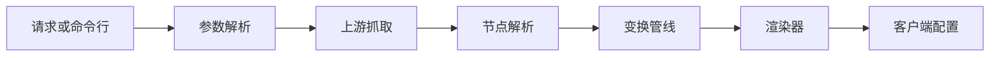
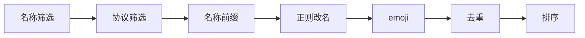
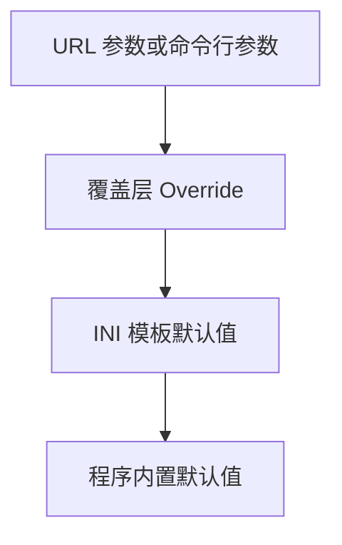

# SubForge 使用手册

SubForge 是一套使用 Go 语言编写的订阅转换与分流规则引擎。它把机场订阅、自建节点、
subconverter 风格的 INI 模板，转换成 Clash / mihomo、Surge、Quantumult X、Loon、
Surfboard、sing-box 等客户端可以直接加载的配置，并在转换之外提供规则工厂、定时任务、
流量策略与异常建议等运维能力。

本 Wiki 是 SubForge 的完整使用手册，既说明工作原理，也给出操作步骤。所有命令、参数与端点
都以当前仓库源码为准，并在需要处标注源码位置，便于核对。

> 仓库地址：https://github.com/tktogether/subforge
> 项目主文档：[README](https://github.com/tktogether/subforge/blob/main/README.md)

---

## 一、项目解决的问题

自建代理的用户通常会遇到三类问题：

| 问题 | 具体表现 | SubForge 的处理方式 |
| --- | --- | --- |
| 格式不统一 | 不同机场给出分享链接、Base64 订阅、Clash YAML 等不同形态 | 统一解析为内部节点模型，再按 `target` 渲染成目标客户端格式 |
| 节点处理重复 | 改名、加 emoji、去重、排序、按地区筛选，每次都需手工处理 | 用 INI 模板与覆盖层声明式描述，转换时自动执行管线 |
| 规则与运维分离 | 转换工具只生成配置，规则更新、节点测活、用量告警依赖其他脚本 | 内置规则工厂、定时任务、流量策略、Rule-Bot 建议队列与控制台 |

SubForge 与 [subconverter](https://github.com/tindy2013/subconverter) 保持语义兼容：参数名、INI 段落、
`target` 取值对齐 subconverter 的既有约定，现有订阅脚本与客户端配置可以沿用。在此之上，
SubForge 额外提供订阅管理、规则版本化、Web 控制台与 HTTP API。

---

## 二、工作原理

一次订阅转换请求依次经过参数解析、上游抓取、节点解析、变换管线与渲染五个阶段：



变换管线把原始节点列表转换为最终输出的节点列表，默认顺序为：



名称前缀阶段必须排在正则改名阶段之前：前缀按协议类型添加，而筛选按节点名称判定，先改名会使
判定依据发生变化，应当添加前缀的节点会被漏掉。完整说明见 [转换流水线原理](转换流水线原理)。

---

## 三、阅读路径

按使用目标选择阅读路径，不需要从头读到尾。

### 3.1 第一次使用 SubForge

| 顺序 | 页面 | 内容 |
| --- | --- | --- |
| 1 | [项目简介与设计目标](项目简介与设计目标) | 项目定位、能力范围与边界 |
| 2 | [安装与部署](安装与部署) | 在本机、Docker、systemd 或 OpenWrt 上启动服务 |
| 3 | [快速上手教程](快速上手教程) | 完成第一次转换并在客户端导入 |
| 4 | [INI-模板配置详解](INI-模板配置详解) | 编写模板，把节点处理规则固定下来 |
| 5 | [故障排查与常见问题](故障排查与常见问题) | 按现象定位原因 |

### 3.2 已部署，需要进阶配置

| 页面 | 内容 |
| --- | --- |
| [覆盖层-Override-详解](覆盖层-Override-详解) | 模板保持共享，个体差异写在覆盖层里 |
| [Web-控制台使用指南](Web-控制台使用指南) | 用浏览器管理机场、分组、规则与订阅 |
| [订阅与节点管理](订阅与节点管理) | 机场、分组、自建节点、访问令牌的管理方式 |
| [分流规则引擎原理](分流规则引擎原理) | 规则来源、装配方式与远程规则集展开时机 |
| [规则工厂与规则源](规则工厂与规则源) | 规则版本化、回滚、规则源与规则提供者 |
| [流量策略与用量统计](流量策略与用量统计) | 用量来源、策略对产物与告警的影响 |
| [定时任务与告警](定时任务与告警) | 刷新、测活、告警的计划执行方式 |

### 3.3 集成到自有系统

| 页面 | 内容 |
| --- | --- |
| [HTTP-API-参考](HTTP-API-参考) | 端点表、鉴权方式、请求与响应示例 |
| [数据模型与本地存储](数据模型与本地存储) | 实体关系、SQLite 存储位置、备份与迁移 |
| [兼容性与迁移说明](兼容性与迁移说明) | 与 subconverter / Sub-Store 的兼容点与差异 |
| [渲染器与输出格式](渲染器与输出格式) | 目标格式、别名规则与响应头 |

### 3.4 参与开发

| 页面 | 内容 |
| --- | --- |
| [系统架构总览](系统架构总览) | 分层结构、包职责、请求经过的组件 |
| [开发与测试指南](开发与测试指南) | 构建、测试、覆盖率门禁、调试手段 |
| [转换流水线原理](转换流水线原理) | 变换逻辑的顺序与约束 |
| [订阅解析与协议支持](订阅解析与协议支持) | 新增协议支持需要修改的位置 |
| [Rule-Bot-智能建议](Rule-Bot-智能建议) | 异常检测与建议队列的工作方式 |
| [CONTRIBUTING.md](https://github.com/tktogether/subforge/blob/main/CONTRIBUTING.md) | 提交流程、代码规范、CI 检查项 |

---

## 四、核心概念

| 概念 | 含义 | 详见 |
| --- | --- | --- |
| 订阅 | 上游提供的一批节点集合，可以是一个 URL，也可以是一段文本 | [订阅解析与协议支持](订阅解析与协议支持) |
| 分享链接 | `ss://`、`vmess://` 这类单节点链接 | 同上 |
| 节点 | 一条代理服务器配置，包含类型、地址、端口、加密与传输参数 | 同上 |
| 目标格式 | `target` 参数指定的客户端配置格式，例如 `clash.meta`、`surge` | [渲染器与输出格式](渲染器与输出格式) |
| 模板 | subconverter 风格的 INI 文件，声明节点处理与规则装配方式 | [INI-模板配置详解](INI-模板配置详解) |
| 覆盖层 | Override，用户本地的差异文件，在模板之上做局部修改 | [覆盖层-Override-详解](覆盖层-Override-详解) |
| 管线 | 节点变换流水线，按固定顺序执行各阶段 | [转换流水线原理](转换流水线原理) |
| 渲染器 | 把内部节点模型转换为目标客户端文本的组件 | [渲染器与输出格式](渲染器与输出格式) |
| 规则集 | 一组分流规则的集合，可以来自本地或远程 | [分流规则引擎原理](分流规则引擎原理) |
| 规则工厂 | 规则的版本化生产与回滚机制 | [规则工厂与规则源](规则工厂与规则源) |
| 控制台 | 内置的 Web 管理界面，与二进制一起分发 | [Web-控制台使用指南](Web-控制台使用指南) |

配置优先级从高到低为：



---

## 五、最小可用示例

以下命令用于确认程序可用。完整步骤见 [快速上手教程](快速上手教程)。

把一份订阅转换成 mihomo 配置并保存到文件：

```bash
subforge convert \
  -url "https://sub.example.com/api/v1/client/subscribe?token=<YOUR_TOKEN>" \
  -format clash.meta \
  -out config.yaml
```

启动 HTTP 服务，监听本机 25500 端口并启用访问令牌：

```bash
subforge serve \
  -listen 127.0.0.1:25500 \
  -token <YOUR_TOKEN> \
  -data-dir ./data
```

服务启动后，客户端中的订阅地址写法如下：

```text
http://127.0.0.1:25500/sub?target=clash.meta&token=<YOUR_TOKEN>&url=https%3A%2F%2Fsub.example.com%2Fapi%2Fv1%2Fclient%2Fsubscribe%3Ftoken%3D<YOUR_TOKEN>
```

---

## 六、项目状态与已知边界

SubForge 仍在持续开发中。使用前需要明确以下状态：

| 项 | 当前状态 |
| --- | --- |
| `GET /getruleset` | 已实现，支持 `type` 1~6 六种规则集形态；规则内容由调用方通过 `rules`、`list`、`url` 或模板提供，服务端不内置第三方规则集 |
| MCP 能力 | `internal/mcp` 包已实现，尚未接入命令行或 HTTP 入口 |
| 公开库 `pkg/subforge` | 已提供，仓库内部暂无调用方 |
| 订阅测活 `subscheck` | 默认关闭，需要显式执行 `subforge subscheck` |
| 订阅管理数据 | 不指定 `-data-dir`（或 `SUBFORGE_DATA_DIR`）时不启用 SQLite 存储；`v0.1.4` 及之后的官方容器镜像已预设该变量，默认启用 |
| 条件覆盖门禁 | `condgate -engine=gobco` 准层不进入 `verify`，仅在夜间任务或手动触发时执行 |

完整的限制清单见仓库根目录 `README.md` 的"已知限制"一节。

---

## 七、获取帮助

- 使用问题与缺陷：提交 GitHub Issue，模板见仓库 `.github/ISSUE_TEMPLATE/`。
- 安全漏洞：不在公开 Issue 中披露，流程见仓库 `SECURITY.md`。
- 参与开发：流程与规范见仓库 `CONTRIBUTING.md`，文档写作要求见仓库 `docs/style-guide.md`。
- 本 Wiki 的源文件保存在仓库 `docs/wiki/` 目录，通过 `scripts/publish-wiki.ps1` 发布。
  直接在网页端编辑的内容会在下次发布时被覆盖。
