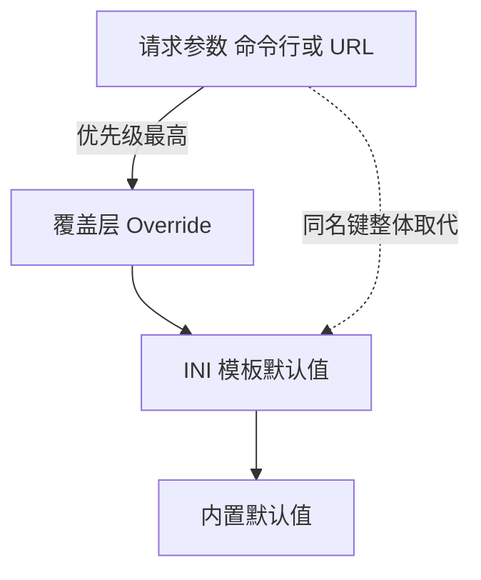

# INI-模板配置详解

INI 模板是 SubForge 的配置主体：它把"每次转换都要重复输入的一长串参数"固化成一份可
复用的文本文件。模板决定默认目标格式、节点改名与加图标规则、代理组结构、规则流，以及
可选的自定义管线。本篇逐段讲解模板的每一个段落、字段与语法，并给出一份可直接运行的
完整示例。阅读本篇前建议先完成[快速上手教程](快速上手教程)中的第一次转换。

---

## 一、模板是什么，解决什么问题

### 1.1 是什么

SubForge 的 INI 模板沿用 subconverter 的写法：一份纯文本文件，由若干 `[段落]` 组成，
每个段落里是 `键 = 值` 形式的配置项。文件本身不含节点数据，只描述"如何转换"。

模板通过三个入口进入转换流程：

| 入口 | 写法 | 说明 |
| --- | --- | --- |
| 命令行 | `subforge convert -config demo.ini` | 本地路径或含 `://` 的远程地址（`cmd/subforge/convert.go:154-161`） |
| HTTP 接口 | `/sub?config=<地址>` | 与命令行同一套语义，可直接填远程模板地址 |
| 服务配置 | `subforge serve -config demo.ini` | 除转换参数外，还提供 `[subforge]` 段的服务级设置与热重载 |

### 1.2 为什么需要它

没有模板时，每一个参数都要在命令行或订阅地址里重复书写：目标格式、节点前缀、改名规则、
代理组、规则流。这些内容在多次转换之间几乎不变，重复书写的代价不只是繁琐，更在于它们
会散落在客户端的订阅地址里，无法统一修改。

模板把这些稳定配置收拢到一处，并带来两个直接收益：

- 订阅地址可以很短，只保留真正随请求变化的部分（如来源地址、临时过滤条件）。
- 共享一份模板给多台设备时，个体差异写在各自的覆盖层里，而不是各自复制一份模板
  （见[覆盖层-Override-详解](覆盖层-Override-详解)）。

### 1.3 模板在整条链路中的位置

模板不参与节点抓取与解析，它在解析完成之后、变换管线之前把语义注入到请求参数里。


### 1.4 注意什么

- 模板是**默认值层**，不是最高优先级。请求参数一旦出现同名键，会整体取代模板里的该键
  （`internal/convert/chain.go:8-23`）。
- 模板文件按 UTF-8 解析，且**不识别字节序标记**（BOM）。带 BOM 的文件会在第一行报
  `无法解析的行（应为 key = value）`，详见第七节的排错条目。
- 模板不做网络访问，除 `[ruleset]` 中声明的远程规则集由转换引擎在展开阶段拉取。

---

## 二、语法基础

### 2.1 段落、键与值

| 语法元素 | 写法 | 说明 |
| --- | --- | --- |
| 段落头 | `[common]` | 单独一行，`[` 开头 `]` 结尾，名称首尾空白被去掉（`internal/template/ini.go:394-403`） |
| 键值对 | `target = clash.meta` | 按第一个 `=` 或 `:` 拆分，`=` 优先（`internal/template/ini.go:434-445`） |
| 键 | `target` | 首尾空白被去掉 |
| 值 | `clash.meta` | **只去首部空白**，尾部空白保留（见 2.3） |
| 重复键 | 同一段落内同名键 | 默认后者覆盖前者；少数键为"可重复键"，逐条追加（见 2.4） |

### 2.2 注释与指令

| 形式 | 作用范围 | 说明 |
| --- | --- | --- |
| `#` | 行内任意位置起注释 | `internal/template/ini.go:383-391` |
| `;` | 仅行首起注释 | 因为值里合法出现分号，例如改名规则的多条写法 |
| `!include <路径>` | 仅顶层（任何段落之前） | 把目标文件整份合并进来（`internal/template/ini.go:409-421`） |
| `!import <路径>` | 任意层级 | 段内使用时只合入同名段落 |
| `!!import <路径>` | 任意层级 | 同 `!import` |

`!include` 只在顶层生效，原因是在 `[common]` 段落内 `!include` / `!exclude` 是节点名
过滤的合法键名，段内误判会把用户写的正则当成文件路径去读
（`internal/template/ini.go:411-413`）。引用链出现环时会直接报错
`!include: 循环引用 <路径>`（`internal/template/ini.go:331-333`）。

所有 include 的路径都限定在**根模板所在目录**内：绝对路径、`../` 越界与指向目录外的
符号链接都会被拒绝。通过 `config=<URL>` 拉取的远程模板没有本地基准目录，其中的任何
include 也一律拒绝，避免远程内容借模板读取本机文件。

### 2.3 值里的空白与引号

解析器只去掉值的**首部**空白，尾部空白被保留，因此 `[node_pref]` 的前缀可以写成
`ss = 🇭🇰 `（末尾带一个空格）来让前缀与节点名之间留出间隔
（`internal/template/ini.go:432-433`、`internal/config/template.go:369-372`）。

解析器**不处理引号**：引号是值的一部分。写成 `ss = "🇭🇰 "` 会让双引号进入前缀，
产物里的节点名会变成 `"🇭🇰 "HK-01`。需要正则里含空格时不要加引号，直接写。

### 2.4 可重复键

绝大多数键遵循"后者覆盖前者"。以下键在同一段落内重复出现时逐条追加，顺序有意义
（`internal/template/ini.go:30-49`）：

| 可重复键 | 所属段落 | 为什么必须追加 |
| --- | --- | --- |
| `custom_proxy_group` | `[custom]` 等 | 模板一行一条地声明分组，覆盖语义只剩最后一条 |
| `rules` | `[custom]`、`[common]` | 规则流靠顺序决定优先级 |
| `ruleset` | `[custom]`、`[ruleset]` | 一行一个规则集 |
| `step` | `[pipeline:<名>]` | 一行一步，覆盖语义只剩最后一步 |
| `prepend` / `append` | `[override.rules]` | 覆盖层的规则逐条追加 |
| `proxy` | `[override.group:<名>]` | 一个组可以有多个成员 |

此外 `[clash_proxy_group]` 段落内的**全部**键都按追加处理，这是为了让多个代理组各自的
`name`、`type` 不互相覆盖，块的边界由 `---` 分隔符维持
（`internal/template/ini.go:367-374`）。

### 2.5 段落一览

| 段落 | 作用 | 是否必需 |
| --- | --- | --- |
| `[common]` | 通用转换参数，键名即参数名 | 否 |
| `[node_pref]` | 按协议类型给节点名加前缀，可限定生效范围 | 否 |
| `[rename]` | 按正则改名 | 否 |
| `[emoji]` | 按正则前置图标 | 否 |
| `[clash_proxy_group]` | 声明代理组，`---` 分隔多个 | 否 |
| `[ruleset]` | 规则集名到类型的映射 | 否 |
| `[custom]` | subconverter 风格的内联分组与规则 | 否 |
| `[pipeline:<名>]` | 命名管线定义 | 否 |
| `[subforge]` | 服务级设置（令牌、混合端口、产物名） | 否 |

---

## 三、`[common]` 段落

### 3.1 是什么

`[common]` 是通用参数段落，**键名就是参数名**，取值与 URL 查询参数完全一致。段落里的
内容会被翻译成请求参数，再与请求侧参数合并（`internal/config/template.go:199-213`）。

兼容 subconverter 的写法：键名前面的 `!` 会被去掉，`!target` 与 `target` 等价
（`internal/config/template.go:205`）。

### 3.2 常用字段

| 字段 | 取值 | 默认值 | 说明 |
| --- | --- | --- | --- |
| `target` | 目标格式名，如 `clash.meta`、`sing-box`、`surge` | `clash.meta` | 未给 `-format` 或 `target` 参数时的默认格式；可用写法共 36 个，另有 `sub`、`subscription` 两个等价写法 |
| `list` | `1` / `true` / `yes` / `on` | — | 等价于 `target=list`，输出分享链接清单 |
| `include` | 节点名正则，多条用 `;` 分隔 | — | 白名单，与 `exclude` 同为"与"关系 |
| `exclude` | 节点名正则，多条用 `;` 分隔 | — | 黑名单 |
| `type` | 协议类型，逗号或分号分隔 | — | 协议白名单，如 `ss,vmess,trojan` |
| `sort` | `name` / `type` / `server` / `port` / `original`，或布尔值 | — | 布尔 `true` 映射为按名排序，`false` 映射为原序 |
| `rename` | `正则,替换` | — | 多条用 `;` 分隔 |
| `emoji` | `正则,替换` | — | 多条用 `;` 分隔 |
| `rules` | 规则行 | — | 分号分隔，形如 `GEOIP,CN,DIRECT` |
| `udp` / `tfo` / `scv` / `tls13` | `1` / `true` / `yes` / `on` | — | 传给渲染器的节点开关 |
| `pipeline` | 命名管线名 | — | 选中 `[pipeline:<名>]`，见第六节 |

字段的解析与校验位置：`internal/convert/params.go:100-192`。

### 3.3 被拦截的键

以下键写在 `[common]` 里**不会**成为转换参数，它们在解释阶段被主动跳过
（`internal/config/template.go:334-347`）：

| 键 | 为什么被跳过 |
| --- | --- |
| `node_pref` | 用于选择 `[node_pref]` 块，不是参数 |
| `rename` / `emoji` | 需要与段落写法合并，由段落规则统一收口 |
| `rules` | 规则流由专门通道收口，走普通参数会产生重复 |
| `token` | 服务访问令牌，由 `[subforge]` 读取 |
| `local` / `remote` | 模板来源开关，尚未实现 |
| `emoji_type` / `node_order` / `node-order` | 图标表选择与排序规则，尚未实现 |

把 `token` 写在 `[common]` 里是 subconverter 的旧习惯，SubForge 仍兼容这一写法：
当 `[subforge] token` 为空时会回退读取 `[common] token`
（`internal/config/settings.go:56-61`）。新写的模板建议直接使用 `[subforge]`。

### 3.4 一个易踩的坑：`mixed-port`

`[common] mixed-port` **不会**影响任何一处的产物端口。原因有两层：

- 命令行 `convert` 的端口来自 `-mixed-port` 标志，默认 7890，不读 `[common]`
  （`cmd/subforge/convert.go:97`、`cmd/subforge/convert.go:166`）。
- 服务端 `serve` 的端口来自 `[subforge] mixed_port` 或 `-mixed-port`
  （`cmd/subforge/serve.go:114`、`cmd/subforge/serve.go:124`、`cmd/subforge/serve.go:160`）。

因此产物的端口请写在 `[subforge] mixed_port`（服务端）或用 `-mixed-port` 指定。

---

## 四、节点改名相关的三个段落

### 4.1 `[node_pref]`

**是什么**：按协议类型给节点名加前缀。键是协议类型名（`ss`、`vmess`、`vless`、
`trojan`、`hysteria2` 等），值是前缀文本。

**为什么**：同一份订阅里不同协议的节点混在一起时，前缀可以让节点名自带协议信息，
便于在客户端里按名称排序与检索。

**怎么用**：

| 键 | 取值 | 默认值 | 说明 |
| --- | --- | --- | --- |
| `<协议类型>` | 任意文本 | — | 该协议节点的名称前缀，尾部空格保留 |
| `include` | 节点名正则，`;` 分隔 | — | 限定前缀只对这些节点生效 |
| `exclude` | 节点名正则，`;` 分隔 | — | 限定前缀对这些节点不生效 |
| `sort` | — | — | 已识别但当前未实现，写了不生效 |
| `prefix` / `suffix` / `remove` | — | — | 已识别但当前未实现，写了不生效 |

`include` / `exclude` 之外的三个控制键被解析器识别为控制键并跳过，不会当成协议类型
（`internal/config/template.go:349-353`）。

**注意什么**：前缀在**改名之前**应用。这一点是刻意的：前缀按协议类型加，而
`include` / `exclude` 按节点名判定，若先改名会让判定基准漂移
（`internal/convert/params.go:218-220`）。因此不要指望用 `[rename]` 的结果去匹配
`[node_pref] include`。

### 4.2 `[rename]` 与 `[emoji]`

**是什么**：两个结构相同的段落，一行一条规则，**键是正则、值是替换文本**。

**为什么**：机场给出的节点名常带冗长的带宽、倍率后缀，且各家的命名习惯不同。改名与加
图标让产物中的节点名整齐可读。

**怎么用**：

```ini
[rename]
" - .*$" =
"香港" = HK

[emoji]
"HK" = 🇭🇰 
"JP" = 🇯🇵 
```

第一行的值刻意留空，语义是"把匹配到的部分删除"。

**注意什么**：

- 同一段落内一行一条规则；若某行的值里含分号，则该行按"多条规则列表"处理，键只作为
  标签（`internal/config/template.go:377-398`）。
- 段落规则与 `[common]` 里的 `rename=` / `emoji=` 行规则是**叠加**关系：段落规则先生效，
  `[common]` 里的行规则后生效，后写的能改前一个规则留下的名字
  （`internal/config/template.go:215-226`）。
- 正则不合法会在参数解析阶段直接报错，不会等到产物生成才暴露
  （`internal/convert/params.go:161-171`）。
- 图标段落的值末尾留一个空格，可以让图标与节点名之间产生间隔。

---

## 五、代理组与规则

### 5.1 `[clash_proxy_group]`

**是什么**：声明 Clash / mihomo 产物中的代理组。段落内允许同名键重复，多个组之间用
单独一行的 `---` 分隔。

**为什么**：代理组决定客户端的节点选择方式。把它写进模板后，所有设备的组结构保持一致。

**字段表**（`internal/config/template.go:415-463`）：

| 字段 | 取值 | 默认值 | 说明 |
| --- | --- | --- | --- |
| `name` | 文本 | — | 组名；**缺省时整个块被丢弃** |
| `type` | `select` / `url-test` / `fallback` / `load-balance` 等 | `select` | 组类型 |
| `proxies` | 成员列表，`;` 或 `,` 分隔 | — | 成员可以是节点名正则、组名或 `DIRECT` |
| `nodes` / `nodes-list` / `proxy-list` | 同上 | — | `proxies` 的同义键 |
| `use` / `providers` / `provider` | proxy-provider 名 | — | 与成员列表可并存 |
| `url` / `test` | 测活地址 | — | `url-test` / `fallback` 使用 |
| `interval` | 非负整数（秒） | — | 测活间隔 |
| `tolerance` | 非负整数（毫秒） | — | 容忍延迟 |
| `timeout` | 非负整数（毫秒） | — | 单次测活超时 |
| `idle` | 非负整数（毫秒） | — | 空闲判定 |
| `strategy` | `global` / `compatible` | — | 仅这两个取值被接受，其他取值被忽略 |
| `lazy` | `1` / `true` / `yes` / `on` | — | 惰性测活 |

`name` 缺失时该块被跳过而不是自动补名，理由是产物里无法引用一个没有名字的组
（`internal/config/template.go:415-417`）。

**注意什么**：多个组必须写在**同一个** `[clash_proxy_group]` 段落里。INI 解析器会合并
同名段落，重复书写段落头只会得到一个组。

该段落采用"识别即取值、不认识就跳过"的策略：写了不在上表中的键不会报错，只是被忽略；
`strategy` 写成 `global` 与 `compatible` 之外的值同样被忽略
（`internal/config/template.go:418-459`）。因此产物里缺少某个字段时，先对照上表核对键名
拼写，而不要先怀疑渲染器。

### 5.2 `[ruleset]`

**是什么**：规则集名到类型的映射，一行一个。

**为什么**：`/getruleset` 接口需要知道某个规则集该渲染成什么形态。类型写在模板里之后，
请求侧只传规则集名即可。

**怎么用**：

```ini
[ruleset]
DIRECT = []GEOIP,CN
FINAL = []FINAL
```

段落里的每一行会被翻译成一条 `ruleset:<名称>:<类型>` 参数
（`internal/config/template.go:234-243`）。取值优先级为：URL 参数 > 模板 `[ruleset]`
段落（`internal/api/handlers.go:111-213`）。

**注意什么**：`ruleset:<名称>:<类型>` 参数缺类型会直接报错
`ruleset 参数 %q 缺少类型（应为 ruleset:<名称>:<类型>）`
（`internal/convert/params.go:183-186`）。

### 5.3 `[custom]` 段落

**是什么**：承载 subconverter 风格的内联分组与内联规则。它的键名同样"即参数名"，但
以下键被拦截，不作为普通参数（`internal/config/custom.go:46-55`）：

| 键 | 实际作用 |
| --- | --- |
| `custom_proxy_group` | 内联分组定义，一行一个组 |
| `rules` | 内联规则行，`;` 分隔 |
| `ruleset` | 内联规则集定义 |
| `custom_rules` | 名字像内联声明，实际是"是否启用自定义规则"的布尔开关 |
| `enable_rule_generator` | 已识别但未实现 |
| `overwrite_original_rules` | 已识别但未实现 |

**内联分组语法**（`internal/config/custom.go:81-124`）：

```text
<组名>`<类型>`<成员>`<成员>`…[`<测活地址>`<参数>]
```

- 用反引号分隔各段，第一段是组名，第二段是类型。
- 成员前带 `[]` 表示引用另一个组；不带 `[]` 的按节点名正则处理。
- 测活地址必须带 `http://` 或 `https://` 前缀才会被识别；其后的参数段只有
  `url-test` 与 `fallback` 会读取，`select` 组带了也会被丢弃
  （`internal/config/custom.go:101-115`、`internal/config/custom.go:149-152`）。

示例：

```ini
[custom]
custom_proxy_group=节点池`select`.*
custom_proxy_group=自动测速`url-test`[]节点池`https://www.gstatic.com/generate_204`300,,50
```

上例中 `[]节点池` 表示"引用名为 `节点池` 的组"，产物里 `自动测速` 的成员就是
`节点池`；不带 `[]` 的成员（如 `.*`）按节点名正则展开。**注意**：方括号在解析期就被
剥掉，是否为组引用要到成员解析阶段才判定，因此写 `[]DIRECT` 不会得到"引用 DIRECT 组"
的效果——不存在名为 `DIRECT` 的组时它只会被当作字面成员。

**内联规则集语法**（`internal/config/custom.go:205-246`）：

```text
<组名>,<类型>[,<取值>][,<附加>]
```

- `[]` 前缀表示内置规则集，取值可以是 `GEOSITE` / `GEOIP` / `FINAL`。
- 冒号前缀表示远程规则集，形如 `clash-domain:<地址>` 或 `clash-classic:<地址>`，
  `clash-` 前缀会被剥掉。
- `GEOIP` 未写 flag 时自动补 `no-resolve`，否则 mihomo 会把整个数据集当成需要做
  DNS 解析的目标（`internal/config/custom.go:187-192`）。
- `FINAL` 会生成一条 `MATCH` 行。

**注意什么**：两种分组写法会合并，顺序是"`[custom]` 内联分组先接入，`[clash_proxy_group]`
的组后追加"（`internal/config/template.go:285-301`）。同名组由后出现的定义覆盖，因此
两种写法混用时组名要保持唯一。

`[custom]` 里出现无法识别的 `custom_` 前缀键时，转换不会失败，但会在
标准错误输出一条提示，说明该定义被忽略
（`internal/config/template.go:303-331`）。这类提示必须看：产物可能是"节点齐、规则空"。

---

## 六、命名管线 `[pipeline:<名>]`

### 6.1 是什么

命名管线让模板自己声明一条变换管线，请求侧用 `pipeline=<名>` 选中它。段落名是
`pipeline:` 加管线名，段落内只认两个键（`internal/config/pipeline.go:151-186`）：

| 键 | 取值 | 默认值 | 说明 |
| --- | --- | --- | --- |
| `step` | `<步骤类型> [键=值]...` | — | 一行一步，可重复 |
| `on_error` | `abort` / `skip` / `warn` | `abort` | 段落级错误处理策略 |

### 6.2 为什么

默认管线的七个阶段是固定的。需要"只保留某类节点再改名"这类组合时，写命名管线比堆叠
请求参数更清晰，也便于在模板里复用。

### 6.3 怎么用

```ini
[pipeline:lite]
step = filter.regex include=^HK
step = op.rename pattern=^HK repl=香港
on_error = skip
```

选中它：

```bash
subforge convert -file sub.b64 -config demo.ini -pipeline lite
```

可用的步骤类型与必需参数（`internal/config/pipeline.go:97-149`）：

| 步骤类型 | 必需参数 | 说明 |
| --- | --- | --- |
| `filter.regex` | `include` / `exclude` | 按名称正则筛选 |
| `filter.region` | — | 按地区筛选 |
| `filter.type` | — | 按协议类型筛选 |
| `filter.script` | — | 脚本筛选 |
| `op.rename` | `pattern`、`repl` | 正则改名 |
| `op.emoji` | `pattern`、`repl` | 正则前置图标 |
| `op.dedupe` | — | 按身份指纹去重 |
| `op.split` | `sep` | 名称截断 |
| `op.sort` | `by` | 排序 |
| `op.script` | — | 脚本操作 |

### 6.4 注意什么

- `op.rename` / `op.emoji` 缺 `pattern=` 会报 `缺少 pattern=`；`op.sort` 缺 `by=` 会报
  `缺少 by=`（`internal/config/pipeline.go:97-149`）。
- 步骤参数含空格时用双引号包裹，引号在解析时被剥掉
  （`internal/config/pipeline.go:189-210`）。
- 管线名不存在时报错并退出：
  `未找到命名管线 "nope"：模板里没有 [pipeline:nope] 段落，控制台的「管线」页也没有启用的同名管线（GET /api/pipelines 可查现有名称）`
  （`internal/convert/params.go:251-264`）。命名管线除了模板里的 `[pipeline:<名>]` 段落，还可以来自控制台「管线」页，详见[转换流水线原理](转换流水线原理)第 5 节。
- `on_error` 可以按步覆盖：在 `step` 行里写 `on_error=skip` 即可。

---

## 七、`[subforge]` 段落

### 7.1 是什么

服务级设置段落，只被 `subforge serve` 读取，不参与转换参数
（`internal/config/settings.go:29-33`）。

| 字段 | 取值 | 默认值 | 说明 |
| --- | --- | --- | --- |
| `token` | 文本 | 空（不鉴权） | 访问令牌 |
| `mixed_port` | 1–65535 的整数 | `7890` | clash.meta 产物的 `mixed-port` |
| `name` | 文本 | 空 | 产物注释头中的配置名 |

### 7.2 为什么

这三个值都是"部署相关"而非"单次转换相关"：令牌属于部署凭证，混合端口属于客户端接入
参数，产物名属于标识。它们集中在这里，配置文件热重载时可以直接生效
（`cmd/subforge/serve.go:346-349`）。

### 7.3 注意什么

- `mixed_port` 取值非法（非整数、或不在 1–65535 之间）时**不报错**，静默沿用默认值
  （`internal/config/settings.go:47-51`）。
- `token` 为空时才回退读取 `[common] token`（`internal/config/settings.go:56-61`）。
- `[subforge]` 段落对 `convert` 与 `diff` 子命令没有任何影响。

---

## 八、一份完整可用的模板

以下模板可直接运行。它把目标格式、节点前缀、改名、两个代理组、规则流与一条命名管线
都写全了，并用 `!include` 演示模板拆分。

本篇所有命令都使用仓库内自带的测试订阅
`testdata/fixtures/mixed-subscription.txt`（12 个节点，节点名形如 `ss-node`、
`trojan-node`），因此无需自建订阅即可复现。

`base.ini`：

```ini
# SubForge 模板：基础部分
[common]
target = clash.meta
sort = name
udp = 1

[node_pref]
vmess = [VM] 
ss = [SS] 

[rename]
" - .*$" =

[clash_proxy_group]
name = 手动选择
type = select
proxies = .*
---
name = 自动测速
type = url-test
proxies = .*
url = https://www.gstatic.com/generate_204
interval = 300
tolerance = 50
lazy = true

[ruleset]
DIRECT = []GEOIP,CN
FINAL = []FINAL
```

`[node_pref]` 里的两行末尾各有一个空格，作用是让前缀与节点名之间留出间隔。保存时若
编辑器自动删除行尾空白，产物中的节点名会变成 `[SS]ss-node`。

`demo.ini`：

```ini
!include base.ini

[custom]
custom_proxy_group=全部节点`select`.*
custom_proxy_group=香港节点`url-test`HK`https://www.gstatic.com/generate_204`300,,50

[pipeline:lite]
step = filter.regex include="^ss-node|^trojan-node"
step = op.rename pattern="^ss-node" repl=香港-SS
on_error = warn

[subforge]
token = <YOUR_TOKEN>
mixed_port = 7890
name = demo
```

使用基础模板转换：

```bash
./bin/subforge convert -file testdata/fixtures/mixed-subscription.txt -config base.ini -out cfg.yaml
```

预期输出（标准错误）：

```text
配置模板: /path/to/base.ini
管线: 12 -> 12 节点
已写入 cfg.yaml
完成: clash.meta, 4591 字节, 12 节点, 8ms
```

产物中的两个代理组各自包含全部 12 个节点，且 `[node_pref]` 的前缀已经生效：

```text
  - name: 手动选择
    type: select
    proxies:
      - '[SS] ss-node'
      - '[VM] vmess-node'
```

注意前缀与节点名之间的那个空格来自模板行尾空白。若编辑器删掉了它，这里会显示为
`'[SS]ss-node'`。

选中命名管线后节点数会下降，因为管线第一步就做了筛选：

```bash
./bin/subforge convert -file testdata/fixtures/mixed-subscription.txt -config demo.ini -pipeline lite -out lite.yaml
```

预期输出（标准错误）：

```text
配置模板: /path/to/demo.ini
管线: 12 -> 2 节点
已写入 lite.yaml
完成: clash.meta, 1516 字节, 2 节点, 2ms
```

此时产物中的节点只剩两个，且第一个被改名为 `香港-SS`：

```text
    name: 香港-SS
    name: trojan-node
```

代理组则被 `[custom]` 的两个内联组取代：`[custom]` 的内联分组先接入，之后才追加
`[clash_proxy_group]` 的组，而同名组由后出现的定义覆盖，因此 `base.ini` 里的
`手动选择` 被 `[custom]` 的 `全部节点` 顶掉，产物里只有：

```text
  - name: 全部节点
  - name: 香港节点
  - name: 自动测速
```

三处必须注意：

1. `!include base.ini` 必须写在**任何段落之前**。写在段落之内不会被当成指令，而会被
   当成普通配置行，直接报 `无法解析的行（应为 key = value）`。需要写在段落内时改用
   `!import` 或 `!!import`。
2. 需要同时保留两组分组写法时，组名不要重复：同名组会被后出现的定义整体覆盖。
3. 命名管线的 `filter.regex` 看到的是**前缀应用之前**的节点名。上例第一步用
   `^ss-node` 而不是 `^[SS]ss-node`，因为 `[node_pref]` 的前缀属于管线内部的
   `node_pref` 阶段，而 `filter` 阶段排在它之前。

---

## 九、优先级与合并规则

### 9.1 整体优先级

从高到低：URL / 命令行参数 > 覆盖层 > INI 模板 > 内置默认值。



### 9.2 合并粒度

模板与请求参数的合并发生在**原始参数 map** 层，粒度是"整个键"而不是"追加取值"
（`internal/convert/chain.go:8-23`）。这意味着在 URL 上写 `include=HK` 会**完全取代**
模板里的 `include`，而不是把两套正则叠加。这样设计是为了让"临时关掉某个过滤"成为可能。

两个结构化字段的规则略有不同，它们在请求侧非空时用请求侧的，否则用模板的
（`internal/convert/chain.go:45-54`）：

| 字段 | 来源 | 规则 |
| --- | --- | --- |
| `NodePref` | `[node_pref]` 段落 | 请求侧非空则用请求侧 |
| `Groups` | `[clash_proxy_group]` 或 `[custom]` | 请求侧非空则用请求侧 |

### 9.3 段落内的叠加顺序

`[rename]` 与 `[emoji]` 的段落规则先于 `[common]` 里的行规则生效
（`internal/config/template.go:215-226`）。规则流的顺序按段落与行的出现顺序排列，
顺序本身是语义的一部分，因为 mihomo 按顺序匹配、靠后的规则优先级低
（`internal/config/template.go:245-250`）。

---

## 十、常见写法错误

| 现象 | 原因 | 修正 |
| --- | --- | --- |
| 第一行报 `无法解析的行（应为 key = value）` | 文件带 UTF-8 BOM | 另存为"UTF-8 无 BOM" |
| 报 `键 "x" 出现在任何段落之前` | 键值对写在了第一个段落头之前 | 补上段落头 |
| 报 `未知键 "x"（pipeline 段落只认 step / on_error）` | `[pipeline:<名>]` 里写了别的键 | 只保留 `step` 与 `on_error` |
| 报 `段落 [pipeline:] 缺少管线名` | 段落头写成 `[pipeline:]`，冒号后为空 | 写成 `[pipeline:<名称>]` |
| `[pipeline]` 段落被静默忽略 | 缺少冒号，解析器不把它当管线段落 | 写成 `[pipeline:<名称>]` |
| 报 `无法解析的行（应为 key = value）`，行内容是 `!include ...` | `!include` 写在段落之内，只在顶层被识别为指令 | 移到文件开头，或改用 `!import` |
| 报 `第 N 行的 step 参数 "x" 应为 key=value` | 步骤参数不是 `键=值` 形式 | 补上 `=` |
| 只生效了最后一个代理组 | 把多个组写成了多个同名段落 | 合并到一个段落，用 `---` 分隔 |
| 写进 `[clash_proxy_group]` 的组没有出现在产物里 | 用了 `group = <类型>,<组名>,<成员>` 这类 subconverter 写法 | 该段落只认 `name` / `type` / `proxies` 等字段名，`group` 键会被忽略 |
| 模板里的组被内联组顶掉 | 两种分组写法出现同名组，后出现的整体覆盖 | 组名保持唯一 |
| 节点名里出现引号 | 值里写了引号，解析器不剥离引号 | 去掉引号 |
| 前缀没有间隔 | 值末尾的空格被编辑器删除 | 在值末尾补一个空格 |
| 模板里的 `include` 没生效 | URL 上同时写了 `include`，整体取代了模板值 | 二者只留一处 |
| `[common] mixed-port` 改了产物却没变 | 该键不是有效参数 | 用 `[subforge] mixed_port` 或 `-mixed-port` |

---

## 相关页面

- [快速上手教程](快速上手教程)
- [覆盖层-Override-详解](覆盖层-Override-详解)
- [转换流水线原理](转换流水线原理)
- [故障排查与常见问题](故障排查与常见问题)
- [安装与部署](安装与部署)
