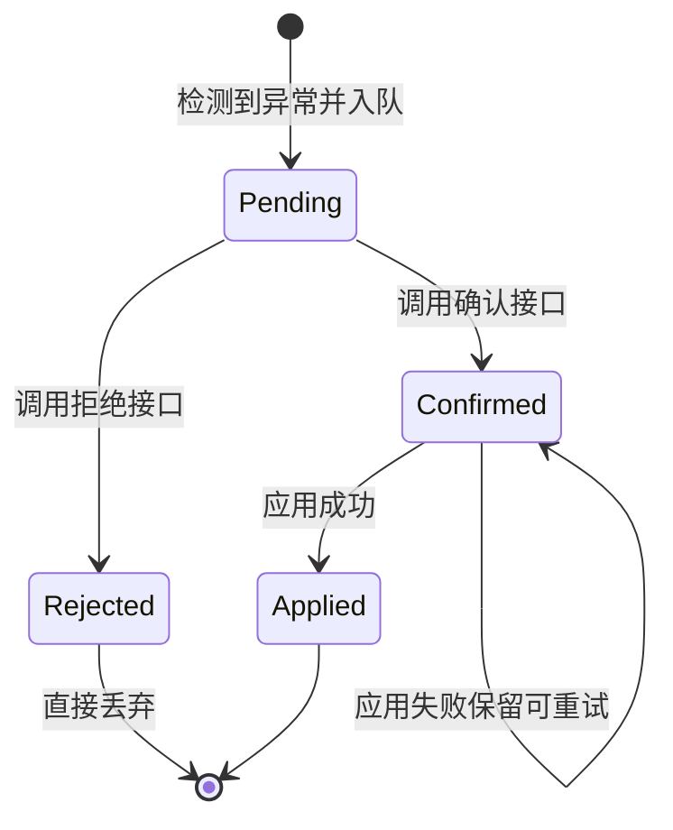

# Rule-Bot-智能建议

> Rule-Bot 是 SubForge 的规则反馈闭环：它从运行日志里识别异常，把异常转成"建议怎么做"的条目放进待确认队列，由人工确认后再提交到规则库。设计目标是让"发现问题"和"修改规则"之间不再需要人工逐条翻日志。
>
> 本页说明异常检测的判定规则、建议的状态流转、对外接口与命令行用法，并如实标注当前实现边界——其中"生成具体规则行"这一步仍是占位。
>
> 事实来源：`internal/rulebot/rulebot.go`、`internal/rulebot/loop.go`、`internal/api/suggestions.go`、`internal/api/server.go`、`cmd/subforge/rulebot.go`、`cmd/subforge/serve.go`。

---

## 1. 这一页解决什么问题

规则问题往往先以日志的形式出现：某个节点连不上、某条规则写错、上游返回的格式解析失败。传统做法是人工读日志、判断原因、再手写一条规则补进去，整个过程依赖经验且容易漏。

Rule-Bot 把这条路径拆成四步（`internal/rulebot/rulebot.go:1-4` 的包注释）：

1. **摄入**：把日志行交给闭环，来源由调用方标注；
2. **检测**：用正则匹配已知的异常特征，命中即归入某个异常类型；
3. **成建议**：为命中的异常生成一条建议，包含动作、理由与（设计上的）规则行；
4. **确认后应用**：人工确认的建议才会被提交到规则库，拒绝的直接丢弃。

需要先说明：第 3 步里的"规则行"目前恒为空串，因此第 4 步实际写入 0 条。细节见第 9 节。

## 2. 组成部件与数据结构

Rule-Bot 由三个类型组成：`Detector`（检测器，持有正则模式表与按类型的计数）、`PendingQueue`（待确认建议队列）、`Loop`（把检测与队列串起来并负责去重）。

### 2.1 异常类型

异常类型是字符串常量，取值即 API 与日志里出现的字面量（`internal/rulebot/rulebot.go:17-23`）：

| 常量 | 取值 | 含义 | 源码位置 |
| --- | --- | --- | --- |
| `AnomalyNodeUnreachable` | `node_unreachable` | 节点不可达 | `internal/rulebot/rulebot.go:18` |
| `AnomalyRuleConflict` | `rule_conflict` | 规则冲突 | `internal/rulebot/rulebot.go:19` |
| `AnomalyFormatError` | `format_error` | 格式错误 | `internal/rulebot/rulebot.go:20` |
| `AnomalyParseError` | `parse_error` | 解析错误 | `internal/rulebot/rulebot.go:21` |
| `AnomalyUnknown` | `unknown` | 未分类 | `internal/rulebot/rulebot.go:22` |

`unknown` 是保留取值：检测器没有为它注册任何模式，未命中的日志行会返回空结果而不是归入 `unknown`（`internal/rulebot/rulebot.go:160`）。

### 2.2 异常与建议的字段

`Anomaly` 描述"发生了什么"（`internal/rulebot/rulebot.go:26-32`）：

| 字段 | 类型 | 说明 | 源码位置 |
| --- | --- | --- | --- |
| `Type` | `AnomalyType` | 命中的异常类型 | `internal/rulebot/rulebot.go:27` |
| `Message` | `string` | 命中的片段，已去掉首尾空白 | `internal/rulebot/rulebot.go:28` |
| `Source` | `string` | 来源标识，如订阅名、URL、文件名 | `internal/rulebot/rulebot.go:29` |
| `Timestamp` | `time.Time` | 检测时刻 | `internal/rulebot/rulebot.go:30` |
| `Raw` | `string` | 原始日志行 | `internal/rulebot/rulebot.go:31` |

`Suggestion` 描述"建议怎么做"（`internal/rulebot/rulebot.go:35-41`）：

| 字段 | 类型 | 说明 | 源码位置 |
| --- | --- | --- | --- |
| `Anomaly` | `Anomaly` | 该建议对应的异常 | `internal/rulebot/rulebot.go:36` |
| `Action` | `string` | 动作，取值 `prepend`、`append`、`replace` | `internal/rulebot/rulebot.go:37` |
| `Rule` | `string` | 建议的规则行 | `internal/rulebot/rulebot.go:38` |
| `Reason` | `string` | 生成理由，中文前缀加命中片段 | `internal/rulebot/rulebot.go:39` |
| `AutoApply` | `bool` | 是否自动应用，内置模式一律为 `false` | `internal/rulebot/rulebot.go:40` |

`AutoApply` 字段在仓库内只有赋值、没有读取点，也就是说**自动应用分支尚未实现**，任何建议都必须人工确认。

## 3. 内置检测模式

### 3.1 四条内置模式

检测器在创建时注册四条模式（`internal/rulebot/rulebot.go:64-117`）。正则一律带 `(?i)` 前缀，即大小写不敏感：

| 异常类型 | 正则 | 建议动作 | 生成理由前缀 | 源码位置 |
| --- | --- | --- | --- | --- |
| `node_unreachable` | `(?i)(unreachable\|timeout\|connection refused\|no route to host)` | `append` | 节点不可达 | `internal/rulebot/rulebot.go:68-75` |
| `rule_conflict` | `(?i)(conflict\|duplicate rule\|already exists)` | `replace` | 规则冲突 | `internal/rulebot/rulebot.go:81-88` |
| `format_error` | `(?i)(invalid\|malformed\|bad format\|unrecognized)` | `prepend` | 格式错误 | `internal/rulebot/rulebot.go:94-101` |
| `parse_error` | `(?i)(parse error\|syntax error\|unexpected token)` | `prepend` | 解析错误 | `internal/rulebot/rulebot.go:107-114` |

匹配是**子串级**的：日志行里只要出现 `timeout` 就会被判为节点不可达，不需要整行符合某种格式。这带来一个直接后果——误报率取决于日志用词，例如一条写着 `upstream timeout while fetching ruleset` 的日志同样会被归入 `node_unreachable`。

### 3.2 检测顺序与首命中

`Analyze` 按注册顺序遍历模式，**第一个命中就返回**，后面的模式不再尝试（`internal/rulebot/rulebot.go:143-159`）。注册顺序即上表顺序，因此当一行日志同时含有 `timeout` 与 `invalid` 时，结果是 `node_unreachable` 而不是 `format_error`。

每次命中都会给该类型的计数器加一（`internal/rulebot/rulebot.go:154-156`），计数只存在于内存中，进程重启后归零。

### 3.3 自定义模式

`Detector.AddPattern` 允许在运行时追加模式，需要提供异常类型、正则与一个生成建议的回调（`internal/rulebot/rulebot.go:120-133`）。正则编译失败时返回 `编译正则 %q: %w`，模式表不会变化。

需要注意两点：自定义模式追加在四条内置模式**之后**，因此优先级低于内置模式；`AddPattern` 在仓库内没有生产调用点，目前只有包内测试使用，属于**已实现但未接入**的能力。

## 4. 闭环状态机

一条建议从产生到落地，最多经历五个状态。下图的迁移条件全部对应可调用的接口或函数：



| 状态 | 对应数据结构 | 进入方式 | 离开方式 | 源码位置 |
| --- | --- | --- | --- | --- |
| 待确认 | `PendingQueue.items` | `Enqueue` | `Confirm` 或 `Reject` | `internal/rulebot/rulebot.go:186-190` |
| 已确认 | `PendingQueue.confirmed` | `Confirm` 按索引移入 | `ApplyConfirmed` 成功后清空 | `internal/rulebot/rulebot.go:202-211` |
| 已拒绝 | 无（直接丢弃） | `Reject` 按索引删除 | 不保留记录 | `internal/rulebot/rulebot.go:214-222` |
| 已应用 | 规则库 | `ApplyConfirmed` 调用注入的落库函数 | 不保留在队列中 | `internal/rulebot/loop.go:65-69` |

"应用失败保留可重试"是刻意设计：落库函数返回错误时不清空已确认列表，返回的错误与已收集条数一并交给调用方（`internal/rulebot/loop.go:52` 的注释与 `:65-67` 的实现）。

## 5. 建议队列与去重

### 5.1 摄入去重

`Loop.Ingest` 在入队前做一次去重，去重键是"异常类型 + 来源 + 原始日志行"三段拼接（`internal/rulebot/loop.go:35`）。同一份日志被重复摄入时，只有第一次会入队，函数返回新增条数（`internal/rulebot/loop.go:37-44`）。

空行与只有空白的行直接跳过（`internal/rulebot/loop.go:28-30`）；没有命中任何模式的行走不到入队分支，不计入返回条数。

### 5.2 队列操作

| 操作 | 方法 | 越界行为 | 源码位置 |
| --- | --- | --- | --- |
| 入队 | `Enqueue` | 无 | `internal/rulebot/rulebot.go:186` |
| 列出待确认 | `Pending` | 返回副本，修改副本不影响队列 | `internal/rulebot/rulebot.go:193-199` |
| 确认 | `Confirm(index)` | 返回 `索引 %d 超出范围（共 %d 条）` | `internal/rulebot/rulebot.go:202-211` |
| 拒绝 | `Reject(index)` | 同上 | `internal/rulebot/rulebot.go:214-222` |
| 列出已确认 | `Confirmed` | 返回副本 | `internal/rulebot/rulebot.go:225-231` |
| 清空已确认 | `ClearConfirmed` | 无 | `internal/rulebot/rulebot.go:234-238` |

队列的所有状态都在内存里，`PendingQueue` 结构体没有持久化字段（`internal/rulebot/rulebot.go:175-179`）。服务重启后待确认与已确认列表都会丢失。

## 6. HTTP 接口

### 6.1 接口一览

路由注册在 `internal/api/server.go:238-241`，处理器实现在 `internal/api/suggestions.go`：

| 方法与路径 | 用途 | 成功响应 | 失败约定 | 源码位置 |
| --- | --- | --- | --- | --- |
| `GET /api/suggestions` | 列出待确认建议 | `{"suggestions":[...]}` | 非 GET 返回 405 | `internal/api/suggestions.go:20-30` |
| `POST /api/suggestions/{index}/confirm` | 确认一条建议 | `{"ok":true}` | 队列未启用 501；索引非法或越界 404 | `internal/api/suggestions.go:42-60` |
| `POST /api/suggestions/{index}/reject` | 拒绝一条建议 | `{"ok":true}` | 同上 | `internal/api/suggestions.go:63-81` |
| `POST /api/suggestions/apply` | 把已确认建议提交到规则库 | `{"applied":N}` | 队列未启用 501；落库失败 502 | `internal/api/suggestions.go:92-114` |

两个 501 的文案都是 `Rule-Bot 建议队列未启用`（`internal/api/suggestions.go:48`、`internal/api/suggestions.go:102`），含义是启动时没有注入队列，见第 8 节。索引越界的 404 文案来自队列本身，即 `索引 %d 超出范围（共 %d 条）`；索引不是数字时返回 `建议索引不存在`（`internal/api/suggestions.go:35`）。

队列未启用时 `GET /api/suggestions` 不会报错，而是返回**空数组**（`internal/api/suggestions.go:25-29`），控制台据此显示"暂无建议"。

### 6.2 调用示例

```bash
curl -s http://127.0.0.1:25500/api/suggestions \
  -H 'Authorization: Bearer <YOUR_TOKEN>'

curl -s -X POST http://127.0.0.1:25500/api/suggestions/0/confirm \
  -H 'Authorization: Bearer <YOUR_TOKEN>'

curl -s -X POST http://127.0.0.1:25500/api/suggestions/apply \
  -H 'Authorization: Bearer <YOUR_TOKEN>'
```

`apply` 使用的来源标识固定为 `scheduler`（`internal/api/suggestions.go:105`），落库动作是把收集到的规则交给 `Manager.ImportRules`（`internal/subforge/import.go:36`）。

## 7. 命令行用法

CLI 入口是 `subforge rulebot`（`cmd/subforge/rulebot.go:12`）。帮助文本列出了三个子命令（`cmd/subforge/rulebot.go:14-17`）：

| 子命令 | 帮助文本描述 | 实际状态 | 源码位置 |
| --- | --- | --- | --- |
| `analyze <file>` | 分析日志文件，输出异常与建议 | 已实现 | `cmd/subforge/rulebot.go:30-61` |
| `pending` | 列出待确认的建议 | **尚未实现**，会报未知子命令 | `cmd/subforge/rulebot.go:20-27` |
| `stats` | 输出异常类型统计 | 占位实现，只打印提示 | `cmd/subforge/rulebot.go:63-67` |

`analyze` 逐行读取文件并打印命中结果，每条形如 `[node_unreachable] timeout`、`建议: append`、`理由: 节点不可达: timeout`，最后打印 `检测到 N 条异常`（`cmd/subforge/rulebot.go:48-59`）：

```bash
subforge rulebot analyze ./subforge.log
```

该子命令在进程内新建检测器与队列，**结果不会写入数据库**，队列随进程结束而丢弃（`cmd/subforge/rulebot.go:34-35`）。`pending` 与 `stats` 在 `switch` 中都没有分支（`cmd/subforge/rulebot.go:20-27`），因此 `pending` 实测会打印 `subforge: 未知子命令 "pending"` 并以退出码 1 结束。

## 8. 装配与启用条件

Rule-Bot 只在指定了数据目录时启用，装配点在 `cmd/subforge/serve.go:159-172`：


关键点有三条：

- 没有 `-data-dir` 时不创建队列与闭环，相关接口返回 501（`cmd/subforge/serve.go:159`、`cmd/subforge/serve.go:168-172`）；
- 启动时队列是**空的**，没有历史建议可读，必须先有日志被摄入（`cmd/subforge/serve.go:168` 的注释）；
- 仓库内唯一的生产摄入点是调度器的失败回调：任务失败且错误非空时，以 `scheduler` 为来源、把 `任务名: 错误` 作为一行日志摄入（`cmd/subforge/serve.go:176-180`）。

## 9. 当前实现边界

以下四点都已回源码确认，引用时请按这里的措辞，不要写成"已完整闭环"：

1. **建议里的规则行恒为空串。** 四条内置模式的回调都把 `Rule` 写成 `""`（`internal/rulebot/rulebot.go:72`、`:85`、`:98`、`:111`）。`ApplyConfirmed` 只收集非空 `Rule`（`internal/rulebot/loop.go:56-61`），因此在生产链路上 `POST /api/suggestions/apply` 会返回 `{"applied":0}`。**"由异常推导出具体规则行"这一步尚未实现**，属于占位。
2. **阈值判定尚未实现。** 包注释写的是"异常检测（正则+阈值）"，但 `detectPattern` 只有正则与回调两个字段，没有任何计数或阈值比较（`internal/rulebot/rulebot.go:50-54`）。
3. **转换日志尚未接入。** 包注释描述的输入是"转换日志/告警"，实际只有调度器任务失败这一路接入了 `Ingest`；转换过程产生的告警没有摄入点。
4. **状态不持久化。** 队列与统计都在内存中（`internal/rulebot/rulebot.go:175-179`），重启即丢；`subforge rulebot pending` 与 `stats` 分别是未实现与占位（`cmd/subforge/rulebot.go:20-27`、`:63-67`）。

`AutoApply` 字段虽然存在，但仓库内没有任何读取点，自动应用能力同样**尚未实现**（`internal/rulebot/rulebot.go:40`）。

## 10. 常见问题

| 现象 | 可能原因 | 处理方式 |
| --- | --- | --- |
| 接口返回 501 与"建议队列未启用" | 启动时没有指定 `-data-dir` | 指定数据目录后重启服务 |
| `GET /api/suggestions` 一直返回空数组 | 队列是空的，没有日志被摄入 | 确认调度器任务是否有失败记录 |
| 确认了建议但 `applied` 为 0 | 内置模式的 `Rule` 为空串 | 属当前实现边界，见第 9 节 |
| `rulebot pending` 报未知子命令 | 该子命令未实现 | 用 `GET /api/suggestions` 查看待确认建议 |
| 重启后建议全部消失 | 队列不持久化 | 重启前先确认并应用需要保留的建议 |
| 同一异常只出现一次 | 去重键是类型加来源加原始行 | 属预期行为，避免重复建议刷屏 |

## 11. 相关页面

- [分流规则引擎原理](分流规则引擎原理)：规则行的形态与规则流装配顺序
- [规则工厂与规则源](规则工厂与规则源)：规则落库与版本管理
- [流量策略与用量统计](流量策略与用量统计)：订阅采集与用量透传
- [定时任务与告警](定时任务与告警)：调度器任务与告警通道
- [HTTP-API-参考](HTTP-API-参考)：全部端点的请求与响应约定
- [Web-控制台使用指南](Web-控制台使用指南)：规则页中的建议区块
