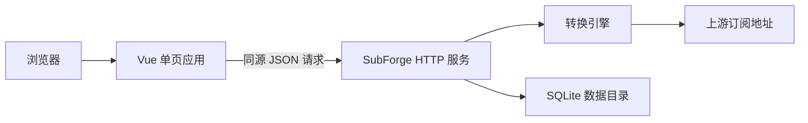
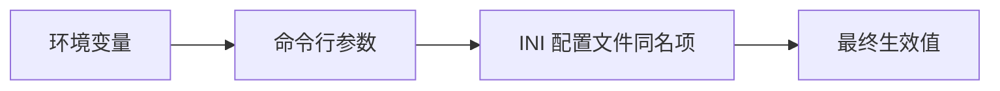
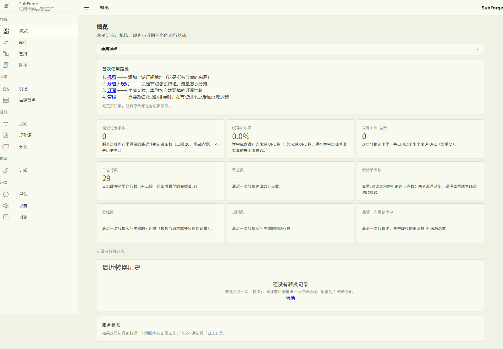
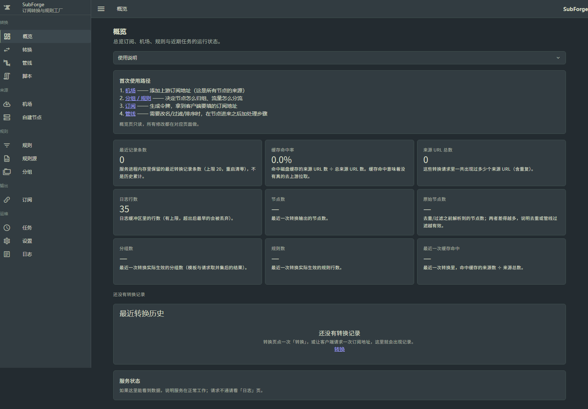
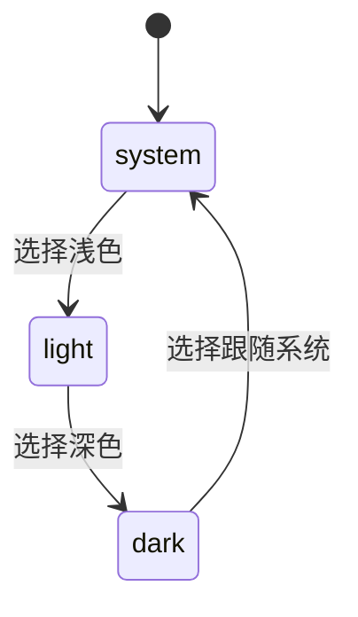
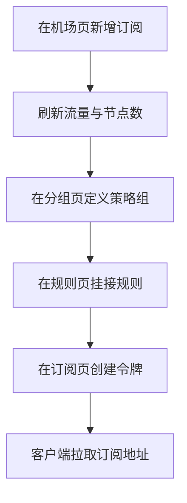

# Web-控制台使用指南

SubForge 的控制台是一个随二进制一起分发的单页应用：它不需要单独部署前端服务，也不依赖外部数据库，只要 `subforge serve` 正常运行，就可以用浏览器完成机场管理、规则维护、订阅生成与运行状态查看。

本页面向日常使用控制台的管理员，按「打开与前置条件 → 界面总览 → 逐页说明 → 常见任务路径 → 已知限制」的顺序组织。所有页面名称、路由与界面文案均取自 `web/src/` 下的真实源码，并在需要处标注来源。

## 1. 打开控制台与前置条件

### 1.1 访问地址

控制台与 HTTP 接口同源，默认地址为 `http://127.0.0.1:25500/`（`cmd/subforge/serve.go:108`）。前端产物在构建时直接输出到 Go 的 embed 目录 `internal/api/web/dist`（`web/vite.config.ts:13`），由服务端从内嵌文件系统读取 `index.html` 返回（`internal/api/spa.go:90-99`）。因此控制台没有独立的端口，也不需要配置跨域。

路由回落规则为：真实存在的静态文件直接返回；带扩展名但文件不存在时返回 404，不会回落成 HTML；其余无扩展名路径一律返回 `index.html`，交由前端路由处理（`internal/api/spa.go:17-68`）。控制台使用浏览器历史模式，因此深层链接可以直接打开或刷新。

静态资源按扩展名返回对应的内容类型，前端资源与接口互不干扰（`internal/api/web.go:32-47`）。

### 1.2 前置条件

| 条件 | 影响 | 说明 |
| --- | --- | --- |
| 已启动 `subforge serve` | 必需 | 未启动时页面无法打开 |
| 提供数据目录（`-data-dir` 或 `SUBFORGE_DATA_DIR`） | 决定管理功能是否可用 | 未提供时页面仍能打开，但订阅管理相关页面会提示「订阅管理未启用」；官方容器镜像（v0.1.4 起）已预设 `SUBFORGE_DATA_DIR=/data`，无需额外参数 |
| 设置访问令牌（`-token` 或 `SUBFORGE_TOKEN`） | 需要在控制台里填写令牌 | 页面照常打开并弹出令牌输入框，填写后即可正常取数，详见第 7.1 节 |
| 浏览器可访问监听地址 | 必需 | 默认只监听回环地址；官方容器镜像（v0.1.4 起）预设 `SUBFORGE_LISTEN=0.0.0.0:25500`，端口发布后即可从宿主机访问 |

控制台、转换引擎与数据目录的关系如下。

### 1.3 环境变量与优先级

`serve` 的四个选项支持用环境变量提供默认值（`cmd/subforge/serve.go:108-113`）：`SUBFORGE_LISTEN` 对应 `-listen`，`SUBFORGE_TOKEN` 对应 `-token`，`SUBFORGE_CONFIG` 对应 `-config`，`SUBFORGE_DATA_DIR` 对应 `-data-dir`。优先级从低到高为环境变量、命令行参数、INI 配置文件中的同名项（`cmd/subforge/serve.go:123`）。

需要注意三点。第一，**裸二进制**不提供数据目录时订阅管理整体不启用，管理类接口返回 503；**官方容器镜像**的 `v0.1.4` 及之后标签预设了 `SUBFORGE_DATA_DIR=/data` 与 `SUBFORGE_LISTEN=0.0.0.0:25500`，容器裸跑即可使用，更早的标签需要显式传参。第二，数据目录不再要求预先存在，目录不存在时会自动创建（`cmd/subforge/serve.go:361`）。第三，未启用订阅管理时，启动日志会打印一行明确提示（`cmd/subforge/serve.go:247-248`）。

## 2. 界面总览

### 2.1 导航结构

左侧导航默认展开，按 5 个分组排列 13 个页面（`web/src/router/index.ts:16-30`），顶栏显示「分组 / 页面标题」面包屑（`web/src/layout/AppShell.vue`）。

| 分组 | 页面 | 路由 | 主要用途 |
| --- | --- | --- | --- |
| 转换 | 概览 | `/` | 运行统计与最近转换记录 |
| 转换 | 转换 | `/convert` | 在线转换与产物对比 |
| 转换 | 管线 | `/pipelines` | 定义处理步骤 |
| 转换 | 脚本 | `/scripts` | 维护脚本步骤 |
| 来源 | 机场 | `/airports` | 管理订阅来源与流量 |
| 来源 | 自建节点 | `/self-nodes` | 管理手工节点 |
| 规则 | 规则 | `/rules` | 维护规则与规则集 |
| 规则 | 规则源 | `/rule-sources` | 生成与更新规则数据 |
| 规则 | 分组 | `/groups` | 定义策略组 |
| 输出 | 订阅 | `/subscriptions` | 创建订阅令牌与地址 |
| 运维 | 任务 | `/tasks` | 查看定时任务执行结果 |
| 运维 | 设置 | `/settings` | 运行设置与主题 |
| 运维 | 日志 | `/logs` | 查看服务日志 |

未匹配到任何路由的地址会落到「页面不存在」页（`web/src/router/index.ts:59`）。

### 2.2 页面通用元素

每个页面都由统一的头部、内容区与帮助面板组成。帮助面板的文案集中定义在 `web/src/content/help.ts`，每个页面包含以下字段：

| 字段 | 内容 |
| --- | --- |
| `oneLiner` | 一句话说明这个页面做什么 |
| `whenToUse` | 什么时候需要用到它 |
| `steps` | 推荐的操作步骤 |
| `concepts` | 涉及的概念解释 |
| `faq` | 常见问题 |
| `emptyState` | 数据为空时的提示 |
| `links` | 相关页面链接 |

首次使用某个页面时，建议先展开帮助面板，再按其中的步骤操作。列表类页面在数据为空时会显示空状态提示，而不是空白表格。

界面外观可参考仓库中的真实截图（浅色主题下的概览、机场、分组、规则与设置页均有留档）：

深色主题使用同一套布局，仅替换配色：

### 2.3 主题切换

主题在「设置」页切换，提供浅色、深色、跟随系统三个选项（`web/src/pages/SettingsPage.vue:111-113`）。选择结果保存在浏览器本地存储的 `subforge.theme` 键中，取值 `light`、`dark`、`system`，默认 `system`（`web/src/composables/useThemeMode.ts:5`、`:13-19`）。切换会同时更新 Vuetify 主题与页面根元素的 `data-theme` 属性。

## 3. 逐页说明

### 3.1 概览

展示运行统计：节点数、原始节点数、分组数、规则数、缓存命中率、来源地址总数、日志行数与最近记录条数。下方「最近转换历史」保存最近若干次转换的内存记录，进程重启后清空；展开一条记录可以看到失败来源与告警明细。

### 3.2 转换

在线转换页面提供两种来源输入：每行一个的订阅地址，或直接粘贴的订阅文本；两者可以同时使用。可调项包括目标格式、类型过滤、包含与排除正则、管线、配置模板、输出节点清单与排序方式。

需要注意的行为：目标格式留空时按 `clash.meta` 处理；部分来源失败不影响其余来源，失败原因记录在结果里；全部来源失败返回 502；过滤后没有节点返回 404，并提示放宽 `include`、`exclude` 或类型条件。页面下方的「基线 A / 当前 B」用于对比两段产物文本。

### 3.3 管线

管线由若干步骤组成，步骤分为过滤类与操作类，可以上下移动调整顺序。编译错误会直接显示在页面上，便于定位写错的参数。管线的命名与参数格式见[转换流水线原理](转换流水线原理)。

### 3.4 脚本

脚本页面维护可被管线引用的脚本步骤，字段包括名称、类型、代码与启用状态，并提供节点 JSON 与超时毫秒两个试运行输入。运行环境为 goja 提供的 ES5.1：只有 `node` 变量，没有 `require`、网络、文件、进程与 `console`，每个节点使用全新环境，单次执行有超时上限。过滤类脚本需要写表达式，操作类脚本写赋值；`node.name`、`node.type`、`node.server`、`node.port` 可写并会写回节点，其他协议字段通过 `node.raw` 访问。

### 3.5 机场

机场即订阅来源。新增时需要填写名称与订阅地址，可补充备注并控制启用状态。列表中的「刷新」用于拉取流量与节点数，「全部刷新」可以勾选「刷新时同时导入规则」顺带导入规则。刷新失败时只记录错误信息，不会把上一次成功的流量数据清零。

### 3.6 自建节点

自建节点用于登记手工节点，填写名称与分享链接（`ss://`、`vmess://`、`vless://`、`trojan://`、`hysteria2://` 等），并用开关控制是否参与输出。自建节点与机场节点在转换时合并输出；去重按「类型 + 服务器 + 端口 + 协议凭据」的指纹进行，保留首次出现的节点，来源顺序为机场在前、自建节点在后。

### 3.7 规则

规则页面维护规则行与规则集。新增规则时选择规则类型并填写参数，`rule_config` 是目标代理分组的 ID，取 0 或指向不存在的分组时，该规则的目标为 `DIRECT`。规则集区域可以批量启用或停用，也可以查看 Rule-Bot 产生的建议。

### 3.8 规则源

规则源页面负责规则数据的生产：先「生成默认清单」，再「全部更新」，随后即可在规则页引用。每个规则源保留最近 5 个版本，可回滚到上一版本；输出格式决定落盘扩展名；单个规则源失败时保留上一版本并逐行显示原因；「生成 MRS」按钮用于产出 MRS 格式文件。

### 3.9 分组

分组决定客户端中的策略组以及节点如何归组。字段包括名称、类型、成员正则、测活地址与测活间隔（秒），排序影响输出顺序。类型可选 `select`、`url-test`、`fallback`、`load-balance`；需要特别注意 mihomo 不接受 `relay` 等其他类型。

### 3.10 订阅

订阅页面把前面配置的机场、自建节点、分组与规则组合成一条可长期复用的订阅地址。一个令牌对应一条独立地址，修改数据库中的配置后，客户端下一次拉取即可获得新配置，不需要重新生成令牌。流量与到期时间以 `Subscription-Userinfo` 响应头的形式提供给客户端。

### 3.11 任务

任务页面显示定时任务的名称、状态、开始时间、耗时与错误原文。本页没有触发按钮，任务的执行时间由设置中的 cron 表达式决定。执行失败会自动重试 3 次，指数退避后仍失败才发送告警。具体口径见[定时任务与告警](定时任务与告警)。

### 3.12 设置

设置页面集中管理运行参数，包括是否启用脚本步骤、是否启用订阅测活、规则源清单路径与规则源输出目录。修改后立即写入生效，不需要重启服务。页面底部是主题切换。

### 3.13 日志

日志页面显示服务端内存环形缓冲中的日志，最多保留 200 行，按时间倒序展示，每 3 秒自动刷新，并支持按关键字过滤（大小写不敏感）。日志没有级别过滤，`error` 与 `warn` 仅通过前端高亮区分。

### 3.14 页面不存在

访问未定义的路径时，前端路由会落到「页面不存在」页（`web/src/router/index.ts:59`）。控制台使用浏览器历史模式，服务端对无扩展名路径统一返回入口页面，因此直接打开深层链接或刷新页面都不会出现 404（`internal/api/spa.go:17-68`）。

## 4. 常见任务操作路径

| 我想完成的事 | 入口页面 | 关键步骤 |
| --- | --- | --- |
| 接入一个新机场 | 机场 | 新增并填写订阅地址，保存后点「刷新」确认节点数 |
| 只输出部分节点 | 转换或管线 | 用包含与排除正则过滤，或在管线中加入过滤步骤 |
| 让客户端按地区分流 | 分组 → 规则 | 先建分组，再让规则的 `rule_config` 指向该分组 |
| 生成给客户端用的地址 | 订阅 | 新建令牌，复制页面给出的订阅 URL |
| 调整任务执行时间 | 设置 | 修改对应的 cron 表达式并保存 |
| 排查一次转换失败 | 日志 → 概览 | 先在日志页看错误原文，再到概览页核对最近记录 |
| 查看服务运行指标 | 概览 | 查看缓存命中率与最近记录，必要时改用 `/api/metrics` |

一次从来源到客户端的完整配置过程如下。

### 4.1 首次使用的推荐顺序

控制台各页面之间存在依赖关系，首次配置建议按下列顺序进行：

1. 在「设置」页确认运行参数，尤其是规则源清单路径与输出目录。
2. 在「机场」页添加订阅来源，并在「自建节点」页补充手工节点。
3. 在「分组」页定义策略组，再在「规则」页把规则的目标指向这些分组。
4. 如需自定义处理步骤，在「管线」页与「脚本」页补充，并在「转换」页验证结果。
5. 在「订阅」页创建令牌，把生成的地址填入客户端。
6. 在「任务」页与「日志」页确认后台任务按预期执行。

先配置来源与分组，再配置规则，可以避免规则指向尚未创建的分组而落到 `DIRECT`。

## 5. 页面与接口对照

控制台本身不保存任何业务数据，所有操作都通过同源 HTTP 接口完成。下表列出每个页面主要使用的端点，便于在页面出现异常时直接定位到接口层。

| 页面 | 主要端点 |
| --- | --- |
| 概览 | `GET /api/stats`、`GET /api/history` |
| 转换 | `POST /api/convert`、`POST /api/diff`、`GET /api/targets`、`GET /api/configs` |
| 管线 | `GET /api/pipelines`、`POST /api/pipelines`、`GET`、`PUT`、`DELETE /api/pipelines/{id}` |
| 脚本 | `GET /api/scripts`、`POST /api/scripts`、`GET`、`PUT`、`DELETE /api/scripts/{id}`、`POST /api/scripts/test` |
| 机场 | `/api/airports` 增删改查、`POST /api/airports/refresh`、`POST /api/airports/{id}/refresh`、`POST /api/airports/{id}/import-rules`、`POST /api/airports/check`、`GET /api/airports/check/last` |
| 自建节点 | `/api/self-nodes` 增删改查 |
| 规则 | `/api/rules` 增删改查、`POST /api/rules/bulk`、`GET /api/rule-providers`、`PUT /api/rule-providers/{id}/enabled`、`GET /api/suggestions` |
| 规则源 | `GET /api/rule-sources`、`POST /api/rule-sources/init`、`update`、`rollback`、`mrs`、`remove`、`update-one` |
| 分组 | `/api/groups` 增删改查 |
| 订阅 | `/api/tokens` 增删改查、`GET`、`PUT /api/traffic/strategy`、`GET /api/traffic/preview` |
| 任务 | `GET /api/tasks` |
| 设置 | `GET`、`PUT /api/settings`、`GET`、`PUT /api/template`、`GET`、`PUT /api/override` |
| 日志 | `GET /api/logs` |

告警通道接口（`GET`、`PUT /api/alert-channels` 与 `POST /api/alert-channels/test`）没有对应的控制台页面，需要直接调用接口配置。

## 6. 常见提示与错误信息

界面与接口会保留失败原因原文，不会只给出「操作失败」这类笼统提示。常见提示与处理方式如下。

| 提示 | 触发条件 | 处理方式 |
| --- | --- | --- |
| 订阅管理未启用 | 裸二进制启动时未提供 `-data-dir` 或 `SUBFORGE_DATA_DIR` | 带上 `-data-dir` 重新启动服务；官方容器镜像（v0.1.4 起）已默认启用 |
| 所有来源都失败 | 转换时全部来源均不可用，返回 502 | 检查订阅地址、上游连通性与参数 |
| 没有可用节点 | 过滤后节点为空，返回 404 | 放宽包含、排除或类型条件 |
| 导入失败 | 规则导入过程中上游或解析出错，返回 502 | 查看错误原文中的具体来源 |
| 脚本试运行失败 | 脚本执行出错，接口仍返回 200，但 `ok` 为 `false` | 按 `error` 字段的原文修正脚本 |
| 令牌不存在 | 请求了已被删除的令牌 | 重新创建令牌并更新客户端地址 |
| 401 缺少或错误的访问令牌 | 服务端设置了 `-token`，请求未携带或令牌错误 | 见第 7 节 |
| 404 路径不存在 | 请求了不存在的接口路径 | 核对路径拼写与版本 |

部分失败属于预期内的降级行为：机场刷新失败时只记录错误、不清空历史流量；规则源单个来源失败时保留上一版本；转换时部分来源失败不影响其余来源。

## 7. 安全与访问控制

控制台与接口共享同一套访问控制：

- 所有响应都会带上 `Cache-Control: no-store` 与 `Server` 头，避免中间层缓存接口内容（`internal/api/middleware.go:17-25`）。
- 服务端令牌可以通过三种形式提供，优先级为 `Authorization: Bearer <令牌>`、`X-Token` 头、查询参数 `token`（`internal/api/middleware.go:99-111`）。
- 令牌比较使用恒定时间比较，避免通过响应时间推断令牌内容（`internal/api/middleware.go:114-116`）。
- 令牌校验失败返回 401，并附带 `WWW-Authenticate: Bearer realm="subforge"`（`internal/api/middleware.go:80-96`）。
- 服务监听全网卡且未设置令牌时，启动阶段会打印警告，提示当前接口可被任意访问（`cmd/subforge/serve.go:132`）。

订阅地址 `/subscribe` 与「订阅地址本身即凭证」的约定不变，但豁免范围不止它一个：控制台的静态外壳同样不校验服务端令牌，否则设了 `-token` 的部署连页面都打不开，用户没有任何地方可以输入令牌（`internal/api/server.go:295-328`）：

| 豁免范围 | 内容 | 理由 |
| --- | --- | --- |
| `/subscribe` | 订阅入口 | 用订阅令牌自行鉴权，不参与服务端令牌比对 |
| `/`、`/assets/*`、`/favicon.ico` | 控制台外壳与静态资源 | 构建产物，不含用户数据；不豁免则页面无法加载 |
| 前端路由深层链接（如 `/subscriptions`） | 回退到 `index.html` 的路径 | 刷新页面或直接访问子页面要能打开 |

数据接口的鉴权强度完全不变：`/api/*`、`/sub`、`/profile`、`/render`、`/getruleset`、`/inspect`、`/version`、`/healthz`、`/api/metrics`、`/debug/pprof/*` 仍然要求令牌，任何非 GET/HEAD 请求也一律校验。

### 7.1 在控制台里填写访问令牌

控制台把访问令牌做成了界面内的输入框，不再需要靠反向代理注入请求头：

- 首次收到 401 时自动弹出输入框；顶栏右侧的钥匙按钮可以随时手动打开（`web/src/layout/AppTopBar.vue`）。
- 令牌保存在浏览器 `localStorage` 的 `subforge.token` 键下，之后每个请求都以 `X-Token` 头携带（`web/src/api/token.ts:5-45`、`web/src/api/client.ts:58-77`）。
- 保存后当前页面会立即用新令牌重新取数，不需要手动刷新浏览器（`web/src/layout/AppShell.vue` 的 `reloadKey`）。
- 服务端没有设置 `-token` 时不会出现 401，输入框也就不会自己跳出来，留空即可。

## 8. 已知限制与注意事项

- 控制台访问令牌保存在浏览器本地（`localStorage` 的 `subforge.token` 键），不随服务端配置同步：换浏览器或清除站点数据后需要重新填写。令牌以明文存放，安全级别与浏览器保存的表单密码相同。
- 控制台外壳与静态资源不校验服务端令牌，因此未授权访问者能看到控制台界面本身；能看到的数据仍然只有登录前的空页面，接口内容一律需要令牌。
- 告警通道没有控制台界面：相关接口已在 `web/src/api/endpoints.ts` 中定义，但没有任何页面引用，只能通过 `PUT /api/alert-channels` 配置。
- 任务页面只读：没有手动触发按钮，任务的注册与执行时间来自服务端配置。
- 裸二进制未提供数据目录时，机场、自建节点、规则、分组、订阅、脚本、设置等页面对应的接口返回 503，页面会提示「订阅管理未启用」，转换与日志等页面仍可使用；官方容器镜像（v0.1.4 起）已预设数据目录，默认不存在这个问题。
- 日志页面的环形缓冲位于进程内存，重启后清空，也不支持按级别筛选。

## 9. 相关页面

- [快速上手教程](快速上手教程)：从零完成一次转换。
- [订阅与节点管理](订阅与节点管理)：页面背后的数据模型与接口语义。
- [HTTP-API-参考](HTTP-API-参考)：页面调用的全部端点。
- [定时任务与告警](定时任务与告警)：任务页与告警配置的完整说明。
- [安装与部署](安装与部署)：`serve` 的启动参数与部署方式。
