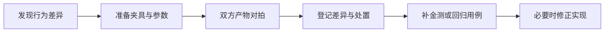
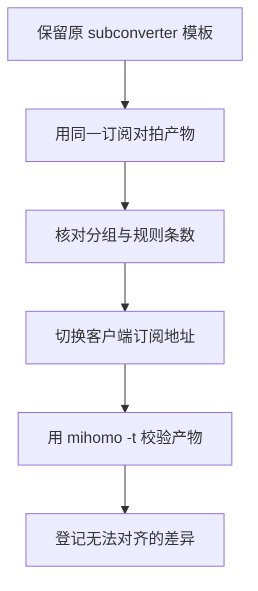
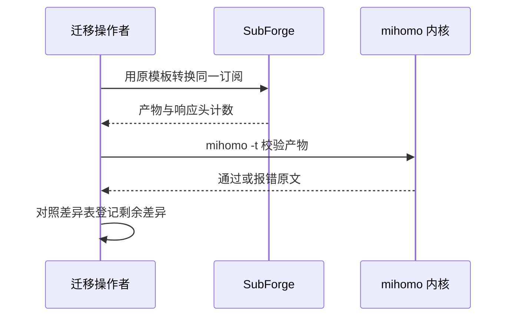

# 兼容性与迁移说明

SubForge 的输出目标是「与 subconverter 语义对齐、与 mihomo 内核实机可加载」。两者并不总是同时成立：subconverter 的模板语法、参数拼法与部分客户端约定需要兼容，而内核又有自己的硬性约束。

本页说明兼容性的判定口径、已知差异、从 subconverter 迁移的操作步骤，以及差异与金测的维护方式。所有差异条目均对应仓库中的 `docs/compatibility.md`，并在需要处标注来源。

## 1. 兼容性口径

### 1.1 记录原则

兼容性差异集中记录在 `docs/compatibility.md`，金测集位于 `testdata/golden/`。该文档明确了两条原则（`docs/compatibility.md:6-9`）：

- 差异必须可机器复现，即给出夹具、参数与双方输出片段；
- 每项差异标注影响面、首见版本与处置方式。

处置方式分三类：**已对齐**（行为一致）、**有意差异**（行为不同但已论证取舍）、**待定**（尚未处理，通常标注目标里程碑）。

### 1.2 差异维护流程



## 2. 参数与接口差异

| 编号 | 差异点 | SubForge 行为 | 处置 |
| --- | --- | --- | --- |
| A1 | 订阅地址自带查询串 | `url` 参数不再按 `?` 拆分，只认 `;` 与重复参数，避免丢掉 `?token=` 凭证 | 已对齐 |
| A2 | 未实现的 target | 返回 501，且在任何上游拉取之前判定 | 已对齐 |
| A3 | `config` 指向远程 URL | 带 `://` 即按远程模板拉取，CLI 与 HTTP 同语义 | 已对齐 |
| A4 | INI 中 `[common] url=` | 不支持：`url` 只从 query 或 CLI 参数取，INI 中的该键按普通参数透传 | 待定 |

来源：`docs/compatibility.md:13-18`。A1 的修复避免了上游因缺少凭证返回 404，也避免产生一个名为 `token=…` 的假来源。

## 3. INI 模板兼容

公开模板大量使用 `[custom]` 段的内联语法，兼容重点是这些内联写法。

| 编号 | 差异点 | SubForge 行为 | 处置 |
| --- | --- | --- | --- |
| N1 | `custom_proxy_group=` 内联分组 | 对齐反引号 DSL；同一段内重复的同名键全部保留 | 已对齐 |
| N2 | `ruleset=` 内联规则 | 对齐；远程类型拉取后在原位展开，不越过 `MATCH` | 已对齐 |
| N3 | `enable_rule_generator` / `overwrite_original_rules` | 效果等价：远程规则集一律展开成内联规则行 | 已对齐 |
| N4 | 远程规则集拉取失败 | 跳过该规则集并逐条告警，不阻断整次转换 | 已对齐 |
| N5 | `[common]` 中的 `!!import` | 支持，递归加载远程模板 | 已对齐 |
| N6 | PCRE 环视断言 | 部分对齐：整段取反翻译为否定匹配，其余断言剥掉，匹配只会放宽 | 有意差异 |
| N7 | 成员正则命中不到节点 | 落 `DIRECT` | 已对齐 |
| N8 | 顶层默认项 | `mixed-port: 7890`、`allow-lan: false`，另加 `ipv6: false`、`unify-ip: true`、`tcp-concurrent: true` 与内置最小 `dns` | 有意差异 |
| N9 | 上游 `.mrs` 二进制规则集 | 识别 zstd 魔数后解码为域名与网段规则，与内核输出逐行一致 | 已对齐 |

来源：`docs/compatibility.md:22-32`。

### 3.1 公开模板对拍结果

以 Aethersailor 的 `Custom_Clash_Full.ini` 为例，双方各产出一份配置后逐层对拍（`docs/compatibility.md:34-45`）：

| 层 | SubForge | subconverter v0.9.1 |
| --- | --- | --- |
| 节点 | 49，名称、顺序、类型一致 | 49 |
| 代理组 | 56，名称、顺序与成员清单一致，合计 2,546 个成员位逐位相同 | 56 |
| 规则 | 93 条逐行一致 | 93 条同分布 |
| `mihomo -t` | 通过 | 失败，报 `yaml: invalid trailing UTF-8 octet` |

该模板把 56 个分组与 93 条规则全部写在内联语法里，因此这一次对拍覆盖了 N1 至 N4。

### 3.2 环视断言的实际代价

Go 使用 RE2 引擎，为保证线性复杂度不做回溯，因此不支持环视断言（`docs/compatibility.md:83-97`）。实测该模板中有 4 个分组的成员正则带断言：其中 `(^(?!.*(已分类关键词)).*)` 被翻译成否定匹配，其余三个剥掉断言后匹配范围放宽。当前实测未引入错误成员，但节点名中真的含有这类字符时可能出现多归类。

### 3.3 MRS 规则集与 CDN 缓存

`.mrs` 是 mihomo 的二进制规则集格式。SubForge 只认 zstd 帧魔数 `28 b5 2f fd`，解压后读取头部与行为字节，再按内核的文本化规则展开为 `DOMAIN-SUFFIX`、`DOMAIN` 或 `DOMAIN-REGEX` 规则行（`docs/compatibility.md:47-67`）。解码结果与 `mihomo convert-ruleset domain mrs` 的输出逐行对拍，共 992 行。

需要注意两个运营层面的现象：

- `.d` 条目被映射为 `DOMAIN-SUFFIX`，会比内核语义多命中 `d` 本身，这是有意的轻微放宽；
- jsdelivr 边缘缓存（`s-maxage=43200`）可能在上游更新后仍返回旧版本，导致同一模板两次转换的规则数不同（实测 1012 与 1018），这不是 SubForge 的缺陷，SubForge 自身不缓存规则集（`docs/compatibility.md:70-82`）。

## 4. 目标格式支持状态

| target | 状态 |
| --- | --- |
| `clash.meta` | 已落地，经 `mihomo -t` 实机校验 |
| `list` / `mixed` / `ss` / `ssd` / `ssr` / `trojan` / `v2ray` | 已落地 |
| `surge` / `surge2` / `surge3` / `surge4` / `suri` | 已落地 |
| `quan` / `quantumult` / `quanx` / `quantumultx` | 已落地 |
| `loon` / `surfboard` | 已落地 |
| `ss-sub` / `ss-sub-json` / `ssjson` / `ss-sub-b64` | 已落地 |
| `mellow` / `mellow-ios` | 已落地 |
| `sing-box` / `singbox` | 已落地，实机校验通过 |
| `clash.json` 系六个别名 | 已落地，与 `clash.meta` 共用构树逻辑 |
| `sstable` | 未落地，返回 501 |

来源：`docs/compatibility.md:99-114`。

`registry.Available()` 会列出 36 个写法，用于 `/api/targets` 与界面下拉框；渲染注册表另外接受 `sub` 与 `subscription` 两个未列出的写法（`internal/render/registry/registry.go:117-120`），因此可用的 target 写法共 38 个。

### 4.1 确认某个写法是否可用

不确定某个 target 写法时，可以让转换命令打印当前支持清单。传入一个不存在的格式即可得到完整列表与错误原文：

```bash
go run ./cmd/subforge convert -url https://example.com/sub -format __nope__
```

也可以直接请求 `GET /api/targets`，返回值与上表一致。部分写法属于别名，例如 `sub` 与 `subscription` 会映射到 list 渲染器，`clash`、`mihomo`、`yaml` 与 `clashr` 都是 Clash YAML 的别名。

## 5. 各渲染器的关键差异

### 5.1 SS-android 节点配置

`ss-sub` 输出的是 SS-android 使用的 JSON 数组，只支持 SS 与 SSR，其他协议跳过并计入跳过数（`docs/compatibility.md:116-135`）。该形态没有代理组与分流规则的概念，分组与规则配置对其不生效。

### 5.2 Mellow

Mellow 使用三列一行的节点写法，并把分组类型映射为 `static`、`latency` 与 `fallback`。差异集中在节点覆盖面、凭据完整性与规则集处理：`RULE-SET` 会被丢弃并告警，`sstable` 未落地（`docs/compatibility.md:137-181`）。

### 5.3 sing-box

sing-box 目标为 1.14，差异包括：SSR 协议无法导出（1.12 起内核移除）、不自带分类组、以及官方 schema 与内核实现之间的 9 处不一致（`docs/compatibility.md:183-242`）。因此以官方 schema 校验通过并不代表内核可以加载，反之亦然。

### 5.4 一行一节点族

Surge、Quantumult X、Loon 与 Surfboard 共用一行一节点的渲染实现。共同差异包括只产出节点、分组与规则三段；兜底组与兜底规则由渲染器补齐；Quantumult X 与 Surfboard 的 IP 网段规则会附加 `no-resolve`；`relay`、`balanced` 与 `sniffer` 无法表达并告警（`docs/compatibility.md:244-302`）。

### 5.5 分享链接与内核约束

分享链接渲染的自研实现通过解析与生成的往返测试保证正确性，不支持的协议跳过并计入跳过数。与内核相关的约束包括：vmess 的 `servername` 键实际名为 `sni`；vless 的 sni 映射到 `servername`；SSR 载荷内层 base64 不能带 `=`；vmess 同时写 `sn` 与 `sni` 等（`docs/compatibility.md:304-371`）。

### 5.6 Clash JSON

六个别名共用同一棵配置树，只替换编码步骤。两个编码细节需要保留：键顺序按构树顺序而非字典序，端口保持字符串形式（`"port": "443"`），空列表输出 `[]`（`docs/compatibility.md:381-398`）。JSON 不支持注释，配置元信息只保留在响应头中；同一样本下 JSON 体积约为 YAML 的 1.3 倍。

## 6. 规则集输出差异

`/getruleset` 沿用 subconverter 的 1 至 6 编号，也接受命名别名。内容优先级为 `rules` > `list` > 模板 `[common] rules` > `url`；类型优先级为 `type` 参数 > 模板 `[ruleset]` 段（`docs/compatibility.md:400-406`）。

| 编号 | 形态 | 扩展名 | 保留的规则 |
| --- | --- | --- | --- |
| 1 | Surge list | `.surge-rules` | 四种域名形态 |
| 2 | Quantumult X | `.qxt` | 域名形态与 IP 网段 |
| 3 | Clash domain provider | `.yaml` | 四种域名形态 |
| 4 | Clash ipcidr provider | `.yaml` | IP 网段 |
| 5 | Surge DOMAIN-SET | `.txt` | `DOMAIN` 与 `DOMAIN-SUFFIX` |
| 6 | Clash classical | `.yaml` | 全部，含 `MATCH` 与 `FINAL` |

丢弃条数通过 `X-Ruleset-Skipped` 上报，写出条数通过 `X-Ruleset-Count` 上报（`docs/compatibility.md:408-420`）。

主要差异包括：不静态打包规则数据，一律运行时提供；`MATCH` 与 `FINAL` 原样透传；Surge list 固定输出 `CNAME = 1`；Quantumult X 的 `expires` 固定为 2592000；DOMAIN-SET 丢弃关键词条目；裸规则行先按网段解析再按域名解析；无类型前缀直接报 400；经典形态用 `out=` 补齐缺失出站（`docs/compatibility.md:422-437`）。

## 7. 内核行为约束

以下两条是 `mihomo -t` 实机校验得出的结论，直接决定产物能否被内核加载（`docs/compatibility.md:439-452`）：

| 编号 | 内核事实 | 影响 |
| --- | --- | --- |
| K1 | 分组只支持 `select`、`url-test`、`fallback`、`load-balance` 四种类型，`relay` 已移除 | 拒绝访问类分组需要写成 `select` 并套用内置 `REJECT` 出站 |
| K2 | 兜底规则是 `MATCH` 而不是 `FINAL` | 以 `FINAL` 结尾的老模板在 mihomo 下不可加载 |

实机校验脚本为 `scripts/validate-mihomo.sh`，通过环境变量 `SUBFORGE_MIHOMO` 指定内核路径；Go 侧的等价门控是 `TestRender_MihomoValid`。

## 8. sub-web 前端兼容

SubForge 可以直连 sub-web 前端。兼容依据来自上游源码，而不是推测：版本端点由后端地址推导，前端把响应体当字符串交给 `formatVersion` 处理（`docs/compatibility.md:455-468`）。

因此 `/version` 必须是纯文本，形如 `subforge <版本> backend` 加换行；返回 JSON 会让前端的字符串替换抛异常，而该异常被静默吞掉，表现为版本号永远为空（`docs/compatibility.md:470-477`）。结构化版本信息在 `/api/version`。

参数处置的要点（`docs/compatibility.md:479-499`）：

| 参数 | 处置 |
| --- | --- |
| `target`、`url`、`insert`、`config`、`include`、`exclude`、`type`、`filename` | 已对齐 |
| `sort` | 兼容并扩展：布尔值映射为排序键，也接受排序键写法 |
| `emoji` | 接受但语义不同：布尔值等价于空操作 |
| `list`、`udp`、`tfo`、`scv`、`tls13` | 已对齐 |
| `new_name`、`expand`、`ver` | 接受并忽略 |
| `append_type`、`fdn`、`clash.doh`、`surge.doh` | 未实现：接受但不生效 |

「接受但不生效」是有意取舍：存量前端可以继续使用，参数仍会进入回显；若直接报错，一个界面开关就会让整条请求失败。

目标写法补齐方面，`sssub` 别名到 `ss-sub`，`clashr` 别名到小写形态的 Clash YAML（`docs/compatibility.md:501-506`）。已知差异汇总为 W1 至 W3（`docs/compatibility.md:508-514`）。

## 9. 从 subconverter 迁移

### 9.1 迁移步骤



### 9.2 迁移检查清单

| 检查项 | 原因 |
| --- | --- |
| 模板中是否使用 `[common] url=` | 该写法不被支持，订阅来源必须写在 query 或 CLI 参数中 |
| 模板是否依赖 `FINAL` 兜底或 `reject` 类型分组 | mihomo 不接受，需要改为 `MATCH` 与 `select` 套 `REJECT` |
| 是否依赖 `append_type`、`fdn` 或 `*.doh` 参数 | 这些参数接受但不生效，需要改用模板规则或渲染器默认值 |
| 是否依赖布尔形式的 `emoji` | 布尔值等价于空操作，加 emoji 需要写正则替换对 |
| 客户端是否需要 `sstable` 或 MRS 规则集产出 | 这两项尚未实现，会返回 501 或需要另配 |
| 顶层默认端口与局域网策略是否一致 | 默认使用 `mixed-port: 7890` 且 `allow-lan: false`，与原实现不同 |

### 9.3 迁移中的验证方法

迁移前后建议各跑一次相同的订阅与模板，逐层核对节点数、分组数与规则条数，并用真实内核校验产物。仓库中的 `testdata/golden/` 提供了各格式的基线产物，可用于回归比对。



## 10. 已修复项与待定项

### 10.1 已修复

M2 阶段核查发现的三个问题均已修复，并在 `docs/m2-aethersailor-compat.md:410-420` 中记录了处置与证据：

| 编号 | 问题 | 处置 |
| --- | --- | --- |
| G1 | `clash-domain:*.mrs` 远程规则集未展开，每个模板丢失 2 至 3 条规则集 | 已修复：接入 MRS 二进制解码，8 个模板与 1 个兼容文件全部转换成功且告警归零 |
| P1 | 成员正则以 `http` 开头时被误判为测活地址 | 已修复：只认绝对 URL 作为测活地址，探针产物与 subconverter 一致 |
| P2 | 零成员分组渲染成 `proxies: []` | 已修复：零成员分组回退为 `DIRECT` |

修复后的独立验证包括：与 `mihomo convert-ruleset` 的 992 行逐行对拍、3 份 `.mrs` 共 1012 个域名零缺失、9 份产物全部通过 `mihomo -t`（`docs/m2-aethersailor-compat.md:422-431`）。

### 10.2 待定项

| 编号 | 待定内容 | 现状 |
| --- | --- | --- |
| A4 | INI 中 `[common] url=` 作为订阅来源 | 不支持，行为按普通参数透传 |
| R2 | 规则集输出不产出 MRS 二进制规则集 | 未产出；输入侧的 MRS 解码已支持 |
| R11 | 规则集响应缺少缓存头 | 无 `ETag` 与缓存控制 |
| R12 | 模板段落名大小写敏感 | `[COMMON]` 匹配不到 `common` |

另外，`docs/compatibility.md:442` 提到 `make mihomo-check` 目标，但当前 `Makefile` 中没有该目标，实机校验请直接运行 `scripts/validate-mihomo.sh`。

## 11. 相关页面

- [渲染器与输出格式](渲染器与输出格式)：各目标格式的渲染细节。
- [订阅解析与协议支持](订阅解析与协议支持)：分享链接与协议支持面。
- [分流规则引擎原理](分流规则引擎原理)：规则与规则集的语义。
- [开发与测试指南](开发与测试指南)：金测与门禁的执行方式。
- [故障排查与常见问题](故障排查与常见问题)：产物无法加载时的排查路径。
