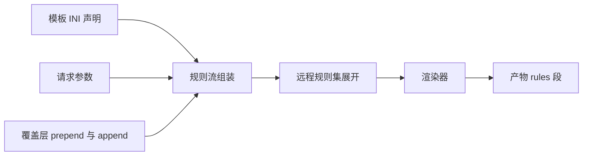
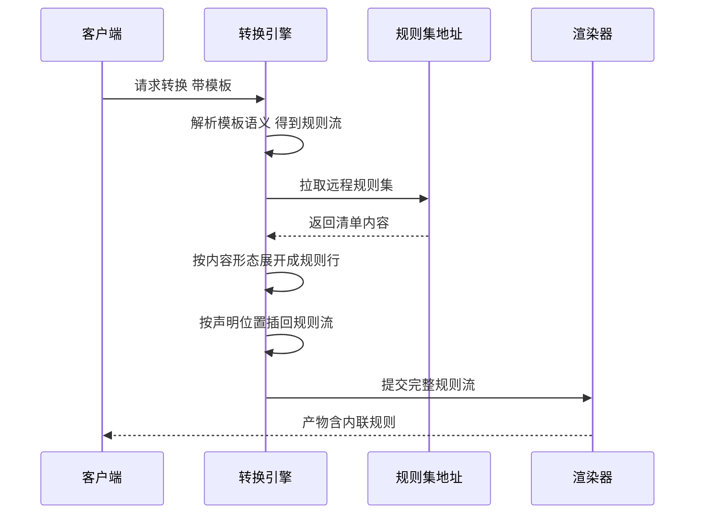

# 分流规则引擎原理

> 本文说明 SubForge 如何把模板声明、请求参数与远程规则集组装成一条**规则流**，如何在转换过程中把远程规则集展开成客户端可读的内联规则行，以及如何用 `GET /getruleset` 把一份规则集单独导出。
>
> 事实来源：`internal/ruleset/`（规则行解析与规则集渲染）、`internal/ini_rules/`（INI 规则源解析）、`internal/config/custom.go`（`ruleset=` 语法）、`internal/convert/remote_rulesets.go`（远程规则集展开）、`internal/mrs/` 与 `internal/parse/mrs.go`（MRS 二进制）、`internal/api/handlers.go`（`/getruleset` 处理器）。文中每条结论均标注源码位置，便于逐条核对。

---

## 1. 分流规则是什么，在产物里长什么样

**分流规则**（简称规则）是一行声明式配置，含义是"当访问目标满足某个条件时，走哪个代理组"。客户端按顺序逐条比对，**第一条命中的规则生效**，因此规则的**顺序本身就是语义**：越靠前优先级越高，兜底规则必须放在最后。在产物里，规则落在两种位置：

| 目标格式 | 规则所在位置 | 说明 |
| --- | --- | --- |
| Clash / mihomo | 顶层 `rules:` 序列 | 由渲染器写入 `render.Request.Rules`（`internal/render/render.go:28`） |
| Surge / Quantumult X / Loon / Surfboard | `[Rule]` 段 | 同一份规则行按目标格式改写，例如 Loon 的远程规则集要落到独立的 `[Remote Rule]` 段（`internal/render/lineform/rules.go:9-17`） |

规则流从模板一路传到渲染器的路径是固定的：模板语义 → 请求参数 → 覆盖层 → 引擎组装 → 渲染器。其中只有"远程规则集展开"这一步需要访问网络（见第 4 节）。



### 1.1 规则行的语法

规则行的形态对齐 mihomo，一行一条，用英文逗号分隔（`internal/ruleset/ruleset.go:1-8` 的包注释）：

```text
TYPE,VALUE[,OVERRIDE]
```

- `TYPE`：规则形态，大小写不敏感，解析时统一转成大写（`internal/ruleset/ruleset.go:99-145`）。
- `VALUE`：匹配取值，含义由形态决定。
- `OVERRIDE`：可选第三段，通常是命中后要走的代理组名，也可以是 `no-resolve` 这类标志位。

SubForge 认识的十种形态如下（`internal/ruleset/ruleset.go:22-41`）：

| 形态 | 匹配含义 | 典型取值 |
| --- | --- | --- |
| `DOMAIN` | 完整域名精确匹配 | `example.com` |
| `DOMAIN-SUFFIX` | 域名后缀匹配（含自身与子域） | `example.com` |
| `DOMAIN-KEYWORD` | 域名关键字包含匹配 | `example` |
| `DOMAIN-REGEX` | 域名正则匹配，解析时即编译校验 | `^ads\..*\.com$` |
| `IP-CIDR` | IPv4 网段匹配 | `10.0.0.0/8` |
| `IP-CIDR6` | IPv6 网段匹配 | `2001:db8::/32` |
| `GEOIP` | 按 IP 归属地数据集匹配 | `CN` |
| `GEOSITE` | 按域名数据集匹配 | `openai` |
| `MATCH` | 兜底，匹配一切 | 无取值，第二段直接写出站 |
| `FINAL` | 兜底，Clash Premium 的叫法 | 无取值，第二段直接写出站 |

`MATCH` 与 `FINAL` 是收尾规则，只有 Clash 经典规则清单能保留它们；规则集形态（provider）里没有对应物（`internal/ruleset/ruleset.go:22-38` 注释）。

### 1.2 裸域名与裸网段的兼容

公共规则文件（`.list`）常常一行只有一个裸域名或裸网段，没有任何形态名。解析器先按 CIDR 试（取值含冒号判为 `IP-CIDR6`），再按合法域名判为 `DOMAIN`，两者都不成立才报 `未知规则形态 %q（支持: %s）`（`internal/ruleset/ruleset.go:99-145`）。这条兼容是刻意的：直接对裸域名报语法错会挡住整批导入（`internal/ruleset/ruleset.go:78-80` 注释）。

---

## 2. 规则流从哪里来

规则内容一律由调用方给出，SubForge 不内置任何第三方规则集（`internal/ruleset/ruleset.go:1-8`）。规则流有五个来源，按生效优先级从低到高排列：

| 顺序 | 来源 | 写法 | 生效位置 |
| --- | --- | --- | --- |
| 1 | 模板 `[common]` 或 `[custom]` 的 `rules=` | `rules=DOMAIN-SUFFIX,example.com,PROXY` | 模板语义的规则流（`internal/config/custom.go:169-175`） |
| 2 | 模板 `[custom]` 的 `ruleset=` | `ruleset=组名,类型:地址` | 同上，见第 3 节 |
| 3 | 请求参数 `rules=` | `/sub?rules=DOMAIN-SUFFIX,example.com,PROXY` | 按分号拆成多条（`internal/convert/params.go:159`） |
| 4 | 请求参数 `ruleset:<名称>:<类型>` | `/sub?ruleset=openai:3` | 进入 `Params.Ruleset` 映射（`internal/convert/params.go:173-187`） |
| 5 | 覆盖层 `rules.prepend` / `rules.append` | Override 文件的 `[rules]` 段 | 在模板与请求参数之上再插入或追加（`internal/convert/engine.go:99-101`） |

优先级链的落点是 `ApplyTemplate`：它把模板语义"压到请求参数下面"，即**模板值在前、请求参数在后**，后写的覆盖先写的（`internal/convert/chain.go:25-42`）。覆盖层则在模板语义应用之后再处理（`internal/convert/engine.go:92-101`）。

覆盖层的规则段只认两个键（`internal/config/override.go:38-41`、`278`）：

```ini
[rules]
prepend = DOMAIN-SUFFIX,openai.com,AI
append = DOMAIN-SUFFIX,claude.ai,AI
```

`prepend` 插到规则流最前面，优先级最高；`append` 追加到末尾，优先级最低。若要把某条规则"顶掉"模板里已有的规则，用 `prepend`；若只是补充漏网域名，用 `append` 更安全——因为 `append` 会排在模板的兜底规则之后，此时兜底规则已经命中，追加的规则不会生效，需要同时确认模板没有把 `MATCH` 写在中间。

### 2.1 为什么规则流必须保持"声明顺序"

模板语义里，规则流是一个 `[]RuleItem` 切片，每一项要么是一条直映规则行（`Line`），要么是一份待展开的远程规则集引用（`Remote`，值为切片下标）（`internal/config/custom.go:33-44`）。

顺序不可丢的原因写在源码注释里：mihomo 按声明顺序匹配，模板作者把 `MATCH` 放最后才保证前面的规则都生效。如果把"直映行"和"远程规则集"拆成两个切片，展开后就会变成"全部直映行在前、全部展开行在后"，`MATCH` 之后的规则全部失效（`internal/config/custom.go:33-37`）。直映规则行的 `Remote` 字段恒为 `-1`，判断"这一项是不是远程引用"必须用 `Remote >= 0`，不能依赖 `int` 的零值（`internal/config/custom.go:41-43`）。

---

## 3. `ruleset=` 的完整语法

INI 模板里的 `ruleset=` 一行可以声明两种完全不同的东西：**内置规则集**（`GEOSITE` / `GEOIP` / `FINAL`，直接用内核数据集）与**远程规则集**（把一份外部清单拉下来展开）。语法由 `splitRulesetSpec` 解析（`internal/config/custom.go:205-246`）：

```text
<组名>,<类型>[,<取值>][,<附加>]
```

判定规则只有一条：类型以 `[]` 开头的是内置规则集，含冒号的是远程规则集；`clash-` 前缀只是 subconverter 用来标记目标客户端的写法，不是内容形态的一部分，解析时会被剥掉（`internal/config/custom.go:210-211`、`236`）。

| 类型写法 | 归类 | 取值段 | 附加段 | 产出的规则行 |
| --- | --- | --- | --- | --- |
| `[]GEOSITE` | 内置 | 数据集名，如 `openai` | 标志位 | `GEOSITE,openai,<组名>` |
| `[]GEOIP` | 内置 | 数据集名，如 `CN` | 标志位，缺省补 `no-resolve` | `GEOIP,CN,<组名>,no-resolve` |
| `[]FINAL` | 内置 | 无 | 无 | `MATCH,<组名>` |
| `clash-domain:<URL>` | 远程 | 写在类型里 | 第三段是缓存秒数 | 展开成域名类规则行 |
| `clash-classic:<URL>` | 远程 | 写在类型里 | 第三段是缓存秒数 | 展开成经典规则行 |

两点需要注意：

1. `[]FINAL` 的组名会变成 `MATCH` 的第二段。`ruleLine` 拼行时，`MATCH` / `FINAL` 没有取值段，组名直接落在第二位（`internal/config/custom.go:182-183`、`248-258`）。
2. `[]GEOIP` 没写标志位时会自动补 `no-resolve`。规则集本身不查域名，不补的话 mihomo 会把整个数据集当成需要 DNS 解析的目标，规则既慢又不生效（`internal/config/custom.go:186-192`）。

一个可用的 `[custom]` 片段：

```ini
[custom]
ruleset=AI,clash-domain:https://rules.example.com/openai.yaml,86400
ruleset=CN,[]GEOIP,CN
ruleset=DIRECT,[]FINAL
```

---

## 4. 远程规则集的拉取与就地展开

### 4.1 为什么必须在转换时展开

subconverter 的 `ruleset=clash-domain:URL` 语义是"把这份域名清单拉下来，每条命中时路由到指定组"。但 **mihomo 的 ruleset provider 只接受本地 `file:` 路径，不接受 `http(s)` 地址**，所以规则集必须在转换时下载并展开成内联规则行——这也是产物体积会明显大于节点本身的原因（`internal/convert/remote_rulesets.go:17-27`）。

### 4.2 展开发生在什么时候

展开由 `expandRemoteRulesets` 完成（`internal/convert/remote_rulesets.go:28`），调用点在引擎主流程中、渲染之前（`internal/convert/engine.go:344`）。

关键约定：**展开完成前 `TemplateRules` 保留、`Params.Rules` 不含它们**（`internal/convert/params.go:68-73`、`internal/convert/chain.go:37-41`）。展开结束后引擎把展开结果并入 `Params.Rules`，并把 `TemplateRules` 与 `TemplateRemoteRulesets` 置空，避免后续再看到"有引用但没展开"的中间状态（`internal/convert/remote_rulesets.go:84-87`）。

展开后的行按模板声明的位置插回规则流：遍历 `TemplateRules`，`Remote < 0` 的项原样追加，否则追加该下标对应的展开结果（`internal/convert/remote_rulesets.go:75-83`）。



### 4.3 三类内容形态与展开结果

拉回来的内容分三类处理，判定顺序写在 `expandRemoteRulesets` 里（`internal/convert/remote_rulesets.go:34-73`）：

| 内容形态 | 判定方式 | 展开结果 |
| --- | --- | --- |
| MRS 二进制 | `parse.IsMRS` 只认 zstd 帧魔数（`internal/parse/mrs.go:75-79`） | 解码后按**文件内部声明的行为**展开（`internal/convert/remote_rulesets.go:161-196`） |
| 文本域名清单 | 模板声明 `clash-domain` | 一行一个域名，前缀 `.` 出 `DOMAIN-SUFFIX`，其余出 `DOMAIN`（`internal/convert/remote_rulesets.go:120-159`） |
| Clash 经典清单 | 模板声明 `clash-classic` | 按形态名逐行改写，`MATCH` / `FINAL` 跳过（`internal/convert/remote_rulesets.go:238-271`） |

MRS 的 `domain` 行为支持四种写法，映射规则如下（`internal/convert/remote_rulesets.go:161-196`）：

| MRS 里的写法 | 展开成 | 说明 |
| --- | --- | --- |
| `+.example.com` | `DOMAIN-SUFFIX,example.com,<组>` | 精确条目与后缀条目成对出现时合并 |
| `.example.com` | `DOMAIN-SUFFIX,example.com,<组>` | 内核语义是仅子域，这里略微放宽到含域名自身 |
| `*.example.com` | `DOMAIN-REGEX,^[^.]+\.example\.com$,<组>` | 精确表达一级子域，正则会做转义 |
| `example.com` | `DOMAIN,example.com,<组>` | 精确匹配 |

`ipcidr` 行为按取值是否含冒号输出 `IP-CIDR6` 或 `IP-CIDR`（`internal/convert/remote_rulesets.go:183-195`）。`.example.com` 之所以要放宽到含域名自身，是因为内核语义只匹配子域，精确表达需要 `DOMAIN-REGEX` 线性扫描，几万条会明显变慢（`internal/convert/remote_rulesets.go:167-172` 注释）。

### 4.4 失败与异常内容的处理

远程规则集的错误处理有一条总原则：**单个规则集失败只提示、不阻断转换**，但必须提示（`internal/convert/remote_rulesets.go:17-27`）。提示通过转换结果里的 warnings 带出，最终体现在响应的 `X-Convert-Skipped` 头与服务日志中。

| 情况 | 行为 | 提示文案（源码原文） |
| --- | --- | --- |
| 拉取失败 | 跳过该规则集 | `规则集 %s 获取失败，该规则集未生效: %v` |
| MRS 解码失败 | 跳过该规则集 | `规则集 %s 是 MRS 但解码失败，该规则集未生效: %v` |
| 内容含控制字符或 NUL | 跳过该规则集 | `规则集 %s 内容异常（%s），该规则集未生效` |
| 类型不是 `domain` / `classic` | 跳过该规则集 | `规则集 %s 的类型 %q 不支持` |
| 展开后没有产出任何规则 | 保留空结果 | `规则集 %s 没有展开出任何规则` |
| MRS 内部行为与模板声明不一致 | 仍按文件内容展开 | `声明为 %s 但 MRS 内部行为是 %s，已按文件内容展开` |

`rulesetProblem` 会逐字节扫描内容，拒绝 `0x00` / `0x7f` / `0xff` 与非法控制字符（`internal/convert/remote_rulesets.go:217-236`）。这条检查是必要的：内容混进控制字符时，YAML 编码器会把整段输出成 `!!binary`，产物会变成内核加载不了的配置（同处注释）。

拉取动作**刻意不复用 `fetch.Fetcher`**：`Fetcher` 会把响应体当订阅识别内容形态，纯域名清单会被判成"无法识别订阅内容形态"而整体失败。因此规则集走独立的 `rulesetBody`，带 `://` 的当 URL 拉、否则当本地路径读（`internal/convert/remote_rulesets.go:94-118`）。

---

## 5. MRS 与 GeoSite / GeoIP 的关系

MRS 是 mihomo 规则集的**二进制形态**（内部用 zstd 压缩），体积远小于文本清单，加载也更快。SubForge 可以离线把文本或 Clash YAML 规则集转成 MRS，转换逻辑复用内核的 `provider.ConvertToMrs`，保证与 `mihomo convert-ruleset` 字节级一致（`internal/mrs/mrs.go:1-4`）。它与另外两个概念的区别如下：

| 概念 | 形态 | 由谁提供 | 在规则行里的写法 |
| --- | --- | --- | --- |
| GeoSite / GeoIP | 内核内置数据集 | mihomo 自带 | `GEOSITE,openai,<组>` / `GEOIP,CN,<组>` |
| MRS 规则集 | 二进制文件 | 由 SubForge 或 mihomo 离线生成 | 不直接写进规则行，转换时展开成域名或网段规则 |
| 文本规则集 | `.list` / `.yaml` 清单 | 规则源仓库 | 同上 |

### 5.1 命令行用法

`subforge mrs` 提供两个子命令（`cmd/subforge/mrs.go:10-53`）：

| 子命令 | 参数 | 说明 |
| --- | --- | --- |
| `generate` | `<behavior> <format> <src> <dst>` | 读源文件生成 MRS 并写入目标文件 |
| `cached` | `<src> <cacheDir> <behavior> <format>` | 命中缓存直接返回，否则生成后尽力写缓存 |

两个参数的含义（`internal/mrs/mrs.go:20-37`）：

| 参数 | 取值 | 说明 |
| --- | --- | --- |
| `behavior` | `domain` / `ipcidr` / `classical` | 匹配行为；`classical` 没有二进制形态，会报错 |
| `format` | `yaml` / `text` / `mrs` | 源数据的格式 |

`cached` 还接受一个 `-ttl` 选项，默认 7 天（`cmd/subforge/mrs.go:40`、`internal/mrs/mrs.go:18`）。缓存文件名由源文件名、行为、格式拼成 `<名字>-<behavior>-<format>.mrs`（`internal/mrs/mrs.go:59-64`）。

下面两条命令分别演示"直接生成"与"走缓存生成"，后者在 24 小时内复用已有产物：

```bash
subforge mrs generate domain yaml ./rules/openai.yaml ./dist/openai.mrs
subforge mrs cached ./rules/openai.yaml ./cache domain yaml -ttl 24h
```

**注意**：`classical` 行为只能走文本路径。MRS 二进制只有 `domain` 与 `ipcidr` 两种行为，解码到其它行为字节会直接报错（`internal/parse/mrs.go:147`）。

---

## 6. 规则提供者与规则集的区别

Clash 生态里有两个名字相近、作用不同的概念，容易混淆：

| 概念 | YAML 里的键 | 作用 | SubForge 的处理 |
| --- | --- | --- | --- |
| proxy-provider | `proxy-providers` | 声明"节点订阅来源"，组的 `use` 引用它 | 原样透传给 Clash / mihomo 产物（`internal/render/clashmeta/clashmeta.go:167-174`） |
| rule-provider | `rule-providers` | 声明"规则集来源"，`RULE-SET` 规则引用它 | 从 Clash YAML 订阅中提取并入库，由控制台管理，**当前不注入转换产物** |

rule-provider 的提取由 `ParseClashRuleProviders` 完成（`internal/model/model.go:272-276`），解析失败只记告警、不拖垮节点（`internal/parse/parse.go:150-156`）。提取结果写入 `rule_providers` 表（`internal/store/store.go:477`），可通过下列接口查询与启停：

| 方法 | 路径 | 说明 |
| --- | --- | --- |
| `GET` | `/api/rule-providers` | 列出规则提供者，支持 `?source=` 与 `?enabled=1\|0` 过滤（`internal/api/ruleproviders.go:11`） |
| `PUT` | `/api/rule-providers/{id}/enabled` | 请求体 `{"enabled": true}`，启停单个提供者（`internal/api/ruleproviders.go:44`） |

**状态说明**：规则提供者目前是"已提取、已入库、可在控制台管理"，但转换管线不会把 `rule-providers:` 段写进产物——渲染层只处理 `RULE-SET` 这类规则行本身（`internal/render/lineform/rules.go:9-30`）。需要让客户端加载远程规则集时，应使用第 7 节的 `/getruleset` 自行托管。

---

## 7. 用 `GET /getruleset` 单独导出一份规则集

`GET /getruleset` 是**已实现**的端点，路由注册在 `internal/api/server.go:144`，处理器在 `internal/api/handlers.go:119`。它的语义对齐 subconverter 的 `/getruleset?type=&name=&url=`：把一份规则内容渲染成指定客户端能直接使用的规则集文件。

### 7.1 请求参数

| 参数 | 是否必填 | 说明 |
| --- | --- | --- |
| `name` | 必填 | 规则集名称，同时用于产物文件名；缺失返回 400 |
| `type` | 见下 | 输出形态，取 1~6 或命名别名；缺省时读模板 `[ruleset]` 段里该名称对应的类型 |
| `rules` | 二选一 | 直接给出的规则行，多条用分号分隔 |
| `list` | 二选一 | 与 `rules` 同义的清单参数，按分号拆分 |
| `url` | 二选一 | 远程规则文件地址，多个用分号分隔；单来源失败不中断整批 |
| `config` | 否 | 指定模板，用于解析 `[ruleset]` 段 |
| `include` / `exclude` | 否 | 按取值正则做白名单 / 黑名单筛选 |
| `out` | 否 | Clash 经典形态缺出站时的默认出站名 |

规则内容的取值优先级是：`rules` > `list` > 模板 `[common]` 段的 `rules` > `url` 远程拉取（`internal/api/handlers.go:111-118`）。

### 7.2 `type` 的六种形态

编号沿用 subconverter 的 1~6（`internal/ruleset/render.go:15-25`）：

| 编号 | 命名别名 | 输出形态 | 文件扩展名 | Content-Type |
| --- | --- | --- | --- | --- |
| 1 | `surge`、`list` | Surge 2.x 规则集 | `.surge-rules` | `application/x-ruleset; charset=utf-8` |
| 2 | `qx`、`quantumult-x` | Quantumult X 远程规则提供方 | `.qxt` | `text/plain; charset=utf-8` |
| 3 | `clash-domain` | Clash DOMAIN 类 provider | `.yaml` | `text/yaml; charset=utf-8` |
| 4 | `clash-ipcidr` | Clash IP-CIDR provider | `.yaml` | `text/yaml; charset=utf-8` |
| 5 | `surge-domain-set`、`domain-set` | Surge DOMAIN-SET | `.txt` | `text/plain; charset=utf-8` |
| 6 | `clash-classical`、`clash` | Clash 经典 `rules:` 段 | `.yaml` | `text/yaml; charset=utf-8` |

每种形态只保留自己能表达的规则形态，表达不了的规则被丢弃并计入 `Skipped` 计数，**这是刻意设计，不报错**（`internal/ruleset/render.go:30-75`）。例如 `DOMAIN-SET` 是纯域名列表，关键词与正则放进去没有意义，因此只收 `DOMAIN` 与 `DOMAIN-SUFFIX`。

### 7.3 一个完整示例

```bash
curl -sS "http://127.0.0.1:25500/getruleset?name=openai&type=3&rules=DOMAIN-SUFFIX,openai.com,AI;DOMAIN-SUFFIX,claude.ai,AI" \
  -o openai.yaml
```

响应头会带上渲染统计（`internal/api/handlers.go:196-213`）：

| 响应头 | 含义 |
| --- | --- |
| `X-Ruleset-Format` | 输出形态的标签 |
| `X-Ruleset-Count` | 实际写入产物的规则条数 |
| `X-Ruleset-Skipped` | 因形态不支持被丢弃的条数，仅在大于 0 时出现 |
| `Content-Disposition` | `attachment; filename=<规则集名>.<扩展名>` |

### 7.4 错误码对照

| 状态码 | 触发条件 |
| --- | --- |
| 400 | 缺少 `name`；`type` 取值非法；规则行解析失败；筛选正则非法；Clash 经典形态缺出站且未给 `out` |
| 404 | 模板 `[ruleset]` 段里没有该名称的类型；筛选后规则集为空 |
| 502 | 模板解析失败；`url` 指向的远程规则全部拉取失败 |
| 500 | 渲染阶段出现非预期错误 |

错误码到语义的映射写在 `statusFor` 里，区分"请求本身不对（400 / 404）、格式没实现（501）、上游有问题（502）"（`internal/api/handlers.go:22-35`）。

---

## 8. 常见问题与注意事项

| 现象 | 可能原因 | 处理方式 |
| --- | --- | --- |
| 产物里 `MATCH` 之后的规则不生效 | 追加的规则排在兜底规则之后 | 用覆盖层的 `prepend` 而不是 `append`；或调整模板里 `MATCH` 的位置 |
| 远程规则集全部没生效 | 地址不可达；内容被判为异常；类型不是 `domain` / `classic` | 查看服务日志中的 warnings 明细，逐条核对错误文案 |
| 纯域名 `.list` 拉取失败 | 用 `fetch.Fetcher` 抓取会被判成"无法识别订阅内容形态" | 规则集必须走独立的 `rulesetBody` 通道，不要用订阅抓取逻辑 |
| 产物 YAML 出现 `!!binary` | 规则内容里混进了控制字符 | 检查规则源文件编码，`rulesetProblem` 会拦下这类内容 |
| `/getruleset` 返回 404 且提示"没有类型" | 未传 `type`，模板 `[ruleset]` 段也没有该名称 | 显式传 `type`，或在模板里补 `名称=类型` 一行 |
| `/getruleset` 产物条数少于输入 | 目标形态表达不了部分规则形态 | 查看 `X-Ruleset-Skipped`；需要全形态保留时用 `type=6` |
| `type=6` 报"规则缺少出站" | Clash 经典形态要求每条规则都有出站 | 传 `out=<组名>`，或在规则行里补第三段 |
| MRS 生成报行为不支持 | `behavior` 传了 `classical` | 只有 `domain` 与 `ipcidr` 有二进制形态 |

---

## 9. 相关页面

- [规则工厂与规则源](规则工厂与规则源)：规则集的版本化、更新与回滚
- [转换流水线原理](转换流水线原理)：规则流进入渲染器之前的节点处理流程
- [渲染器与输出格式](渲染器与输出格式)：各目标格式如何写入 `rules:` 与 `[Rule]`
- [INI-模板配置详解](INI-模板配置详解)：`[common]`、`[custom]`、`[ruleset]` 段的完整写法
- [覆盖层-Override-详解](覆盖层-Override-详解)：`prepend` / `append` 的完整覆盖语义
- [HTTP-API-参考](HTTP-API-参考)：`/getruleset` 与其它端点的请求响应细节
