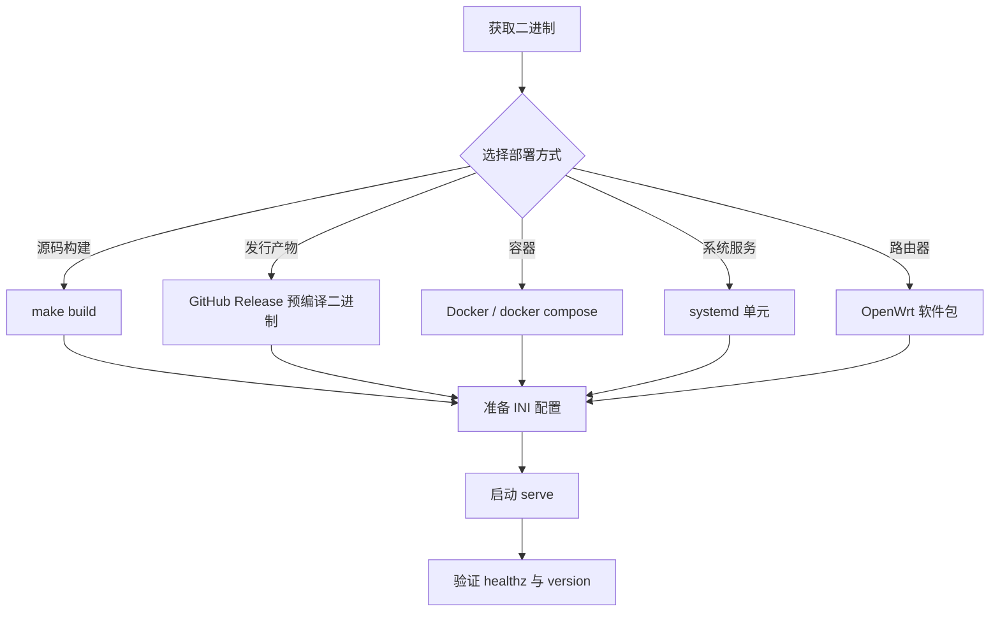
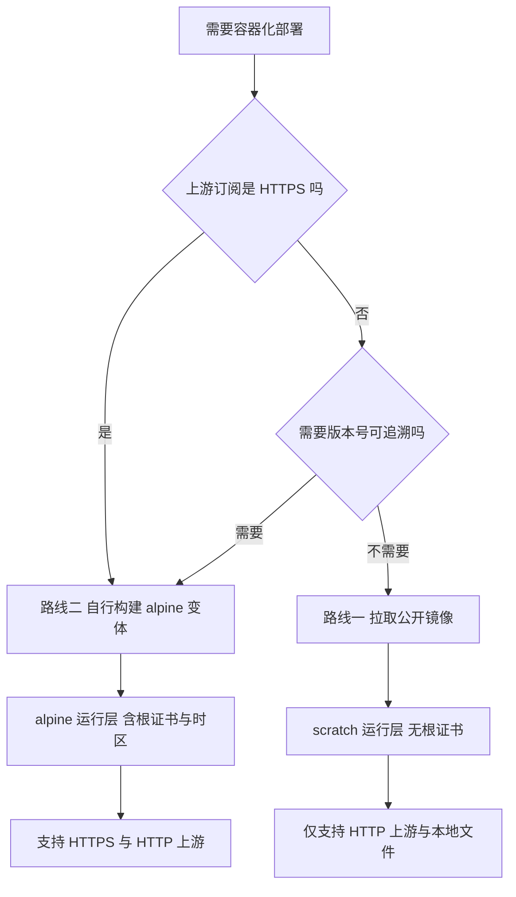
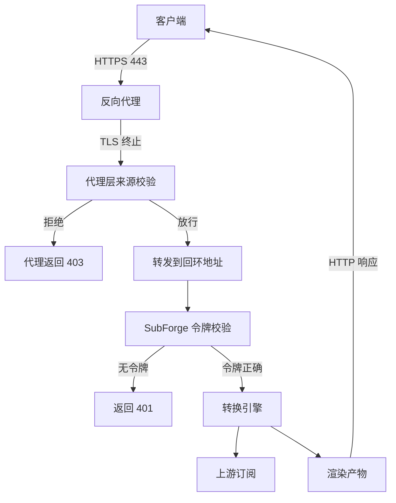

# 安装与部署

本页给出 SubForge 的全部安装方式：从源码构建、使用发行产物、容器部署、systemd 托管、
OpenWrt 打包，以及首次启动后的验证方法。SubForge 是单个静态二进制程序，运行时不依赖
Go 工具链、Node.js 或任何外部服务，因此"部署"本质上只有三件事：放置二进制、准备配置
文件、决定监听地址与访问令牌。下文每一步都给出可直接复制的命令，并标注该步骤的事实
来源文件与行号，便于核对。

---

## 一、系统与依赖要求

### 1.1 运行期要求

| 项目 | 要求 | 说明 |
| --- | --- | --- |
| 操作系统 | Linux / Windows / macOS / FreeBSD | 交叉编译矩阵见 `Makefile:30-36` |
| CPU 架构 | amd64 / arm64 / arm | 同上 |
| 动态库 | 无 | 构建使用 `CGO_ENABLED=0`，产物为静态链接 |
| 磁盘 | 约 40 MB 二进制 + 数据目录 | 实测体积见 `deploy/README.md:13-23` |
| 网络 | 能出站访问上游订阅地址 | 服务只做出站 HTTP 拉取，不额外监听端口 |
| 可选 | `ca-bundle` | OpenWrt 上需要，见 `deploy/openwrt/Makefile:47` |

内存占用实测为 27,436 KB（26.8 MiB）、9 个线程、稳态 CPU 0.0%
（`deploy/README.md:54`），因此可以直接跑在路由器与低配 VPS 上。

### 1.2 构建期要求

仅"从源码构建"与"自行打包"需要下列工具：

| 工具 | 版本 | 用途 |
| --- | --- | --- |
| Go | 1.26.0 或更高 | 编译后端，版本要求见 `go.mod:3` |
| GNU Make | 任意 | 驱动 `Makefile` 目标 |
| pnpm | 11 | 构建 `web/` 控制台前端（`Makefile:55`） |
| Node.js | 22 | 同上（`.github/workflows/release.yml:33`） |
| Docker | 任意 | 仅在构建镜像时需要 |

依赖已在 `vendor/` 目录全量锁定（`Makefile:12` 使用 `-mod=vendor`），因此构建过程
不需要访问 Go 模块代理。

---

## 二、部署方式总览



五种方式产出的都是同一个 `./cmd/subforge` 二进制（`deploy/README.md:3-4`），
差别只在进程如何被拉起、配置与数据放在哪个目录。

---

## 三、方式一：从源码构建

### 3.1 构建步骤

1. 克隆仓库并进入目录：

   ```bash
   git clone https://github.com/tktogether/subforge.git
   cd subforge
   ```

2. 构建二进制。该目标等价于 `CGO_ENABLED=0 go build -trimpath -mod=vendor -ldflags "..." -o bin/subforge ./cmd/subforge`（`Makefile:20-21`）：

   ```bash
   make build
   ```

3. 验证产物可以运行：

   ```bash
   ./bin/subforge version
   ```

   预期输出形如（本机实测，`version` 打印 `buildinfo.Full()`，见 `cmd/subforge/main.go:74-81`）：

   ```text
   subforge dev (commit none, built unknown)
   ```

   版本号由构建时的 `-X` 链接参数注入（`Makefile:7-10`）：直接 `go build` 而不带
   `LDFLAGS` 时显示为 `dev`。

### 3.2 相关目标

| 目标 | 作用 | 来源 |
| --- | --- | --- |
| `make build` | 构建本机二进制到 `bin/subforge` | `Makefile:20-21` |
| `make cross` | 交叉编译 7 个平台到 `bin/` | `Makefile:29-36` |
| `make release` | 先 `cross`，再打成 `dist/*.tar.gz` | `Makefile:42-47` |
| `make docker` | 构建 `scratch` 与 `alpine` 两个镜像 | `Makefile:38-40` |
| `make test` | 运行全部 Go 测试 | `Makefile:23-24` |
| `make verify` | 构建 + vet + 测试 + 覆盖率门禁 + 前端检查 | `Makefile:88-89` |
| `make clean` | 删除 `bin/` 与 `dist/` | `Makefile:49-50` |

`make cross` 覆盖的目标为 `linux/amd64`、`linux/arm64`、`linux/arm`、`windows/amd64`、
`darwin/amd64`、`darwin/arm64`、`freebsd/amd64`（`Makefile:30-32`）。

---

## 四、方式二：使用发行产物

### 4.1 发行工作流的真实触发条件

发行产物由 `.github/workflows/release.yml` 生成，触发条件只有两个
（`.github/workflows/release.yml:3-12`）：

| 触发方式 | 条件 | 产物去向 |
| --- | --- | --- |
| 推送标签 | 标签名匹配 `v*` | 创建 GitHub Release，上传 `dist/*` |
| 手动触发 | `workflow_dispatch`，可选填 `ref` | 以 Actions Artifact 形式交付，名称为 `subforge-packages` |

两种触发方式的行为差异必须区分清楚：

- **只有标签触发才创建 Release。** 上传步骤带 `if: github.ref_type == 'tag'`
  （`release.yml:155-162`）；非标签触发时改走 artifact 上传（`release.yml:163-169`）。
- **只有标签触发才推送容器镜像。** 两个镜像构建步骤的 `push` 参数都是
  `${{ github.ref_type == 'tag' }}`（`release.yml:132`、`release.yml:146`）；
  手动触发时镜像会被构建但不推送。
- 工作流先跑 `gates` 任务（前端 `typecheck` / `test`，Go `vet` / `test`，
  `release.yml:36-48`），通过后才进入 `package` 任务，因此不会发布测试不通过的产物。

### 4.2 安装发行产物的步骤

1. 从 Release 页面下载对应平台的可执行文件。文件名为 `subforge-<系统>-<架构>`
   （Windows 版带 `.exe` 后缀，见 `release.yml:98-99`）。

   **Release 页面上的资产是裸可执行文件，不是压缩包**：`release.yml:86-99` 用
   `-o dist/subforge-<系统>-<架构>` 直接输出可执行文件，没有打包步骤，因此不需要
   `tar -xzf` 或 `unzip`。`make release` 在本地确实会额外压出 `dist/*.tar.gz`
   （`Makefile:42-47`），但那是本地构建产物，与 Release 资产是两回事。
2. 校验完整性。Release 同时提供 `sha256sums.txt`（`release.yml:106-110`）：

   ```bash
   sha256sum -c sha256sums.txt --ignore-missing
   ```

3. 赋予执行权限并安装到系统路径：

   ```bash
   chmod +x subforge-linux-amd64
   sudo install -o root -g root -m 0755 subforge-linux-amd64 /usr/local/bin/subforge
   ```

4. 确认安装成功：

   ```bash
   subforge version
   ```

---

## 五、方式三：Docker 与 docker compose

容器部署有两条路线：**路线一**直接拉取已发布到 GHCR 的公开镜像，**路线二**在本机
自行构建镜像。两条路线的运行层不同，能力边界也不同——尤其是"能不能抓 HTTPS 上游
订阅"这一点直接决定镜像是否可用，务必先读完 5.1 节的对照表再动手。



### 5.1 两条路线总览

| 对比项 | 路线一：拉取公开镜像 | 路线二：自行构建 |
| --- | --- | --- |
| 镜像来源 | `ghcr.io/tktogether/subforge` | 本机 `docker build` |
| 运行层 | `scratch` | `scratch` 或 `alpine:3.20` |
| 根证书 | 无 | `scratch` 无、`alpine` 有 |
| 支持架构 | 现存镜像仅 `linux/amd64` | 本机架构，或用 buildx 构建多架构 |
| 版本信息 | `dev (commit none, built unknown)` | 可用 `--build-arg` 注入真实版本 |
| 获取耗时 | 拉取约 15.96 MB | 构建 40s（scratch）/ 60s（alpine） |
| 适合谁 | 快速试用、HTTP 上游、只做本地文件转换 | 生产部署、HTTPS 上游、要求版本可追溯 |

> **上表"路线一"一列描述的是 GHCR 上现存镜像的实测状态**（`v0.1.0` 与 `latest`，
> 构建于 2026-10-19T17:21:57Z）。仓库当前的发布流水线已经改过：
> `.github/workflows/release.yml:112-153` 现在一次推送两个镜像——默认 tag 用
> `Dockerfile.alpine`，另加 `-scratch` 后缀的 tag 用 `Dockerfile`；两者都写明了
> `platforms: linux/amd64,linux/arm64`，也都传了 `VERSION` / `COMMIT` / `DATE` 三个
> `build-args`。也就是说，**下次推送 `v*` 标签之后**，`latest` 会变成 alpine 运行层、
> 双架构、且自带版本号；在那之前拉到的仍是上表描述的旧镜像。两者的逐项差异见 5.5 节。

> **先记住一句话**：公开镜像是 `scratch` 运行层，**没有根证书，抓 HTTPS 上游订阅必然
> 失败**；`docker-compose.yml` 现在默认改用 `Dockerfile.alpine`（`docker-compose.yml:6-9`），
> 因此走 compose 不受这条限制。需要 HTTPS 上游又不使用 compose 时，请自行构建
> `Dockerfile.alpine`。实测原文见 5.2 节。

两种镜像的差异如下（`Dockerfile:55-58`、`Dockerfile.alpine:51-54`）：

| 镜像 | 基础镜像 | 内容 | 来源 |
| --- | --- | --- | --- |
| `Dockerfile` | `scratch` | 仅静态二进制与 `LICENSE` | `Dockerfile:55-58` |
| `Dockerfile.alpine` | `alpine:3.20` | 额外安装 `ca-certificates` 与 `tzdata` | `Dockerfile.alpine:51-54` |

两个镜像的 `ENTRYPOINT` 都是 `/usr/local/bin/subforge`、默认 `CMD` 都是 `serve`
（`Dockerfile:68-69`、`Dockerfile.alpine:67-68`），数据目录都通过
`ENV SUBFORGE_DATA=/data` 与 `VOLUME ["/data"]` 声明（`Dockerfile:61-62`、
`Dockerfile.alpine:60-61`），暴露端口都是 25500（`Dockerfile:65`、
`Dockerfile.alpine:64`）。

两个 Dockerfile 现在都支持 buildx 多架构构建：编译阶段固定在 `$BUILDPLATFORM` 上原生
执行，只把目标平台交给 Go 交叉编译（`GOOS`/`GOARCH` 取自 buildx 注入的
`TARGETOS`/`TARGETARCH`），因此编译过程不需要指令级模拟（`Dockerfile:25-29`、
`Dockerfile:52`；`Dockerfile.alpine:21-25`、`Dockerfile.alpine:44`）。alpine 变体的
运行阶段多出一条 `apk add`，需要在目标平台上执行，所以它的多架构构建仍依赖 QEMU
（`Dockerfile.alpine:13-16`）。

### 5.2 路线一：拉取公开镜像

镜像已发布在 GitHub Container Registry，匿名即可拉取，无需 `docker login`：

```bash
docker pull ghcr.io/tktogether/subforge:v0.1.0

docker run -d --name subforge -p 25500:25500 \
  -v subforge-data:/data \
  ghcr.io/tktogether/subforge:v0.1.0 \
  serve -listen 0.0.0.0:25500 -token <YOUR_TOKEN>
```

**tag 语义**：

| tag | 现存镜像（2026-10-19 发布） | 仓库当前流水线的定义 | 来源 |
| --- | --- | --- | --- |
| `v0.1.0` | 版本化 tag，`scratch` 运行层 | 推送 `v*` 标签时发布的版本化 tag，默认指向 `Dockerfile.alpine` | `release.yml:137-139` |
| `latest` | 与 `v0.1.0` 同一次推送覆盖的滚动 tag | 同一次推送同时覆盖的滚动 tag | `release.yml:139` |
| `v0.1.0-scratch`、`latest-scratch` | 尚不存在 | 同一版本的最小体积变体，指向 `Dockerfile` | `release.yml:151-153` |

**实测的镜像元数据**（用 GHCR registry API 匿名读取 manifest 核对）：

| 项目 | 值 |
| --- | --- |
| index digest | `sha256:418f7ef051dae9d1323f3be52c099c09a4d7d0cc752f4d35ddf6aef3c942909c` |
| manifest 类型 | OCI image index |
| 包含的平台 | `linux/amd64` 一个，外加一个 `unknown/unknown` 的 attestation manifest |
| 体积 | `docker pull` 报告 15,964,766 字节；按 manifest 两个 layer 之和为 15,961,750 字节 |
| 构建时间 | 2026-10-19T17:21:57Z |
| 容器默认 | `Entrypoint=/usr/local/bin/subforge`、`Cmd=serve`、`Env` 含 `SUBFORGE_DATA=/data` |

> **限制一：现存镜像只有 `linux/amd64`，不是多架构镜像。** 它由旧版流水线构建，当时的
> build-push 步骤没有写 `platforms:`，因此 `arm64` 设备（含 Apple Silicon 上的 Linux
> 容器）无法直接使用该镜像。仓库当前的 `.github/workflows/release.yml:126-153` 已经为
> 两个镜像都补上 `platforms: linux/amd64,linux/arm64`，并配套
> `docker/setup-qemu-action`（`release.yml:116-117`）与 `docker/setup-buildx-action`
> （`release.yml:118-119`）；下次打标签之后新镜像即可在 `arm64` 上直接使用。在那之前，
> `arm64` 设备需要走 5.3 节自行构建。

> **限制二：`scratch` 运行层没有根证书，抓 HTTPS 上游订阅必然失败。** 用与
> `Dockerfile:55-58` 运行层同构的 scratch 探针镜像抓取一个 HTTPS 订阅源，报错原文为
> `tls: failed to verify certificate: x509: certificate signed by unknown authority`，
> 退出码 1；把同一 URL 交给与 `Dockerfile.alpine:51-54` 同构的 alpine 探针镜像
> （`/etc/ssl/certs` 下 291 个文件）则成功，输出 `管线: 12 -> 12 节点` 与
> `完成: clash.meta, 4844 字节, 12 节点`。scratch 镜像内连 `/bin/sh` 都不存在
> （`exec: "/bin/sh": no such file or directory`），因此也无法在容器里执行任何 shell
> 脚本。

因此公开镜像的**适用边界**是：上游订阅使用 `http://`、或输入来自挂载进容器的本地
文件（`convert -file /data/sub.txt`）。需要抓 HTTPS 上游订阅时，请直接走 5.3 节的
alpine 变体。

公开镜像的容器内行为实测如下：

| 操作 | 结果 |
| --- | --- |
| `docker pull ghcr.io/tktogether/subforge:v0.1.0` | 成功，digest 与上表一致 |
| 容器内 `version` | 退出码 0，输出 `subforge dev (commit none, built unknown)` |
| `serve -listen 0.0.0.0:25500 -token ghcrtoken` 后不带令牌访问 `/healthz` | **401** |
| 同一地址带 `X-Token: ghcrtoken` 访问 `/healthz` | **200** |
| 抓 HTTPS 上游订阅 | **失败**，`x509: certificate signed by unknown authority` |

### 5.3 路线二：自行构建

两条构建命令分别对应两种运行层（`Dockerfile:6-9`、`Dockerfile.alpine:6-8` 也给出了
同样的示例）：

```bash
# scratch 变体：体积最小，但没有根证书
docker build -f Dockerfile -t subforge:latest .

# alpine 变体：含 ca-certificates 与 tzdata，可抓 HTTPS 上游
docker build -f Dockerfile.alpine -t subforge:alpine .
```

需要多架构镜像（例如在 Apple Silicon 上构建供 `amd64` 服务器使用的镜像）时改用
`buildx`（`Dockerfile:9`、`Dockerfile.alpine:8`）。alpine 变体的运行阶段要执行
`apk add`，多架构构建仍需要 QEMU：

```bash
docker run --privileged --rm tonistiigi/binfmt --install arm64

docker buildx build --platform linux/amd64,linux/arm64 \
  -f Dockerfile.alpine -t subforge:alpine .
```

`Makefile:38-40` 的 `make docker` 会一次构建上面两个镜像（tag 为 `subforge:$(VERSION)`
与 `subforge:alpine-$(VERSION)`），但它只构建本机架构。

**注入版本信息**：两个 Dockerfile 都声明了 `ARG VERSION=dev`、`ARG COMMIT=none`、
`ARG DATE=unknown`（`Dockerfile:32-34`、`Dockerfile.alpine:28-30`），不传就落到这三个
默认值——这正是现存公开镜像自报 `dev (commit none, built unknown)` 的原因
（`Dockerfile:19-23` 也记录了这一点）。要构建带真实版本号的镜像：

```bash
docker build -f Dockerfile.alpine -t subforge:alpine \
  --build-arg VERSION=v0.1.0 \
  --build-arg COMMIT=$(git rev-parse --short HEAD) \
  --build-arg DATE=$(date -u +%Y-%m-%dT%H:%M:%SZ) .
```

构建完成后容器内 `subforge version` 会打印注入的版本（`Dockerfile:35-38` 把三个变量
拼进 `-X .../internal/buildinfo.*` 链接参数；`Dockerfile.alpine:45-48` 是同样的做法）。

容器内覆盖 `CMD` 即可执行其他子命令，例如在容器里做一次本地转换
（`Dockerfile:12-13`）：

```bash
docker run --rm -v subforge-data:/data subforge:alpine convert -file /data/sub.txt -format sing-box -out /data/cfg.json
```

### 5.4 使用 docker compose

仓库根目录的 `docker-compose.yml` 内容如下（`docker-compose.yml:1-37`）：

```yaml
# SubForge Docker Compose
services:
  subforge:
    build:
      context: .
      # 默认用 alpine 运行层而不是 scratch：scratch 镜像内没有任何根证书，抓 HTTPS 订阅源会直接
      # 失败（tls: failed to verify certificate: x509: certificate signed by unknown authority）。
      # 只有在确定上游全部是 http:// 或本地文件、且追求最小体积时，才改成 Dockerfile。
      dockerfile: Dockerfile.alpine
      # 版本信息默认留空（与 Dockerfile 的默认值一致）。想让它出现在 `subforge version` 与产物
      # 头部注释里，就设置下面三个环境变量后重新构建，例如：
      #   $env:SUBFORGE_VERSION="v0.1.1"; $env:SUBFORGE_COMMIT=(git rev-parse --short HEAD); docker compose build
      args:
        VERSION: ${SUBFORGE_VERSION:-dev}
        COMMIT: ${SUBFORGE_COMMIT:-none}
        DATE: ${SUBFORGE_DATE:-unknown}
    image: subforge:latest
    container_name: subforge
    # 容器内 serve 的默认监听地址是 127.0.0.1:25500，只监听容器回环；而 ports 做的是端口
    # 发布（转发到容器网卡地址），两者不匹配时从宿主机访问会得到 Connection reset by peer。
    # 因此这里显式绑定所有网卡。若要暴露到局域网，请再追加一行 -token 与你的访问令牌，
    # 否则服务会对整个容器网络开放。
    command:
      - serve
      - -listen
      - 0.0.0.0:25500
    ports:
      - "25500:25500"
    volumes:
      - subforge-data:/data
      - ./config:/config:ro
    environment:
      - SUBFORGE_DATA=/data
      - SUBFORGE_CONFIG=/config
    restart: unless-stopped
volumes:
  subforge-data:
```

启动命令：

```bash
docker compose up -d
docker compose logs -f subforge
```

逐项解释：

| 配置项 | 值 | 说明 | 来源 |
| --- | --- | --- | --- |
| `build` | `context: .`、`dockerfile: Dockerfile.alpine` | 用仓库根目录的 **alpine 运行层**构建（含根证书与时区），因此可直接抓 HTTPS 上游 | `docker-compose.yml:4-9` |
| `build.args` | `VERSION` / `COMMIT` / `DATE` | 把版本信息传给镜像，默认值 `dev` / `none` / `unknown`；可用 `SUBFORGE_VERSION` 等环境变量覆盖 | `docker-compose.yml:10-16` |
| `command` | `serve -listen 0.0.0.0:25500` | 显式绑定所有网卡，否则端口发布从宿主机不可达 | `docker-compose.yml:23-26` |
| `ports` | `25500:25500` | 宿主端口映射到容器端口，与默认监听端口一致（`Dockerfile:65`） | `docker-compose.yml:27-28` |
| `volumes` | `subforge-data:/data` | 命名卷，存放数据目录内容 | `docker-compose.yml:29-30` |
| `volumes` | `./config:/config:ro` | 宿主机配置目录以只读方式挂载 | `docker-compose.yml:31` |
| `environment` | `SUBFORGE_DATA=/data` | 声明数据目录路径（当前不会被读取，见下） | `docker-compose.yml:32-33` |
| `environment` | `SUBFORGE_CONFIG=/config` | 声明配置目录路径（当前不会被读取，见下） | `docker-compose.yml:34` |
| `restart` | `unless-stopped` | 异常退出后自动重启 | `docker-compose.yml:35` |

> **为什么必须有 `command` 里的 `-listen 0.0.0.0:25500`**：`serve` 的默认监听地址是
> `127.0.0.1:25500`（`cmd/subforge/serve.go:100`），而 compose 的
> `ports: 25500:25500` 只是把宿主 25500 端口转发到**容器内**的 25500 端口。容器内的
> `127.0.0.1` 指向容器自己的回环网卡，因此不显式绑定所有网卡时，从宿主机访问已发布
> 端口**打不通**：

| 操作 | 结果 |
| --- | --- |
| `docker compose build` | 成功，退出码 0，产出 `subforge:latest`（走 buildx） |
| `docker compose up -d` | 容器 `subforge` Up，端口映射 `0.0.0.0:25500->25500/tcp` |
| 未加 `-listen` 时宿主机 `curl http://127.0.0.1:25500/healthz` | **`HTTP=000`**，curl 报 `Recv failure: Connection reset by peer` |
| 未加 `-listen` 时容器网络内 `curl http://127.0.0.1:25500/healthz` | **`HTTP=200`**，容器日志同步出现 `GET /healthz -> 200 ... 127.0.0.1` |
| 仓库当前版本（含 `command`）宿主机 `curl http://127.0.0.1:25500/healthz` | **`HTTP=200`**，返回 `{"status":"ok"}` |
| `docker run -p 25503:25500 subforge:latest serve -listen 0.0.0.0:25500` | 宿主机访问 **`HTTP=200`**，`/version` 返回 `subforge dev (commit none, built unknown) backend` |

也就是说端口映射本身是好的，问题出在服务只绑在容器回环上。仓库当前版本的
`docker-compose.yml` **已经补上了这段 `command`**（`docker-compose.yml:19-26`），
按现状 `docker compose up -d` 之后宿主机即可访问。

> **compose 用的是 alpine 运行层，可以抓 HTTPS 上游。** `docker-compose.yml:6-9` 明确
> 指定 `dockerfile: Dockerfile.alpine`，并在注释里写明了原因：scratch 镜像内没有任何根
> 证书，抓 HTTPS 订阅源会直接失败。若为了最小体积把它改回 `Dockerfile`，就会退化成
> scratch 运行层，抓 HTTPS 上游会得到与公开镜像相同的
> `x509: certificate signed by unknown authority` 失败——那时上游必须全部是 `http://`
> 或本地文件。也可以把 `build:` 段整体换成 `image: ghcr.io/tktogether/subforge:latest`
> 之类的现成镜像。

> **必须注意**：`docker-compose.yml` 中声明的两个环境变量目前不会被 `serve` 读取。
> 源码中读取环境变量的位置只有三处：`SUBFORGE_DATA_DIR`（`cmd/subforge/doctor.go:62`）、
> `SUBFORGE_DEBUG`（`internal/api/pprof.go:22`）、`TELEGRAM_CHAT_ID`
> （`cmd/subforge/scheduler.go:47`）。因此上述两个变量是"声明性"的，要让数据目录与
> 配置文件真正生效，需要在 `command` 中显式传参：

```yaml
    command:
      - serve
      - -listen
      - 0.0.0.0:25500
      - -token
      - <YOUR_TOKEN>
      - -config
      - /config/subforge.ini
      - -data-dir
      - /data
```

> 此时服务已绑定所有网卡，**建议同时加 `-token`**（程序只对"绑所有网卡且无令牌"打印
> 警告，不会拒绝启动，`cmd/subforge/serve.go:124-125`）。

### 5.5 实测结果汇总

镜像层已于 2026-10-20 在 WSL2 Ubuntu 22.04 + Docker 29.1.3（overlayfs 后端、
内核 5.10.16.3-microsoft-standard-WSL2）上**实测构建成功**，公开镜像亦已实测拉取运行：

| 入口 | 命令 | 退出码 | 耗时 | 体积 |
| --- | --- | --- | --- | --- |
| 公开镜像 | `docker pull ghcr.io/tktogether/subforge:v0.1.0` | 0 | — | 15,964,766 B（`docker pull` 报告值） |
| scratch 构建 | `docker build -f Dockerfile .` | 0 | 40s | 56.1 MB |
| alpine 构建 | `docker build -f Dockerfile.alpine .` | 0 | 60s | 71.7 MB |
| compose | `docker compose build` | 0 | — | 产出 `subforge:latest`（走 buildx） |

两个自建镜像内的二进制均为 `ELF 64-bit LSB executable, x86-64, statically linked,
stripped`，各 40,091,810 B，`ldd` 报 `not a dynamic executable`；`version` 退出码 0；
`convert` 实测成功（12 节点 → `clash.meta` 4845 B / 4870 B，`sing-box` 5546 B 且 JSON
合法，顶层键 `log`/`dns`/`ntp`/`inbounds`/`outbounds`/`route`/`experimental`）。scratch
镜像跑 `serve` 时容器 Up、端口映射 `0.0.0.0:25500->25500/tcp`；设置 `-token` 后不带
令牌访问 `/healthz`、`/version`、`/` 均返回 401（响应头
`Www-Authenticate: Bearer realm="subforge"`），带 `X-Token` 时 `/healthz` 返回
`{"status":"ok"}`、`/api/version` 与 `/api/targets` 均 200。

**HTTPS 上游抓取能力对照（决定选哪条路线的关键差异）**：

| 运行层 | 抓 HTTPS 上游订阅 | 实测输出 |
| --- | --- | --- |
| `scratch`（公开镜像、自行构建的 `Dockerfile` 变体） | **失败** | `tls: failed to verify certificate: x509: certificate signed by unknown authority`，退出码 1 |
| `alpine`（`Dockerfile.alpine`） | 成功 | `管线: 12 -> 12 节点`、`完成: clash.meta, 4844 字节, 12 节点` |

`docker compose` 路径的端到端结论与 5.4 节一致：`docker compose build` 与
`docker compose up -d` 都成功（容器 Up、映射 `0.0.0.0:25500->25500/tcp`），仓库当前
版本已带 `-listen 0.0.0.0:25500`，宿主机访问 `/healthz` 实测 `HTTP=200` 并返回
`{"status":"ok"}`。

已发布的 GHCR 镜像同样实测可用：`docker pull ghcr.io/tktogether/subforge:v0.1.0`
成功，digest `sha256:418f7ef051dae9d1323f3be52c099c09a4d7d0cc752f4d35ddf6aef3c942909c`，
`amd64/linux`，压缩后 15,964,766 B，构建时间 2026-10-19T17:21:57Z；容器内 `serve`
起来后 `/healthz` 无令牌 401、带令牌 200。

但**已发布的镜像由旧版流水线构建**，与仓库当前的发布配置存在三点差异。已发布的那一层是
2026-10-19 的产物；仓库当前的 `.github/workflows/release.yml:112-153` 已经修掉了这三点，
但要等下一次推送 `v*` 标签才会体现在 GHCR 上。

1. **已发布镜像没有版本号。** 旧版 build-push 步骤没有传 `build-args`，因此镜像内的
   `subforge version` 输出 `dev (commit none, built unknown)`——正是 `Dockerfile:32-34`
   的 ARG 默认值与 `internal/buildinfo/buildinfo.go:8-10` 的源码默认值。同一个 Release
   里的二进制产物则带 `VERSION`/`COMMIT`/`DATE`（`release.yml:88-94`），两者不一致。
   仓库当前的流水线已经给两个镜像都传了这三个 `build-args`（`release.yml:133-136`、
   `release.yml:147-150`），取值来自与二进制共用的 `steps.meta` 输出
   （`release.yml:79-85`）。自行构建时按 5.3 节传 `--build-arg` 同样可以避免。
2. **已发布镜像里没有 alpine 变体。** 旧版流水线的 `file:` 只指向 `./Dockerfile`，
   `Dockerfile.alpine` 不在构建矩阵里，因此带根证书与时区的变体从未发布。仓库当前的
   流水线一次构建两个镜像：默认 tag（`v0.1.0`、`latest`）走 `Dockerfile.alpine`
   （`release.yml:126-139`），最小体积变体走 `-scratch` 后缀的 tag
   （`release.yml:140-153`）。
3. **已发布镜像只有 `linux/amd64` 一个架构。** 旧版步骤没有写 `platforms:`，因此不含
   `arm64`。仓库当前的两个构建步骤都写了 `platforms: linux/amd64,linux/arm64`
   （`release.yml:131`、`release.yml:145`），并配套 QEMU 与 Buildx
   （`release.yml:116-119`）。

---

## 六、方式四：systemd 托管

### 6.1 安装步骤

安装步骤与 `deploy/subforge.service:3-7`、`deploy/README.md:55-61` 一致：

1. 创建专用系统用户与目录：

   ```bash
   sudo useradd --system --no-create-home --shell /usr/sbin/nologin subforge
   sudo install -d -o subforge -g subforge -m 0750 /etc/subforge /var/lib/subforge
   ```

2. 安装二进制与单元文件：

   ```bash
   sudo install -o root -g root -m 0755 dist/subforge-linux-amd64 /usr/local/bin/subforge
   sudo install -o root -g root -m 0640 deploy/subforge.service /etc/systemd/system/
   ```

3. 重新加载 systemd 并开机自启：

   ```bash
   sudo systemctl daemon-reload
   sudo systemctl enable --now subforge
   ```

4. 查看状态：

   ```bash
   systemctl status subforge
   journalctl -u subforge -n 50 --no-pager
   ```

### 6.2 单元字段逐项解释

| 字段 | 值 | 作用 | 来源行 |
| --- | --- | --- | --- |
| `Description` | SubForge subscription conversion and rule engine | 单元描述 | `deploy/subforge.service:17` |
| `Documentation` | 仓库地址 | `systemctl help` 显示的文档链接 | `deploy/subforge.service:18` |
| `After` / `Wants` | `network-online.target` | 等待网络就绪后启动 | `deploy/subforge.service:19-20` |
| `StartLimitIntervalSec` | 60 | 启动限流窗口（秒），属于 `[Unit]` | `deploy/subforge.service:23` |
| `StartLimitBurst` | 5 | 窗口内最多启动次数 | `deploy/subforge.service:24` |
| `Type` | simple | 前台进程模型 | `deploy/subforge.service:27` |
| `User` / `Group` | subforge | 以非特权用户运行 | `deploy/subforge.service:28-29` |
| `ExecStart` | 见下方命令块 | 启动命令与全部参数 | `deploy/subforge.service:30-35` |
| `Restart` | on-failure | 异常退出才重启 | `deploy/subforge.service:38` |
| `RestartSec` | 3s | 重启前等待 3 秒 | `deploy/subforge.service:39` |
| `NoNewPrivileges` | true | 禁止提权 | `deploy/subforge.service:42` |
| `ProtectSystem` | full | 系统目录只读 | `deploy/subforge.service:43` |
| `ProtectHome` | read-only | 家目录只读 | `deploy/subforge.service:44` |
| `PrivateTmp` | true | 独立 `/tmp` | `deploy/subforge.service:45` |
| `ProtectKernelTunables` | true | 禁止改内核参数 | `deploy/subforge.service:46` |
| `ProtectControlGroups` | true | 禁止改 cgroup | `deploy/subforge.service:47` |
| `RestrictSUIDSGID` | true | 禁止创建 SUID/SGID 文件 | `deploy/subforge.service:48` |
| `LockPersonality` | true | 锁定执行域 | `deploy/subforge.service:49` |
| `MemoryDenyWriteExecute` | true | 禁止可写可执行内存 | `deploy/subforge.service:50` |
| `RestrictAddressFamilies` | AF_UNIX AF_INET AF_INET6 | 只允许所需地址族 | `deploy/subforge.service:51` |
| `RestrictNamespaces` | true | 禁止创建命名空间 | `deploy/subforge.service:53` |
| `SystemCallArchitectures` | native | 只允许本机系统调用 | `deploy/subforge.service:54` |
| `StateDirectory` | subforge | 自动创建并授权 `/var/lib/subforge` | `deploy/subforge.service:56` |
| `StateDirectoryMode` | 0750 | 目录权限 | `deploy/subforge.service:57` |
| `WantedBy` | multi-user.target | 多用户模式启用 | `deploy/subforge.service:60` |

`ExecStart` 的完整命令为（`deploy/subforge.service:30-35`）：

```text
/usr/local/bin/subforge serve \
    --config /etc/subforge/subforge.ini \
    --cache-dir /var/lib/subforge/cache \
    --listen 127.0.0.1:25500 \
    --timeout 30 \
    --shutdown 10
```

三点需要注意：

- **单元里没有 `--token`。** 默认监听 `127.0.0.1` 时只有本机可访问，不设令牌是安全的
  （`deploy/README.md:66-68`）。要改成 `0.0.0.0` 必须先设置令牌。
- **配置热重载不需要 `SIGHUP`。** 实现是 mtime 轮询（`cmd/subforge/serve.go:312-340`），
  改完 INI 文件即自动生效。
- **`StartLimitIntervalSec` 与 `StartLimitBurst` 必须写在 `[Unit]`。** systemd ≥229 起
  这两个键从 `[Service]` 移出，放错节会报 `Unknown key name ... ignoring`
  （`deploy/subforge.service:22`、`deploy/README.md:48-50`）。

### 6.3 反向代理与 HTTPS

SubForge 本身只提供 HTTP，不实现 TLS 终止。若需要 HTTPS，推荐在反向代理上终止 TLS，
并把上游指向本机监听地址。

1. 让服务监听本机回环地址（默认值，无需改动）：

   ```bash
   subforge serve -listen 127.0.0.1:25500 -token <YOUR_TOKEN>
   ```

2. 在 Nginx 中配置反向代理。要点如下：

   | 要点 | 做法 | 原因 |
   | --- | --- | --- |
   | 透传 Host | `proxy_set_header Host $host;` | 服务按请求生成绝对地址时需要 |
   | 超时时间 | `proxy_read_timeout` 不小于 `-timeout` 的两倍 | 写超时为 `timeout * 2`（`cmd/subforge/serve.go:240-241`） |
   | 缓冲设置 | 保持默认即可 | 服务没有任何流式端点：`/subscribe` 是一次性返回的纯文本响应，`/api/metrics` 是 JSON，因此不需要 `proxy_buffering off` |
   | 大响应体 | 按需调整 `proxy_buffer_size` | 大型订阅产物可达数百 KB |

3. 访问令牌通过查询参数传递，例如
   `https://sub.example.com/sub?target=clash.meta&token=<YOUR_TOKEN>&url=...`。
   反向代理的访问日志会记录完整 URL，因此建议在代理层关闭查询串记录或对 `token`
   参数做脱敏。

鉴权链路与信任边界如下图所示。关键点是：TLS 与来源限制由反向代理负责，SubForge 自己
只做令牌校验，且该校验对全部端点生效（包括 `/healthz` 与 `/version`）。图中的 403 由
反向代理产生，SubForge 本身只返回 401。



### 6.4 升级与回滚

升级流程：

1. 记录当前版本，便于回滚：

   ```bash
   subforge version
   ```

2. 停服务并备份二进制与配置：

   ```bash
   sudo systemctl stop subforge
   sudo cp /usr/local/bin/subforge /usr/local/bin/subforge.bak
   sudo cp /etc/subforge/subforge.ini /etc/subforge/subforge.ini.bak
   ```

3. 替换二进制并启动：

   ```bash
   sudo install -o root -g root -m 0755 subforge-linux-amd64 /usr/local/bin/subforge
   sudo systemctl start subforge
   ```

4. 验证：

   ```bash
   curl -s "http://127.0.0.1:25500/healthz?token=<YOUR_TOKEN>"
   ```

回滚即反向执行第 2 步的备份覆盖与第 3 步的启动。数据目录 `-data-dir` 内的 SQLite
数据库在升级时不需要迁移操作，但**降级前必须备份**，因为旧版本可能无法读取新版本
写入的表结构。

容器部署的升级与回滚：仓库当前的 `docker-compose.yml` 走的是**本地构建**方式
（`docker-compose.yml:4-16` 的 `build:` 段），因此升级要重新构建镜像，而不是 `pull`：

```bash
git pull
docker compose build --pull
docker compose up -d
```

若改用 5.2 节的公开镜像，则把 compose 文件的 `build:` 段换成
`image: ghcr.io/tktogether/subforge:v0.1.0`，此后升级与回滚就是换 tag：

```bash
docker compose pull
docker compose up -d
```

回滚到指定版本即把 `image` 的 tag 改回旧版本后重新 `up -d`。使用公开镜像时请一并
记住 5.2 节的两条限制：它只有 `linux/amd64` 一个架构，且是 `scratch` 运行层、
无法抓取 HTTPS 上游订阅。

---

## 七、方式五：OpenWrt

OpenWrt 打包由 `deploy/openwrt/` 下的三个文件组成，安装后包含二进制、init 脚本与
UCI 配置文件。本节给出的打包步骤已在官方 **OpenWrt SDK 24.10.4** 上对
`x86/64` 与 `bcm27xx/bcm2711`（树莓派 4，aarch64_cortex-a72）两个目标实测跑通。

> **前置事实：修复前这个包打不出来。** 原样（未修改）的 `deploy/openwrt/` 在 SDK 里
> 执行 `make package/subforge/compile V=s` **失败，退出码 2**，报错原文为
> `make[3]: *** No targets specified and no makefile found.  Stop.`，最终
> `ERROR: package/subforge failed to build.`。根因在 SDK 侧：
> `include/package-defaults.mk:63-69` 的 `Build/Prepare/Default` 被
> `ifneq ($(strip $(PKG_UNPACK)),)` 整段包住，而本包没有 `PKG_SOURCE`（`PKG_UNPACK`
> 为空），于是 `Build/Prepare` 根本没有被定义，而 `include/package.mk:221-228` 会
> 无条件调用它——结果 `$(PKG_BUILD_DIR)` 只是个空目录，`Package/subforge/install` 里的
> `./bin/subforge`、`./files/*` 全部找不到，默认的 `Build/Compile` 也会在空目录里跑
> `make` 而报上面的错。修复方式是在 `deploy/openwrt/Makefile` 中显式定义
> `Build/Prepare`（把 `bin/`、`files/` 拷进 `$(PKG_BUILD_DIR)`）与空的
> `Build/Compile`，并删掉对本包无意义的 `PKG_BUILD_DEPENDS:=golang/host`。

### 7.1 打包定义

`deploy/openwrt/Makefile` 声明包名 `subforge`、版本 `1.0.0`、许可证 MIT
（`deploy/openwrt/Makefile:5-9`），依赖 `+ca-bundle`（`deploy/openwrt/Makefile:47`），
并声明了三处安装位置（`deploy/openwrt/Makefile:54-61`）：

| 源 | 安装到 | 说明 |
| --- | --- | --- |
| `./bin/subforge` | `/usr/bin/subforge` | 主程序 |
| `./files/subforge.init` | `/etc/init.d/subforge` | procd 启动脚本 |
| `./files/subforge.conf` | `/etc/config/subforge` | UCI 配置 |

表里的 `./` 是**相对 `$(PKG_BUILD_DIR)`** 而不是包源目录——这正是上面前置事实里那个
失败的原因，也是 `Build/Prepare`（`deploy/openwrt/Makefile:22-36`）必须存在的理由：
它把包源目录下的 `bin/subforge` 与 `files/*` 拷进 `$(PKG_BUILD_DIR)`，install 阶段才
找得到文件。

安装后自动启用并启动（`deploy/openwrt/Makefile:63-70`）：

```sh
/etc/init.d/subforge enable
/etc/init.d/subforge start
```

### 7.2 打包步骤（实测走通的唯一路径）

**前置条件**：`deploy/openwrt/bin/subforge` 必须已经存在。它是打包用的预编译静态
二进制，**不属于源码树**（`bin/` 已被 `.gitignore` 忽略），需要先自行交叉编译。缺少
它时 `Build/Prepare` 会直接报错并提示构建命令（`deploy/openwrt/Makefile:23-30`）。

1. 交叉编译目标平台的二进制：

   ```bash
   # x86/64 目标
   CGO_ENABLED=0 GOOS=linux GOARCH=amd64 \
     go build -trimpath -mod=vendor -ldflags "-s -w" \
     -o deploy/openwrt/bin/subforge ./cmd/subforge

   # arm64 目标（树莓派 4 等）
   CGO_ENABLED=0 GOOS=linux GOARCH=arm64 \
     go build -trimpath -mod=vendor -ldflags "-s -w" \
     -o deploy/openwrt/bin/subforge ./cmd/subforge
   ```

2. 解压官方 SDK：

   ```bash
   mkdir -p /opt/sdk-x86
   tar --zstd -xf openwrt-sdk-24.10.4-x86-64_gcc-13.3.0_musl.Linux-x86_64.tar.zst \
       -C /opt/sdk-x86 --strip-components=1
   cd /opt/sdk-x86
   export FORCE_UNSAFE_CONFIGURE=1      # 以 root 身份编译时需要
   make defconfig
   ```

   SDK 缺 host 依赖时 `make defconfig` 会先失败，需要装 `libncurses-dev bzip2
   liblzma-dev zlib1g-dev libssl-dev` 后重试；这是构建环境问题，与包定义无关。

3. 把包放进 SDK 的本地 package 目录：

   ```bash
   mkdir -p package/subforge/bin
   cp -a <repo>/deploy/openwrt/Makefile package/subforge/
   cp -a <repo>/deploy/openwrt/files    package/subforge/
   cp -a <repo>/deploy/openwrt/bin/subforge package/subforge/bin/
   ```

4. 打包：

   ```bash
   make package/subforge/compile V=s
   ```

产物落在 **`<sdk>/bin/packages/<PKGARCH>/base/`**（注意不是 `bin/targets/...`，后者
只放 toolchain 自动产出的 `libc`/`libgcc` 等）：

| 目标 | 产物 | 字节 | sha256 |
| --- | --- | --- | --- |
| x86/64 | `bin/packages/x86_64/base/subforge_1.0.0-r1_x86_64.ipk` | 15,451,470 | `5ba5d0f87946a21c666678fea50207a0f8be54f07656c9d13b96463bd9488fce` |
| aarch64_cortex-a72 | `bin/packages/aarch64_cortex-a72/base/subforge_1.0.0-r1_aarch64_cortex-a72.ipk` | 14,264,239 | `78050022c2b0c8ca191174468eb613ae8834625233260e7e906381f2392844cc` |

**检查产物时注意：这个 SDK 打出的 `.ipk` 外层是 gzip 包一层 tar，不是 `ar` 归档。**
`ar t` 会报 `file format not recognized`；`scripts/ipkg-build:195` 的实现就是
`tar | gzip`，SDK 自己产出的 `libc`/`libgcc` 包格式相同。正确做法是：

```bash
gunzip -c subforge_1.0.0-r1_x86_64.ipk > pkg.tar
tar -tf pkg.tar        # ./debian-binary  ./data.tar.gz  ./control.tar.gz
tar -xzf data.tar.gz   # ./usr/bin/subforge  ./etc/init.d/subforge  ./etc/config/subforge
```

`control` 与 Makefile 声明逐项一致：`Package: subforge`、`Version: 1.0.0-r1`、
`Depends: libc, ca-bundle`（`libc` 由 SDK 自动补入）、`Architecture: x86_64`、
`License: MIT`、`Section: net`。`postinst` 权限 0755，SDK 把包自带的脚本落成
`postinst-pkg` 再由 `default_postinst` 调用。把 `data.tar.gz` 解出来后，x86/64 包里的
二进制可以直接运行：`./usr/bin/subforge version` 退出码 0、`ldd` 报
`not a dynamic executable`，证明它是无动态依赖的静态程序。

`DEPENDS:=+ca-bundle` 在裸 SDK 的 `make defconfig` 阶段会报
`has a dependency on 'ca-bundle', which does not exist`——那是因为裸 SDK 没有装任何
feed，不是包本身有问题：官方 24.10.4 的 base feed 里 `ca-bundle` 存在（同时
`Provides: ca-certs`），该警告也不影响打包成功。

**尚未验证**：没有在真实 OpenWrt 设备或 rootfs 上执行过 `opkg install`，因此
`postinst` 的实际行为、`procd` 能否拉起服务、`ca-bundle` 依赖能否被设备端 `opkg`
解析、设备端 `opkg` 是否接受上述 gzip 外层格式，都还没有实测。

### 7.3 启动脚本

`deploy/openwrt/files/subforge.init` 使用 procd 模型（`START=99`、`USE_PROCD=1`，
`deploy/openwrt/files/subforge.init:4-5`），启动命令与参数如下
（`deploy/openwrt/files/subforge.init:7-15`）：

| procd 指令 | 值 | 作用 |
| --- | --- | --- |
| `command` | `/usr/bin/subforge serve` | 启动子命令 |
| `env SUBFORGE_DATA` | `/var/lib/subforge` | 声明数据目录 |
| `env SUBFORGE_CONFIG` | `/etc/subforge` | 声明配置目录 |
| `stdout` / `stderr` | 1 | 输出接入系统日志 |
| `respawn` | 启用 | 进程退出后自动重启 |

> **必须注意**：与 compose 中的环境变量同理，`SUBFORGE_DATA` 与 `SUBFORGE_CONFIG`
> 目前不会被 `serve` 读取。要让 OpenWrt 上的数据目录与配置文件生效，需要把
> `command` 改为显式传参，例如
> `/usr/bin/subforge serve -config /etc/subforge/subforge.ini -data-dir /var/lib/subforge`。
> 另外脚本中没有 `-listen` 参数，服务会使用默认的 `127.0.0.1:25500`，即只监听路由器
> 本机；若要让局域网内其他设备访问，必须同时加 `-listen 0.0.0.0:25500` 与
> `-token <YOUR_TOKEN>`。

### 7.4 UCI 配置

`deploy/openwrt/files/subforge.conf` 的内容为（`deploy/openwrt/files/subforge.conf:3-8`）：

```text
config subforge 'main'
    option enabled '1'
    option port '25500'
    option data_dir '/var/lib/subforge'
    option config_dir '/etc/subforge'
    option log_level 'info'
```

**这五个选项当前全部是死配置，一个都没有被读取。** 实测核对结果：

- 在 `deploy/openwrt/files/subforge.init` 全文检索 `config_load`、`config_get`、`uci`
  三个关键字，**零命中**——脚本里没有任何 UCI 读取逻辑。
- 脚本里硬编码的 `SUBFORGE_DATA` 与 `SUBFORGE_CONFIG` 两个环境变量，在 `cmd/` 与
  `internal/` 全仓库检索也是**零命中**（`serve` 只接受命令行 flag，见
  `cmd/subforge/serve.go:100`）。因此即便把这两个变量写对，也不会有任何效果。
- 结论：`/etc/config/subforge` 会被正常安装进包（`data.tar.gz` 里确实有
  `./etc/config/subforge`，权限 644），但改它不会影响服务行为。

现阶段应把该文件视为参数清单与后续接入点，实际生效参数以 init 脚本的 `command`
为准。另外 `subforge.conf` 里声明的 `/var/lib/subforge` 与 `/etc/subforge` 两个目录，
`Package/subforge/install`（`deploy/openwrt/Makefile:54-61`）也没有创建。

---

## 八、首次启动与验证

### 8.1 启动服务

最小可用启动命令（默认监听 `127.0.0.1:25500`，`cmd/subforge/serve.go:100`）：

```bash
subforge serve -token <YOUR_TOKEN> -name myconfig
```

带配置文件与数据目录的完整启动命令：

```bash
subforge serve \
  -listen 127.0.0.1:25500 \
  -token <YOUR_TOKEN> \
  -config ./subforge.ini \
  -data-dir ./data \
  -cache-dir ./cache \
  -name myconfig \
  -mixed-port 7890 \
  -timeout 30 \
  -shutdown 10
```

启动成功时标准错误输出两行（`cmd/subforge/serve.go:252-256`），形如：

```text
subforge dev 监听 127.0.0.1:25500（格式: clash.meta, surge, quan, quanx, loon, ...）
配置: ./subforge.ini（热重载已启用）
```

若监听所有网卡且未设置令牌，会先打印一条警告（`cmd/subforge/serve.go:123-125`）：

```text
警告: 监听所有网卡但未设置访问令牌，同网段任何主机都能使用本服务。
```

`serve` 的全部参数见下表（`cmd/subforge/serve.go:100-108`）：

| 参数 | 取值 | 默认值 | 说明 |
| --- | --- | --- | --- |
| `-listen` | `主机:端口` | `127.0.0.1:25500` | 监听地址 |
| `-token` | 字符串 | 空 | 访问令牌，空表示不鉴权 |
| `-config` | 文件路径 | 空 | INI 配置文件，改动后自动热重载 |
| `-mixed-port` | 1–65535 | `7890` | clash.meta 产物的 `mixed-port` |
| `-timeout` | 秒 | `30` | 上游请求与单请求超时 |
| `-shutdown` | 秒 | `10` | 收到停止信号后的优雅关闭时间 |
| `-cache-dir` | 目录 | 空 | 上游内容磁盘缓存目录，空表示不缓存 |
| `-data-dir` | 目录 | 空 | 订阅管理数据目录（SQLite），空表示不启用 |
| `-name` | 字符串 | 空 | 写入产物注释头的配置名 |

### 8.2 验证端点

| 端点 | 作用 | 是否需要令牌 |
| --- | --- | --- |
| `GET /healthz` | 存活探针 | 设置令牌后需要 |
| `GET /version` | 版本与运行时长 | 设置令牌后需要 |
| `GET /inspect` | 回显解析后的参数 | 设置令牌后需要 |
| `GET /sub` | 转换订阅 | 设置令牌后需要 |

验证命令：

```bash
curl -s "http://127.0.0.1:25500/healthz?token=<YOUR_TOKEN>"
curl -s "http://127.0.0.1:25500/version?token=<YOUR_TOKEN>"
```

> **重要事实**：鉴权是全局的，`/healthz` 与 `/version` 同样受令牌保护。本机实测：
> 设置 `-token tok123` 后，不带令牌访问 `/healthz` 返回 `401`，带
> `?token=tok123` 才返回 `200`。因此健康检查探针必须把令牌写进 URL 或改用不带
> 令牌的监听地址。`deploy/README.md:268` 记录的 `/healthz` 200 与 `/version` 200
> 是在**未设置令牌**的服务上测得的。

### 8.3 环境自检

```bash
subforge doctor
```

该命令输出环境与运行时信息（`cmd/subforge/doctor.go`），实测输出包含以下段落：

```text
--- 版本信息 ---
subforge dev (commit none, built unknown)
go:       go1.26.3
platform: windows/amd64 (GOMAXPROCS=16, NumCPU=16)
module:   github.com/tktogether/subforge
vcs:      7a2738b3ce040879ca515357e9d80474673f1fd9 (modified=false)

--- 内存信息 ---
HeapAlloc=1.41 MB HeapSys=7.81 MB Sys=12.39 MB NumGC=0

--- 工作目录 ---
workdir: E:\Projects\subforge

--- 数据目录 ---
data_dir: E:\Projects\subforge\data
exists:   false (...)

--- 配置文件 ---
config:   not found (using defaults)

--- 依赖检查 ---
go      : C:\Program Files\Go\bin\go.exe
git     : C:\Program Files\Git\cmd\git.exe

--- 健康检查 ---
All checks passed.
```

其中数据目录一项读取的是环境变量 `SUBFORGE_DATA_DIR`（`cmd/subforge/doctor.go:62`），
而不是 `serve -data-dir` 的值——这两个名字不同，不要混用。

---

## 九、安全建议

### 9.1 监听地址

| 场景 | 建议监听地址 | 说明 |
| --- | --- | --- |
| 仅本机使用 | `127.0.0.1:25500` | 默认值，最安全 |
| 局域网内其他设备访问 | `0.0.0.0:25500` | **必须**同时设置 `-token` |
| 公网访问 | `127.0.0.1:25500` + 反向代理 | 由代理负责 TLS 与访问控制 |

服务会在启动时对"绑定所有网卡且无令牌"的组合向标准错误输出一行警告
（`cmd/subforge/serve.go:121-125`，警告文本在 `cmd/subforge/serve.go:125`）：
只要监听地址是 `0.0.0.0`、`::` 或省略主机名，且令牌为空，就会打印
`警告: 监听所有网卡但未设置访问令牌，同网段任何主机都能使用本服务。`。
该行为**只警告、不拒绝启动**（`cmd/subforge/serve.go:123` 的注释写明"这里只警告不
拦截"），因为使用者可能在反向代理或内网隔离环境中刻意如此部署。也正因如此，把服务
暴露到局域网之前必须自行设置 `-token`，程序不会代为阻止。

### 9.2 访问令牌

- 令牌通过 `-token`、INI 的 `[subforge] token` 或 URL 的 `token=` 参数设置，
  三者的优先级为 URL 参数 > 配置文件 > 命令行（`cmd/subforge/serve.go:115-119`）。
- 令牌比较使用恒定时间比较（`internal/api` 的 `presentedTokenMatch`），避免时序侧信道。
- 生成高强度令牌：

  ```bash
  openssl rand -hex 32
  ```

- 服务日志会记录请求路径。由于令牌可以写在查询串里，建议不要把服务日志原样外发。
- 令牌可热重载：改 INI 中的 `token` 后无需重启，重载日志形如
  `配置已重载: mixed_port 7890 -> 7890, token - -> ***`（`cmd/subforge/serve.go:330-331`）。

### 9.3 控制台与调试端点

- 控制台由前端产物内嵌提供，访问根路径 `/` 即进入控制台。
- `/api/metrics` 返回的是 **JSON 格式的运行时指标**（`internal/api/pprof.go:154` 走
  `writeJSON`），不是 Prometheus 文本暴露格式，因此不能直接作为 Prometheus 抓取目标，
  需要自行写一个转换脚本或改用 JSON 采集器。
- `/debug/pprof/*` 性能分析端点默认关闭，只有环境变量 `SUBFORGE_DEBUG=1` 时才注册
  （`internal/api/pprof.go:22`）。生产环境不要设置该变量。

---

## 十、部署后的检查清单

1. `subforge version` 能打印版本号。
2. `subforge doctor` 的"健康检查"段落显示 `All checks passed.`。
3. `/healthz` 返回 200（带令牌时需附 `token` 参数）。
4. `/version` 返回版本与运行时长。
5. `curl "<服务地址>/inspect?target=clash.meta&token=<YOUR_TOKEN>"` 能回显参数。
6. 用真实订阅地址请求一次 `/sub`，确认返回 200 且节点数大于 0。
7. 重启主机或容器，确认服务自动恢复。

---

## 相关页面

- [快速上手教程](快速上手教程)
- [INI-模板配置详解](INI-模板配置详解)
- [故障排查与常见问题](故障排查与常见问题)
- [系统架构总览](系统架构总览)
