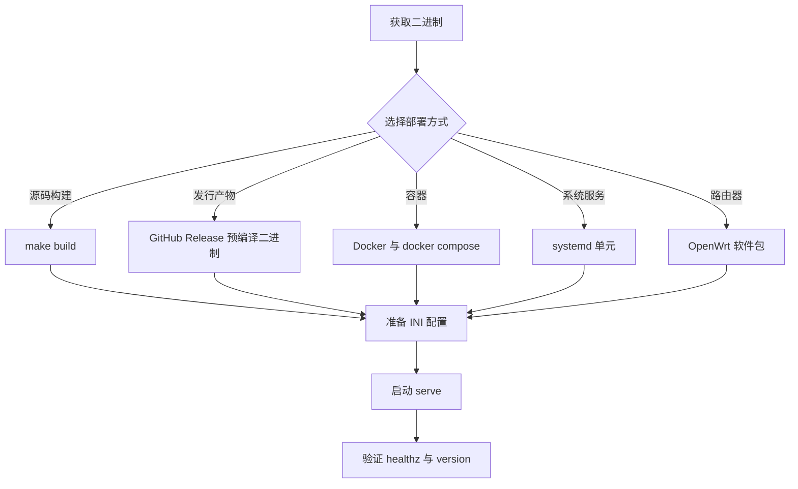
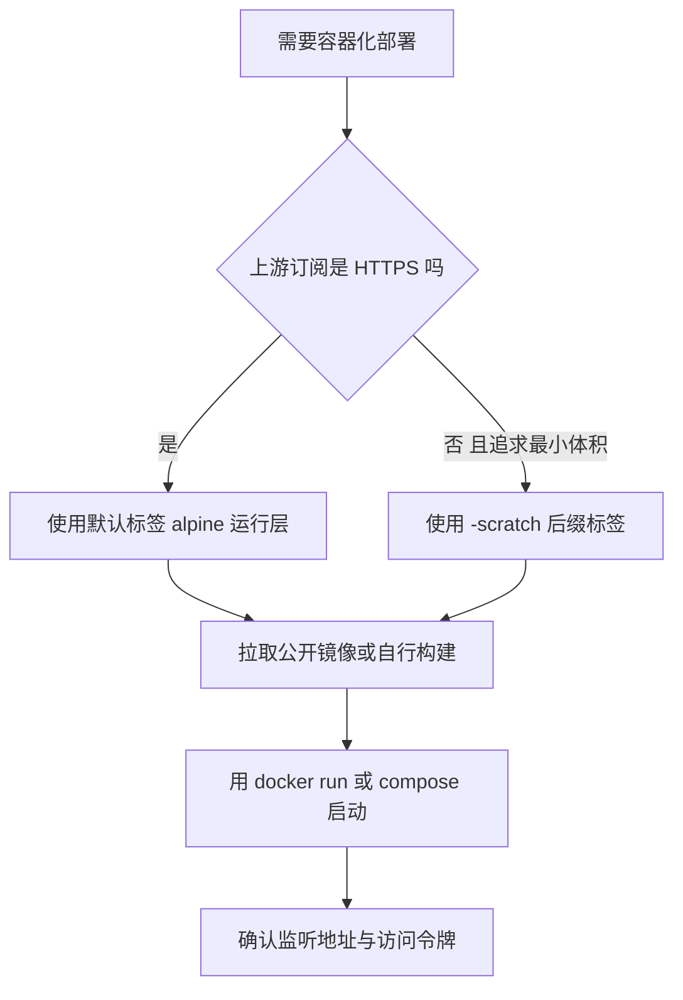
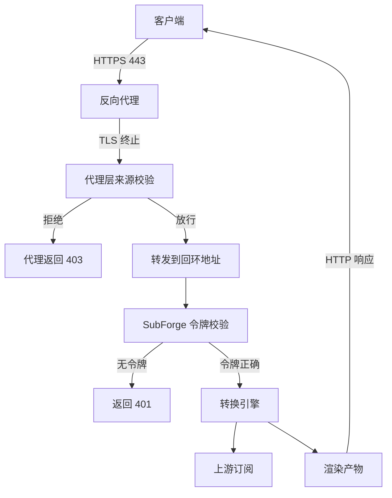

# 安装与部署

本页给出 SubForge 的全部安装与部署方式：从源码构建、使用发行产物、容器部署、systemd
托管、OpenWrt 打包。SubForge 是单个静态二进制程序，运行时不依赖 Go 工具链、Node.js 或
任何外部服务，因此"部署"本质上只有三件事：放置二进制、准备配置文件、决定监听地址与
访问令牌。下文每一步都给出可直接复制的命令，并标注事实来源文件与行号。

本页只写读者据此行动所需的结论；发布产物的完整验证数据见
[v0.1.2 发布验证报告](../reports/v0.1.2-release-verification.md)。

---

## 一、系统与依赖要求

### 1.1 运行期要求

| 项目 | 要求 | 说明 |
| --- | --- | --- |
| 操作系统 | Linux / Windows / macOS / FreeBSD | 交叉编译矩阵见 `Makefile:30-36` |
| CPU 架构 | amd64 / arm64 / arm | 同上 |
| 动态库 | 无 | 构建使用 `CGO_ENABLED=0`，产物为静态链接 |
| 网络 | 能出站访问上游订阅地址 | 服务只做出站 HTTP 拉取，不额外监听端口 |
| 可选 | `ca-bundle` | OpenWrt 上需要，见 `deploy/openwrt/Makefile:47` |

内存占用很低，可以直接跑在路由器与低配 VPS 上。

### 1.2 构建期要求

仅"从源码构建"与"自行打包"需要下列工具：

| 工具 | 版本 | 用途 |
| --- | --- | --- |
| Go | 1.26.0 或更高 | 编译后端，版本要求见 `go.mod:3` |
| GNU Make | 任意 | 驱动 `Makefile` 目标 |
| pnpm | 11 | 构建 `web/` 控制台前端（`Makefile:55`） |
| Node.js | 22 | 同上（`.github/workflows/release.yml:33`） |
| Docker | 任意 | 仅在构建镜像时需要 |

依赖已在 `vendor/` 目录全量锁定（`Makefile:12` 使用 `-mod=vendor`），构建过程不需要
访问 Go 模块代理。

---

## 二、部署方式总览



五种方式产出的都是同一个 `./cmd/subforge` 二进制（`deploy/README.md:3-4`），差别只在
进程如何被拉起、配置与数据放在哪个目录。本机试用用方式一；部署到 VPS 用方式二加方式
四；已有容器编排环境用方式三；目标设备是路由器用方式五。

---

## 三、方式一：从源码构建

1. 克隆仓库并进入目录：

   ```bash
   git clone https://github.com/tktogether/subforge.git
   cd subforge
   ```

2. 构建二进制。该目标等价于
   `CGO_ENABLED=0 go build -trimpath -mod=vendor -ldflags "..." -o bin/subforge ./cmd/subforge`
   （`Makefile:20-21`）：

   ```bash
   make build
   ```

3. 确认版本信息已被注入。`make build` 会通过 `-X` 链接参数写入 `COMMIT` 与 `DATE`
   （`Makefile:7-10`）：`COMMIT` 取当前提交短哈希、`DATE` 取 UTC 时间
   （`Makefile:4-5`），版本号来自 `VERSION ?= dev` 的默认值（`Makefile:3`）。

   ```bash
   ./bin/subforge version
   ```

   预期输出形如：

   ```text
   subforge dev (commit f62f9d7, built 2026-10-20T03:05:35Z)
   ```

   若输出为 `subforge dev (commit none, built unknown)`，说明二进制不是用 `make build`
   构建的——只有完全不传链接参数的 `go build ./cmd/subforge` 才会这样。

4. 运行环境自检，预期最后一段为 `All checks passed.`：

   ```bash
   ./bin/subforge doctor
   ```

其他常用目标：`make test`（`:23-24`）、`make vet`（`:26-27`）、`make cross`
（交叉编译 linux/amd64、linux/arm64、linux/arm、windows/amd64、darwin/amd64、
darwin/arm64、freebsd/amd64 七个目标，`:29-36`）、`make release`（先 `cross` 再打包
进 `dist/`，`:42-47`）、`make docker`（`:38-40`）、`make verify`（构建、检查、测试、
覆盖率门禁、前端检查，`:88-89`）。

---

## 四、方式二：使用发行产物

推送 `v*` 形式的标签会触发打包工作流（`.github/workflows/release.yml:3-12`），它先跑 Web 与 Go 两套门禁（`:36-48`），再交叉编译出 7 个裸可执行文件并生成一份校验和清单（`:86-110`）。标签触发时同时创建 GitHub Release（`:155-162`）；手动触发只上传 Actions artifact，不创建 Release（`:163-169`）。

安装步骤：

1. 从 Release 页面下载对应平台的裸可执行文件，例如 `subforge-linux-amd64`，并校验
   摘要：

   ```bash
   sha256sum -c sha256sums.txt --ignore-missing
   ```

2. 赋予执行权限并放到 `PATH` 中：

   ```bash
   chmod +x subforge-linux-amd64
   sudo install -o root -g root -m 0755 subforge-linux-amd64 /usr/local/bin/subforge
   ```

3. 验证：

   ```bash
   subforge version
   ```

---

## 五、方式三：容器部署

容器部署有两条路线：拉取已发布的公开镜像，或从本仓库自行构建。两者的关键差别是运行层
是否带根证书——**scratch 运行层不含任何根证书，抓取 HTTPS 订阅源会失败**
（`Dockerfile:15-20`）。先按下图判断：



公开镜像位于 `ghcr.io/tktogether/subforge`，匿名即可拉取。当前可用的标签如下
（`.github/workflows/release.yml:126-153`）：

| 标签 | 运行层 | 架构 | 适合 |
| --- | --- | --- | --- |
| `v0.1.2`、`v0.1.3`、`v0.1.4`、`v0.1.5`、`latest` | alpine，含根证书与时区数据 | linux/amd64、linux/arm64 | 上游是 HTTPS 订阅地址，绝大多数情况 |
| `v0.1.2-scratch`、`v0.1.3-scratch`、`v0.1.4-scratch`、`v0.1.5-scratch`、`latest-scratch` | scratch，无根证书 | linux/amd64、linux/arm64 | 上游全部是 `http://` 或本地文件，且追求最小体积 |

> **历史标签的行为不同。** `:v0.1.0` 是 amd64 单架构、scratch 运行层；`:v0.1.1` 已是
> 双架构但仍以 scratch 为默认运行层；`:v0.1.3` 及更早的标签没有预设监听地址与数据目录。
> 引用旧版本的结论时必须写明具体标签。

### 5.1 路线一：拉取公开镜像

镜像的 `ENTRYPOINT` 是 `/usr/local/bin/subforge`、默认 `CMD` 是 `serve`（`Dockerfile.alpine:80-81`），数据目录通过卷持久化（`Dockerfile.alpine:74`）。

`serve` 接受四个环境变量作为选项的默认值（`cmd/subforge/serve.go:108-113`），优先级从低到高是**环境变量 < 命令行参数 < 配置文件同名项**（`cmd/subforge/serve.go:373-378`）。仓库当前的两份 Dockerfile 预设了前两项，因此容器无需额外参数即可从宿主机访问，且订阅管理默认启用：

| 环境变量 | 等价选项 | 镜像内的预设值 |
| --- | --- | --- |
| `SUBFORGE_LISTEN` | `-listen` | `0.0.0.0:25500`（容器内必须监听所有网卡，端口映射才通） |
| `SUBFORGE_DATA_DIR` | `-data-dir` | `/data`（订阅管理数据库与规则源落盘目录） |
| `SUBFORGE_TOKEN` | `-token` | 未设置，留空即不鉴权 |
| `SUBFORGE_CONFIG` | `-config` | 未设置，需指向**文件**而不是目录 |

```bash
# v0.1.4 及之后的镜像：已预设监听地址与数据目录，裸跑即可
docker run -d --name subforge -p 25500:25500 -v subforge-data:/data \
  -e SUBFORGE_TOKEN=<YOUR_TOKEN> ghcr.io/tktogether/subforge:latest

# v0.1.3 及更早的镜像：没有预设，必须显式传参
docker run -d --name subforge -p 25500:25500 -v subforge-data:/data \
  -e SUBFORGE_TOKEN=<YOUR_TOKEN> ghcr.io/tktogether/subforge:v0.1.3 \
  serve -listen 0.0.0.0:25500 -data-dir /data
```

> **`v0.1.3` 及更早的镜像必须显式传参。** 那些标签里 `CMD` 只有 `serve`，而 `serve`
> 默认监听 `127.0.0.1`，也不启用订阅管理。不显式传参时，宿主机访问会得到
> `Connection reset by peer`，控制台的管理接口会返回 503。

验证：

```bash
curl -s "http://127.0.0.1:25500/healthz?token=<YOUR_TOKEN>"
docker exec subforge /usr/local/bin/subforge version
```

### 5.2 路线二：自行构建

仓库提供两份 Dockerfile：`Dockerfile` 的运行层是 `scratch`（`Dockerfile:68`），体积最小但不含根证书；`Dockerfile.alpine` 的运行层是 `alpine:3.20`（`Dockerfile.alpine:58`），额外安装 `ca-certificates` 与 `tzdata`（`:61`），推荐用于实际部署。

```bash
# 需要 HTTPS 上游时用这个
docker build -f Dockerfile.alpine -t subforge:alpine .

# 上游是明文 HTTP 或本地文件、且追求最小体积时用这个
docker build -t subforge:latest .
```

两份 Dockerfile 都定义了 `VERSION`、`COMMIT`、`DATE` 三个构建参数，默认值为 `dev`、`none`、`unknown`（`Dockerfile:44-46`、`Dockerfile.alpine:35-37`）。不传这些参数时，镜像内 `subforge version` 会自报 `dev (commit none, built unknown)`：

```bash
docker build -f Dockerfile.alpine \
  --build-arg VERSION=v0.1.2 \
  --build-arg COMMIT=$(git rev-parse --short HEAD) \
  --build-arg DATE=$(date -u +%Y-%m-%dT%H:%M:%SZ) \
  -t subforge:alpine .
```

构建多架构镜像时，构建阶段固定在原生平台执行，只把目标平台交给 Go 交叉编译（`Dockerfile:22-24`、`Dockerfile.alpine:20-23`）；alpine 版本因为运行阶段要执行 `apk add`，还需要 QEMU。两份 Dockerfile 的头部注释里都给了可直接复制的 `docker buildx` 命令（`Dockerfile:9`、`Dockerfile.alpine:8`）。

镜像里也可以直接执行其他子命令，例如把上游文件挂在卷上做一次转换（`Dockerfile.alpine:10-11`）：

```bash
docker run --rm -v subforge-data:/data subforge:alpine \
  convert -file /data/sub.txt -format sing-box -out /data/cfg.json
```

### 5.3 使用 docker compose

仓库根目录的 `docker-compose.yml` 已把上述要点固化成默认值。去掉注释后的关键内容如下：

```yaml
services:
  subforge:
    build:
      context: .
      dockerfile: Dockerfile.alpine            # 默认走带根证书的运行层
      args:                                    # 版本信息，留空即 dev / none / unknown
        VERSION: ${SUBFORGE_VERSION:-dev}
        COMMIT: ${SUBFORGE_COMMIT:-none}
        DATE: ${SUBFORGE_DATE:-unknown}
    image: subforge:latest
    container_name: subforge
    ports:
      - "25500:25500"
    volumes:
      - subforge-data:/data                    # 数据库与规则源缓存，容器重建不丢
      - ./config:/config:ro                    # 供可选的 SUBFORGE_CONFIG 使用
    environment:
      - SUBFORGE_DATA_DIR=/data                # serve 只认这个名字
      - SUBFORGE_LISTEN=0.0.0.0:25500
    restart: unless-stopped
volumes:
  subforge-data:
```

与旧版的差别是**去掉了 `command:` 覆盖**：监听地址与数据目录改由 `environment` 里的
`SUBFORGE_LISTEN`、`SUBFORGE_DATA_DIR` 提供（`docker-compose.yml:30-35`）。构建时可用
`SUBFORGE_VERSION`、`SUBFORGE_COMMIT`、`SUBFORGE_DATE` 三个环境变量注入版本信息
（`docker-compose.yml:17-20`）。

```bash
docker compose up -d
docker compose logs -f subforge
curl -s "http://127.0.0.1:25500/healthz"
```

> **`SUBFORGE_CONFIG` 指向的是文件，不是目录。** 完整文件里该项以注释形式给出，默认指向挂载进来的 `/config` 目录下的配置文件（`docker-compose.yml:36-40`）；启用它之前要先在 `./config` 目录里准备好那个文件，否则 `serve` 会以 `读取配置 ...: no such file or directory` 退出。`SUBFORGE_TOKEN` 同样以注释形式给出，设置后控制台首次打开会要求填入同一个值。

若要从公开镜像启动而不是本地构建，把 `build:` 段整段换成
`image: ghcr.io/tktogether/subforge:latest` 即可；若固定用 `v0.1.3` 及更早的标签，则要按 5.1 节补上显式的 `-listen` 与 `-data-dir` 参数。

---

## 六、方式四：systemd 托管

1. 创建运行用户、配置目录与数据目录。单元文件里写的是 `User=subforge` / `Group=subforge`（`deploy/subforge.service:28-29`），**用户不存在时 `systemctl start` 会直接失败**，因此这一步不能省略：

   ```bash
   sudo useradd --system --no-create-home --shell /usr/sbin/nologin subforge
   sudo install -d -o subforge -g subforge -m 0750 /etc/subforge /var/lib/subforge
   sudo install -o subforge -g subforge -m 0640 /dev/null /etc/subforge/subforge.ini
   ```

2. 安装二进制与单元文件，然后重新加载并开机自启：

   ```bash
   sudo install -o root -g root -m 0755 dist/subforge-linux-amd64 /usr/local/bin/subforge
   sudo install -o root -g root -m 0640 deploy/subforge.service /etc/systemd/system/
   sudo systemctl daemon-reload
   sudo systemctl enable --now subforge
   ```

3. 查看状态与日志：

   ```bash
   systemctl status subforge
   journalctl -u subforge -n 50 --no-pager
   ```

单元文件的启动命令为（`deploy/subforge.service:30-35`）：

```text
/usr/local/bin/subforge serve \
    --config /etc/subforge/subforge.ini \
    --cache-dir /var/lib/subforge/cache \
    --listen 127.0.0.1:25500 \
    --timeout 30 \
    --shutdown 10
```

> **`--config` 指向的文件必须先存在。** 单元文件写死 `--config` 指向 `/etc/subforge` 目录下的配置文件（`deploy/subforge.service:31`），该路径不存在时程序立刻以退出码 1 结束，报错原文为 `subforge: 读取配置 <path>: open <path>: no such file or directory`。空文件可以正常启动，所以上一步先建了一个空文件；需要预置参数时再把 INI 内容写进去。

关键字段：

| 字段 | 值 | 作用 | 来源 |
| --- | --- | --- | --- |
| `After` / `Wants` | `network-online.target` | 等待网络就绪后启动 | `deploy/subforge.service:19-20` |
| `StartLimitIntervalSec` / `StartLimitBurst` | 60 / 5 | 启动限流，必须写在 `[Unit]` | `deploy/subforge.service:23-24` |
| `User` / `Group` | subforge | 以非特权用户运行 | `deploy/subforge.service:28-29` |
| `Restart` / `RestartSec` | on-failure / 3s | 异常退出后延迟 3 秒重启 | `deploy/subforge.service:38-39` |
| 沙箱与权限项 | `ProtectSystem=full`、`ProtectHome=read-only`、`PrivateTmp=true`、`RestrictAddressFamilies` 等 | 系统目录与家目录只读、独立 `/tmp`、限制地址族与命名空间 | `deploy/subforge.service:42-54` |
| `StateDirectory` / `StateDirectoryMode` | subforge / 0750 | 自动创建并授权数据目录 | `deploy/subforge.service:56-57` |

三点需要注意：

- **单元里没有 `--token`。** 默认监听 `127.0.0.1` 时只有本机可访问，不设令牌是安全的
  （`deploy/README.md:66-68`）。要改成 `0.0.0.0` 必须先设置令牌。
- **配置热重载不需要 `SIGHUP`。** 实现是 mtime 轮询（`cmd/subforge/serve.go:326-329`），
  改完 INI 文件即自动生效。

### 6.1 反向代理与 HTTPS

SubForge 本身只提供 HTTP，不实现 TLS 终止。若需要 HTTPS，推荐在反向代理上终止 TLS，
并把上游指向本机监听地址：

```bash
subforge serve -listen 127.0.0.1:25500 -token <YOUR_TOKEN>
```

Nginx 侧只需三点：用 `proxy_set_header Host $host;` 透传 Host；把 `proxy_read_timeout` 设为不小于 `-timeout` 的两倍（写超时为 `timeout * 2`，`cmd/subforge/serve.go:257`）；按需调整 `proxy_buffer_size` 以容纳数百 KB 的产物。服务没有流式端点（`/subscribe` 是一次性返回的纯文本响应），因此不需要关闭 `proxy_buffering`。

访问令牌通过查询参数传递，例如 `https://sub.example.com/sub?target=clash.meta&token=<YOUR_TOKEN>&url=...`。反向代理的访问日志会记录完整 URL，建议在代理层关闭查询串记录或对 `token` 参数做脱敏。

鉴权链路与信任边界如下图所示。TLS 与来源限制由反向代理负责，SubForge 自己只做令牌校验，且该校验对全部端点生效（包括 `/healthz` 与 `/version`）。图中的 403 由反向代理产生，SubForge 本身只返回 401。



---

## 七、方式五：OpenWrt

`deploy/openwrt/Makefile` 声明包名 `subforge`、版本 `1.0.0`、许可证 MIT（`deploy/openwrt/Makefile:5-9`），依赖 `+ca-bundle`（`:47`），并声明三处安装位置（`:54-61`）：`./bin/subforge` 装到 `/usr/bin/subforge`，`./files/` 下的启动脚本装到 `/etc/init.d/subforge`，`./files/` 下的 UCI 配置装到 `/etc/config/subforge`。表里的 `./` 是**相对 `$(PKG_BUILD_DIR)`** 而不是包源目录，因此 `Build/Prepare`（`:22-36`）必须存在：它把包源目录下的 `bin/subforge` 与 `files/*` 拷进 `$(PKG_BUILD_DIR)`，install 阶段才找得到文件。安装后会自动启用并启动（`:63-70`）。

### 7.1 打包步骤

**前置条件**：`deploy/openwrt/bin/subforge` 必须已经存在。它是打包用的预编译静态二进制，**不属于源码树**（`bin/` 已被 `.gitignore` 忽略），需要先自行交叉编译；缺少它时 `Build/Prepare` 会直接报错并提示构建命令（`deploy/openwrt/Makefile:23-30`）。

1. 交叉编译目标平台的二进制：

   ```bash
   CGO_ENABLED=0 GOOS=linux GOARCH=amd64 \
     go build -trimpath -mod=vendor -ldflags "-s -w" \
     -o deploy/openwrt/bin/subforge ./cmd/subforge
   ```

2. 解压官方 SDK 并准备构建环境。SDK 缺 host 依赖时 `make defconfig` 会先失败，需要装
   `libncurses-dev bzip2 liblzma-dev zlib1g-dev libssl-dev` 后重试。

   ```bash
   mkdir -p /opt/sdk-x86 && tar --zstd -xf \
       openwrt-sdk-24.10.4-x86-64_gcc-13.3.0_musl.Linux-x86_64.tar.zst \
       -C /opt/sdk-x86 --strip-components=1
   cd /opt/sdk-x86 && export FORCE_UNSAFE_CONFIGURE=1 && make defconfig
   ```

3. 把包放进 SDK 的本地 package 目录并打包，产物落在
   `<sdk>/bin/packages/<PKGARCH>/base/`，文件名形如 `subforge_1.0.0-r1_x86_64.ipk`：

   ```bash
   mkdir -p package/subforge/bin
   cp -a <repo>/deploy/openwrt/Makefile package/subforge/
   cp -a <repo>/deploy/openwrt/files    package/subforge/
   cp -a <repo>/deploy/openwrt/bin/subforge package/subforge/bin/
   make package/subforge/compile V=s
   ```

> **检查产物时注意**：这个 SDK 打出的 `.ipk` 外层是 gzip 包一层 tar，不是 `ar` 归档，
> `ar t` 会报 `file format not recognized`。正确做法是 `gunzip -c pkg.ipk > pkg.tar`
> 后再用 `tar` 查看（`scripts/ipkg-build:195` 的实现就是 `tar | gzip`）。

`DEPENDS:=+ca-bundle` 在裸 SDK 的 `make defconfig` 阶段会报
`has a dependency on 'ca-bundle', which does not exist`——那是因为裸 SDK 没有装任何
feed，不是包本身有问题，该警告也不影响打包成功。

> **尚未验证**：没有在真实 OpenWrt 设备或 rootfs 上执行过 `opkg install`，因此
> `postinst` 的实际行为、`procd` 能否拉起服务、`ca-bundle` 依赖能否被设备端 `opkg`
> 解析，都还没有实测。

### 7.2 启动脚本与 UCI 配置

`deploy/openwrt/files/` 下的启动脚本用 procd 模型：`START=99`、`USE_PROCD=1`，启动命令为 `/usr/bin/subforge serve`，由 `deploy/openwrt/Makefile:54-61` 安装到 `/etc/init.d/subforge`。

> **脚本已经按新语义写好，需要时再补变量。** 脚本目前只设置一个环境变量：`SUBFORGE_DATA_DIR=/etc/subforge/data`。它等价于 `-data-dir`（`cmd/subforge/serve.go:111`），目录不存在时由 `serve` 自动创建；放在 `/etc/subforge/data` 而不是 `/var` 是因为 OpenWrt 上 `/var` 是 tmpfs，重启即清空。
>
> 脚本里没有 `-listen` 参数，服务使用默认的 `127.0.0.1:25500`，只监听路由器本机。若要让局域网内其他设备访问，在 `start_service` 里补上 `procd_set_param env SUBFORGE_LISTEN=0.0.0.0:25500` 与 `procd_set_param env SUBFORGE_TOKEN=<YOUR_TOKEN>`。需要 INI 模板时再补 `SUBFORGE_CONFIG`，取值必须是**文件**路径；指向目录会让 `serve` 以 `读取配置 <路径>: is a directory` 直接退出，指向不存在的文件则报 `no such file or directory`。

`deploy/openwrt/files/subforge.conf` 声明的五个 UCI 选项（`option enabled`、`option port`、`option data_dir`、`option config_dir`、`option log_level`，`deploy/openwrt/files/subforge.conf:3-8`）当前全部不会被读取：启动脚本里没有任何 `config_load` / `config_get` 调用。现阶段应把该文件视为参数清单与后续接入点，实际生效参数以启动脚本里的 `command` 与环境变量为准。

---

## 八、首次启动与验证

最小可用启动命令：

```bash
subforge serve -token <YOUR_TOKEN> -name myconfig
```

带配置文件与数据目录时，在最小命令的基础上追加所需参数即可：

```bash
subforge serve -token <YOUR_TOKEN> -config ./subforge.ini -data-dir ./data -cache-dir ./cache
```

启动成功时标准错误输出形如（`cmd/subforge/serve.go:269-272`）：

```text
subforge dev 监听 127.0.0.1:25500（格式: clash.meta, surge, quan, quanx, loon, ...）
配置: ./subforge.ini（热重载已启用）
```

`serve` 的全部参数见下表（`cmd/subforge/serve.go:108-113`）：

| 参数 | 取值 | 默认值 | 说明 |
| --- | --- | --- | --- |
| `-listen` | `主机:端口` | `127.0.0.1:25500` | 监听地址 |
| `-token` | 字符串 | 空 | 访问令牌，空表示不鉴权 |
| `-config` | 文件路径 | 空 | INI 配置文件，改动后自动热重载 |
| `-mixed-port` | 1–65535 | `7890` | clash.meta 产物的 `mixed-port` |
| `-timeout` | 秒 | `30` | 上游请求与单请求超时 |
| `-shutdown` | 秒 | `10` | 收到停止信号后的优雅关闭时间 |
| `-cache-dir` | 目录 | 空 | 上游内容磁盘缓存目录，空表示不缓存 |
| `-data-dir` | 目录 | 空 | 订阅管理数据目录，空表示不启用 |
| `-name` | 字符串 | 空 | 写入产物注释头的配置名 |

其中前四项的默认值可以由环境变量提供：`SUBFORGE_LISTEN`、`SUBFORGE_TOKEN`、`SUBFORGE_CONFIG`、`SUBFORGE_DATA_DIR` 依次对应 `-listen`、`-token`、`-config`、`-data-dir`（`cmd/subforge/serve.go:108-113`）。命令行参数会覆盖环境变量，配置文件里的同名项再覆盖命令行参数，因此显式传参始终有效。

另有一个环境变量与启动参数无关，只影响对外拉取：`SUBFORGE_USER_AGENT` 决定请求上游订阅时使用的 User-Agent（`internal/fetch/useragent.go`），默认值是 `mihomo/1.19.31 SubForge/<版本>`。多数机场按 User-Agent 判断客户端类型：认成 Clash 内核时才返回带 `Subscription-Userinfo` 的完整配置，否则退化成一份纯节点链接清单，既没有流量信息，也拿不到机场自带的规则与规则集。只有在对方按 UA 做特殊处理、需要伪装成别的客户端时才需要覆盖它。

`-data-dir` 指向的目录**不需要提前创建**：`serve` 会用 `os.MkdirAll` 建出整条路径（`cmd/subforge/serve.go:361-366`），多级不存在也会一并创建。只有创建失败时才会终止启动并报 `创建数据目录 <dir>: ...`。不指定 `-data-dir`、也没有设置 `SUBFORGE_DATA_DIR` 时，订阅管理整体不启用，启动日志会提示 `订阅管理未启用：-data-dir 与 SUBFORGE_DATA_DIR 都为空，控制台的订阅、规则、令牌、任务等接口会返回 503。加 -data-dir ./data 即可启用。`（`cmd/subforge/serve.go:247-248`）。

启动后可访问 `/healthz`、`/version`、`/inspect`、`/sub` 四个端点，它们都受令牌保护：

```bash
curl -s "http://127.0.0.1:25500/healthz?token=<YOUR_TOKEN>"
curl -s "http://127.0.0.1:25500/version?token=<YOUR_TOKEN>"
```

> **鉴权是全局的**，`/healthz` 与 `/version` 同样受令牌保护。设置 `-token` 后不带令牌
> 访问 `/healthz` 会返回 `401: 缺少或错误的访问令牌`，带 `?token=` 才返回 200。因此健康
> 检查探针必须把令牌写进 URL，或改用不带令牌的监听地址。

环境自检：

```bash
subforge doctor
```

该命令输出版本信息、内存信息、工作目录、数据目录、配置文件查找结果、依赖检查与健康检查等段落，最后一段固定为 `All checks passed.`。其中数据目录一项读取的是环境变量 `SUBFORGE_DATA_DIR`（`cmd/subforge/doctor.go:62`），而不是 `serve -data-dir` 的值——这两个名字不同，不要混用。

---

## 九、安全建议

| 场景 | 建议监听地址 | 说明 |
| --- | --- | --- |
| 仅本机使用 | `127.0.0.1:25500` | 默认值，最安全 |
| 局域网内其他设备访问 | `0.0.0.0:25500` | **必须**同时设置 `-token` |
| 公网访问 | `127.0.0.1:25500` + 反向代理 | 由代理负责 TLS 与访问控制 |

服务会在启动时对「绑定所有网卡且无令牌」的组合向标准错误输出一行警告（`cmd/subforge/serve.go:132-133`）：

```text
警告: 监听所有网卡但未设置访问令牌，同网段任何主机都能使用本服务。
```

该行为**只警告、不拒绝启动**（`cmd/subforge/serve.go:129-131` 的注释写明「这里只警告不拦截」），因为使用者可能在反向代理或内网隔离环境中刻意如此部署。也正因如此，把服务暴露到局域网之前必须自行设置 `-token`，程序不会代为阻止。

令牌通过 `-token`、INI 的 `[subforge] token` 或 URL 的 `token=` 参数设置，比较时使用
恒定时间比较以避免时序侧信道。生成高强度令牌：

```bash
openssl rand -hex 32
```

服务日志会记录请求路径。由于令牌可以写在查询串里，建议不要把服务日志原样外发。另外：

- 控制台由前端产物内嵌提供，访问根路径 `/` 即进入控制台。
- `/api/metrics` 返回的是 **JSON 格式的运行时指标**（`internal/api/pprof.go:154` 走
  `writeJSON`），不是 Prometheus 文本暴露格式，不能直接作为 Prometheus 抓取目标。
- `/debug/pprof/*` 默认关闭，只有环境变量 `SUBFORGE_DEBUG=1` 时才注册
  （`internal/api/pprof.go:22`）。生产环境不要设置该变量。

---

## 十、升级与卸载

1. 记录当前版本，便于回滚：

   ```bash
   subforge version
   ```

2. 停服务并备份二进制与配置：

   ```bash
   sudo systemctl stop subforge
   sudo cp /usr/local/bin/subforge /usr/local/bin/subforge.bak
   sudo cp /etc/subforge/subforge.ini /etc/subforge/subforge.ini.bak
   ```

3. 替换二进制并启动，然后验证：

   ```bash
   sudo install -o root -g root -m 0755 subforge-linux-amd64 /usr/local/bin/subforge
   sudo systemctl start subforge
   curl -s "http://127.0.0.1:25500/healthz?token=<YOUR_TOKEN>"
   ```

回滚即反向执行第 2 步的备份覆盖与第 3 步的启动。`-data-dir` 内的 SQLite 数据库在升级时
不需要迁移操作，但**降级前必须备份**，因为旧版本可能无法读取新版本写入的表结构。

容器部署的升级方式取决于用的是哪条路线。走本地构建
（`docker-compose.yml:4-16` 的 `build:` 段）时：

```bash
git pull
docker compose build --pull
docker compose up -d
```

走公开镜像（已把 `build:` 段换成 `image:`）时，升级与回滚就是换标签：

```bash
docker compose pull
docker compose up -d
```

卸载二进制部署：

```bash
sudo systemctl disable --now subforge
sudo rm /etc/systemd/system/subforge.service /usr/local/bin/subforge
sudo systemctl daemon-reload
sudo rm -rf /etc/subforge /var/lib/subforge
```

最后一条会连同数据目录一起删除，执行前请确认不再需要其中的订阅管理与历史数据。卸载
容器部署则用 `docker compose down`，数据卷需另用 `docker volume rm` 删除。

---

## 相关页面

- [快速上手教程](快速上手教程)
- [INI-模板配置详解](INI-模板配置详解)
- [故障排查与常见问题](故障排查与常见问题)
- [系统架构总览](系统架构总览)
