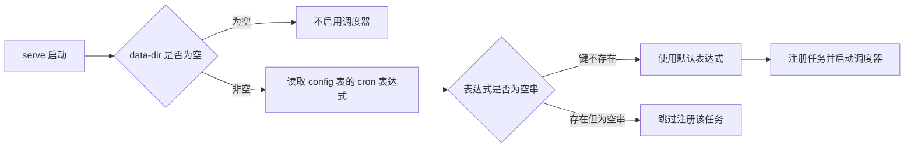
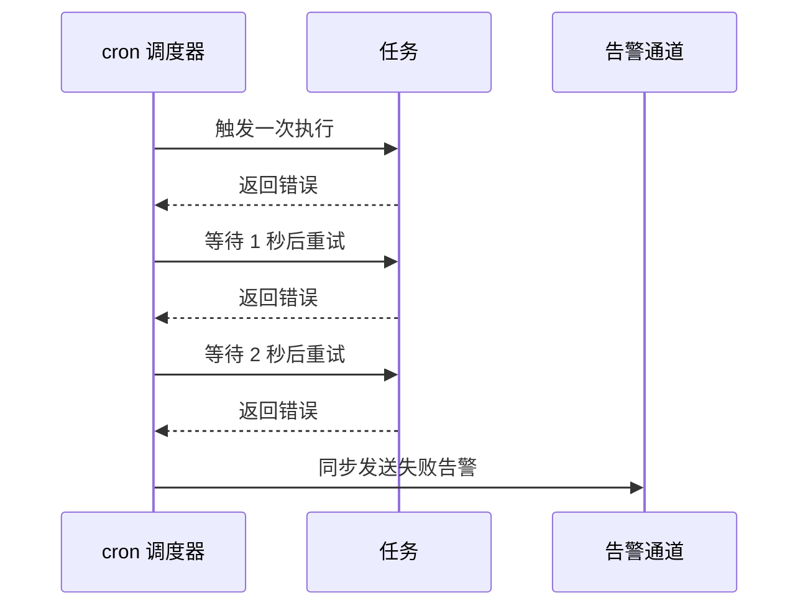
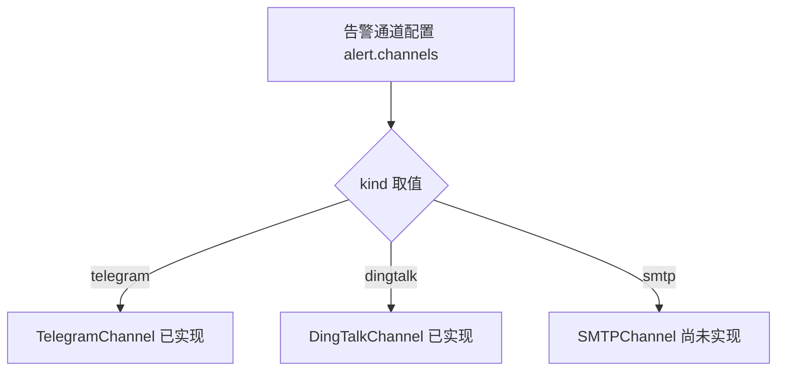

# 定时任务与告警

SubForge 的 `serve` 命令内置一个调度器，用于按固定周期执行规则源更新与订阅测活，并在任务连续失败时通过告警通道发出通知。本文说明调度器的启用条件、两个内置任务的行为、告警通道的配置方式，以及当前版本中尚未打通的环节。

阅读本文前，建议先了解订阅管理与规则源的基本概念；本文只讨论「何时自动执行」与「失败后如何通知」，不展开转换与渲染细节。

## 1. 能力概览

调度器基于 `robfig/cron/v3` 实现（`internal/scheduler/scheduler.go:11`），使用 5 字段 cron 表达式，字段顺序为「分 时 日 月 周」（`internal/scheduler/scheduler.go:18`）。调度器读取宿主机本地时区，即 `time.Local`（`internal/scheduler/scheduler.go:54`），因此表达式中的时刻按部署机器的系统时区解释。

当前版本内置两个定时任务，二者的表达式都存放在 SQLite 的 `config` 表中：

| 任务名 | 作用 | 默认 cron | 配置键 | 默认值来源 |
| --- | --- | --- | --- | --- |
| `rule-sources` | 按规则源清单拉取各规则源的最新版本并落盘 | `0 4 * * *`（每天 04:00） | `rules.update_cron` | `internal/scheduler/jobs.go:21` |
| `subscheck` | 对所有「已启用且填写了订阅地址」的机场做订阅可用性检查 | `*/30 * * * *`（每 30 分钟） | `subscheck.cron` | `internal/scheduler/jobs.go:23` |

调度器不提供手动触发按钮，也不提供任务的增删改接口：任务的注册与移除由代码在启动时完成（`internal/scheduler/scheduler.go:80-108`），对外只暴露最近执行记录。

## 2. 启用条件与启动流程

调度器只在启用订阅管理时装配，判据是启动参数 `-data-dir` 非空（`cmd/subforge/serve.go:158`）。该参数为空时，`serve` 不初始化 SQLite、不读取规则源清单，也不会注册任何定时任务；此时访问任务接口会得到 `503`，错误正文为 `{"error":"调度器未启用"}`（`internal/api/tasks.go:16-19`）。

启用订阅管理后，启动流程按以下顺序执行：



图中三条分支对应 `cmd/subforge/serve.go:201-231` 的实际逻辑：键不存在时使用默认表达式；键存在但值为空串时不注册该任务，这是一种「显式关闭」手段；注册失败（例如表达式语法错误）只打印一行日志 `注册 rule-sources 任务失败: ...`（`cmd/subforge/serve.go:210-212`），服务继续运行，但该任务不会执行。

启动完成后，进程会在标准错误输出中打印 `订阅管理已启用: <数据目录>`（`cmd/subforge/serve.go:165`），可用于确认调度器所在的数据目录。

## 3. 查看任务执行记录

执行记录通过 `GET /api/tasks` 读取，控制台的「任务」页面即调用该接口（`web/src/pages/TasksPage.vue:3-9`）。

```bash
curl -s http://127.0.0.1:25500/api/tasks \
  -H 'X-Token: <YOUR_TOKEN>'
```

响应结构如下：

```json
{
  "tasks": [
    {
      "JobName": "subscheck",
      "Success": true,
      "Err": "",
      "StartedAt": "2026-10-20T02:00:00.1234567+08:00",
      "Duration": 81234567
    }
  ]
}
```

字段说明：

| 字段 | 类型 | 默认值 | 说明 |
| --- | --- | --- | --- |
| `JobName` | 字符串 | — | 任务名，取值为 `rule-sources` 或 `subscheck` |
| `Success` | 布尔 | — | 本次执行是否成功 |
| `Err` | 字符串 | `""` | 失败原因原文，成功时为空串 |
| `StartedAt` | 字符串 | — | 开始时间，RFC 3339 格式 |
| `Duration` | 整数 | — | 执行耗时，单位为纳秒 |

`JobResult` 结构体没有 JSON 标签（`internal/scheduler/scheduler.go:43-49`），因此字段名保持 Go 的导出名，耗时也是 `time.Duration` 的纳秒整数；控制台在渲染时按纳秒换算（`web/src/pages/TasksPage.vue:22`）。手工调用接口时不要按毫秒或秒解析该字段。

执行记录保存在内存中，只保留最近 100 条（`internal/scheduler/scheduler.go:180-187`），进程重启后清空。一次调度只产生一条记录：成功时记录成功结果；失败时只在第 3 次重试仍失败后记录失败结果（`internal/scheduler/scheduler.go:132-174`）。

## 4. 规则源更新任务

任务名为 `rule-sources`（`internal/scheduler/jobs.go:99`），执行逻辑是读取 `rules.manifest_path` 指向的清单文件，并调用规则源更新流程拉取全部规则源的最新版本。

该任务有两个重要行为：

1. **未配置清单路径时不算失败。** 若 `rules.manifest_path` 为空，任务直接返回成功，日志输出 `[scheduler] rule-sources: 未配置 rules.manifest_path，跳过本次更新`（`internal/scheduler/jobs.go:107-115`）。这样设计是为了避免「尚未使用规则工厂」的部署被反复告警。
2. **更新结果按源逐条记录。** 更新完成后打印 `[scheduler] rule-sources: 更新完成，共 N 个规则源`（`internal/scheduler/jobs.go:116-121`）；单个规则源拉取失败由规则源实现保留上一版本，不会让整个任务失败。

清单路径可通过控制台「设置」页面或 `PUT /api/settings` 写入，对应设置项为 `rules.manifest_path`（`internal/subforge/settings.go:37`）。规则源清单的字段含义参见[规则工厂与规则源](规则工厂与规则源)。

## 5. 订阅测活任务

任务名为 `subscheck`（`internal/scheduler/jobs.go:151`），执行逻辑如下：

1. 读取机场列表；
2. 只保留 `enabled` 为真且订阅地址非空的机场（`internal/scheduler/jobs.go:164-170`）；
3. 若筛选结果为空，打印 `[scheduler] subscheck: 没有启用且已配置订阅地址的机场，跳过本次测活` 并返回成功（`internal/scheduler/jobs.go:171-174`）；
4. 否则调用订阅测活实现，逐个检查订阅地址，失败项逐条打印，最后输出 `[scheduler] subscheck: 完成，成功 N / 失败 M（共 K 个订阅）`（`internal/scheduler/jobs.go:175-183`）。

需要注意两点：

- **测活结果只写日志，不写数据库。** 调度器侧的测活不会更新机场的流量字段，也不会写入「上次测活结果」；控制台机场页的手动测活走的是另一条路径（`POST /api/airports/check`），其结果保存在进程内存中，同样不落库。
- **`subscheck.enabled` 设置项目前未接入执行路径。** 该设置项已实现存取（`internal/subforge/settings.go:36`），控制台也可以保存，但调度任务本身没有读取它（`internal/scheduler/jobs.go:159-184` 中不存在对该键的读取），因此关闭该开关不会阻止任务按 cron 执行。若需要停用测活，应把 `subscheck.cron` 设为空串，或在数据库中删除该键后改为不注册。

## 6. 失败重试与告警触发

任务执行失败后会重试，重试策略是固定次数而非无限重试：

- 最多执行 3 次（`internal/scheduler/scheduler.go:134`）；
- 前两次失败后分别等待 1 秒与 2 秒，等待时长按 `1 << attempt` 秒计算（`internal/scheduler/scheduler.go:154-166`）；
- 第 3 次失败不再等待，直接进入告警流程（`internal/scheduler/scheduler.go:175-176`）。



告警消息由调度器统一拼装，原文为：

```text
[SubForge 告警] 任务 "<任务名>" 执行失败（重试 3 次后仍失败）: <错误原文>
时间: <RFC 3339 时间>
```

（格式串见 `internal/scheduler/scheduler.go:195-196`。）发送是同步的，且每个通道的返回错误会被忽略（`internal/scheduler/scheduler.go:197-199`），因此通道自身故障不会影响任务记录，也不会二次告警。

以下能力在当前版本中尚未实现，部署时不要依赖：

- 告警抑制与去重：同一任务连续多个周期失败会重复发送；
- 恢复通知：任务恢复正常后不会补发通知；
- 告警发送结果落库：发送失败只体现在日志中。

此外，失败结果还会被投递到 Rule-Bot 建议队列（`cmd/subforge/serve.go:175-179`），用于在控制台的规则页面生成建议。

## 7. 配置告警通道

告警通道配置存放在 SQLite `config` 表的 `alert.channels` 键中，值为一个 JSON 数组（`internal/subforge/alerts.go:12`）。当前控制台没有提供告警通道管理界面：前端虽已声明相关请求函数（`web/src/api/endpoints.ts:459-464`），但没有页面引用它们，因此需要通过 HTTP API 配置。

通道对象的字段如下：

| 字段 | 类型 | 默认值 | 说明 |
| --- | --- | --- | --- |
| `kind` | 字符串 | — | 通道类型，取值为 `telegram`、`dingtalk` 或 `smtp`；缺失时写入失败并报错「告警通道缺少 kind」 |
| `enabled` | 布尔 | `false` | 是否在启动时装配该通道 |
| `bot_token` | 字符串 | `""` | Telegram 机器人令牌 |
| `chat_id` | 字符串 | `""` | Telegram 会话标识 |
| `webhook` | 字符串 | `""` | 钉钉自定义机器人 Webhook 地址 |
| `host` | 字符串 | `""` | SMTP 服务器地址，当前仅存储 |
| `port` | 整数 | `0` | SMTP 端口，当前仅存储 |
| `username` | 字符串 | `""` | SMTP 用户名，当前仅存储 |
| `password` | 字符串 | `""` | SMTP 密码，当前仅存储 |
| `from` | 字符串 | `""` | SMTP 发件人，当前仅存储 |
| `to` | 字符串 | `""` | SMTP 收件人，当前仅存储 |

写入采用「整体替换」语义：请求体中的列表即最终列表，未出现在列表中的通道会被删除（`internal/subforge/alerts.go:78-124`）。为避免回传明文密钥，读取接口会对 `bot_token`、`webhook`、`password` 三个字段脱敏为 `***`，并在 `configured` 映射中标记该字段是否已配置（`internal/subforge/alerts.go:42-76`）；写入时把字段值写回 `***`，表示沿用同类型通道的旧值（`internal/subforge/alerts.go:107-115`）。

配置一个 Telegram 通道的示例：

```bash
curl -s -X PUT http://127.0.0.1:25500/api/alert-channels \
  -H 'X-Token: <YOUR_TOKEN>' \
  -H 'Content-Type: application/json' \
  -d '{"channels":[{"kind":"telegram","enabled":true,"bot_token":"<YOUR_TOKEN>","chat_id":"123456789"}]}'
```

写入后可先做连通性测试，再依赖定时任务触发：

```bash
curl -s -X POST http://127.0.0.1:25500/api/alert-channels/test \
  -H 'X-Token: <YOUR_TOKEN>' \
  -H 'Content-Type: application/json' \
  -d '{"index":0}'
```

测试接口的响应形如 `{"ok":false,"error":"Telegram 响应码 401","channel":"telegram"}`。发送失败同样返回 HTTP `200`，判定结果以 `ok` 字段为准（`internal/api/alerts.go:69-102`）。若不想写入配置就先验证，也可以在请求体中直接给出通道字段，例如 `{"kind":"dingtalk","webhook":"https://example.com/robot/send?access_token=<YOUR_TOKEN>"}`。

通道类型的支持情况如下：



- Telegram 通道调用 Bot API 的 `sendMessage` 接口，超时 10 秒，响应码非 200 时报错 `Telegram 响应码 N`（`internal/scheduler/alert_channels.go:20-50`）。
- 钉钉通道向 Webhook 发送 `{"msgtype":"text","text":{"content":"..."}}`，响应码非 200 时报错 `DingTalk 响应码 N`（`internal/scheduler/alert_channels.go:58-83`）。
- SMTP 通道尚未实现：`Send` 恒返回错误 `SMTP 通道尚未实现，请使用 Telegram 或 DingTalk`（`internal/scheduler/alert_channels.go:99-101`），`serve` 启动时遇到 `smtp` 类型会打印 `[serve] 告警通道 "smtp" 为 smtp，SMTPChannel 尚未实现，已跳过`（`cmd/subforge/serve.go:193-194`）。SMTP 相关字段目前只做存储，不会生效。

通道只在 `serve` 启动时读取并装配一次（`cmd/subforge/serve.go:180-199`）。修改配置后必须重启 `serve` 才会生效，运行期新增的通道不会自动接入。

## 8. 调整 cron 表达式

两个 cron 表达式都存在 `config` 表中，但当前版本没有提供写入入口：

- `PUT /api/settings` 只接受白名单内的 4 个设置项（`internal/subforge/settings.go:34-39`），提交 `rules.update_cron` 或 `subscheck.cron` 会得到 `400`，错误正文为 `未知设置项 "..."`（`internal/subforge/settings.go:113-119`）；
- 控制台「设置」页面按同一份白名单渲染表单，因此也没有对应输入框。

需要修改时，可直接操作数据目录下的 `subforge.db`（数据库文件名见 `cmd/subforge/serve.go:159`），改完重启 `serve` 生效：

```sql
-- 把规则源更新改到每天 03:30
INSERT INTO config (key, value) VALUES ('rules.update_cron', '30 3 * * *')
  ON CONFLICT(key) DO UPDATE SET value = excluded.value;

-- 显式关闭订阅测活任务：保留键但写空串，启动时不注册该任务
INSERT INTO config (key, value) VALUES ('subscheck.cron', '')
  ON CONFLICT(key) DO UPDATE SET value = excluded.value;

-- 删除键则恢复默认表达式
DELETE FROM config WHERE key = 'subscheck.cron';
```

写入前建议先停掉 `serve`，避免与运行中的进程并发写同一个 SQLite 文件。表达式使用 5 字段格式，字段含义依次为分、时、日、月、周；`robfig/cron/v3` 的解析错误只会在启动日志中出现一行 `注册 ... 任务失败`，不会阻止服务启动。

## 9. 常见问题与排查

| 现象 | 可能原因 | 处理方式 |
| --- | --- | --- |
| 任务接口返回 `503 调度器未启用` | 启动时未指定 `-data-dir` | 指定数据目录后重启，确认日志出现 `订阅管理已启用` |
| 任务页面长期为空 | 任务尚未到达触发时间，或表达式被写成空串 | 检查 `config` 表中两个 cron 键；确认启动日志没有「注册 ... 任务失败」 |
| 规则源任务每次跳过 | `rules.manifest_path` 未配置 | 在设置页或 `PUT /api/settings` 中配置清单路径 |
| 告警没有送达 | 通道未启用、配置后未重启、通道类型为 `smtp` | 用 `POST /api/alert-channels/test` 验证，确认 `enabled` 为真并重启 `serve` |
| 任务重复告警 | 当前版本没有告警抑制与去重 | 先修复失败原因；抑制能力尚未实现 |
| 关闭 `subscheck.enabled` 后测活仍在执行 | 该设置项目前未接入调度器 | 改用空串 cron 关闭任务 |

## 10. 相关页面

- [规则工厂与规则源](规则工厂与规则源)
- [流量策略与用量统计](流量策略与用量统计)
- [HTTP-API-参考](HTTP-API-参考)
- [Web-控制台使用指南](Web-控制台使用指南)
- [安装与部署](安装与部署)
- [故障排查与常见问题](故障排查与常见问题)
