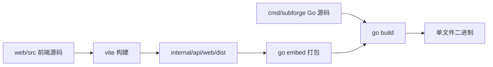
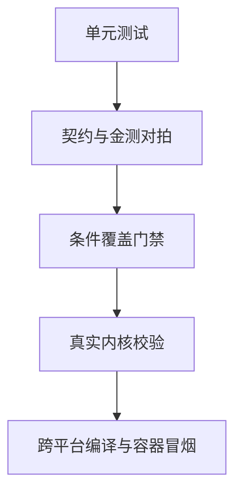
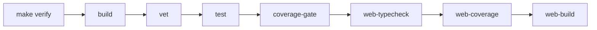
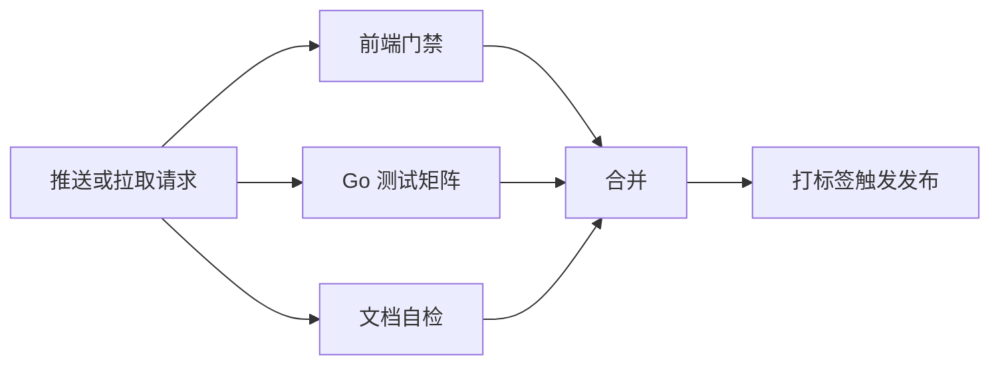

# 开发与测试指南

本页面向需要修改 SubForge 源码或补充测试的开发者，说明环境准备、目录结构、构建方式、测试体系与本地门禁的执行口径。

内容只覆盖技术操作：如何编译、如何跑测试、如何满足覆盖率与条件覆盖门禁、如何自检文档。提交规范、评审规则与协作流程属于政策范畴，请以仓库根目录的 [CONTRIBUTING.md](../../CONTRIBUTING.md) 为准，本页仅做摘要。

## 1. 环境准备

| 组件 | 版本要求 | 来源 |
| --- | --- | --- |
| Go | 1.26.0 | `go.mod` |
| Node.js | 20.19.0 或更高 | `web/package.json` 的 `engines.node` |
| pnpm | 11.28.5 | `web/package.json` 的 `packageManager` |
| mihomo（可选） | 用于校验 Clash 产物可加载性 | `scripts/validate-mihomo.sh` |
| Docker（可选） | 构建容器镜像 | `Makefile:38-40` |

前端依赖需要单独安装，首次克隆仓库后执行：

```bash
make web-install
```

该目标实际执行 `pnpm -C web install --frozen-lockfile`（`Makefile:54-55`），在 CI 中同样使用冻结锁文件的方式安装。

## 2. 目录结构

| 目录 | 职责 |
| --- | --- |
| `cmd/subforge` | 命令行入口，包含 `serve`、`convert` 等子命令 |
| `internal/api` | HTTP 路由、中间件与接口处理器 |
| `internal/convert` | 转换参数解析与执行引擎 |
| `internal/render` | 各目标格式的渲染器与目标注册表 |
| `internal/parse` | 上游订阅内容解析 |
| `internal/transform` | 过滤、重命名、去重、排序等节点变换 |
| `internal/ruleset` | 规则集解析与渲染 |
| `internal/store` | SQLite 存储与表结构迁移 |
| `internal/subforge` | 机场、分组、规则、令牌等管理逻辑 |
| `internal/scheduler` | 定时任务与告警通道 |
| `internal/tools` | 覆盖率门禁工具 `coveragegate` 与 `condgate` |
| `web` | Vue 3 单页应用与单元测试 |
| `testdata` | 测试夹具与金测产物 |
| `scripts` | 文档自检、mihomo 校验、Windows 一键验证脚本 |
| `docs` | 文档源文件，含 `docs/wiki` |

## 3. 构建与产物

`make build` 使用 `CGO_ENABLED=0` 编译，并通过 `-trimpath`、`-mod=vendor` 与链接参数注入版本信息（`Makefile:7-12`、`:20-21`）。注入的字段包括版本、提交号与构建日期，对应 `internal/buildinfo` 包中的变量。

前端产物在构建时直接写入 `internal/api/web/dist`（`web/vite.config.ts:13`），随后由 Go 的 `embed` 打包进二进制，因此发布物只有一个可执行文件。



跨平台构建由 `make cross` 完成，覆盖 linux/amd64、linux/arm64、linux/arm、windows/amd64、darwin/amd64、darwin/arm64 与 freebsd/amd64 七个目标（`Makefile:29-36`）。`make release` 在交叉编译后把二进制打包为 `dist/` 下的压缩包（`Makefile:42-47`）。

### 3.1 前端构建细节

前端构建配置中有几处约定需要保留：

| 配置 | 值 | 原因 |
| --- | --- | --- |
| `build.outDir` | `../internal/api/web/dist` | 产物必须落在 Go 的 embed 目录内 |
| `emptyOutDir` | `true` | 每次构建清空目录，避免残留旧资源 |
| 占位文件 | `scripts/ensure-dist-placeholder.mjs` | 清空后补回 `.gitkeep`，保证未构建时也能编译 |
| `sourcemap` | `false` | 发布物不包含源码映射 |
| `chunkSizeWarningLimit` | 1500 | 单页应用的依赖体积较大，调整告警阈值 |
| `@` 别名 | `./src` | 统一导入路径 |

构建脚本本身会先执行 `vue-tsc --noEmit` 再做打包（`web/package.json` 的 `build` 脚本），因此类型错误会直接中断构建。

## 4. 常用命令

| 命令 | 作用 | 来源 |
| --- | --- | --- |
| `make build` | 编译本机二进制到 `bin/subforge` | `Makefile:20-21` |
| `make test` | 运行全部 Go 测试，禁用结果缓存 | `Makefile:23-24` |
| `make vet` | 运行 `go vet` | `Makefile:26-27` |
| `make cross` | 交叉编译七个平台 | `Makefile:29-36` |
| `make docker` | 构建 scratch 与 alpine 两种镜像 | `Makefile:38-40` |
| `make web-install` | 冻结锁文件安装前端依赖 | `Makefile:54-55` |
| `make web-dev` | 启动前端开发服务器 | `Makefile:57-58` |
| `make web-typecheck` | 前端类型检查 | `Makefile:60-61` |
| `make web-test` | 前端单元测试 | `Makefile:63-64` |
| `make web-coverage` | 前端覆盖率检查 | `Makefile:66-67` |
| `make web-build` | 构建前端产物 | `Makefile:69-70` |
| `make coverage` | 生成 Go 覆盖率数据 | `Makefile:74-75` |
| `make coverage-gate` | 执行覆盖率与条件覆盖门禁 | `Makefile:77-79` |
| `make condition-gate` | gobco 真条件覆盖，仅夜间执行 | `Makefile:82-83` |
| `make verify` | 本地一键全绿 | `Makefile:88-89` |
| `make docs-check` | 文档自检 | `Makefile:95-96` |

Windows 环境如果不便使用 make，可以直接运行 `scripts/verify.cmd`，它以 10 个步骤执行与 `make verify` 等价的检查，并在缺少 pnpm 时回退到 `web/node_modules/.bin` 下的可执行文件。

## 5. 测试体系

### 5.1 Go 测试

Go 侧使用标准测试框架，`make test` 执行 `go test ./... -count=1`（`Makefile:23-24`）。测试数据位于 `testdata/`：`fixtures` 存放输入夹具，`golden` 存放金测产物，按格式分为 `lineform`、`mellow`、`singbox` 等子目录，并包含 `clash-meta-default.yaml`、`clash-meta-default.json` 与 `ss-sub.json` 等基线文件。

除常规单元测试外，仓库中还有几类契约测试值得注意：

| 测试 | 作用 |
| --- | --- |
| `internal/api/token_fields_test.go` | 锁定订阅令牌字段语义与部分更新行为 |
| `internal/api/subweb_compat_test.go` | 锁定与 sub-web 前端的参数兼容契约 |
| `internal/parse/roundtrip_test.go` | 分享链接解析与生成的往返一致性 |
| `internal/api/api_cond_test.go` | 条件覆盖用例，配合条件覆盖门禁 |
| `internal/render` 下的 mihomo 校验测试 | 用真实内核校验 Clash 产物可加载 |

需要实机校验 Clash 产物时，设置 mihomo 可执行文件路径后运行脚本：

```bash
SUBFORGE_MIHOMO=/path/to/mihomo bash scripts/validate-mihomo.sh
```

### 5.2 前端测试

前端使用 Vitest，配置位于 `web/vitest.config.ts`：测试环境为 jsdom，用例匹配 `src/**/*.spec.ts`，覆盖率提供者为 v8（`:12-25`）。每个源码模块都有同名 `spec.ts` 文件，修改组件或组合式函数时应同步更新对应用例。

### 5.3 测试分层



## 6. 门禁与验证流水线

### 6.1 覆盖率门禁

Go 覆盖率门禁由 `internal/tools/coveragegate` 执行，要求语句覆盖率不低于 80%，函数覆盖率为 100%（`Makefile:78`）。条件覆盖门禁由 `internal/tools/condgate` 以 profile 模式执行，阈值同为 80%（`Makefile:79`）。

`make condition-gate` 使用 gobco 采集真实条件覆盖，默认不并入 `verify`，只在夜间或手动触发的工作流中执行（`Makefile:81-83`）。

前端覆盖率阈值定义在 `web/vitest.config.ts:26-31`：行、函数与语句覆盖率要求 100%，分支覆盖率要求 80%。

### 6.2 一键验证

`make verify` 依次执行构建、静态检查、测试、覆盖率门禁与前端三项检查（`Makefile:88-89`）。



## 7. 持续集成

仓库包含三个工作流：

| 工作流 | 触发条件 | 主要作业 |
| --- | --- | --- |
| `ci.yml` | 代码推送与拉取请求 | 前端检查、Go 测试矩阵、交叉编译、基准测试、镜像构建、覆盖率门禁、夜间条件覆盖 |
| `docs.yml` | Markdown 与 `docs/**` 改动 | 使用 Node 22 执行 `node scripts/check-docs.mjs` |
| `release.yml` | 推送 `v*` 标签或手动触发 | 先跑 Web 与 Go 门禁，再打包发布物、校验和与容器镜像 |

`ci.yml` 的 Go 测试矩阵覆盖 ubuntu-latest 与 windows-latest，Linux 侧额外检查 `gofmt` 输出为空，确保提交的 Go 代码已格式化。发布工作流会做 ELF 魔数抽查与 `version` 冒烟测试，并在手动触发时以构建产物形式交付。

### 7.1 发布工作流

`release.yml` 在推送 `v*` 标签或手动触发时执行，分为两个阶段（`.github/workflows/release.yml`）：

| 阶段 | 内容 |
| --- | --- |
| `gates` | 先跑前端门禁（安装依赖、类型检查、单元测试）与 Go 门禁 |
| `package` | 构建前端产物、交叉编译发布二进制、抽查 ELF 魔数、执行版本冒烟测试、生成校验和、构建并推送容器镜像、上传发布物 |

版本号通过链接参数注入 `internal/buildinfo`，因此 `subforge version` 输出的是构建时的版本、提交号与日期，而不是源码中的常量。

### 7.2 持续集成流程



## 8. 本地调试

### 8.1 前后端联调

前端开发服务器默认监听 5173 端口，并把 `/api`、`/sub`、`/subscribe`、`/version`、`/healthz`、`/getruleset`、`/inspect` 代理到 `http://127.0.0.1:8080`（`web/vite.config.ts:25-31`）。而后端默认监听 `127.0.0.1:25500`（`cmd/subforge/serve.go:100`），两者端口并不一致，联调时需要显式指定后端端口：

```bash
go run ./cmd/subforge serve -listen 127.0.0.1:8080 -data-dir ./data
pnpm -C web run dev
```

### 8.2 启用管理功能

`-data-dir` 决定 SQLite 订阅管理是否启用：不指定时机场、规则、令牌等接口返回 503，只有转换与日志类接口可用（`cmd/subforge/serve.go:158-232`）。需要联调管理页面时必须显式传入该参数。

### 8.3 性能与运行时观测

pprof 端点默认关闭，只有在请求带 `?debug=1` 或进程环境变量 `SUBFORGE_DEBUG=1` 时才可用（`internal/api/pprof.go:16-26`）。运行时指标可以通过 `/api/metrics` 获取，返回 JSON 格式的 goroutine 数量、内存与 CPU 信息（`internal/api/pprof.go:128-155`）。

### 8.4 命令行调试

`subforge` 提供若干便于排查的子命令：`doctor` 检查运行环境，`convert` 可在不启动服务的情况下转换本地文件或订阅地址，`diff` 对比两段产物，`scheduler run` 在前台执行调度任务，`scheduler test-alert <channel> <target>` 用于验证告警通道配置。规则建议相关操作由 `rulebot analyze`、`rulebot pending`、`rulebot stats` 提供。

### 8.5 常见问题

| 现象 | 原因 | 处理方式 |
| --- | --- | --- |
| 前端页面能打开但数据为空 | 后端未指定 `-data-dir`，管理接口返回 503 | 带 `-data-dir` 重新启动后端 |
| `pnpm` 不存在 | 未安装 pnpm 或未加入 PATH | 使用 `scripts/verify.cmd`，它会回退到 `web/node_modules/.bin` |
| 前端构建报找不到 `web/node_modules` | 未安装前端依赖 | 执行 `make web-install` |
| 本地联调接口 404 | 前端代理指向 8080，后端默认监听 25500 | 用 `-listen 127.0.0.1:8080` 启动后端 |
| 覆盖率门禁失败 | 语句覆盖率低于 80% 或存在未覆盖函数 | 补齐测试，或确认新增代码确实需要豁免 |
| pprof 返回 404 | 未开启调试模式 | 请求带 `?debug=1` 或设置 `SUBFORGE_DEBUG=1` |
| 文档自检报链接不可达 | Wiki 页间链接指向不存在的页面 | 确认 `docs/wiki/` 下存在同名 Markdown 文件 |

### 8.6 扩展改动检查清单

新增或修改功能时，除功能本身外还应检查以下位置：

- 新增 HTTP 端点：更新接口文档并在契约测试中锁定字段与状态码。
- 新增目标格式或渲染差异：同步更新 `docs/compatibility.md` 的差异表与 `testdata/golden/` 基线。
- 新增设置项：在设置定义中加入键、类型与说明，使其能通过设置接口读写。
- 新增前端页面或字段：同步补充对应 `*.spec.ts` 用例与帮助文案。
- 修改文档：执行 `make docs-check`，避免链接与 Mermaid 图错误。

## 9. 文档自检

`node scripts/check-docs.mjs` 会遍历仓库根目录与 `docs/` 下的全部 Markdown 文件，检查代码围栏闭合、Mermaid 图类型、流程节点文本、链接可达性与 Wiki 页面结构，存在错误时以非零状态退出（`scripts/check-docs.mjs`）。对应的 `make docs-check` 不并入 `verify`，由 `docs.yml` 单独执行（`Makefile:93-96`）。

Wiki 页面发布使用 `scripts/publish-wiki.ps1`，建议先用 `-DryRun` 预览将要写入的页面。

## 10. 协作规范摘要

以下要求与仓库政策相关，具体口径以 [CONTRIBUTING.md](../../CONTRIBUTING.md) 为准：

- 提交前应保证 `make verify` 通过，Go 代码需要通过 `gofmt` 检查。
- 修改文档后应执行 `make docs-check`，避免相对链接或 Mermaid 图错误进入主干。
- 涉及行为差异的改动应同步更新 `docs/compatibility.md` 中的金测与差异记录。
- 前端改动应同步补充或更新对应的 `*.spec.ts` 用例，覆盖率阈值由 `web/vitest.config.ts` 强制。

## 11. 相关页面

- [系统架构总览](系统架构总览)：各模块的职责与调用关系。
- [转换流水线原理](转换流水线原理)：管线步骤的语义。
- [兼容性与迁移说明](兼容性与迁移说明)：金测与差异记录的维护方式。
- [HTTP-API-参考](HTTP-API-参考)：接口层的行为约定。
- [安装与部署](安装与部署)：发布物与运行方式。
