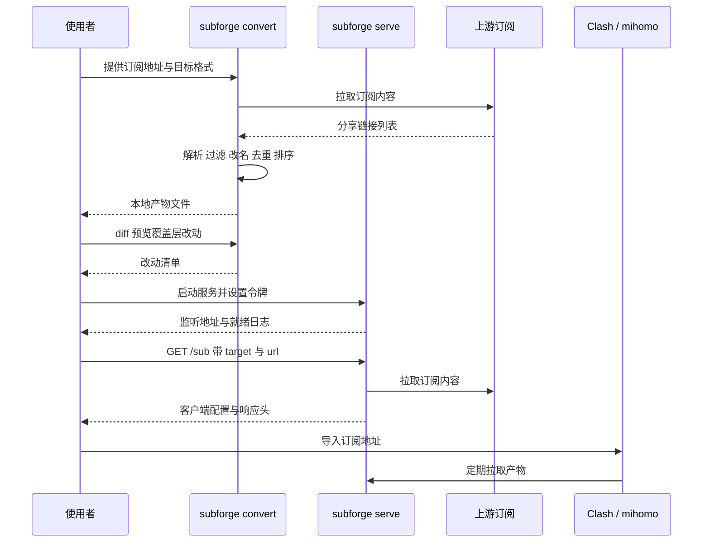
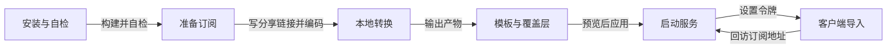

# 快速上手教程

本页是一份从零开始的端到端教程：从准备一个订阅地址开始，依次完成本地转换、产物检查、覆盖层改动预览、启动 HTTP 服务，最后把订阅地址导入 Clash / mihomo 客户端。每一步都给出可直接复制的命令与预期输出，便于逐条对照。教程中的域名统一使用保留域名 `example.com`，令牌统一使用占位符 `<YOUR_TOKEN>`。



全流程的环节与对应命令如下图所示。前四个环节只在本机执行，不对外暴露端口；启动服务之后才需要关心监听地址与访问令牌。



---

## 一、前置条件

1. 已完成安装。任选一种方式即可，最简的是源码构建：

   ```bash
   make build
   ./bin/subforge version
   ```

   预期输出形如：

   ```text
   subforge dev (commit f62f9d7, built 2026-10-20T03:05:35Z)
   ```

   `Makefile` 会把提交号与构建时间注入二进制（`Makefile:4-5`）。若输出为 `subforge dev (commit none, built unknown)`，说明这个二进制不是用 `make build` 构建的——只有完全不传链接参数的 `go build ./cmd/subforge` 才会这样。

2. 确认环境自检通过，最后一段为 `All checks passed.`：

   ```bash
   ./bin/subforge doctor
   ```

3. 准备一个订阅地址。本教程用 `<订阅地址>` 表示，例如 `https://example.com/sub?token=<YOUR_TOKEN>`。若手头暂时没有机场订阅，可以按第二节自己造一个本地订阅，效果完全相同。

---

## 二、准备一份可用的测试订阅

真实订阅可能是 Base64 编码的分享链接清单，也可能是 Clash YAML、sing-box JSON 等形态，SubForge 会自动识别。为便于复现，下面构造一份最小订阅。

> 若已克隆本仓库，可以跳过本节，直接使用仓库自带的测试订阅 `testdata/fixtures/mixed-subscription.txt`。该文件包含 12 个节点，覆盖 vmess、vless、hysteria2、tuic、ss、ssr、trojan、anytls、socks5、http 等协议，节点名形如 `ss-node`；用它替换下文的 `sub.b64` 即可，预期输出中的节点数会相应变为 12。

1. 新建文件 `sub.links`，写入三行分享链接：

   ```text
   ss://YWVzLTI1Ni1nY206cGFzc0hLMTIz@hk1.example.com:8388#HK-01
   ss://YWVzLTI1Ni1nY206cGFzc0pQNDU2@jp1.example.com:8388#JP-01
   trojan://trojanpass@us1.example.com:443?sni=us1.example.com#US-01
   ```

2. 编码为 Base64（这是多数机场订阅的真实形态）：

   ```bash
   base64 -w0 sub.links > sub.b64
   ```

   macOS 上 `base64` 不接受 `-w0`，改用 `base64 -i sub.links -o sub.b64`。

3. 若要让 SubForge 通过 HTTP 拉取（用于验证完整的服务链路），用任意静态服务器暴露该文件，此时订阅地址为 `http://127.0.0.1:25598/sub.b64`：

   ```bash
   python3 -m http.server 25598
   ```

> **本地文件必须用 `-file` 参数交给 SubForge。** 写成 `-url ./sub.b64` 会被当成 HTTP 地址，报 `unsupported protocol scheme "c"`。

---

## 三、第一次本地转换

### 3.1 最小命令

```bash
./bin/subforge convert -file sub.b64 -format clash.meta -name demo
```

`convert` 的常用参数如下，完整列表见 `subforge convert -h`：

| 参数 | 取值 | 默认值 | 说明 |
| --- | --- | --- | --- |
| `-url` | 订阅地址，可重复 | — | 支持多个来源，部分成功也出结果 |
| `-file` | 本地文件，可重复 | — | 本地订阅或配置文件 |
| `-format` | 目标格式名 | 取模板 `[common] target`，再退回 `clash.meta` | 输出格式 |
| `-config` | INI 模板路径 | 空 | subconverter 风格模板 |
| `-include` / `-exclude` | 正则，可重复 | — | 节点名白名单 / 黑名单 |
| `-type` | 协议名，可重复 | — | 仅保留指定协议 |
| `-sort` | `original` / `name` / `type` / `server` / `port` | 空 | 排序键 |

### 3.2 预期输出

产物写到标准输出，进度信息写到标准错误。产物开头是注释头与基础字段：

```text
# 此配置由 SubForge 自动生成
# 配置名: demo
# SubForge subforge dev (commit f62f9d7, built 2026-10-20T03:05:35Z)
mixed-port: 7890
```

随后是 `proxies`、`proxy-groups` 与 `rules` 三段，例如：

```yaml
proxies:
  - name: HK-01
    type: ss
    server: hk1.example.com
proxy-groups:
  - name: "🚀 节点选择"
    type: select
    proxies: [HK-01, JP-01, US-01]
rules:
  - GEOIP,CN,DIRECT
```

标准错误上的两行统计是后续排查的主要依据：

```text
管线: 3 -> 3 节点
完成: clash.meta, 1883 字节, 3 节点, 3ms
```

格式为 `管线: <过滤前节点数> -> <过滤后节点数>` 与 `完成: <格式>, <字节数>, <节点数>, <耗时>`。出现 `3 -> 0` 说明问题在过滤条件；出现 `所有来源都失败` 说明问题在上游拉取。

### 3.3 查看产物与换格式

1. 落盘到文件：

   ```bash
   ./bin/subforge convert -file sub.b64 -format clash.meta -out cfg.yaml
   ```

   标准错误会多出一行 `已写入 cfg.yaml`。

2. 只看分享链接清单，不做渲染，便于核对节点是否被过滤或去重：

   ```bash
   ./bin/subforge convert -file sub.b64 -list
   ```

   输出为三行分享链接，参数顺序会被规范化重排。

3. 换成 sing-box 格式，输出为合法 JSON，开头是 `log` 与 `dns` 段：

   ```bash
   ./bin/subforge convert -file sub.b64 -format sing-box
   ```

4. 试一试过滤与排序，预期标准错误输出为 `管线: 3 -> 2 节点`：

   ```bash
   ./bin/subforge convert -file sub.b64 -format clash.meta -include '^HK|^JP' -sort name
   ```

   `-include` 与 `-type` 是「与」关系：节点必须同时满足名称白名单与协议白名单。

---

## 四、用模板固化常用配置

每次转换都敲一长串参数不现实，因此把稳定部分写进 INI 模板。新建 `demo.ini`：

```ini
[common]
target = clash.meta

[node_pref]
ss = 🇭🇰 
trojan = 🇺🇸 

[rename]
" - .*$" =

[clash_proxy_group]
name = 手动选择
type = select
proxies = HK|JP|US
---
name = 自动测速
type = url-test
proxies = HK|JP|US
url = https://www.gstatic.com/generate_204
interval = 300

[ruleset]
DIRECT = []GEOIP,CN
FINAL = []FINAL
```

使用模板转换，此时无需再传 `-format`：

```bash
./bin/subforge convert -file sub.b64 -config demo.ini
```

产物与上一节的关键差异：节点名带上了协议前缀，形如 `"🇭🇰 HK-01"`；代理组被模板声明的两个组取代；规则段变为 `[ruleset]` 声明的形态。

两点必须注意：

1. **多个代理组必须写在同一个 `[clash_proxy_group]` 段落里，用单独一行的 `---` 分隔。** INI 解析器会合并同名段落（`internal/template/ini.go:352-357`），重复书写段落头只会得到一个组。
2. **`[node_pref]` 的前缀不要加引号。** 值按原样保留，包括尾部空格（`internal/config/template.go:369-372`），写成 `ss = "🇭🇰 "` 会让引号成为前缀的一部分。

---

## 五、用覆盖层做一次改动并预览

模板是共享的，个人差异写在覆盖层。新建 `local.yaml`：

```yaml
groups:
  - name: 自动测速
    strategy: global
    proxies:
      - 手动选择
rules:
  prepend:
    - DOMAIN-SUFFIX,openai.com,手动选择
  append:
    - MATCH,自动测速
proxies:
  - name: ^HK
    server: hk2.example.com
    port: "9443"
```

### 5.1 先用 diff 预览

```bash
./bin/subforge diff -config demo.ini -override local.yaml
```

预期输出形如：

```text
== 代理组 ==
  [改] 自动测速           strategy "" → "global"; proxies +手动选择
== 规则 ==
  +P DOMAIN-SUFFIX,openai.com,手动选择
  +A MATCH,自动测速
  合并后共 2 条（基础 0 + prepend 1 + append 1）
== 节点 ==
  [改] /^HK/ server → hk2.example.com; port → 9443
```

读法：

| 输出 | 含义 |
| --- | --- |
| `[新]` | 覆盖层新增了一个模板中没有的组 |
| `[改]` | 覆盖层改动了已有组的字段，或按正则替换了节点的 `server` / `port` |
| `+P` | prepend 规则，插入到基础规则之前 |
| `+A` | append 规则，追加到基础规则之后 |
`diff` 不拉订阅、不跑管线（`cmd/subforge/diff.go:1-4`），因此可以放心在改动前反复预览。

### 5.2 再应用到转换

```bash
./bin/subforge convert -file sub.b64 -config demo.ini -override local.yaml
```

产物中可以看到：`自动测速` 组多了 `strategy: global` 与成员 `手动选择`；规则段变为 `DOMAIN-SUFFIX,openai.com,手动选择` 与 `MATCH,自动测速` 两条。

> **节点级覆盖的正则要按原始节点名写。** `server` / `port` 替换作用在**管线之前**的原始节点上（`internal/convert/engine.go:178-182`），若写成 `^🇭🇰`，日志会提示 `override.proxy "^🇭🇰" 未匹配到任何节点`，因为 emoji 前缀是管线里 `[node_pref]` 步骤才加的，此时还没执行。

---

## 六、启动 HTTP 服务

### 6.1 启动命令

```bash
./bin/subforge serve -listen 127.0.0.1:25500 -token <YOUR_TOKEN> -config demo.ini -name demo
```

若还需要控制台数据、订阅管理与调度器，在命令里追加 `-data-dir ./data` 即可；该目录必须已存在，否则启动会失败并报 `初始化订阅管理: 设置 WAL: unable to open database file (14)`。

预期输出形如：

```text
订阅管理已启用: ./data
subforge dev 监听 127.0.0.1:25500（格式: clash.meta, surge, quan, quanx, loon, ...）
配置: demo.ini（热重载已启用）
```

### 6.2 验证服务就绪

```bash
curl -s "http://127.0.0.1:25500/healthz?token=<YOUR_TOKEN>"
curl -s "http://127.0.0.1:25500/version?token=<YOUR_TOKEN>"
```

`/healthz` 返回 `{"status":"ok"}`；`/version` 返回版本与运行时长。

> **鉴权是全局的**，`/healthz` 与 `/version` 同样受令牌保护。设置令牌后不带 `token` 参数访问会返回 `401: 缺少或错误的访问令牌`。令牌可以放在 `Authorization: Bearer <YOUR_TOKEN>` 头、`X-Token` 头或查询参数 `token=`，优先级为请求头高于查询参数（`internal/api/middleware.go:98-111`）。

### 6.3 用 curl 取一次产物

```bash
curl -s -D - -o cfg-from-server.yaml \
  "http://127.0.0.1:25500/sub?target=clash.meta&token=<YOUR_TOKEN>&url=http://127.0.0.1:25598/sub.b64&include=HK%7CJP&exclude=US"
```

`/sub` 的常用参数：

| 参数 | 取值 | 说明 |
| --- | --- | --- |
| `target` | 目标格式名 | 省略时按客户端 `User-Agent` 推断，再退回 `clash.meta` |
| `token` | 令牌 | 访问令牌 |
| `url` | 订阅地址 | 可重复；HTTP 入口不接受本地文件 |
| `include` / `exclude` | 正则 | 节点名白名单 / 黑名单，`|` 需编码为 `%7C` |
| `config` | 路径或 URL | 指定另一份模板，优先级高于服务启动时的模板 |
| `list` | 布尔 | 输出分享链接清单，优先于 `target` |

预期响应头：

```text
HTTP/1.1 200 OK
Content-Disposition: attachment; filename=clash.yaml
X-Convert-Format: clash.meta
X-Node-Count: 2
X-Request-Id: <请求 id>
Cache-Control: no-store
```

`X-Convert-Format` 是实际生效的格式名（由别名归一而来），`X-Node-Count` 是产物中的节点数，`X-Request-Id` 与服务日志中的 `rid=` 对应，便于对账。

参数是否被正确识别，可以用 `/inspect` 回显检查：

```bash
curl -s "http://127.0.0.1:25500/inspect?target=clash.meta&token=<YOUR_TOKEN>&include=HK&url=https://example.com/sub.txt"
```

### 6.4 在浏览器中访问

控制台地址为服务根路径，订阅地址可直接粘进客户端：

```text
http://127.0.0.1:25500/?token=<YOUR_TOKEN>
http://127.0.0.1:25500/sub?target=clash.meta&token=<YOUR_TOKEN>&url=https://example.com/sub
```

---

## 七、在 Clash / mihomo 客户端导入

1. 打开客户端，进入订阅或 Profiles 页面。
2. 新增订阅，把第六节的订阅地址粘贴进去。客户端不填 `User-Agent` 也能用，服务会按它推断目标格式，推断不出时退回 `clash.meta`。
3. 更新订阅。客户端会定期回访该地址，SubForge 每次都会重新拉取上游并渲染产物，因此上游节点变化无需手工干预。
4. 若客户端要求单独填写令牌，可放进 URL 的 `token=` 参数，或使用请求头 `Authorization: Bearer <YOUR_TOKEN>`。

> **端口冲突**：产物默认 `mixed-port: 7890`、`external-controller: 127.0.0.1:9090`（`internal/config/settings.go:13`）。若与本机其他客户端冲突，用 `-mixed-port` 参数或 `[subforge] mixed_port` 调整；注意 `[common] mixed-port` 对 `serve` 无效。

---

## 八、常见的第一步踩坑

| 现象 | 原因 | 解决方法 |
| --- | --- | --- |
| `所有来源都失败: ... unsupported protocol scheme "c"` | 用 `-url` 传了本地路径 | 本地文件改用 `-file` |
| `至少需要一个订阅地址或本地文件` | 请求里既无 `url` 也无文件 | 补上 `url` 参数 |
| `401: 缺少或错误的访问令牌` | 设置了令牌但请求未携带 | 加 `token=` 参数或 `X-Token` 头 |
| `不支持的输出格式 "xxx"` | `target` 拼写错误 | 用 `GET /api/targets` 查可用名单 |
| 产物节点数少于上游 | 按类型、服务器、端口与凭据的指纹去重 | 名称不同但指向同一服务器的节点会被合并 |
| 模板里的多个代理组只剩一个 | 重复书写 `[clash_proxy_group]` 段落头 | 同一段落内用 `---` 分隔 |
| 节点名前缀多了引号 | `[node_pref]` 的值写了引号 | 前缀不加引号，尾部空格原样保留 |
| 覆盖层正则匹配不到节点 | 正则按改名后的名字写 | 按原始节点名写正则 |
| `未找到命名管线 "xxx"` | 模板里没有该 `[pipeline:<名>]` 段落 | 补上段落，或检查是否漏传 `-config` |
| `-data-dir` 启动失败 | 目录不存在 | 先 `mkdir -p` 再启动 |
| 控制台数据为空 | 未启用 `-data-dir` | 启动时加上该参数 |
| `include` 正则报错 | URL 中的 `|` 或 `(` 未编码 | 使用 `%7C`、`%28` |

---

## 九、下一步阅读

1. 想理解参数从哪来、模板与 URL 谁优先：[INI-模板配置详解](INI-模板配置详解)。
2. 想让同一份模板服务多个使用者：[覆盖层-Override-详解](覆盖层-Override-详解)。
3. 想搞清节点在管线里被如何处理：[转换流水线原理](转换流水线原理)。
4. 想用 HTTP 接口做自动化：[HTTP-API-参考](HTTP-API-参考)。
5. 遇到报错：[故障排查与常见问题](故障排查与常见问题)。

---

## 相关页面

- [安装与部署](安装与部署)
- [INI-模板配置详解](INI-模板配置详解)
- [覆盖层-Override-详解](覆盖层-Override-详解)
- [故障排查与常见问题](故障排查与常见问题)
