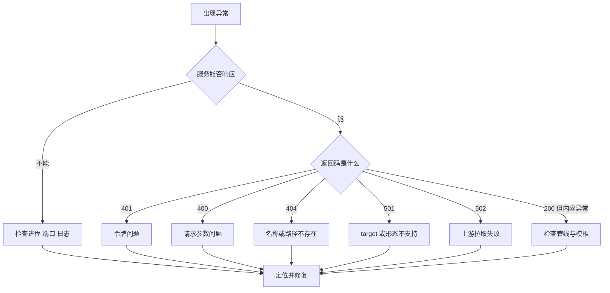
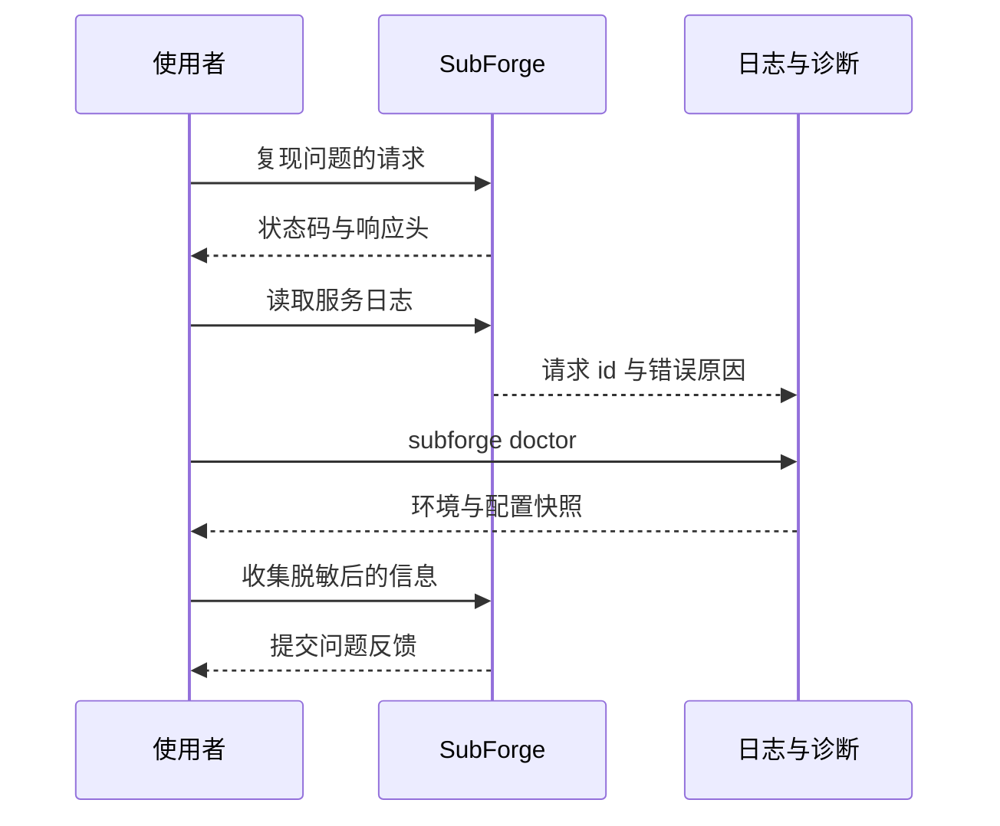

# 故障排查与常见问题

本页按"现象 → 可能原因 → 排查命令 → 解决方法"的结构，收录 SubForge 在安装、转换、
规则与运维四个环节中最常见的故障。每条都给出实际可执行的诊断命令与源码依据，便于把
"猜问题"变成"读证据"。文末附诊断命令速查表与问题反馈所需信息清单。

排查的基本原则是：**先确认服务活着，再确认参数对，最后才怀疑上游**。SubForge 的绝大多数
"转换失败"都能在这三步内定位。



---

## 一、安装与启动

### 1.1 服务无法启动，端口被占用

**现象**：`serve` 启动后立即退出，日志出现 `bind: address already in use` 或
`Only one usage of each socket address is normally permitted`。

**可能原因**：

- 已有另一个 SubForge 实例在运行（最常见）。
- 上一个实例没有正常退出，端口处于 `TIME_WAIT`。
- 端口被其他程序占用（例如本机的 subconverter、mihomo 的外部控制端口）。

**排查命令**：

```bash
# Linux：查看谁占用了 25500 端口
ss -lntp | grep 25500

# macOS / FreeBSD
lsof -nP -iTCP:25500 -sTCP:LISTEN

# Windows
netstat -ano | findstr :25500
```

**解决方法**：

1. 结束占用进程，或换一个端口启动：

   ```bash
   subforge serve -listen 127.0.0.1:25501 -token <YOUR_TOKEN>
   ```

2. 确认新端口已监听：

   ```bash
   curl -s "http://127.0.0.1:25501/healthz?token=<YOUR_TOKEN>"
   ```

### 1.2 服务启动成功但外部访问不到

**现象**：本机 `curl` 正常，同局域网的其他设备连接超时。

**可能原因**：`-listen` 仍为默认的 `127.0.0.1:25500`（`cmd/subforge/serve.go:100`），
只监听回环地址。

**排查命令**：

```bash
ss -lntp | grep 25500
```

输出中若地址列为 `127.0.0.1:25500`，说明只监听本机。

**解决方法**：

```bash
subforge serve -listen 0.0.0.0:25500 -token <YOUR_TOKEN>
```

**注意**：绑定所有网卡时必须同时设置令牌。程序只警告、不拒绝启动：只要监听地址是
`0.0.0.0`、`::` 或省略主机名，且令牌为空，就会向标准错误打印
`警告: 监听所有网卡但未设置访问令牌，同网段任何主机都能使用本服务。`
（`cmd/subforge/serve.go:121-125`）。因此在反向代理或内网隔离之外的场景，务必自行
设置 `-token`。

### 1.3 `-data-dir` 指向的目录不存在导致启动失败

**现象**：加上 `-data-dir` 后服务启动失败，输出形如：

```text
subforge: 初始化订阅管理: 设置 WAL: unable to open database file (14)
```

**可能原因**：`-data-dir` 不会自动创建目录（`cmd/subforge/serve.go:158-162`）。

**排查命令**：

```bash
ls -ld ./data
```

**解决方法**：

```bash
mkdir -p ./data
subforge serve -token <YOUR_TOKEN> -data-dir ./data
```

### 1.4 Docker 容器里数据目录与配置文件不生效

**现象**：按 `docker-compose.yml` 启动后，控制台数据为空，或改配置无效果。

**可能原因**：`docker-compose.yml:14-16` 声明了 `SUBFORGE_DATA=/data` 与
`SUBFORGE_CONFIG=/config`，但 `serve` 不读取这两个环境变量。源码中读取环境变量的位置
只有三处：`SUBFORGE_DATA_DIR`（`cmd/subforge/doctor.go:62`）、`SUBFORGE_DEBUG`
（`internal/api/pprof.go:22`）、`TELEGRAM_CHAT_ID`（`cmd/subforge/scheduler.go:47`）。

**排查命令**：

```bash
docker compose exec subforge env | grep SUBFORGE
docker compose logs subforge | head -20
```

**解决方法**：在 compose 文件中显式传参：

```yaml
    command:
      - serve
      - -config
      - /config/subforge.ini
      - -data-dir
      - /data
```

### 1.5 Docker 容器内 HTTPS 上游拉取失败

**现象**：容器内请求订阅时报证书错误，例如 `x509: certificate signed by unknown authority`。

**可能原因**：`Dockerfile` 的运行阶段基于 `scratch`（`Dockerfile:47`），镜像内没有根
证书，任何 HTTPS 请求都无法完成 TLS 校验。

**排查命令**：

```bash
docker run --rm subforge:latest convert -url https://example.com/sub.txt -format list
```

**解决方法**：改用带根证书的镜像：

```bash
docker build -f Dockerfile.alpine -t subforge:alpine .
```

`Dockerfile.alpine:14` 通过 `apk add --no-cache ca-certificates tzdata` 补齐根证书与
时区数据。若必须使用 `scratch` 镜像，可自行把宿主机的 `/etc/ssl/certs/ca-certificates.crt`
挂载进容器。

### 1.6 Docker 容器内时区不正确

**现象**：产物注释头中的"生成时间"与本地时间相差数小时，日志时间戳同样偏移。

**可能原因**：`scratch` 镜像内没有 `/usr/share/zoneinfo`，容器只能使用 UTC。

**排查命令**：

```bash
docker run --rm subforge:latest version
docker run --rm -v /etc/localtime:/etc/localtime:ro subforge:latest version
```

**解决方法**：使用 `Dockerfile.alpine` 构建的镜像（已安装 `tzdata`，
`Dockerfile.alpine:14`），或通过环境变量指定时区：

```bash
docker run -d -e TZ=Asia/Shanghai -p 25500:25500 subforge:alpine serve -token <YOUR_TOKEN>
```

### 1.7 OpenWrt 上无法启动

**现象**：`/etc/init.d/subforge start` 后进程立即退出，或服务在跑但局域网访问不到。

**可能原因**：

- 缺少 `ca-bundle`，HTTPS 上游全部失败（依赖声明见 `deploy/openwrt/Makefile:21`）。
- init 脚本没有传 `-listen`，服务使用默认的 `127.0.0.1:25500`
  （`deploy/openwrt/files/subforge.init:9`），只监听路由器本机。
- init 脚本里的 `SUBFORGE_DATA` / `SUBFORGE_CONFIG` 环境变量不会被 `serve` 读取
  （`deploy/openwrt/files/subforge.init:10-11`）。
- UCI 配置文件 `/etc/config/subforge` 中的选项当前没有被 init 脚本读取（脚本内没有
  `config_load` 调用），改它不会影响运行参数。

**排查命令**：

```sh
logread | grep -i subforge
ps | grep subforge
netstat -lntp | grep 25500
```

**解决方法**：直接修改 `/etc/init.d/subforge` 的 `procd_set_param command` 行，显式传入
参数：

```sh
procd_set_param command /usr/bin/subforge serve -config /etc/subforge/subforge.ini -data-dir /var/lib/subforge -listen 0.0.0.0:25500 -token <YOUR_TOKEN>
```

改完执行 `/etc/init.d/subforge restart`。

---

## 二、鉴权与访问

### 2.1 返回 401

**现象**：任意端点返回 `401: 缺少或错误的访问令牌`。

**可能原因**：服务设置了令牌，而请求没有携带或携带错误
（`internal/api/middleware.go:80-95`）。

**关键事实**：鉴权是**全局**的，`/healthz` 与 `/version` 同样受保护。设置
`-token` 后，不带令牌访问 `/healthz` 返回 401，带令牌才返回 200。

**排查命令**：

```bash
# 三种携带方式任选其一，逐一验证
curl -s -o /dev/null -w "%{http_code}\n" "http://127.0.0.1:25500/healthz?token=<YOUR_TOKEN>"
curl -s -o /dev/null -w "%{http_code}\n" -H "X-Token: <YOUR_TOKEN>" "http://127.0.0.1:25500/healthz"
curl -s -o /dev/null -w "%{http_code}\n" -H "Authorization: Bearer <YOUR_TOKEN>" "http://127.0.0.1:25500/healthz"
```

**解决方法**：令牌的取值优先级为 `Authorization` 头 > `X-Token` 头 > 查询参数
（`internal/api/middleware.go:98-111`）。响应同时带
`WWW-Authenticate: Bearer realm="subforge"` 头（`middleware.go:92`），可用于确认是
鉴权失败而非路由不存在。

**注意**：SubForge 的鉴权中间件只返回 401，不返回 403。若见到 403，来源不是本服务
的令牌校验，应检查前置反向代理的访问控制规则。

### 2.2 令牌热重载后旧令牌仍可用

**现象**：改了 INI 里的 `token`，用旧令牌请求仍然返回 200。

**可能原因**：热重载是 mtime 轮询，最长有 1 秒延迟（`cmd/subforge/serve.go:313`）；
另外若 `serve` 启动时未加 `-config`，则不存在热重载，改文件不会生效。

**排查命令**：

```bash
# 确认配置文件路径出现在启动日志里
journalctl -u subforge -n 20 --no-pager | grep 热重载
```

**解决方法**：启动时必须带 `-config <文件>`。重载成功时日志形如
`配置已重载: mixed_port 7890 -> 7890, token - -> ***`（`cmd/subforge/serve.go:330-331`）。

### 2.3 配置文件写错后配置不生效

**现象**：改坏 INI 后配置没有变化，也没有报错退出。

**可能原因**：这是设计行为——解析失败时保留旧设置并继续轮询，避免把正在跑的服务打挂
（`cmd/subforge/serve.go:309-322`）。

**排查命令**：

```bash
journalctl -u subforge -n 50 --no-pager | grep 解析失败
```

日志形如 `配置 <路径> 解析失败，沿用当前设置: ...`。

**解决方法**：修复 INI 语法。可先用 `diff` 命令做一次只读解析，它会在解析失败时直接
报错退出：

```bash
subforge diff -config ./subforge.ini -override ./local.yaml
```

---

## 三、转换与产物

### 3.1 上游订阅拉取失败或超时

**现象**：返回 502，错误信息形如 `所有来源都失败: <地址>: 拉取 <名称>（重试 2 次后仍失败）: ...`
（`internal/convert/engine.go:173`）。

**可能原因**：

- 上游地址不可达、需要代理、或返回非 2xx。
- 上游要求特定 `User-Agent`，而默认请求头被拒。
- 超时过短，大型订阅未能在 `-timeout` 内拉完。

**排查命令**：

```bash
# 先脱离 SubForge，用 curl 直连上游确认可达性
curl -sS -o /dev/null -w "%{http_code} %{time_total}s\n" "https://example.com/sub.txt"

# 再用 -cache-dir 观察缓存是否命中
subforge convert -url https://example.com/sub.txt -format list -cache-dir ./cache
```

**解决方法**：

1. 提高超时：

   ```bash
   subforge serve -token <YOUR_TOKEN> -timeout 60
   ```

2. 启用磁盘缓存，减少对上游的重复拉取：

   ```bash
   subforge serve -token <YOUR_TOKEN> -cache-dir /var/lib/subforge/cache
   ```

3. 多个来源时 SubForge 是"部分成功也出结果"的：只有全部来源失败才整体报错
   （`internal/convert/engine.go:135-176`）。因此单条来源报错不一定意味着产物为空。

### 3.2 产物为空或节点数为 0

**现象**：返回 `至少需要一个订阅地址或本地文件`、或产物里 `proxies:` 为空。

**可能原因**：

- 请求里既没有 `url` 也没有本地文件（`ErrNoSource`）。
- 所有来源都失败（见 3.1）。
- 管线过滤后没有剩余节点（`ErrNoNodes`，`internal/convert/engine.go:188-190`）。
- `include` / `exclude` / `type` 过滤条件互斥。

**排查命令**：

```bash
# 先看原始参数解析结果
curl -s "http://127.0.0.1:25500/inspect?target=clash.meta&token=<YOUR_TOKEN>&url=https://example.com/sub.txt&include=HK"

# 去掉全部过滤条件，只验证拉取链路
subforge convert -url https://example.com/sub.txt -format list

# 再逐个加回过滤条件
subforge convert -url https://example.com/sub.txt -format list -include '^HK'
```

**解决方法**：`convert` 与 `serve` 都会在标准错误输出一行管线统计，形如
`管线: 3 -> 3 节点`，前者是过滤前节点数、后者是过滤后节点数。若"3 -> 0"，说明问题在
过滤条件而不是上游。

### 3.3 节点被去重"吃掉"

**现象**：上游有 10 个节点，产物只剩 6 个，且丢失的都是不同名称的节点。

**可能原因**：去重按节点身份指纹进行，依据是 `type | server | port | 凭据`
（`internal/transform/op.go:12`），**节点名称不参与**。两个名称不同但指向同一服务器
与端口的节点会被合并，保留首次出现者。

**排查命令**：

```bash
subforge convert -url https://example.com/sub.txt -format list -sort original
```

**解决方法**：

1. 确认是否真的重复：对比上游原始链接中的 `server:port` 组合。
2. 若需要保留全部条目，改用 `-list` 输出分享链接清单做核对（`-list` 优先于 `-format`，
   `cmd/subforge/convert.go:90`）。
3. 去重步骤无法通过参数关闭，它是默认管线的固定一步（`internal/convert/params.go:236`）。

### 3.4 节点名乱码

**现象**：产物中的节点名显示为 `HK-01` 之类的中文乱码，或出现多余引号与空格。

**可能原因**：

- 上游订阅本身使用非 UTF-8 编码。
- 节点名里包含引号等 YAML 特殊字符，序列化时被转义。
- `[node_pref]` 中的前缀被写成了带引号的字面量，例如 `ss = "🇭🇰 "`，此时引号会成为
  前缀的一部分。

**排查命令**：

```bash
# 看原始订阅内容（先 base64 解码）
curl -s "https://example.com/sub.txt" | base64 -d | head -5

# 看管线后的节点名
subforge convert -url https://example.com/sub.txt -format list
```

**解决方法**：把 `[node_pref]` 的前缀写成不带引号的形式，尾部空格需要保留时直接写在
等号后：

```ini
[node_pref]
ss = 🇭🇰 
trojan = 🇺🇸 
```

前缀的值按原样保留，包括尾部空格（`internal/config/template.go:369-372`）。

### 3.5 `target` 不支持

**现象**：返回 501，正文形如
`{"error":"不支持的输出格式 \"nope\"（目前支持: clash.meta, surge, ...）"}`。

**可能原因**：`target` 拼写错误或使用了未实现的格式名。

**排查命令**：

```bash
curl -s "http://127.0.0.1:25500/api/targets?token=<YOUR_TOKEN>"
```

**解决方法**：改用受支持的 `target`。可用名单由渲染器注册表汇总
（`internal/render/registry/registry.go:106-150`），当前包含 `clash.meta`、`surge`、
`quan`、`quanx`、`loon`、`surfboard`、`mellow`、`list`、`mixed`、`ss`、`ssd`、
`ssr`、`trojan`、`v2ray`、`sing-box`、`ss-sub` 及其别名等。错误信息里会完整列出
当前支持的全部名称。

**注意**：`target` 的校验发生在任何上游拉取之前（`internal/convert/engine.go:105-111`），
所以 501 不会伴随一次无谓的订阅拉取。

### 3.6 前端构建产物缺失导致页面空白

**现象**：访问控制台根路径 `/` 返回空白页，或 API 前缀被返回 HTML。

**可能原因**：二进制编译时 `web/dist` 不存在，`go:embed` 嵌入的是空目录。发行工作流
会先执行 `pnpm --dir web run build` 再交叉编译（`.github/workflows/release.yml:68-71`），
因此从源码直接 `go build` 而没构建前端时会遇到此问题。

**排查命令**：

```bash
ls -l web/dist/index.html
curl -s -o /dev/null -w "%{http_code} %{content_type}\n" "http://127.0.0.1:25500/"
```

**解决方法**：

```bash
make web-install
make web-build
make build
```

`/api` 前缀下的路由永远不会返回 HTML（有测试守住这条约束：
`internal/api/routes_test.go:185`），因此"API 返回 HTML"一定是路由或反代配置问题。

---

## 四、规则与模板

### 4.1 `ruleset` 参数缺少类型

**现象**：返回 400，错误信息形如
`ruleset 参数 "DIRECT" 缺少类型（应为 ruleset:<名称>:<类型>）`
（`internal/convert/params.go:185`）。

**可能原因**：`ruleset` 参数的格式是 `名称:类型`，只写了名称。

**排查命令**：

```bash
curl -s "http://127.0.0.1:25500/inspect?token=<YOUR_TOKEN>&ruleset=DIRECT"
```

**解决方法**：补上类型，多条规则集用分号分隔：

```text
ruleset=DIRECT:[]GEOIP,CN;FINAL:[]FINAL
```

在 INI 模板中则写在 `[ruleset]` 段落里，键是名称、值是类型
（`internal/config/template.go:234-243`）：

```ini
[ruleset]
DIRECT = []GEOIP,CN
FINAL = []FINAL
```

### 4.2 `/getruleset` 返回 400 或 404

**现象**：请求 `/getruleset` 得到
`缺少 name 参数（规则集名）`（400）或
`规则集 "xxx" 没有类型：请传 type，或在模板 [ruleset] 段落里配置 xxx`（404）。

**可能原因**：

- 没有传 `name`（`internal/api/handlers.go:126-130`）。
- 传了 `name` 但没有 `type`，且模板 `[ruleset]` 段落里也没有对应条目
  （`internal/api/handlers.go:138-146`）。
- `type` 取值不在 1~6 或命名别名之内。

**排查命令**：

```bash
# 六种形态各试一次
for t in 1 2 3 4 5 6; do
  curl -s -o /dev/null -w "type=$t -> %{http_code}\n" \
    "http://127.0.0.1:25500/getruleset?token=<YOUR_TOKEN>&name=DIRECT&type=$t&rules=GEOIP,CN"
done
```

**解决方法**：`type` 支持 1~6 六种输出形态：1=Surge list、2=Quantumult X、
3=Clash domain provider、4=Clash ipcidr provider、5=Surge DOMAIN-SET、6=Clash classical
（`internal/ruleset/render.go:18-23`），也接受命名别名（`render.go:115-118`）。
类型取值的优先级是 URL 参数 > 模板 `[ruleset]` 段落；规则内容的优先级是
`rules` > `list` > 模板 `[common] rules` > `url` 远程拉取
（`internal/api/handlers.go:111-167`）。

**澄清**：该接口**已经实现**，成功时返回 200 并带
`X-Ruleset-Format` / `X-Ruleset-Count` 响应头，不会返回 501。历史上
`cmd/subforge/serve.go` 的帮助文本曾写成"未实现，返回 501"，该文本已修正。
真正会返回 501 的是**不支持的输出格式**：`/sub?target=nope` 得到
`{"error":"不支持的输出格式 \"nope\"（目前支持: ...）"}`。

### 4.3 规则不生效

**现象**：产物里有规则，但客户端不按预期分流。

**可能原因**：

- 规则顺序错误：`MATCH` / `FINAL` 被放在了前面，后面的规则永远不会命中
  （`internal/config/custom.go:33-44` 说明了顺序即语义）。
- 覆盖层把规则 append 到了 `MATCH` 之后，形成死规则。
- 规则引用的代理组名不存在。

**排查命令**：

```bash
# 查看规则在产物中的实际顺序
subforge convert -url https://example.com/sub.txt -config ./subforge.ini -format clash.meta | grep -A 20 '^rules:'
```

**解决方法**：把兜底规则放在最后。若需要插入高优先级规则，用覆盖层的 `prepend` 而不是
`append`：

```yaml
rules:
  prepend:
    - DOMAIN-SUFFIX,openai.com,手动选择
```

### 4.4 `include` / `exclude` 正则写错

**现象**：返回 400，错误信息里带正则编译失败的原因。

**可能原因**：正则语法错误，例如 `include=HK(`。

**排查命令**：

```bash
curl -s "http://127.0.0.1:25500/inspect?token=<YOUR_TOKEN>&include=HK%28"
```

**解决方法**：正则的编译校验发生在拉取订阅之前（`internal/convert/params.go:196-201`），
因此修正正则后重试即可，不会浪费一次上游拉取。注意 URL 中的正则元字符需要
URL 编码，例如 `|` 写成 `%7C`、`(` 写成 `%28`。

**注意**：`include` / `exclude` 与 `type` 过滤是"与"关系
（`internal/convert/params_test.go:228-247`），即节点必须同时满足名称白名单与协议白名单。

### 4.5 命名管线名字找不到

**现象**：返回 400，错误信息形如
`未找到命名管线 "clean"：模板里没有 [pipeline:clean] 段落`
（`internal/convert/params.go:255`）。

**可能原因**：请求里写了 `pipeline=clean`，但当前生效的模板里没有对应的
`[pipeline:<名>]` 段落；或模板没有被加载（未传 `-config`）。

**排查命令**：

```bash
# 确认模板里定义了哪些命名管线
grep -n '^\[pipeline:' ./subforge.ini

# 确认服务实际加载了哪个模板
journalctl -u subforge -n 20 --no-pager | grep 配置
```

**解决方法**：管线定义与引用的写法为：

```ini
[pipeline:clean]
step = filter.regex include=^HK|^JP
step = op.rename pattern=" - .*$" repl=
step = op.dedupe
on_error = warn
```

引用方式有三种：URL 参数 `pipeline=clean`、`[common]` 段落里的 `pipeline = clean`
作为默认值、CLI 的 `-pipeline clean`（`cmd/subforge/convert.go:94`）。可用的
`step` 类型为 `filter.regex` / `filter.region` / `filter.type` / `filter.script` /
`op.rename` / `op.emoji` / `op.dedupe` / `op.split` / `op.sort` / `op.script`
（`internal/config/pipeline.go:26-27`）。

### 4.6 覆盖层的节点正则匹配不到节点

**现象**：转换日志出现
`override.proxy "^🇭🇰" 未匹配到任何节点`。

**可能原因**：节点级覆盖（`server` / `port`）在**管线之前**应用到原始节点上
（`internal/convert/engine.go:178-182`），而 `[node_pref]` 前缀、`rename`、`emoji`
都是管线里的步骤。因此按"加了前缀之后的名字"写正则会匹配不到。

**排查命令**：

```bash
# 先看原始节点名
subforge convert -url https://example.com/sub.txt -format list
```

**解决方法**：用原始节点名写正则，例如：

```yaml
proxies:
  - name: ^HK
    server: hk2.example.com
    port: "9443"
```

匹配不到节点的覆盖会被记入告警而不是静默失效，这正是为了让人看见
（`internal/convert/engine.go:179-181`）。

### 4.7 代理组正则没有命中任何节点

**现象**：产物中某个代理组的成员是 `DIRECT`，而不是预期的节点列表。

**可能原因**：组成员支持三种写法——另一个组的名称、节点名正则、裸节点名；正则合法但
没有任何节点命中时，会兜底为 `DIRECT`，以避免 mihomo 拒绝加载整份配置
（`internal/convert/chain.go:80-116`）。

**排查命令**：

```bash
subforge convert -url https://example.com/sub.txt -config ./subforge.ini -format clash.meta | grep -A 8 'proxy-groups:'
```

**解决方法**：核对组成员正则与节点实际名称。组成员正则不做大小写转换，且中文名称需要
与上游完全一致。

### 4.8 模板里的 `[clash_proxy_group]` 分组全部丢失

**现象**：模板里写了多个 `[clash_proxy_group]` 段落，但产物里只出现一个组，或组名正确
而成员为空。

**可能原因**：INI 解析器对同名段落做合并，**重复书写 `[clash_proxy_group]` 段落头不会
产生多个组**。多个组必须写在同一个段落里，用单独一行的 `---` 分隔
（`internal/template/ini.go:352-357`）。

**排查命令**：

```bash
# 确认模板里 --- 分隔符的数量
grep -c '^---$' ./subforge.ini
```

**解决方法**：改为正确写法：

```ini
[clash_proxy_group]
name = 手动选择
type = select
proxies = HK|JP|US
---
name = 自动测速
type = url-test
proxies = HK|JP|US
url = https://www.gstatic.com/generate_204
interval = 300
```

---

## 五、运维与门禁

### 5.1 `-data-dir` 未启用导致控制台数据为空

**现象**：控制台能打开，但订阅列表、历史、任务等页面全部为空。

**可能原因**：没有传 `-data-dir`。数据目录默认不启用（`cmd/subforge/serve.go:103`），
未启用时订阅管理器、Rule-Bot 建议队列与调度器都不会初始化
（`cmd/subforge/serve.go:158-232`）。

**排查命令**：

```bash
# 启动日志里应有这一行
journalctl -u subforge -n 30 --no-pager | grep 订阅管理
```

输出形如 `订阅管理已启用: /var/lib/subforge`。

**解决方法**：

```bash
subforge serve -token <YOUR_TOKEN> -data-dir /var/lib/subforge
```

**注意**：数据目录必须已存在（见 1.3），且运行用户需要写权限。

### 5.2 配置热重载不生效

**现象**：改了 INI 文件，服务行为没有变化。

**可能原因**：

| 原因 | 判定方法 |
| --- | --- |
| 启动时没加 `-config` | 启动日志中没有 `热重载已启用` 一行 |
| 改了不支持的键 | 只有 `[subforge]` 的 `token` / `mixed_port` 与模板段落会重载 |
| `name` 不重载 | `-name` 在启动时固定（`cmd/subforge/serve.go:91`） |
| 文件被编辑器"移走重建" | 读不到时沿用当前设置（`cmd/subforge/serve.go:314-317`） |
| INI 语法写错 | 日志出现 `解析失败，沿用当前设置` |

**排查命令**：

```bash
journalctl -u subforge -f | grep -E '重载|解析失败'
```

**解决方法**：确认启动命令带 `-config`；`name` 的改动需要重启服务；语法错误按日志
提示修复。

### 5.3 覆盖率门禁失败

**现象**：`make verify` 或 CI 在 `coverage-gate` 阶段失败。

**可能原因**：`make coverage-gate` 串联两个门禁
（`Makefile:77-79`）：`coveragegate` 要求总覆盖率不低于 80% 且函数覆盖率为 100%，
`condgate` 以 profile 引擎要求条件覆盖率不低于 80%。

**排查命令**：

```bash
make coverage
go tool cover -func=coverage.out | tail -5
go run ./internal/tools/coveragegate -profile coverage.out -min 80 -min-func 100
go run ./internal/tools/condgate -engine=profile -profile coverage.out -min 80
```

**解决方法**：按门禁输出中指出的文件与函数补测试。更严格的条件覆盖门禁
`make condition-gate`（gobco 引擎）只在 nightly 与手动触发时运行，不进 `make verify`
（`Makefile:81-83`）。

### 5.4 转换历史或日志为空

**现象**：`/api/history`、`/api/logs` 返回空数组。

**可能原因**：历史与日志依赖 `-data-dir` 中的 SQLite 数据库；未启用数据目录时这些
端点返回空数组而不是报错。

**排查命令**：

```bash
curl -s "http://127.0.0.1:25500/api/history?token=<YOUR_TOKEN>"
ls -l /var/lib/subforge/subforge.db
```

**解决方法**：启用 `-data-dir` 并确认数据库文件可写。若使用容器部署，确认卷已挂载到
数据目录（见 1.4）。

---

## 六、诊断命令速查表

| 症状 | 首条命令 |
| --- | --- |
| 服务是否存活 | `curl -s -o /dev/null -w "%{http_code}\n" "http://127.0.0.1:25500/healthz?token=<YOUR_TOKEN>"` |
| 版本与运行时长 | `curl -s "http://127.0.0.1:25500/version?token=<YOUR_TOKEN>"` |
| 参数解析结果 | `curl -s "http://127.0.0.1:25500/inspect?token=<YOUR_TOKEN>&target=clash.meta&url=..."` |
| 环境自检 | `subforge doctor` |
| 支持的输出格式 | `curl -s "http://127.0.0.1:25500/api/targets?token=<YOUR_TOKEN>"` |
| 端口占用 | `ss -lntp \| grep 25500` |
| 服务日志 | `journalctl -u subforge -n 100 --no-pager` |
| 容器日志 | `docker compose logs -f subforge` |
| 容器内环境变量 | `docker compose exec subforge env \| grep SUBFORGE` |
| 脱离服务验证上游 | `curl -sS -o /dev/null -w "%{http_code} %{time_total}s\n" "<订阅地址>"` |
| 只验证拉取链路 | `subforge convert -url <订阅地址> -format list` |
| 观察管线节点数 | `subforge convert -url <订阅地址> -format clash.meta 2>&1 \| grep 管线` |
| 预览覆盖层改动 | `subforge diff -config ./subforge.ini -override ./local.yaml -v` |
| 校验模板语法 | `subforge diff -config ./subforge.ini -override ./local.yaml` |
| 覆盖率门禁 | `make coverage-gate` |
| 一键本机验证 | `make verify` |

---

## 七、收集问题反馈所需信息

提交问题时请附上以下信息，可以显著缩短定位时间：

1. **版本信息**：`subforge version` 的完整输出。
2. **环境信息**：`subforge doctor` 的完整输出（其中包含 Go 版本、平台、模块版本与
   VCS 提交号）。
3. **部署方式**：源码构建 / 发行产物 / Docker / systemd / OpenWrt，以及对应的启动
   命令（**请把令牌替换为 `<YOUR_TOKEN>` 后再粘贴**）。
4. **复现步骤**：从请求或命令开始，到出现异常为止的完整步骤。
5. **请求与响应**：完整 URL（令牌脱敏）、HTTP 状态码、响应头与响应正文。
6. **服务日志**：`journalctl -u subforge -n 200 --no-pager` 或
   `docker compose logs --tail 200 subforge`。日志中包含请求 id，形如
   `GET /sub -> 400 (58 B, 0s, rid=...)`，便于与服务端记录对齐。
7. **配置内容**：相关 INI 模板与覆盖层文件（同样请先脱敏）。
8. **期望与实际**：预期产物应包含什么，实际产物是什么。



---

## 相关页面

- [安装与部署](安装与部署)
- [快速上手教程](快速上手教程)
- [INI-模板配置详解](INI-模板配置详解)
- [覆盖层-Override-详解](覆盖层-Override-详解)
- [HTTP-API-参考](HTTP-API-参考)
