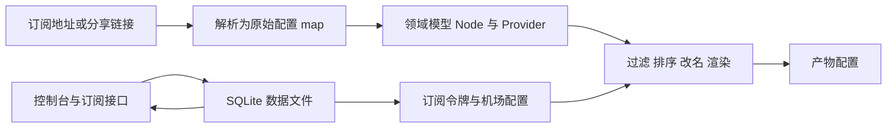
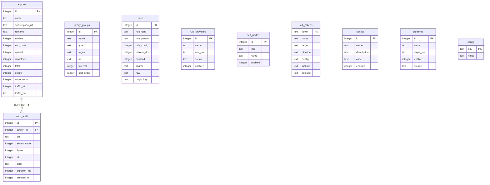

# 数据模型与本地存储

> SubForge 的数据分成两条互不干扰的主线：**转换链路的领域模型**只存在于内存中，每次请求现算现用；**订阅管理数据**落在本地 SQLite 文件里，由控制台与订阅接口读写。
> 本文说明两条主线各自的数据结构、SQLite 的连接参数与建表迁移策略、实体之间的关系，以及数据文件的位置与备份方式。
> 事实来源：`internal/model/model.go`、`internal/store/store.go`、`internal/subforge/subforge.go`、`internal/subforge/rulesources.go`、`internal/api/server.go`、`cmd/subforge/serve.go`、`cmd/subforge/doctor.go`。

---

## 1. 两条数据主线

两条主线的区别：

| 维度 | 转换链路领域模型 | 订阅管理数据 |
| --- | --- | --- |
| 存储位置 | 内存，随请求结束释放 | SQLite 文件，进程重启后仍在 |
| 事实源 | 原始配置 `map[string]any` | 数据库表行 |
| 启用条件 | 始终启用 | 指定了数据目录才启用，来源可以是命令行参数或环境变量 |
| 主要代码 | `internal/model`、`internal/convert` | `internal/store`、`internal/subforge` |

**为什么这样分**：转换是无状态计算，把节点写进数据库既无必要也会带来一致性问题；而机场、令牌、规则这些"用户配置"必须持久化，否则每次重启都要重新录入。

---

## 2. 转换链路的领域模型

### 2.1 节点：原始 map 才是唯一事实源

`Node` 结构上有一份原始配置和四个派生字段（`internal/model/model.go:20-33`）：

| 字段 | 类型 | 来源 | 说明 |
| --- | --- | --- | --- |
| `Raw` | `map[string]any` | 原始 Clash 配置 | **渲染的唯一事实源**，原样往返 |
| `Name` | 字符串 | `Raw["name"]` | 只读派生视图 |
| `Type` | 字符串 | `Raw["type"]` | 如 vmess、vless、ss、trojan、hysteria2、tuic |
| `Server` | 字符串 | `Raw["server"]` | 只读派生视图 |
| `Port` | 字符串 | `Raw["port"]` | 统一为字符串，兼容内核给出的数字或字符串 |
| `Source` | 字符串 | 调用方传入 | 标记节点来自哪个订阅或导入批次 |

包注释解释了这样设计的原因：内核的 outbound 适配器没有 `Marshal` 方法，无法从适配器还原配置，因此渲染一律走原始 map 往返；派生字段只供过滤、排序、去重使用，**改配置必须改 `Raw` 再重新派生**（`internal/model/model.go:1-7`）。

### 2.2 去重指纹

`Fingerprint` 把节点身份归一化成一个字符串：类型、服务器、端口，再依次拼接存在值的凭据字段 `uuid`、`id`、`password`、`key`、`secret`（`internal/model/model.go:60-71`）。`NodeList.Dedupe` 按指纹去重并保留首次出现的节点（`internal/model/model.go:156-169`）。

**注意**：指纹只覆盖上述字段。两个节点如果只有 `ws-opts`、`grpc-opts` 这类传输层参数不同，会被判为同一节点并去重。

### 2.3 类型抖动的归一化

同一种配置在 YAML 里可能是 `port: 443`，也可能是 `port: "443"`。`MapString` 把任意标量统一转成字符串，覆盖 `nil`、字符串、布尔、整数、浮点与 `fmt.Stringer`（`internal/model/model.go:171-196`）。这是节点派生字段全部用字符串类型的原因。

### 2.4 提供者与规则提供者

| 类型 | 对应配置段 | 引用方式 | 源码位置 |
| --- | --- | --- | --- |
| `Provider` | `proxy-providers` | 代理分组里用 `use` 引用 | `internal/model/model.go:73-81` |
| `RuleProvider` | `rule-providers` | 规则行 `RULE-SET,<名称>,<策略>` | `internal/model/model.go:83-91` |

两者的 `Raw` 与 `Node.Raw` 同构：原样透传，不丢扩展字段。解析函数按名称字典序固定顺序，保证渲染产物可复现（`internal/model/model.go:228-256`、`:272-300`）。

### 2.5 四个解析入口

| 函数 | 提取内容 | 缺失时的行为 |
| --- | --- | --- |
| `ParseClashProxies` | `proxies` 列表 | 报错 `配置中不含 proxies` |
| `ParseClashProviders` | `proxy-providers` | 返回 `nil`，不报错 |
| `ParseClashRules` | `rules` 规则行 | 返回 `nil`，不报错 |
| `ParseClashRuleProviders` | `rule-providers` | 返回 `nil`，不报错 |

四个函数都直接取原始 map 或字符串列表，不做字段归一化（`internal/model/model.go:212-300`）。`ParseClashRules` 的注释特别说明：它供持久化导入扫描复用，**不在转换路径上隐式调用**（`internal/model/model.go:261`）。

---

## 3. 本地存储：SQLite

### 3.1 数据文件位置

| 场景 | 路径 | 源码位置 |
| --- | --- | --- |
| 服务端启用订阅管理 | `<数据目录>/subforge.db`，目录不存在时自动创建 | `cmd/subforge/serve.go:167-179`、`cmd/subforge/serve.go:361-366` |
| 未提供数据目录 | 不创建数据库，订阅管理接口返回 503 | `cmd/subforge/serve.go:111`、`cmd/subforge/serve.go:246-249`、`internal/api/subscription.go:41-48` |
| `doctor` 检查 | 环境变量 `SUBFORGE_DATA_DIR`，未设置时取 `<当前目录>/data` | `cmd/subforge/doctor.go:62-67` |

数据目录有两个来源，任选其一即可：

- 命令行参数 `-data-dir`，例如 `subforge serve -data-dir ./data`；
- 环境变量 `SUBFORGE_DATA_DIR`，作为 `-data-dir` 的默认值生效（`cmd/subforge/serve.go:111`）。

两者同时提供时以命令行参数为准。数据目录**不能**通过 INI 配置文件设置：配置文件只覆盖 `token`、`mixed_port`、`name` 三项（`cmd/subforge/serve.go:124`、`internal/config/settings.go:17-24`）。

目录不需要事先创建。首次运行时 `serve` 会自行建出目录（含多级不存在的父目录），权限为 `0o755`，失败时报 `创建数据目录 <目录>: ...`（`cmd/subforge/serve.go:170`、`cmd/subforge/serve.go:361-366`）。

启用后启动日志会打印 `订阅管理已启用: <目录>`（`cmd/subforge/serve.go:179`）；未提供数据目录时，启动日志会打印一行明确提示，说明控制台的订阅、规则、令牌、任务等接口会返回 503，并给出启用方式（`cmd/subforge/serve.go:247-248`）。

**注意**：`internal/store` 的包注释写"数据文件默认 `./data/subforge.db`"（`internal/store/store.go:1-5`），那是存储包的设计口径；`serve` 的实际行为是**没有数据目录就不启用**，以启动参数与环境变量为准。

**容器场景**：官方镜像（`Dockerfile`、`Dockerfile.alpine`）预设 `SUBFORGE_DATA_DIR=/data`（`Dockerfile:76`、`Dockerfile.alpine:69`），因此容器内 `serve` 默认启用订阅管理，数据落在挂载到 `/data` 的卷上。该预设从 `v0.1.4` 起随镜像发布；`v0.1.3` 及更早的标签仍是"需要手工传 `-data-dir`"的旧行为。

### 3.2 连接参数

| 设置 | 取值 | 原因 |
| --- | --- | --- |
| 驱动 | `modernc.org/sqlite` | 纯 Go 实现，零 cgo 依赖，便于交叉编译 |
| 最大打开连接数 | 1 | 避免 SQLite 写锁竞争 |
| 最大空闲连接数 | 1 | 同上 |
| 连接最长存活 | 1 小时 | 定期重建连接 |
| 日志模式 | `PRAGMA journal_mode=WAL` | 读写并发更好，崩溃恢复更安全 |
| 外键 | `PRAGMA foreign_keys=ON` | 打开外键检查开关 |
| 建表 | `migrate` 幂等执行 | 每次启动都跑一遍 |

以上见 `internal/store/store.go:22-47`。**注意**：外键开关虽然打开，但当前建表语句里**没有任何 `REFERENCES` 声明**，表间关联由应用层维护，删除机场不会级联删除它的拉取审计。

### 3.3 建表与迁移策略

迁移分三步：先执行建表语句，再用 `addColumnIfMissing` 幂等补列，最后建索引（`internal/store/store.go:439-609`）。

补列的设计有一条明确约定：**建表语句保持历史形态不修改，新增列一律走 `ALTER TABLE` 补齐**，这样新库与老库走同一条加列路径，列定义只有一处事实源（`internal/store/store.go:529-531`、`:543-545`）。

| 表 | 用途 | 建表位置 | 补列 |
| --- | --- | --- | --- |
| `airports` | 机场（订阅来源） | `internal/store/store.go:443-452` | 流量元数据 7 列（`:546-558`） |
| `proxy_groups` | 代理分组 | `internal/store/store.go:454-464` | — |
| `rules` | 分流规则 | `internal/store/store.go:466-476` | 溯源 3 列（`:587-595`） |
| `rule_providers` | 从订阅导入的规则集定义 | `internal/store/store.go:478-487` | — |
| `self_nodes` | 自建节点分享链接 | `internal/store/store.go:489-497` | — |
| `config` | 全局键值配置 | `internal/store/store.go:499-503` | — |
| `sub_tokens` | 订阅令牌 | `internal/store/store.go:505-509` | 定制 5 列（`:532-542`） |
| `fetch_audit` | 订阅拉取审计 | `internal/store/store.go:511-521` | — |
| `scripts` | goja 脚本库 | `internal/store/store.go:561-569` | — |
| `pipelines` | 有序步骤管线 | `internal/store/store.go:570-580` | — |

**时间列的口径并不统一**：`airports`、`proxy_groups`、`rules`、`rule_providers`、`self_nodes`、`sub_tokens` 用 `DATETIME DEFAULT CURRENT_TIMESTAMP`；`fetch_audit` 用 `INTEGER` 存 unix 秒；`scripts` 与 `pipelines` 也用 `INTEGER`，默认 0，由写入方赋值（`internal/store/store.go:520`、`:567-568`，另见 `internal/store/store.go:202-203` 的注释）。

### 3.4 索引与唯一约束

| 索引 | 定义 | 作用 |
| --- | --- | --- |
| `idx_fetch_audit_created` | `fetch_audit(created_at DESC)` | 按时间倒序读审计 |
| `idx_rules_origin` | `rules(source, origin_key) WHERE origin_key <> ''` | 导入规则按来源去重 |
| `idx_rule_providers_source_name` | `rule_providers(source, name) WHERE source <> ''` | 导入规则集按来源去重 |

后两条是**部分唯一索引**：只约束真正带溯源标记的导入行，手工创建的规则（`origin_key` 为空串）与手工规则集（`source` 为空串）不受约束，允许多行共存（`internal/store/store.go:600-607`）。建立索引前会先按 `(source, name)` 去重并保留最小 `id`，避免老库里的重复行导致建索引失败（`internal/store/store.go:596-599`）。

---

## 4. 实体关系

**只有一条关系被画出来**，因为它是唯一在列名上体现出来的关联：`fetch_audit.airport_id` 指向 `airports.id`。其它表之间没有列级关联，`sub_tokens` 通过 `target`、`pipeline`、`config`、`include`、`exclude` 五个定制字段间接影响产物，而不是指向某张表的主键。

**规则源状态不在数据库里**：控制台规则源页面展示的名称、地址、版本列表、最新版本，全部由清单文件与输出目录下的版本文件实时推导，没有对应的数据库表（`internal/subforge/rulesources.go:164-201`）。因此备份时不能只备份数据库。

---

## 5. 数据与接口的对应关系

| 数据 | 接口前缀 | 路由注册位置 |
| --- | --- | --- |
| 机场 | `/api/airports` | `internal/api/server.go:164-176` |
| 代理分组 | `/api/groups` | `internal/api/server.go:178-185` |
| 规则 | `/api/rules` | `internal/api/server.go:187-195` |
| 订阅令牌 | `/api/tokens` | `internal/api/server.go:197-204` |
| 自建节点 | `/api/self-nodes` | `internal/api/server.go:205-211` |
| 流量策略 | `/api/traffic/strategy`、`/refresh`、`/preview` | `internal/api/server.go:214-218` |
| 脚本 | `/api/scripts` | `internal/api/server.go:220-226` |
| 规则提供者 | `/api/rule-providers` | `internal/api/server.go:236-237` |
| 规则源 | `/api/rule-sources` | `internal/api/server.go:242-249` |
| 全局设置 | `/api/settings` | `internal/api/server.go:251-254` |

读取接口对可能为 `NULL` 的列统一用 `COALESCE` 兜底成空串，避免扫描时报类型转换错误（`internal/store/store.go:256-263`）。更新接口采用"部分更新"语义：`nil` 指针表示不动该列，非 `nil` 表示写入（空串即清空），全部为 `nil` 时直接成功返回（`internal/store/store.go:280-296`）。

---

## 6. 备份与迁移

| 操作 | 做法 | 注意 |
| --- | --- | --- |
| 备份数据库 | 停止服务后复制 `subforge.db` | WAL 模式下还有 `-wal` 与 `-shm` 两个附属文件，运行中复制可能拿到不一致快照 |
| 备份规则源 | 复制清单文件与输出目录 | 版本文件在 `output.path` 指向的目录，默认 `<数据根目录>/rules` |
| 迁移到新机器 | 复制整个数据目录，启动时用同一个 `-data-dir` 或 `SUBFORGE_DATA_DIR` 指向它 | 清单里的相对路径是相对清单文件解析的，只要目录结构不变即可 |
| 老版本升级 | 直接启动即可 | 迁移是幂等的，缺失的列会自动补齐 |

---

## 7. 常见问题

| 现象 | 原因 | 处理 |
| --- | --- | --- |
| 控制台接口全部返回 503 | 没有提供数据目录（`-data-dir` 与 `SUBFORGE_DATA_DIR` 都为空） | 用其中任一方式指定数据目录后重启，目录会被自动创建 |
| 重启后机场与令牌全部消失 | 每次启动用了不同的数据目录，或用了临时目录 | 固定数据目录 |
| 导入的规则重复入库 | 手工创建的规则不受部分唯一索引约束 | 导入行靠 `origin_key` 去重，手工行需自行避免重复 |
| 节点数量比订阅里的少 | 指纹去重把仅传输层参数不同的节点判为同一节点 | 见 2.2 节，必要时关闭去重 |
| 规则源页面有数据但数据库里找不到表 | 规则源状态由清单文件与版本文件推导 | 备份时一并复制清单与输出目录 |
| 时间字段格式不一致 | 不同表的时间列口径不同 | 见 3.3 节末 |

---

## 8. 相关页面

- [规则工厂与规则源](规则工厂与规则源)：清单文件与版本文件的组织方式
- [流量策略与用量统计](流量策略与用量统计)：`airports` 表里七个流量字段的写入与读取
- [分流规则引擎原理](分流规则引擎原理)：规则行的形态与渲染
- [订阅与节点管理](订阅与节点管理)：`sub_tokens` 五个定制字段的优先级
- [系统架构总览](系统架构总览)：两条数据主线在整体架构中的位置
- [HTTP-API-参考](HTTP-API-参考)：各接口的请求与响应细节
