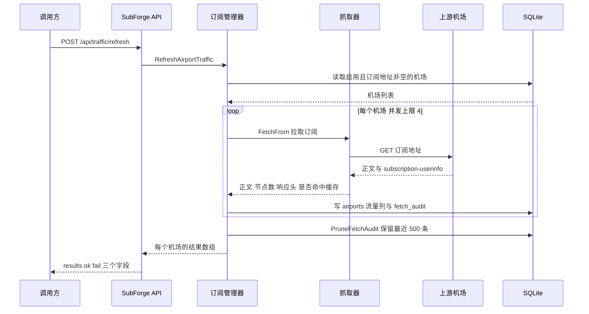
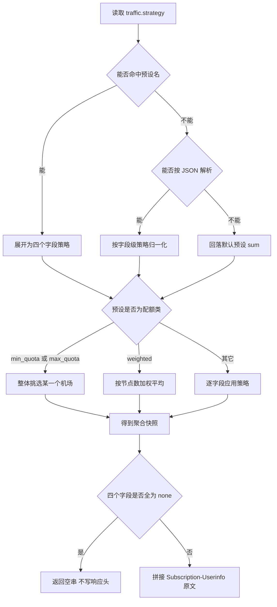

# 流量策略与用量统计

> 一个客户端通常只能显示一个流量余额，而用户往往同时持有多个机场。SubForge 的流量策略负责把多个机场的 `subscription-userinfo` 采集下来、按配置的规则聚合成一个数值，再写回订阅响应头，让下游客户端显示"合并后"的余额与到期时间。
>
> 本页说明流量数据的来源、采集时机、十种聚合预设的精确语义，以及透传链路上的注意事项。
>
> 事实来源：`internal/traffic/traffic.go`、`internal/subforge/traffic.go`、`internal/api/traffic.go`、`internal/api/subscription.go`、`internal/store/store.go`、`internal/scheduler/jobs.go`。

---

## 1. 这一页解决什么问题

机场订阅的上游通常会在响应头里附带一行 `subscription-userinfo`，内容是已用流量、总流量与到期时间。单个机场时，客户端直接读这一行即可；但 SubForge 的产物可以由多个来源合并而成，此时上游头有多个，客户端只认一个，必须由服务端决定"合并后应该显示什么"。

SubForge 把这套决策拆成采集、聚合、透传三步：拉取每个启用机场的订阅并解析 `subscription-userinfo`，落库到 `airports` 表；按"流量策略"把多个机场的四个数值合并成一个快照；在 `/subscribe` 响应里写回 `Subscription-Userinfo` 响应头。三步相互独立，不配置策略时使用默认预设，不采集时透传头为空。

## 2. 流量数据的来源与字段语义

### 2.1 subscription-userinfo 响应头

上游响应头的标准形态是一串以分号分隔的键值对：

```text
upload=1073741824; download=5368709120; total=107374182400; expire=1767225600
```

解析规则见 `internal/traffic/traffic.go:20`：

| 规则 | 说明 | 源码位置 |
| --- | --- | --- |
| 前缀兼容 | 整串可带 `Subscription-Userinfo: ` 前缀，解析前会被剥掉 | `internal/traffic/traffic.go:23-26` |
| 键名集合 | 只认 `upload`、`download`、`total`、`expire` 四个键，键名大小写不敏感 | `internal/traffic/traffic.go:41-44` |
| 键值分隔 | 每段按第一个 `=` 拆成键与值 | `internal/traffic/traffic.go:37-40` |
| 单键容错 | 某个键的数值无法解析为整数时只跳过该键，不影响同串其它键 | `internal/traffic/traffic.go:45-48` |
| 整体可用性 | 一个可识别键都没有命中时返回 `ok=false`，调用方据此判定"这条头不可用" | `internal/traffic/traffic.go:62-64` |

### 2.2 Usage 的四个字段

| 字段 | JSON 名 | 单位 | 零值的含义 | 源码位置 |
| --- | --- | --- | --- | --- |
| `Upload` | `upload` | 字节 | 未知或确实为 0 | `internal/traffic/traffic.go:11` |
| `Download` | `download` | 字节 | 未知或确实为 0 | `internal/traffic/traffic.go:12` |
| `Total` | `total` | 字节 | 0 表示**无限流量**，不是"未知" | `internal/traffic/traffic.go:13` |
| `Expire` | `expire` | Unix 秒 | 0 表示未知，不是 1970 年 | `internal/traffic/traffic.go:14` |

`Total` 的零值语义直接决定了 `max_quota` 预设的行为：它优先挑选 `Total == 0` 的机场，也就是"不限量"的那一个。

### 2.3 落库的七个列

`airports` 表的流量相关列由幂等迁移补齐（`internal/store/store.go:546-554`），对应 `store.Airport` 的字段：

| 列 | 结构体字段 | 说明 | 源码位置 |
| --- | --- | --- | --- |
| `upload` | `Upload` | 上次成功采集的上行字节 | `internal/store/store.go:546` |
| `download` | `Download` | 上次成功采集的下行字节 | `internal/store/store.go:547` |
| `total` | `Total` | 总配额，0 表示无限 | `internal/store/store.go:548` |
| `expire` | `Expire` | 到期 Unix 秒 | `internal/store/store.go:549` |
| `node_count` | `NodeCount` | 该源解析出的节点数，按节点加权时使用 | `internal/store/store.go:551`、`internal/store/store.go:74` |
| `traffic_at` | `TrafficAt` | 上次**成功**采集的 Unix 秒，0 表示从未成功 | `internal/store/store.go:552`、`internal/store/store.go:75` |
| `traffic_err` | `TrafficErr` | 上次采集失败原因，成功时清空 | `internal/store/store.go:553`、`internal/store/store.go:76` |

写库统一走 `Manager.UpdateAirportTraffic`（`internal/subforge/subforge.go:149`）：传入非 nil 的 `*traffic.Usage` 时覆盖六个流量列并清空 `traffic_err`；传入 nil 时只写 `traffic_err`，流量值保持不动。这个"传 nil 只写错误"的设计是下面所有失败语义的基础。

## 3. 采集流程

### 3.1 触发方式

| 触发方式 | 入口 | 范围 | 源码位置 |
| --- | --- | --- | --- |
| HTTP API | `POST /api/traffic/refresh` | 所有"启用且订阅地址非空"的机场 | `internal/api/server.go:217` |
| HTTP API | `POST /api/airports/{id}/refresh` | 单个机场 | `internal/api/server.go:167` |
| 控制台 | 订阅管理页的刷新与策略按钮 | 同上 | `web/src/pages/SubscriptionsPage.vue:245` |

需要明确：**仓库内没有流量采集的定时任务**。调度器目前只注册了两个内置任务——规则源更新 `rule-sources`（`internal/scheduler/jobs.go:99`）与订阅测活 `subscheck`（`internal/scheduler/jobs.go:151`），流量刷新不在其中。如果希望按固定周期采集，需要外部定时调用上面的 API。

### 3.2 一次刷新的数据流



并发上限是 `trafficRefreshParallel = 4`（`internal/subforge/traffic.go:21`），用带缓冲的 channel 做信号量；结果按下标写回，因此**返回顺序与机场列表顺序一致**，不随并发完成顺序变化（`internal/subforge/traffic.go:96-108`）。

### 3.3 五种结果语义

`refreshOneAirport` 用统一的 `fail` 闭包收口失败路径（`internal/subforge/traffic.go:127-133`），它只写 `traffic_err`，**不覆盖上一次成功的流量值**。完整语义如下：

| 情形 | 流量值 | `traffic_err` | 结果里的 `ok` | 源码位置 |
| --- | --- | --- | --- | --- |
| 拉取失败（网络错误、超时、非 2xx） | 保留上次 | 写入错误原文 | `false` | `internal/subforge/traffic.go:134-136` |
| 缓存命中但上游未回该头 | 保留上次 | 清空 | `false` | `internal/subforge/traffic.go:145-147` |
| 非缓存且上游未提供该头 | 保留上次 | `上游未提供 subscription-userinfo` | `false` | `internal/subforge/traffic.go:149` |
| 该头存在但无法解析 | 保留上次 | `subscription-userinfo 无法解析: ` 加原文 | `false` | `internal/subforge/traffic.go:151-154` |
| 解析成功 | 覆盖四个值 | 清空 | `true` | `internal/subforge/traffic.go:155-159` |

"缓存命中"指抓取器返回了 304，此时上游不回该头属于正常现象，因此只清错、不报错（`internal/subforge/traffic.go:146`）。

节点数在同一个函数里顺带采集：`parse.DecodeSubscription` 成功时取其长度，失败时记为 0，**不影响流量采集的成功判定**（`internal/subforge/traffic.go:138-142`）。

每次采集都会写一条 `fetch_audit`（机场 ID、URL、HTTP 状态码、字节数、是否成功、错误、耗时毫秒），失败路径同样记录（`internal/subforge/traffic.go:119-130`）。整批刷新结束后裁剪到最近 500 条（`trafficAuditRetention = 500`，`internal/subforge/traffic.go:23`、`internal/subforge/traffic.go:110`），裁剪失败不影响刷新结果。

## 4. 聚合策略

### 4.1 十个预设

预设名大小写不敏感、忽略首尾空白（`internal/traffic/traffic.go:125`）：

| 预设 | `upload` | `download` | `total` | `expire` | 说明 | 源码位置 |
| --- | --- | --- | --- | --- | --- | --- |
| `sum` | sum | sum | sum | min | 默认值，配额与用量都相加 | `internal/traffic/traffic.go:127` |
| `min` | min | min | min | min | 四项都取非零最小值 | `internal/traffic/traffic.go:129` |
| `max` | max | max | max | max | 四项都取最大值 | `internal/traffic/traffic.go:131` |
| `avg` | avg | avg | avg | avg | 四项都取非零平均值 | `internal/traffic/traffic.go:133` |
| `first` | first | first | first | first | 每项取第一个非零值 | `internal/traffic/traffic.go:135` |
| `last` | last | last | last | last | 每项取最后一个非零值 | `internal/traffic/traffic.go:137` |
| `min_quota` | — | — | — | — | 整体取"总配额最小"的那个机场 | `internal/traffic/traffic.go:139` |
| `max_quota` | — | — | — | — | 整体取"总配额最大"的机场，无限优先 | `internal/traffic/traffic.go:141` |
| `weighted` | — | — | — | — | 按节点数加权平均，到期时间取最小值 | `internal/traffic/traffic.go:143` |
| `off` | none | none | none | none | 四项都不透传，响应头不出现 | `internal/traffic/traffic.go:145` |

`sum` 的 `expire` 用的是 `min` 而不是 `sum`：到期时间相加没有意义，取最早到期才是安全的选择（`internal/traffic/traffic.go:127`）。

### 4.2 字段级策略

预设之外还可以逐字段指定，存储形态是 JSON：

```json
{
  "preset": "custom",
  "upload": "sum",
  "download": "sum",
  "total": "max",
  "expire": "min"
}
```

字段名与取值见 `internal/traffic/traffic.go:76-93`，合法取值是 `sum`、`min`、`max`、`avg`、`first`、`last`、`none`。归一化规则（`internal/traffic/traffic.go:102-121`）：未给出的字段先按预设展开，预设也不认识时回落到内置基线 `sum/sum/sum/min`；**显式给出的字段永远优先于预设展开值**；预设名被回填进 `preset` 字段，便于回显。`preset` 本身不参与聚合计算，只是回显用的标签，`Aggregate` 的默认分支只看四个字段值（`internal/traffic/traffic.go:96-100`）。

### 4.3 三个特殊预设

`min_quota`、`max_quota`、`weighted` 不走逐字段计算，而是在 `Aggregate` 里被单独处理（`internal/traffic/traffic.go:160-212`）：

| 预设 | 选择逻辑 | 边界情况 | 源码位置 |
| --- | --- | --- | --- |
| `min_quota` | 在所有 `Total != 0` 的机场里取 `Total` 最小者，整体返回它的四个值 | 全部机场 `Total` 都为 0 时退回下标 0 | `internal/traffic/traffic.go:161-174` |
| `max_quota` | 优先取第一个 `Total == 0`（不限量）的机场；没有则取 `Total` 最大者 | 至少存在一个机场时必有结果 | `internal/traffic/traffic.go:175-190` |
| `weighted` | 用量与配额按 `node_count` 加权平均，`expire` 取非零最小值 | 权重和 0 或节点数数组长度不匹配时，前三项退回非零平均值 | `internal/traffic/traffic.go:191-211` |

### 4.4 零值如何参与计算

`applyField` 对不同策略的零值处理并不一致（`internal/traffic/traffic.go:236-310`）：

| 策略 | 是否跳过 0 | 全部为 0 时的结果 |
| --- | --- | --- |
| `sum` | 跳过 | 0 |
| `min` | 跳过 | 0 |
| `max` | **不跳过** | 0 |
| `avg` | 跳过，且分母只数非零项 | 0 |
| `first` | 跳过 | 0 |
| `last` | 跳过 | 0 |
| `none` | 不适用，恒为 0 | 0 |

`max` 不跳过零值是刻意为之：`max` 的语义是"取最大值"，把 0 排除在外会让"所有机场都已用尽"这种情形显示成别的数字。

### 4.5 聚合决策总览



## 5. 透传到订阅响应头

### 5.1 只统计采集成功过的机场

`/subscribe` 在渲染完成后追加流量头（`internal/api/subscription.go:722-746`），过滤条件是三项同时满足：

- 机场处于启用状态；
- 订阅地址非空；
- `traffic_at > 0`，即**至少成功采集过一次**。

第三条是关键。从未采集成功的机场，四个流量字段都是零值，混进 `min`、`max`、`avg` 会把结果拉偏，所以直接排除（`internal/api/subscription.go:725-726` 的注释记录了这个理由）。

读策略失败时（例如数据库故障）**静默跳过**这一段，订阅正文照常返回（`internal/api/subscription.go:728`）。这是有意的取舍：流量头是附加信息，不应该让订阅本身生成失败。

### 5.2 头部拼接规则

聚合结果按字段策略拼成响应头原文（`internal/traffic/traffic.go:322-344`）：四个字段都不是 `none` 时输出完整的 `upload=%d; download=%d; total=%d; expire=%d`；部分字段是 `none` 时只输出其余字段并用 `; ` 连接；四个字段全是 `none` 时返回空串，调用方据此**不设置**该响应头。

### 5.3 怎么验证

先写策略，再触发一次采集，最后看订阅响应头：

```bash
curl -s -X PUT http://127.0.0.1:25500/api/traffic/strategy \
  -H 'Authorization: Bearer <YOUR_TOKEN>' \
  -H 'Content-Type: application/json' \
  -d '{"preset":"sum"}'

curl -s -X POST http://127.0.0.1:25500/api/traffic/refresh \
  -H 'Authorization: Bearer <YOUR_TOKEN>'

curl -s -D - -o /dev/null 'http://127.0.0.1:25500/sub?token=<YOUR_TOKEN>&target=clash.meta' \
  | grep -i 'subscription-userinfo'
```

如果第三行没有任何输出，按顺序排查：策略是否为 `off`（全 `none` 不写头）、机场是否从未采集成功（`traffic_at` 仍为 0）、`traffic_err` 里记录的原因。访问令牌可以走 `Authorization: Bearer`、`X-Token` 响应头或 `?token=` 查询参数三种形式（`internal/api/middleware.go:79`）。

## 6. HTTP 接口一览

| 方法与路径 | 用途 | 成功响应 | 源码位置 |
| --- | --- | --- | --- |
| `GET /api/traffic/strategy` | 读取当前策略，未配置时返回默认预设 `sum` | `{"strategy":{...}}` | `internal/api/traffic.go:24-30` |
| `PUT /api/traffic/strategy` | 写入策略，回显归一化后的结果 | `{"strategy":{...}}` | `internal/api/traffic.go:31-45` |
| `POST /api/traffic/refresh` | 刷新所有启用机场，`?with_rules=1` 时附带规则导入结果 | `{"results":[...],"ok":N,"fail":M}` | `internal/api/traffic.go:110-147` |
| `POST /api/airports/{id}/refresh` | 刷新单个机场 | `{"result":{...}}` | `internal/api/traffic.go:151-174` |
| `GET /api/traffic/preview` | 按 `?strategy=<json>` 试算，缺参时用当前策略 | `{"usage":...,"header":"...","ok":bool}` | `internal/api/traffic.go:178-209` |

错误约定：方法不符返回 405 与 `仅支持 GET/PUT` 一类提示（`internal/api/traffic.go:47`）；`?strategy=` 不是合法 JSON 返回 400 与 `strategy 参数不是合法 JSON`（`internal/api/traffic.go:198`）；订阅管理未启用时统一返回 503。`with_rules` 的真值判定接受 `1`、`true`、`yes`、`on`，大小写不敏感（`internal/api/traffic.go:52-58`）。

试算接口用已存数据计算，**不访问网络、不写数据库**（`internal/subforge/traffic.go:175-176`）；`ok` 为 `false` 表示"没有可聚合的数据"或"策略为不透传"，此时 `header` 是空串（`internal/api/traffic.go:203-208`）。

控制台入口在订阅管理页（`web/src/pages/SubscriptionsPage.vue`）：读取策略 `:245`、保存策略 `:260`、按表单值试算 `:280`，接口封装见 `web/src/api/endpoints.ts:446-450`。推荐的操作顺序是先试算确认结果，再保存策略，最后触发一次刷新让数据落库。

## 7. 常见问题

| 现象 | 可能原因 | 处理方式 |
| --- | --- | --- |
| 订阅响应里没有 `Subscription-Userinfo` | 策略为 `off`；或所有机场 `traffic_at` 为 0 | 改回 `sum` 等预设，并先触发一次采集 |
| 刷新结果 `ok=false` 且错误是"上游未提供 subscription-userinfo" | 机场上游确实不回该头 | 该机场无法参与聚合，属上游限制 |
| 刷新结果 `ok=false` 且错误是"无法解析" | 上游头格式非标准 | 对照 `upload=...; download=...; total=...; expire=...` 检查上游原文 |
| 用量显示远小于实际 | 部分机场从未采集成功，被排除在聚合之外 | 逐个机场用 `POST /api/airports/{id}/refresh` 确认 |
| `total` 显示为 0 | 选中的机场是不限量套餐 | 属正常；`Total = 0` 即无限 |
| 到期时间比预期早 | 预设 `sum` 的 `expire` 取的是最小值 | 改用 `max` 或字段级策略把 `expire` 设为 `max` |

## 8. 相关页面

- [数据模型与本地存储](数据模型与本地存储)：`airports` 表的七个流量列与迁移方式
- [订阅解析与协议支持](订阅解析与协议支持)：订阅正文的解析与节点数来源
- [定时任务与告警](定时任务与告警)：`rule-sources` 与 `subscheck` 两个内置任务
- [Rule-Bot-智能建议](Rule-Bot-智能建议)：基于转换日志与告警的规则建议闭环
- [HTTP-API-参考](HTTP-API-参考)：全部端点的请求与响应约定
- [Web-控制台使用指南](Web-控制台使用指南)：订阅管理页的界面操作
