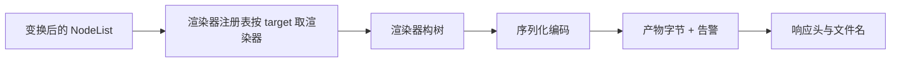
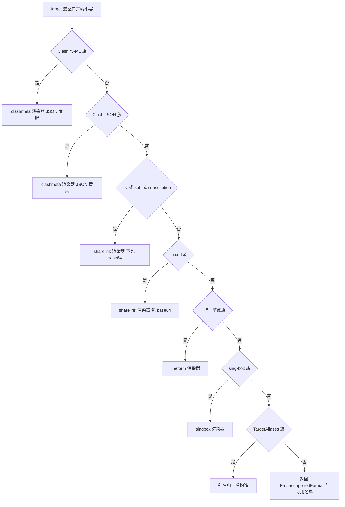
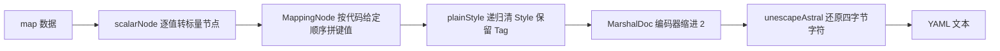
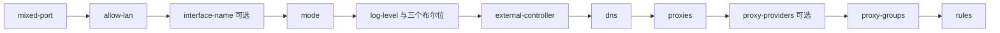
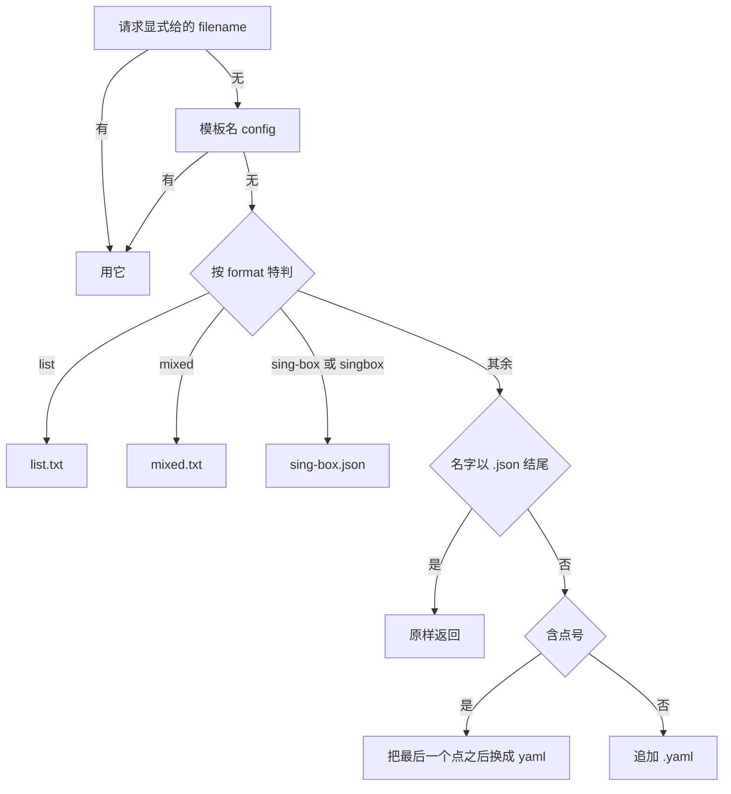

# 渲染器与输出格式

> 本文讲清"内部节点模型是怎么变成目标客户端能直接加载的配置文本的"，以及"有哪些输出格式、它们各自支持什么、产物头与文件名从哪里来"。所有函数名、字段名、默认值、错误串与响应头均以 `internal/render/`、`internal/api/` 的当前源码为准，行号标注在括号里。

---

## 1. 渲染阶段在整条流水线里的位置

渲染是转换链路的最后一步：它只负责"把已经定型的节点写成文本"，不再做任何内容决策。



### 1.1 三条不可违反的渲染约定

`internal/render/render.go:1-6` 的包注释把渲染层的边界写死了，三条约定各自对应一类线上问题：

| 约定 | 原文要点 | 违反后的后果 |
| --- | --- | --- |
| 渲染只读节点 | 渲染器只读 `Node.Raw`，绝不在渲染时改写节点内容 | 同一份输入两次渲染结果不同；渲染器之间互相污染 |
| 改名去重属于变换阶段 | 节点改名、去重必须在 transform 阶段完成 | 产物里的节点名与解析结果不一致，且无法定位是哪一层改的 |
| 输出必须确定性 | 键顺序稳定、字节级可复现 | 金测（golden test）随机失败；用户每次拿到的配置都在无意义地变动 |

因此，**如果产物里节点名不对、节点重复、顺序不对，问题一定在变换阶段，而不在渲染器里**（见 [转换流水线原理](转换流水线原理)）。

### 1.2 降级不能静默

渲染器会遇到"这个节点/组/规则我表达不了"的情况。此时唯一正确的做法是跳过并把原因交出去：

```go
// render.go:90-93
type WarningReporter interface {
	Warnings() []string
}
```

- 实现它的渲染器（`sharelink`、`lineform`、`mellow`、`sssub`、`singbox`）把本次 `Render` 中被跳过的项记在实例字段里。
- 调用方把 `Warnings()` 汇总进 `convert.Result.Warnings`，最终变成 `X-Convert-Skipped` 响应头与服务日志（`internal/api/handlers.go:80-86`）。
- 包注释的原话是"**降级不能静默**：跳过的节点名必须回传给调用方当作警告，否则用户会以为节点都在"（`render.go:89`）。

> **注意**：响应头里只放**计数**，不放条目。因为条目里可能出现 emoji（节点名），而 emoji 不是合法的 HTTP header 值（`internal/api/handlers.go:82`）。要看具体被跳过了什么，得看服务日志。

---

## 2. 渲染器注册表：target 怎么变成一个渲染器

`internal/render/registry/` 是 target 名的唯一裁决处。它必须与 `render` 包分离，因为 `render/clashmeta` 反向 import 了 `render`，放进 `render` 里会构成循环依赖（`internal/render/registry/registry.go:3-4`）。

### 2.1 `Lookup` 的分支顺序



`func Lookup(target string, clashOpts clashmeta.Options) (render.Renderer, error)`（`registry.go:29`）的关键细节：

| 分支 | 判定函数 | 行为 | 源码 |
| --- | --- | --- | --- |
| Clash YAML | `render.IsClashYAMLTarget` | **强制** `clashOpts.JSON = false` | `registry.go:32-36` |
| Clash JSON | `render.IsClashJSONTarget` | **强制** `clashOpts.JSON = true` | `registry.go:37-40` |
| 分享链接清单 | `t == "list" \|\| t == "sub" \|\| t == "subscription"` | `sharelink.New("list", Options{})` | `registry.go:41-43` |
| 混合订阅 | `render.IsMixedTarget` | `sharelink.New(LinkTargets[t].Renderer, Options{Base64: true})` | `registry.go:44-47` |
| 一行一节点 | `render.IsLineFormTarget` | `lineform.New(lineFormFormat(renderer), Options{})` | `registry.go:48-50` |
| sing-box | `render.IsSingboxTarget` | `singbox.New(singbox.DefaultOptions())` | `registry.go:51-53` |
| 别名 | `render.IsTargetAlias` | `aliasRenderer(t)` | `registry.go:54-57` |
| 默认 | — | 错误 `%w %q（目前支持: %s）` + `Available()` | `registry.go:58-61` |

**为什么序列化格式由 target 决定、而不是由调用方传入的 `Options` 决定**：源码注释写明"复用同一个 `Options` 结构体时才不会串到 JSON 输出"（`registry.go:33-34`）。也就是说，`Lookup` 每次都显式覆写 `JSON` 字段，避免上一次请求残留的选项影响这一次。

**为什么别名要归一**：`registry.go:27-28` 的注释说明，`X-Convert-Format` 与文件名都从 `Renderer.Name()` 派生，所以同一个格式无论用哪个别名请求，产物头与落盘名都一致。

### 2.2 未支持的 target 报什么

```go
// registry.go:24
var ErrUnsupportedFormat = errors.New("不支持的输出格式")
```

错误串格式是 `不支持的输出格式 "xxx"（目前支持: clash.meta, surge, ...）`（`registry.go:59-60`）。完整清单见第 4 节。

这个错误会被 `internal/api/handlers.go:28-29` 映射成 **HTTP 501**：

```go
case errors.Is(err, registry.ErrUnsupportedFormat):
	return http.StatusNotImplemented
```

`statusFor` 一共区分三类性质（`handlers.go:20-33`）：请求本身不对 → 400/404，格式没实现 → 501，上游有问题 → 502。

### 2.3 `Available()` 与它的顺序问题

`Available()`（`registry.go:106-150`）的构造方式分四段：

1. **头部手写名单**（22 个，顺序有意义）：
   `clash.meta, surge, quan, quanx, loon, surfboard, mellow, list, mixed, ss, ssd, shadowsocks, ssr, shadowsocksr, trojan, v2ray, sing-box, singbox, ss-sub, ss-sub-json, ss-sub-b64, ssjson`（`registry.go:107-112`）
2. 从 `render.LinkTargets` 展开，**跳过** `list` / `sub` / `subscription`（`registry.go:117-125`）
3. 从 `sortedLineFormTargets()` 展开规范名与全部别名（`registry.go:126-134`）
4. 从 `sortedBoolKeys(render.ClashJSONTargets)` 与 `sortedKeys(render.TargetAliases)` 展开（`registry.go:137-148`）

**为什么第 3、4 段必须先排序**：这三族来自 Go 的 map，`range` 顺序是随机的。源码注释直接点出后果——"不排序的话 `/api/targets` 的尾段每次请求顺序都不同，前端下拉框会抖动，任何断言全序的测试也会随机红"（`registry.go:135-136`）。仓库里的测试也据此只断言集合与首元素、不断言全序（`internal/api/web_ui_test.go:337-339`）。

`Available()` 当前返回 **36 项**，完整清单见第 4.1 节。

> **注意**：`sub` 与 `subscription` 这两个写法**能正常解析、能正常出产物，但不在 `Available()` 名单里**。它们只登记在 `render.LinkTargets`（`targets.go:20-21`）而没进头部手写名单，展开时又被显式跳过（`registry.go:118-120`）。所以"错误信息里列出的格式数"与"实际可用的写法数"并不相等：**实际可用 38 个写法**（36 项 + `sub` + `subscription`）。写文档或做前端下拉框时不要用 `Available()` 的长度当作"支持的全部 target 数"。

### 2.4 别名与"一行一节点"族的归一

`aliasRenderer`（`registry.go:67-82`）按 `render.TargetAliases[t]` 取规范名，再分派：

```go
case "ss-sub":
	opts := sssub.DefaultOptions()
	if t == "ss-sub-b64" {
		opts.Base64 = true
	}
	return sssub.New(opts), nil
case "mellow":
	return mellow.New(mellow.DefaultOptions()), nil
```

`lineFormFormat`（`registry.go:86-101`）把规范渲染器名映射到 `lineform.Format`：`surge` / `quan` / `quanx` / `loon` / `surfboard`，`default` 分支回落 `SurgeFormat()`。源码注释说明这样做的意图是"渲染器与格式解耦在这里收口：registry 只做名单判断，语法细节留在 lineform 包内"（`registry.go:84-85`）。

---

## 3. 确定性编码：为什么不能直接用 `yaml.Marshal` / `json.Marshal`

`render.go` 花了近 200 行手工构树与编码，原因只有一个：**Go 的 map 迭代顺序是随机的，而金测要求字节级稳定**（`render.go:95-98`）。

### 3.1 YAML 路径



| 助手 | 签名 | 作用 | 源码 |
| --- | --- | --- | --- |
| `scalarNode` | `func scalarNode(v any) (yaml.Node, error)` | 先走 YAML 序列化再取回节点，保证转义正确 | `render.go:101-117` |
| `MappingNode` | `func MappingNode(entries ...any) (yaml.Node, error)` | 按给定顺序构造映射（键值交替） | `render.go:120-136` |
| `SequenceNode` | `func SequenceNode(items ...*yaml.Node) yaml.Node` | 构造序列，子节点保持传入顺序 | `render.go:139-143` |
| `StringSequence` | `func StringSequence(items []string) yaml.Node` | 字符串序列（规则行等），**不设 Tag** | `render.go:146-153` |
| `plainStyle` | `func plainStyle(n *yaml.Node)` | 递归清 `Style`，**保留 `Tag`** | `render.go:158-163` |
| `MarshalDoc` | `func MarshalDoc(root yaml.Node) ([]byte, error)` | 编码为 YAML 文本 | `render.go:168-181` |
| `unescapeAstral` | `func unescapeAstral(body []byte) []byte` | 把 `\U0001F680` 还原为 UTF-8 | `render.go:191-199` |
| `CommentBlock` | `func CommentBlock(lines []string) string` | 生成 `# ` 前缀的配置头注释 | `render.go:307-316` |

三个容易踩的坑，源码都写了原因：

1. **`plainStyle` 必须保留 `Tag`**。`Tag` 记录了标量的原始类型（`"443"` 是字符串、`443` 是整数），清掉会导致编码后类型漂移，破坏"原始配置即事实源"的往返一致性（`render.go:156-157`）。
2. **不能手工包一层 `DocumentNode` 再 `Marshal`**。yaml.v3 会报 `expected SCALAR ... but got document start`，文档层由 `Marshal` 自己负责（`render.go:166-167`）。
3. **必须做 `unescapeAstral`**。yaml.v3 v3.0.1 的 `is_printable` 只识别到 3 字节 UTF-8 序列，遇到 emoji 这类 4 字节字符就判定为"特殊字符"，只能输出 `"\U0001F680 节点选择"`。转义本身合法，但订阅转换产物要给用户直接阅读，观感不能这么差，因此在编码完成后按正则 `\\U[0-9A-Fa-f]{8}` 还原（保留双引号，仍是合法 YAML）（`render.go:184-199`）。

### 3.2 JSON 路径

```go
// render.go:207-209
func MarshalJSONDoc(root yaml.Node) ([]byte, error)
```

同一棵 `yaml.Node` 树也要能出 JSON。这里同样手工遍历，因为：

- `encoding/json.Marshal` 对 `map[string]any` **按键字典序**输出，会破坏键顺序契约（`render.go:204-205`）。
- 不用 `json.Indent`，因为它走 `Encoder` 默认设置，会把字符串里的 `<` `>` `&` 转成 `\u` 转义——域名规则里恰好会出现这些字符，转完虽仍合法但产物不可读（`render.go:208-209`）。

`jsonScalarNode`（`render.go:277-304`）按 `Tag` 决定 JSON 值形态：`!!null` → `null`，`!!bool` → `true`/`false`（`true`/`on`/`yes` 为真），`!!int` / `!!float` 解析成功就原样写数字，其余一律走 `json.Marshal` 当字符串输出。`Tag` 为空时按 `!!str` 处理（`StringSequence` 不设 Tag，`render.go:279-281`）。

源码注释把后果说得很直白：**"Tag 不能丢：丢了对客户端来说端口就变成数字字段，mihomo 读不出代理"**（`render.go:274-276`）。

### 3.3 配置头注释

- YAML 形态：`clashmeta` 渲染器在正文前拼 `render.CommentBlock(headerLines(req.Profile))`（`clashmeta.go:201`），内容为"此配置由 SubForge 自动生成"、配置名、`SubForge <版本>`、生成时间（`clashmeta.go:387-399`）。
- **JSON 形态没有注释**：JSON 不支持注释，配置头无处可放——元信息只留在 HTTP 响应头里（`clashmeta.go:189`）。
- `lineform` 族用各自的注释前缀（`#` 或 `//!`）逐行写头（`lineform.go:100-116`）。
- `singbox` 同样因为 JSON 不支持注释，生成时间只留在响应头（`singbox.go:298`）。

---

## 4. 目标格式总览

### 4.1 可用清单（36 项，顺序与 `Available()` 的输出一致）

| 序 | target | 渲染器 | 产物形态 |
| --- | --- | --- | --- |
| 1 | `clash.meta` | clashmeta | Clash / mihomo YAML |
| 2 | `surge` | lineform | Surge 配置 |
| 3 | `quan` | lineform | Quantumult classic |
| 4 | `quanx` | lineform | Quantumult X |
| 5 | `loon` | lineform | Loon 配置 |
| 6 | `surfboard` | lineform | Surfboard 配置 |
| 7 | `mellow` | mellow | Mellow 配置 |
| 8 | `list` | sharelink | 分享链接清单 |
| 9 | `mixed` | sharelink | Base64 包裹的混合订阅 |
| 10–14 | `ss` / `ssd` / `shadowsocks` / `ssr` / `shadowsocksr` | sharelink | 按协议收窄后的混合订阅 |
| 15–16 | `trojan` / `v2ray` | sharelink | 按协议收窄后的混合订阅 |
| 17–18 | `sing-box` / `singbox` | singbox | sing-box JSON |
| 19–22 | `ss-sub` / `ss-sub-json` / `ss-sub-b64` / `ssjson` | sssub | Shadowsocks-android 节点 JSON |
| 23–24 | `quantumult` / `quantumultx` | lineform | `quan` / `quanx` 的别名 |
| 25–28 | `surge2` / `surge3` / `surge4` / `suri` | lineform | `surge` 的别名 |
| 29–34 | `clash-json` / `clash.json` / `clash.meta.json` / `clashmeta-json` / `clashmeta.json` / `mihomo.json` | clashmeta | Clash JSON |
| 35 | `mellow-ios` | mellow | `mellow` 的别名 |
| 36 | `sssub` | sssub | `ss-sub` 的别名 |

**另有 2 个可用但未列入名单的写法**：`sub`、`subscription`（等价于 `list`）。

**复现方式**：传一个不存在的 target（`subforge convert -format __nope__ ...`）会走同一条
`Lookup` 路径，错误信息里列出的就是上面 36 项：

```
不支持的输出格式 "__nope__"（目前支持: clash.meta, surge, quan, quanx, loon, surfboard, mellow,
list, mixed, ss, ssd, shadowsocks, ssr, shadowsocksr, trojan, v2ray, sing-box, singbox,
ss-sub, ss-sub-json, ss-sub-b64, ssjson, quantumult, quantumultx, surge2, surge3, surge4,
suri, clash-json, clash.json, clash.meta.json, clashmeta-json, clashmeta.json, mihomo.json,
mellow-ios, sssub）
```

### 4.2 target 族的真源表

target 名单不在 `registry` 里，而是集中在 `internal/render/targets.go`，`convert` 与 `registry` 都从这张表读，避免两份名单漂移（`targets.go:117-119`）。

| 表 | 变量 | 项数 | 内容 | 源码 |
| --- | --- | --- | --- | --- |
| 分享链接族 | `LinkTargets` | 11 | `list` / `sub` / `subscription` / `mixed` / `ss` / `ssd` / `shadowsocks` / `ssr` / `shadowsocksr` / `trojan` / `v2ray` | `targets.go:18-30` |
| Clash YAML 族 | `ClashYAMLTargets` | 7 | 空串 / `clash` / `clash.meta` / `clashmeta` / `mihomo` / `yaml` / `clashr` | `targets.go:48-60` |
| Clash JSON 族 | `ClashJSONTargets` | 6 | `clash.json` / `clash.meta.json` / `clashmeta.json` / `clash-json` / `clashmeta-json` / `mihomo.json` | `targets.go:65-72` |
| sing-box 族 | `SingboxTargets` | 2 | `sing-box` / `singbox` | `targets.go:77-80` |
| 一行一节点族 | `LineFormTargets` | 5 | `surge`{surge2,surge3,surge4,suri} / `quan`{quantumult} / `quanx`{quantumultx} / `loon` / `surfboard` | `targets.go:130-136` |
| 别名族 | `TargetAliases` | 7 | `ss-sub` / `ss-sub-json` / `ss-sub-b64` / `ssjson` / `sssub` → `ss-sub`；`mellow` / `mellow-ios` → `mellow` | `targets.go:105-115` |

**为什么 Clash YAML 与 Clash JSON 要分成两张表**：输出编码不同、扩展方式也不同，"新增一种序列化格式不该去改这一张名单"（`targets.go:46-47`）。两者的**构树逻辑完全共用**（同一份配置，只换编码步骤），所以 `ClashJSONTargets` 只登记写法，不复制渲染逻辑（`targets.go:63-64`）。

**`clashr` 的处理是个明确取舍**：ClashR 早已停止维护，它的字段名（`Proxy` / `Rule` 大写）是 Clash 大写形态的历史遗留。这里按现代 Clash/meta 的小写形态产出——ClashR 客户端接受小写，而大写形态 mihomo 会拒绝加载。取舍原则是"能用"优先于"逐字节复刻一个死掉的客户端"（`targets.go:55-59`）。

**为什么别名要过一张展开表**：`lineFormByName`（`targets.go:141-150`）把别名一并展开成 `target -> 规范渲染器名`。源码注释解释了必要性——"否则 `surge4` 会在'列出来可用'和'Lookup 报未支持'之间出现分裂"（`targets.go:138-140`）。

### 4.3 别名归一后的产物一致性

因为 `X-Convert-Format` 与文件名都从 `Name()` 派生，别名请求出来的产物头与文件名与规范名完全一致：

| 请求的 target | `Name()` / `X-Convert-Format` | 落盘文件名 |
| --- | --- | --- |
| `surge4`、`suri` | `surge` | `surge.yaml` |
| `quantumultx` | `quanx` | `quanx.yaml` |
| `sssub`、`ss-sub-json` | `ss-sub` | `ss-sub.yaml` |
| `ss-sub-b64` | `ss-sub`（仅内容为 Base64） | `ss-sub.yaml` |
| `mellow-ios` | `mellow` | `mellow.yaml` |
| `clashmeta-json` | `clash.meta.json` | `clash.meta.json` |

---

## 5. 各渲染器详解

### 5.1 `clashmeta`：Clash / mihomo 配置

**是什么**：产出 mihomo 兼容的 YAML 或 JSON 配置（`internal/render/clashmeta/clashmeta.go`）。

**为什么直接透传 `Node.Raw`**：mihomo 的 outbound 适配器**没有 `Marshal` 方法**，因此 `proxies` 直接透传 `Node.Raw` 的全部键值，不经过任何自研结构体中转——这样订阅里的任何扩展字段（`reality-opts`、`ws-opts`、`obfs`…）都不会丢失（`clashmeta.go:3-5`）。

**顶层键的顺序是代码写死的**（`clashmeta.go:141-181`）：



| 键 | 值来源 | 源码 |
| --- | --- | --- |
| `mixed-port` | `Options.MixedPort`（默认 7890） | `clashmeta.go:145` |
| `allow-lan` | `Options.AllowLan`（默认 `false`） | `clashmeta.go:146` |
| `interface-name` | 非空才写 | `clashmeta.go:147-149` |
| `mode` | 默认 `rule` | `clashmeta.go:150` |
| `log-level` | 固定 `info` | `clashmeta.go:151` |
| `ipv6` / `unify-ip` / `tcp-concurrent` | 固定 `false` / `true` / `true` | `clashmeta.go:152-154` |
| `external-controller` | 默认 `127.0.0.1:9090` | `clashmeta.go:155` |
| `dns` | 见下 | `clashmeta.go:156-160` |
| `proxies` | `req.Nodes.Raws()` 逐项透传 | `clashmeta.go:162-166` |
| `proxy-providers` | 有 provider 才写，原样透传 | `clashmeta.go:167-175` |
| `proxy-groups` | `req.Groups`，为空时用默认组 | `clashmeta.go:176-180` |
| `rules` | `req.Rules`，为空时用默认规则 | `clashmeta.go:181` |

**`proxies` 内部键按字典序排**（`rawMappingNode` 里 `sort.Strings(keys)`，`clashmeta.go:266-277`）。这不是为了好看，是为了 golden 稳定——`Node.Raw` 本身是 map。

**默认 DNS 段**（`DefaultOptions()`，`clashmeta.go:62-81`）：

| 字段 | 默认值 |
| --- | --- |
| `enable` | `true` |
| `listen` | `0.0.0.0:1053` |
| `enhanced-mode` | `fake-ip` |
| `fake-ip-range` | `198.18.0.0/16` |
| `fake-ip-filter` | `+.lan` / `lanserver.test` / `*.local` / `*.localdomain` |
| `default-nameserver` | `223.5.5.5` / `1.1.1.1` |
| `nameserver` | `https://doh.pub/dns-query` / `https://dns.cloudflare.com/dns-query` |
| `fallback` | `tls://8.8.8.8:853` |
| `fallback-filter` | `geoip: true`、`geoip-code: CN` |

`New()` 会用 `fillDefaults` 补齐空字段：`MixedPort == 0`、`Mode == ""`、`ExternalController == ""`、`DNS.Listen == ""`、`DNS.EnhancedMode == ""`、`DNS.FakeIPRange == ""`、`DNS.Nameserver` 为空（此时整个 `DNS` 结构替换为默认值）、`DNS.FallbackFilterGeoIPCode == ""`（`clashmeta.go:93-120`）。

**分组类型有白名单**（`supportedTypes`，`clashmeta.go:297-302`）：只有 `select` / `url-test` / `fallback` / `load-balance` 四类。依据是 mihomo v1.19.31 `adapter/outboundgroup/parser.go` 的类型 switch——**`relay` 已被移除**。mihomo 也没有 `reject` / `direct` / `pass` 这类"特殊类型分组"，要拒绝流量就用 `select` 分组套内置的 `REJECT` / `REJECT-DROP` 出站。渲染期就拦下非法类型，错误串是：

```
proxy-group %q: mihomo 不支持的分组类型 %q（支持: select / url-test / fallback / load-balance）
```
（`clashmeta.go:311-314`）

**默认组是五组**（`clashmeta.go:348-366`）：`🚀 节点选择`（select）、`♻️ 自动选择`（url-test，`interval=300`、`tolerance=50`、`timeout=5000`、`lazy=true`）、`🎯 全球直连`（select，成员 `DIRECT` 与 `♻️ 自动选择`）、`🛑 拒绝访问`（select，成员 `REJECT` 与 `REJECT-DROP`）、`🐟 漏网之鱼`（select，成员 `🚀 节点选择` 与 `DIRECT`）。

**兜底规则用 `MATCH` 而不是 `FINAL`**（`clashmeta.go:368-385`）。源码注释写明原因：mihomo v1.19.31 的 `rules/parser.go` 里**没有 `FINAL` 这个规则类型**，写 `FINAL` 会报 `rules[i] error: format invalid`，兜底规则必须写 `MATCH`。这一点经 `mihomo -t` 实机确认（见 `scripts/validate-mihomo.sh` 与 `docs/compatibility.md`）。

**JSON 形态的 `Name()` 带 `.json` 后缀**（`clashmeta.go:123-128`）：`clash.meta.json`。注释说明 `X-Convert-Format` 与落盘名都从它派生（`clashmeta.go:122`）。

### 5.2 `lineform`：Surge / Quantumult / QX / Loon / Surfboard

**是什么**：实现"一行一节点"族的客户端配置渲染器。这一族的共同形态是"节点是形如 `名字 = 协议字段` 的文本行，加上几个固定段落"（`internal/render/lineform/lineform.go:1-9`）。

**为什么只写一份组装逻辑**：Surge / Quantumult(X) / Loon / Surfboard 字段顺序与关键名各不相同，但共享同一套骨架，所以 `lineform.go` 只写一份组装逻辑，每个格式只贡献自己的三个映射函数（`Node` / `Group` / `Rule`）。语法依据不是猜的，取自 subconverter v0.9.0 实机输出（`tools/scv/goldens2/`）（`lineform.go:8-9`）。

`Format` 结构（`lineform.go:30-57`）的关键字段：

| 字段 | 含义 |
| --- | --- |
| `Name` | 渲染器名，也用作 `X-Convert-Format` |
| `CommentPrefix` | 注释前缀，如 `#`、`//!` |
| `General` | 配置头段落内容（不含节点） |
| `ProxyIntro` | 节点段里的伪节点行（如 `DIRECT = direct`） |
| `ProxySection` / `GroupSection` / `RuleSection` | 三个段落的段落名 |
| `Node` / `Group` / `Rule` | 三个映射函数 |
| `RemoteRuleSection` | 远程规则段落名；空表示混在本地规则段里（只有 Loon 有独立的 `[Remote Rule]` 段） |
| `HasSections` | 段落是否用 `[Proxy]` 这种方括号包裹 |

**段落顺序与段落名对照**：

| 格式 | 注释前缀 | 节点段 | 组段 | 规则段 | 远程规则段 | 源码 |
| --- | --- | --- | --- | --- | --- | --- |
| `surge` | `#` | `[Proxy]` | `[Proxy Group]` | `[Rule]` | 无（混在 `[Rule]`） | `formats.go:101-126` |
| `quan` | `#` | `[SERVER]` | `[POLICY]` | `[TCP]` | 无 | `formats.go:162-180` |
| `quanx` | `//!` | `[server_local]` | `[policy]` | `[filter_local]` | `[filter_remote]` | `formats.go:217-236` |
| `loon` | `#` | `[Proxy]` | `[Proxy Group]` | `[Rule]` | `[Remote Rule]` | `formats.go:288-307` |
| `surfboard` | `#` | `[Proxy]` | `[Proxy Group]` | `[Rule]` | 无 | `formats.go:352-370` |

Surge 还额外带 `[General]` 段（`loglevel = notify`、`bypass-system = true`、`skip-proxy = ...`、`bypass-tun = ...`）与伪节点行 `DIRECT = direct`（`formats.go:110-116`）。其余四个格式不写 `[General]`。

**各格式支持的协议不同**，这是客户端能力差异，不是实现偷懒：

| 格式 | 支持的协议 | 源码 |
| --- | --- | --- |
| `surge` | `ss`、`socks5`/`socks4`、`http`（TLS 时写 `https`） | `formats.go:128-158` |
| `quan` | `vmess`、`ss`、`ssr` | `formats.go:182-213` |
| `quanx` | `vmess`、`ss`、`ssr`、`trojan` | `formats.go:239-284` |
| `loon` | `vmess`、`ss`、`ssr`、`trojan` | `formats.go:309-348` |
| `surfboard` | `vmess`、`ss`、`trojan`、`socks5`/`socks4`、`http` | `formats.go:372-428` |

Surge 的注释解释了取舍：Surge 内核原生只支持 `ss` / `socks` / `http`；`ssr` 需要外挂 `ssr-local`，`vmess` 与 `vless` 完全不支持。这里与 subconverter v0.9.0 的取舍一致——**不支持的协议跳过并告警，不尝试硬塞，硬塞出来的行客户端会直接报错**（`formats.go:97-100`）。

**组的词汇差异由 `groupStyle` 收口**（`formats.go:12-20`）：

| 格式 | select | url-test | fallback | interval 键 | url 键 |
| --- | --- | --- | --- | --- | --- |
| `surge` | `select` | `url-test` | `fallback` | `interval` | `url` |
| `quan` | `select` | `url-latency-test` | 不支持 | `check-interval` | `check-url` |
| `quanx` | `static` | `url-latency-benchmark` | 不支持 | `check-interval` | `check-url` |
| `loon` | `select` | `url-test` | `fallback` | `interval` | `url` |
| `surfboard` | `select` | `url-test` | 不支持 | `interval` | `url` |

`buildGroupLine`（`formats.go:30-83`）按 `g.Type` 分派：`select`（空类型也按 select 处理）、`url-test`、`fallback`、`direct`/`pass`/`local`、`reject`；`default` 分支（`relay` / `balanced` / `sniffer`）返回空串表示无法表达（`formats.go:79-81`）。**成员会先用 `valid` 过滤**——引用了被跳过节点的名字会被剔除，产出的配置不能含悬空引用（`formats.go:29`）。

**组过滤与默认值注入的顺序有讲究**：默认组与默认规则在**节点渲染之后**注入，因为它们要引用产物里真实存在的名字，而哪些节点能被这个格式表达要到渲染完才知道（`lineform.go:161-168`）。

**默认组是两组**（`lineform.go:239-257`）：`节点选择`（select）与`自动测速`（url-test，测速 URL `https://www.google.com/generate_204`、`interval=300`、`tolerance=50`、`timeout=5000`）。源码注释给了两个理由：

- 成员只能引用 `valid` 里的名字，否则会自动产出一条引用悬空成员的组，**客户端整个组直接失效——那比没有组更糟**（`lineform.go:235-237`）。
- 组名刻意不用 emoji：这几个客户端对组名的字符集限制比 mihomo 严（`lineform.go:238`）。
- 只看真实节点名，伪节点不算，否则无节点时也会生成一组只有 `DIRECT` 的空组，那种组在客户端里点不开（`lineform.go:240-241`）。

**默认规则用 `FINAL` 而不是 `MATCH`**（`lineform.go:264-273`）：收尾规则一律写 `FINAL`，这是 Surge / QX / Loon / Surfboard 的通用写法；mihomo 的 `MATCH` 是内核专属语法，写进这些客户端的配置不会被识别。没有组时兜底到内置 `DIRECT`，因为 `FINAL,DIRECT` 在四种格式里都成立。默认规则是 `GEOIP,CN,DIRECT` + `FINAL,<第一个 select 组名>`。

**规则映射只有两处真差异**（`internal/render/lineform/rules.go:9-17`）：

- `GEOSITE` 是内核专属，非 Clash 格式不认识，**必须丢弃**（`rules.go:58-59`）。
- 规则集的写法每个格式都不同，而且 Loon 要落到独立的 `[Remote Rule]` 段。

其余类型在 `passthroughRules` 白名单里原样透传：`DOMAIN-SUFFIX`、`DOMAIN`、`DOMAIN-KEYWORD`、`IP-CIDR`、`IP-CIDR6`、`IP-CIDRNOLOG`、`IP-CIDR6NOLOG`、`DST-PORT`、`SRC-PORT`、`GEOIP`、`FINAL`、`MATCH`（`rules.go:20-25`）。源码注释强调 `GEOIP` **不能**当 Clash 专属丢弃——这是逐个 target 实机输出核实过的（`rules.go:11-13`）。

规则集写法三种（`rules.go:97-111`）：

| 格式 | 写法 |
| --- | --- |
| Surge / Quantumult classic / Surfboard | `RULE-SET,<url>,<组名>,update-interval=<秒>` |
| Quantumult X | `rule-list=<url>,group=<组名>,update-interval=<秒>` |
| Loon | `<url>,<组名>`（落在 `[Remote Rule]` 段） |

Quantumult classic 还要求 `IP-CIDR` 类规则追加 `no-resolve`（`noResolve=true`，`rules.go:68-70`）。规则行的 `update-interval=N` 片段会被解析出来覆盖默认间隔，默认 86400 秒（`rules.go:31-33`、`rules.go:86-95`）。

**`reservedNames`** 是各格式都认可的伪节点，组成员引用它们无需过滤：`DIRECT`、`REJECT`、`DNS`、`PASS`、`LOCAL`、`DRESS`、`NO-CDN`、`DIRECT-INTERNET`、`FINAL`（`formats.go:23-26`）。

**`Options`**（`lineform.go:60-66`）：`ManagedConfigURL` 非空时在产物首行写 `#!MANAGED-CONFIG <url> interval=<n> strict=false`，供 Surge 自动更新；`UpdateInterval` ≤ 0 时回落 86400。转换引擎通常不知道自己的对外 URL，所以默认留空即不写（`lineform.go:61-62`）。

**被跳过的三类对象都会告警**：节点（`lineform.go:150-151`）、代理组（`lineform.go:175-176`）、规则（`lineform.go:192-193`、`lineform.go:200`）。

### 5.3 `singbox`：sing-box JSON

**是什么**：产出 sing-box 1.14 schema 的 JSON 配置（`internal/render/singbox/singbox.go`，1126 行，是 render 包里最大的渲染器）。

**为什么单独成家**：sing-box 是独立内核，出站 schema 与 Clash 不同，自成渲染器（`registry.go:52`）。

**目标 schema 版本与 1.12 起的破坏性变更**（`singbox.go:1-35` 包注释）：`dns.servers` 改为 `type` 判别式对象、移除 `dns.fakeip` / `independent_cache` / `default` / `resolver` / `proxy` / `block`、无内置 `geoip`/`geosite`、出站无 `udp` 布尔位、移除 `shadowsocksr` / `fallback` / `dns` 出站、`tls.utls` 变对象、`reality` 移进 `tls.reality`、`alpn` 移进 `tls.alpn`、`spider-x` 移除、hysteria 凭据叫 `auth_str`、tuic 改 `congestion_control`、主机名 DNS 必须声明 `domain_resolver`。规则动作是**平铺字段**而不是嵌套对象（官方 `schema.json` 有 `allOf`/`oneOf` 生成器坑，以 `sing-box check` 实测为准）。取舍记在 `docs/compatibility.md` B1~B7。

**默认参数**（`DefaultOptions()`，`singbox.go:120-143`）：

| 字段 | 默认值 |
| --- | --- |
| `LogLevel` | `info` |
| `Timestamp` | `true` |
| `MixedPort` | 2080 |
| `AllowLan` | `true` |
| `Tun` | `true` |
| `TunAddress` | `172.19.0.1/30` |
| `DomainResolver` | `dns_resolver` |
| `DefaultDNSTag` | `dns_proxy` |
| `FinalDNSTag` | `dns_direct` |

内置 DNS 服务器四个（`singbox.go:120-143`）：`dns_proxy`（`tls://1.1.1.1`，`resolver=dns_resolver`）、`dns_direct`（`h3://dns.alidns.com/dns-query`，`detour=DIRECT`）、`dns_fakeip`（`fakeip`，`198.18.0.0/15`）、`dns_resolver`（`223.5.5.5`，`detour=DIRECT`）。

源码注释解释了 `DefaultDNSTag` 为什么必须是 `dns_proxy` 而不是 `dns_resolver`：**兜底必须指 `dns_proxy`，否则所有域名绕过代理直连解析、fakeip 永不生效**（`singbox.go:115-119`）。

**顶层段落**（`singbox.go:285-293`）：`log` / `dns` / `ntp` / `inbounds` / `outbounds` / `route` / `experimental`。其中：

- `ntp` 固定 `enabled=true`、`server=time.apple.com`、`server_port=123`、`interval=30m`、`detour=DIRECT`（`singbox.go:238-247`）。
- `experimental` 含 `cache_file{enabled, store_fakeip}` 与 `clash_api{external_controller: 127.0.0.1:9090, external_ui: dashboard}`。
- 内置出站 `DIRECT`（`direct`）与 `REJECT`（`block`）；无效 tag 不记账，以免整份配置加载失败（`singbox.go:161-300`）。
- `finalTag` 取第一个 selector 组，无组则 `DIRECT`（`singbox.go:210-217`）。

**协议映射表**（`singboxType`，`singbox.go:839-858`）：`ss`/`shadowsocks`→`shadowsocks`、`vmess`→`vmess`、`vless`→`vless`、`trojan`→`trojan`、`hysteria`→`hysteria`、`hysteria2`→`hysteria2`、`tuic`→`tuic`、`anytls`→`anytls`、`socks5`/`socks`→`socks`、`http`→`http`、`https`→`http`（带 TLS）。**`ssr` 故意不在表内**（1.12 起移除 shadowsocksr 出站），命中时告警：

```
sing-box 不支持协议 %q，已跳过节点 %s
```
（`singbox.go:304-388`）

**逐协议字段映射要点**（`singbox.go:304-388`）：

| 协议 | 关键映射 |
| --- | --- |
| shadowsocks | `method` ← `cipher`；`password` |
| vmess | `uuid`；`alter_id` ← `alterId`；`security` ← `encryption` 或 `cipher`，默认 `auto` |
| vless | `uuid`；`flow` 非空才写 |
| trojan | `password` |
| hysteria2 | `password`（可选）+ 带宽可选 |
| hysteria（v1） | 凭据写 **`auth_str`** 而非 `password`（写 `password` 会判未知字段导致整份配置失败）；带宽**必填** |
| tuic | `uuid`、`password`；`congestion_control` ← `congestion-controller`，默认 `bbr` |
| anytls | `password`，回落 `username` |
| socks / http | `username` / `password` |

hysteria v1 的带宽兜底是 `defaultBandwidthMbps = 1000`（`singbox.go:958-1002`），三种告警分别对应"都缺"/"缺 up"/"缺 down"。

**TLS 段**（`tlsNode`，`singbox.go:398-458`）：`server_name` 优先取 `sni` 再取 `servername`；`enabled` 的判定是 `rawBool(raw,"tls") || hasReality || sni != "" || tlsInherent(typ, isHTTPS)`；`skip-cert-verify` 与 `skip-cert-verify-fallback` → `insecure`；`client-fingerprint` 或 `fingerprint` → `utls{enabled, fingerprint}`；`reality` → `reality{enabled, public_key, short_id}`。

`realityPublicKey`（`singbox.go:884-894`）把标准 base64 转成 URL 安全无填充形式，解不出则告警：

```
节点 %s 的 reality public-key %q 不是合法 base64，已原样输出，sing-box 会判配置非法
```

**传输层**（`transportNode`，`singbox.go:462-511`）：`ws` → `type=ws` + `path` + `headers.Host`（ws 无独立 `host` 字段）；`grpc` → `type=grpc` + `service_name`，`multiMode` → `permit_without_stream`；`h2`/`httpupgrade` → `type=httpupgrade` + `path` + `host`。

**组映射**（`groupNodes`，`singbox.go:529-581`）：`select`/`relay`/`direct`/`pass` → `selector`；`url-test` → `urltest`（默认测速 URL `http://www.gstatic.com/generate_204`，带 `tolerance`、`interval`）；`fallback` → 告警后降级 `selector`：

```
sing-box 1.12 起已移除 fallback 出站，组 %s 退化为 selector（失去逐个试探语义）
```

未知类型告警 `sing-box 无对应出站类型 %q，已跳过组 %s`。

**路由规则**（`routeRules`，`singbox.go:595-658`）：`MATCH` / `FINAL` 不落规则行（改写 `finalTag`）；`ruleField`（`singbox.go:867-874`）把 Clash 规则类型映射为 sing-box 字段——`Domain`→`domain`、`DomainSuffix`→`domain_suffix`、`DomainKeyword`→`domain_keyword`、`DomainRegex`→`domain_regex`、`IPCIDR`→`ip_cidr`、`IPCIDR6`→`ip_cidr`（1.12 起 `ip_cidr` 同时接受 v4/v6）。同字段同出站的相邻行会合并进一个数组。

两类规则会被丢弃并告警：

```
sing-box 1.12 起 %q 不再内置匹配，需自行提供 route.rule_set，已丢弃规则: %s
规则引用的出站 %q 不存在（节点可能被跳过），已丢弃规则: %s
```

**DNS 兜底**（`dnsNode`，`singbox.go:661-697`）：`DefaultDNSTag` 落成 `domain=["*"], action=route, server=<tag>`（1.12 起 `dns.default` 被移除）。注释说明旧实现的 geosite 三条规则因"不打包规则数据"（R3）而无法产出，是有意取舍。`checkDNSRefs`（`singbox.go:701-721`）校验 `domain_resolver` / 兜底 / `dns.final` / `route.default_domain_resolver` 的悬空引用。`parseDNSAddr`（`singbox.go:1071-1112`）支持 `tls` / `https`（doh）/ `h3`（quic）/ `udp` / `tcp` / `fakeip` / `rcode` 七种 scheme。`duration` 非正数兜底 `300s`（`singbox.go:1054-1059`）；`mixedListen` 按 `allowLan` 选 `0.0.0.0` 或 `127.0.0.1`（`singbox.go:1061-1066`）。

### 5.4 `sharelink`：分享链接与混合订阅

**是什么**：把节点还原成分享链接（`internal/render/sharelink/`），`target=list`（以及 `sub`、`subscription`）走的就是它；`mixed` 族在链接清单外面再包一层 Base64。

| 事实 | 源码 |
| --- | --- |
| `ErrUnsupportedProtocol = errors.New("协议不支持分享链接序列化")` | `sharelink.go:26` |
| `Render` 按 `type` 分派：`vmess` / `vless` / `trojan` / `ss`/`shadowsocks` / `ssr`/`shadowsocksr` / `hysteria` / `hysteria2` / `tuic` / `anytls` / `socks5` / `http`/`https` | `sharelink.go:49-83` |
| `RenderAll` 命中 `ErrUnsupportedProtocol` 只记 `Skipped`，不报错 | `sharelink.go:83-105` |
| 内核 `socks`/`socks5`/`socks5h` 三种 scheme 都归一为 `type=socks5` | `sharelink.go:329` |
| 内核不读 `http`/`socks` 的任何查询参数（`skip-cert-verify` 恒 `true`、`tls` 只看 scheme 是否 `https`、`sni` 直接丢弃），所以不输出 `tls`/`insecure` 参数，用 scheme 表达加密 | `sharelink.go:340-347` |

被跳过的协议最终进入 `X-Convert-Skipped`（`sharelink.go:155` → `internal/api/handlers.go:80-86`）。

### 5.5 `sssub`：Shadowsocks-android 节点配置

**是什么**：把节点渲染成 SS-android 的节点配置形态。SS-android 吃的是 **JSON 数组**而不是分享链接：每个节点是一组 `server` / `server_port` / `method` / `password` / `plugin` 字段，再带上一套应用级默认值（路由、DNS、代理应用白名单）（`internal/render/sssub/sssub.go:1-6`）。

**语法依据**是 subconverter v0.9.0 的实机输出（`tools/scv/goldens2/sssub.out`，GPL-3.0 仅作参照）。**JSON 字段顺序按参考输出原样固定**：SS-android 反序列化时不挑顺序，但 golden 测试要字节级稳定，所以不能交给 `encoding/json` 的 map 排序（`sssub.go:8-10`）。

**只支持两种协议**（`nodeFields`，`sssub.go:118-145`）：`ss`/`shadowsocks` 与 `ssr`/`shadowsocksr`。SS-android 只支持 SS 与 SSR，其余协议没有对应的 `server`/`method` 语义。不支持的节点告警：

```
节点 %q（%s）不支持 SS-android 形态，已跳过
```
（`sssub.go:70-71`）

**逐节点字段顺序**：`commonFields`（应用级，6 个）→ `remarks`（节点名）→ `server` → `server_port`（**JSON 数字，不带引号**）→ `method` ← `cipher` → `password` → `plugin` / `plugin_opts`。SS 的 `plugin` 恒为空串，SSR 取 `Options.Plugin` / `Options.PluginOpts`（`sssub.go:120-145`）。

`commonFields` 的六个应用级字段（`sssub.go:147-158`）：

| 字段 | 值 |
| --- | --- |
| `route` | `Options.Route`，默认 `bypass-lan-china` |
| `remote_dns` | `Options.RemoteDNS`，默认 `dns.google` |
| `ipv6` | `false` |
| `metered` | `false` |
| `proxy_apps` | `{"enabled":false,"bypass":true,"android_list":[...]}` |
| `udpdns` | `false` |

`ProxyApps` 白名单取自 subconverter 的默认值：`com.eg.android.AlipayGphone`、`com.wudaokou.hippo`、`com.zhihu.android`；空列表即全部走代理（`sssub.go:23-29`）。

**手工编码而不是 `encoding/json.Marshal`**（`marshalNodes`，`sssub.go:160-188`）：map 的键会被排序，产物就不确定了。内部用 `pair{key, kind, value}` 三态（`kindStr` 加引号转义 / `kindRaw` 数字布尔原样 / `kindObj` 对象字面量原样）（`sssub.go:90-107`）。

**端口不能缺**（`intField`，`sssub.go:204-208`）：端口缺失时不写这个字段是错的，SS-android 会拒绝无端口的节点。若一个节点都导不出，返回错误 `没有可导出的节点`（`sssub.go:76-78`）。

**`Base64` 开关**：`Options.Base64` 为真时把整份 JSON 再做一次 `base64.StdEncoding` 包裹（`sssub.go:81-83`），由 `ss-sub-b64` 这个别名触发（`registry.go:72-76`）。**渲染器名不变**，仍是 `ss-sub`。

### 5.6 `mellow`：Mellow 配置

**是什么**：产出 Mellow 客户端配置（`internal/render/mellow/mellow.go`）。

**默认参数**（`DefaultOptions()`，`mellow.go:50-57`）：`DomainStrategy` = `IPIfNonMatch`、`LogLevel` = `warning`、`DNSClientIP` = `114.114.114.114`。

**段落顺序固定**：Endpoint → Routing → Dns → DnsServer → Log → EndpointGroup → RoutingRule（`mellow.go:84-191`）。Routing 段写 `domainStrategy=`；Dns 段写 `clientIp=` 与 `hijack=Dns-Out`。

**可选首行** `#!MANAGED-CONFIG <url> interval=<n> strict=false`，`interval` ≤ 0 时写 86400（`mellow.go:101-108`）。

**协议映射**（`mellowProtocol`，`mellow.go:198-213`）：`ss`/`shadowsocks`→`ss`、`ssr`/`shadowsocksr`→`ssr`、`vmess`、`vless`、`trojan`、`hysteria`、`hysteria2`、`tuic`、`anytls`、`socks5`→`socks`、`http`→`http`、`https`→`http`。

**组行形态**是 `名字, 成员1:成员2, 模式, 选项`（`groupLine`，`mellow.go:220-258`）：`select`→`static`、`url-test`→`latency`（`interval` 默认 300，`timeout` 默认 6000ms，**毫秒四舍五入转秒、小于 1 秒按 1 秒**）、`fallback`→`fallback`。无法表达时告警：

```
代理组 %q（%s）在 Mellow 中无法表达，已跳过
```

内置端点 `DIRECT` / `REJECT` / `Dns-Out` 的合法集合是 `builtinNames`（`mellow.go:340`）。无组时注入 `defaultGroups`、无规则时注入 `defaultRules`（`mellow.go:136-142`）。

---

## 6. 产物头、文件名与状态码

### 6.1 响应头一览

`handleConvert`（`internal/api/handlers.go:46-109`）在写出产物前设置这些头：

| 响应头 | 取值 | 源码 |
| --- | --- | --- |
| `Content-Type` | 按 target 派生，未知格式退回 `application/octet-stream` | `handlers.go:73`、`handlers.go:336-349` |
| `Content-Disposition` | `attachment; filename=<派生名>` | `handlers.go:74` |
| `X-Convert-Format` | `result.Format`，即渲染器的 `Name()` | `handlers.go:75` |
| `X-Node-Count` | 产物里的节点数 | `handlers.go:76` |
| `X-Convert-Warning` | 仅当有来源失败：`%d 个来源失败` | `handlers.go:77-79` |
| `X-Convert-Skipped` | 仅当有告警：`%d`（只放计数） | `handlers.go:80-86` |
| `X-Convert-Cache` | 仅当命中缓存：`命中 %d 个` | `handlers.go:87-89` |

`Content-Type` 的映射表（`contentTypeFor`，`handlers.go:336-349`）：

| target | Content-Type |
| --- | --- |
| 空、`clash`、`clash.meta`、`clashmeta`、`mihomo`、`yaml` | `text/yaml; charset=utf-8` |
| `list`、`mixed`、`surge`、`surge4`、`surge-ios`、`surge-android` | `text/plain; charset=utf-8` |
| `v2ray`、`base64` | `text/plain; charset=utf-8` |
| `sing-box`、`mihomo-party` | `application/json; charset=utf-8` |
| 其余 | `application/octet-stream` |

> **注意**：这张表里有几个 target 名**不在注册表里**（`surge-ios`、`surge-android`、`base64`、`mihomo-party`），实测 `Lookup` 对它们返回 501。也就是说这些分支目前不可达，属于实现滞后而非文档口径问题。本文档以 `Lookup` 的实际行为为准。

### 6.2 文件名的派生优先级

`filenameFor`（`handlers.go:355-382`）的优先级是：



几个例子：

| target | 派生文件名 |
| --- | --- |
| `clash.meta` | `clash.meta.yaml` |
| `surge` | `surge.yaml` |
| `list` | `list.txt` |
| `mixed` | `mixed.txt` |
| `sing-box` | `sing-box.json` |
| `clash.meta.json` | `clash.meta.json`（已带 `.json`，不再换成 `.yaml`） |

源码注释解释了为什么显式 `filename` 排最前：它就是用户为了覆盖后两者才传的（`handlers.go:353-354`）。

### 6.3 错误状态码

| 错误 | 状态码 | 源码 |
| --- | --- | --- |
| `convert.ErrNoSource`（`至少需要一个订阅地址或本地文件`） | 400 | `handlers.go:24-25` |
| `convert.ErrNoNodes`（`没有可用节点：检查来源内容，或放宽 include/exclude/type 条件`） | 404 | `handlers.go:26-27` |
| `registry.ErrUnsupportedFormat`（`不支持的输出格式`） | **501** | `handlers.go:28-29` |
| 其余（上游问题） | 502 | `handlers.go:30-31` |

**target 校验发生在任何上游拉取之前**（`internal/convert/engine.go:105-111`）：这样 target 写错的请求不会白跑一整轮拉取，也不会把本该是 501 的错误报成 502。

### 6.4 UA 推断：不带 target 时怎么办

客户端订阅地址里通常不带 `target` 参数，格式由 User-Agent 决定，这是 subconverter 的约定（`internal/api/auto.go:1-4`）。`guessTarget`（`auto.go:40-51`）按"越具体越靠前"的顺序匹配关键词，第一条命中即返回，推不出来时返回 `clash.meta`（`defaultTarget`，`auto.go:9`）。

| UA 关键词 | 推断出的 target | 注册表是否支持 |
| --- | --- | --- |
| `ClashX Meta` | `clash.meta` | 支持 |
| `Mihomo Party` | `mihomo-party` | **不支持（501）** |
| `mihomo` | `clash.meta` | 支持 |
| `Clash` | `clash.meta` | 支持 |
| `Surge` | `surge` | 支持 |
| `Loon` | `loon` | 支持 |
| `Stash` | `stash` | **不支持（501）** |
| `Quantumult` | `quantumult` | 支持（`quan` 的别名） |
| `Shadowrocket` | `quantumult` | 支持 |
| `sing-box` | `sing-box` | 支持 |
| `SFI` | `sing-box` | 支持 |
| `Nekoray` | `v2ray` | 支持 |
| `hiddify` | `v2ray` | 支持 |
| `v2rayN` | `v2ray` | 支持 |
| `QwertyX` | `qwertyx` | **不支持（501）** |
| `FoXray` | `foxray` | **不支持（501）** |

**这是一处已实现但会踩空的推断**：`mihomo-party`、`stash`、`qwertyx`、`foxray` 四个推断结果没有对应渲染器，实测 `Lookup` 均返回 `不支持的输出格式`（501）。源码注释也承认"是否支持由渲染器注册表裁决"（`auto.go:4`）。使用这些客户端的用户需要显式传 `target`。

**顺序上的唯一必要约束**：`ClashX Meta` 必须排在 `Clash` 前面——Clash Verge 也含 `Clash`，但两者目标相同（都是 `clash.meta`），真正需要区分的是 ClashX Meta 与原版 Clash（`auto.go:17-19`）。

### 6.5 只属于 API 层的参数

`token` / `apikey` / `accesskey` 三个参数在进入 `Params.Raw` 之前就被剔除（`apiOnlyParams`，`handlers.go:37-41`；`sanitizeQuery`，`handlers.go:289-298`）。源码注释给了两个理由：它们不属于转换参数，**更不能被当成上游订阅的认证信息转发出去**（`handlers.go:35-36`）。

---

## 7. 操作教程

### 7.1 查可用 target 列表

```bash
curl -s "http://127.0.0.1:25500/api/targets" | python -m json.tool
```

返回 `registry.Available()` 的 JSON 数组（`internal/api/web.go:110`），首项固定是 `clash.meta`。**尾段顺序**由排序后的 map 键决定，因此同一版本内是稳定的，但不要假设与本文档的清单顺序逐项一致。

### 7.2 用别名请求，验证产物一致性

```bash
# 用 surge4 请求
curl -sD - -o surge.out "http://127.0.0.1:25500/sub?target=surge4&url=https://example.com/sub"
```

预期看到：

```
X-Convert-Format: surge
Content-Disposition: attachment; filename=surge.yaml
Content-Type: text/plain; charset=utf-8
```

即：请求写的是别名 `surge4`，产物头与文件名都是规范名 `surge`。

### 7.3 让渲染器告警显形

```bash
curl -sD - -o out.yaml "http://127.0.0.1:25500/sub?target=surge&url=https://example.com/sub" | grep X-Convert-Skipped
```

如果 `target=surge` 而订阅里有 `vmess` 节点，`X-Convert-Skipped` 会出现，值为被跳过的项数。要看**具体跳过了谁**，查服务日志里 `跳过/忽略 N 项:` 那一行（`handlers.go:84-85`）。

### 7.4 排查"格式不支持"

```bash
# 错误信息会直接列出全部可用 target
curl -s "http://127.0.0.1:25500/sub?target=clashx&url=https://example.com/sub"
```

响应体是 JSON：`{"error":"不支持的输出格式 \"clashx\"（目前支持: ...）"}`，状态码 501（`handlers.go:301-305` 的 `fail`）。

---

## 8. 常见问题

| 现象 | 原因 | 处理 |
| --- | --- | --- |
| 501 且错误里列了 36 个格式 | target 拼写错误或用了未实现的格式名 | 用 `/api/targets` 核对；`sub`/`subscription` 可用但不在该名单里 |
| `surge` 产物里少了 vmess 节点 | Surge 内核不支持 vmess/vless，渲染器按取舍跳过并告警 | 查 `X-Convert-Skipped` 与服务日志；需要 vmess 就换 `quanx` / `loon` / `clash.meta` |
| `sing-box` 产物里少了 SSR 节点 | sing-box 1.12 起移除 shadowsocksr 出站 | 查告警；SSR 节点改用其他格式 |
| `sing-box` 产物里 `fallback` 组变成 selector | sing-box 1.12 起移除 fallback 出站，渲染器降级并告警 | 属预期降级，日志有明确说明 |
| 规则集在 Loon 产物里跑到别的段 | Loon 有独立的 `[Remote Rule]` 段，其余格式混在本地规则段 | 属预期行为；见 `formats.go:300` 与 `lineform.go:182-206` |
| 产物里的节点名带了 `\U0001F680` | 只可能出现在 JSON 路径——YAML 路径有 `unescapeAstral` 还原 | JSON 不支持注释且不经该还原；如观感重要，改用 YAML 形态 |
| `X-Convert-Format` 与请求的 target 不一致 | 别名被归一到了规范渲染器名 | 属预期行为，见第 4.3 节 |
| `/api/targets` 每次顺序不同 | 理论上不会：`Available()` 对 map 族做了排序 | 若真出现，检查是否绕过 `registry.Available()` 自行展开 map |
| 客户端订阅地址不带 target，拿到 501 | UA 推断出了注册表不支持的 target（`mihomo-party`/`stash`/`qwertyx`/`foxray`） | 在订阅地址里显式加 `target=` |

---

## 9. 相关页面

- [转换流水线原理](转换流水线原理)：渲染阶段之前的节点变换管线
- [订阅解析与协议支持](订阅解析与协议支持)：节点是怎么进来的、协议支持矩阵的入口一侧
- [系统架构总览](系统架构总览)：渲染层在整体架构里的位置与依赖方向
- [INI-模板配置详解](INI-模板配置详解)：`target` 参数与模板 `[common]` 段的写法
