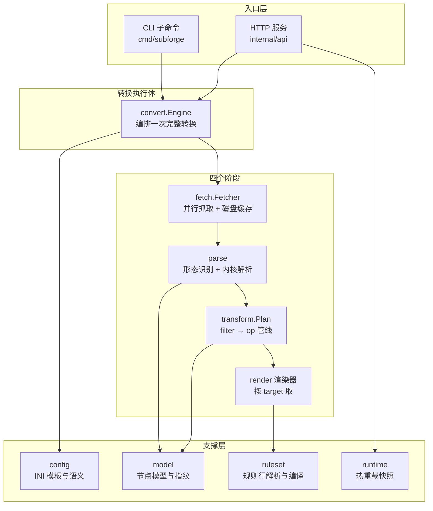
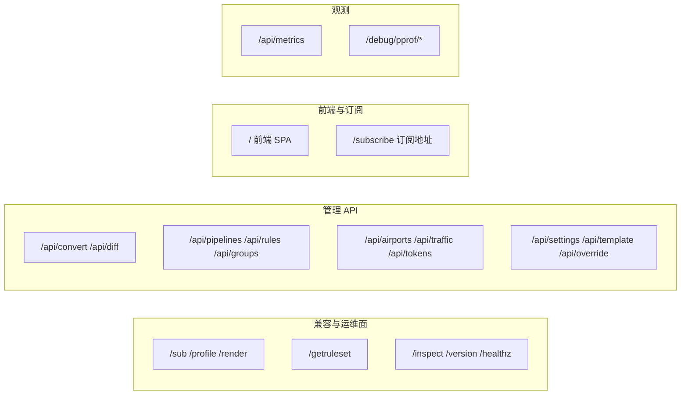
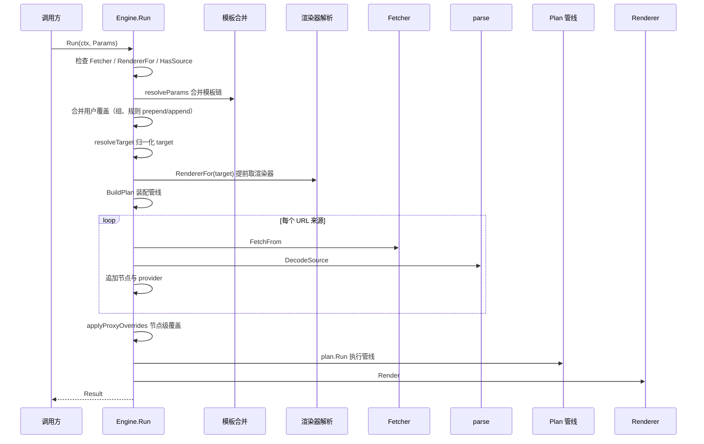
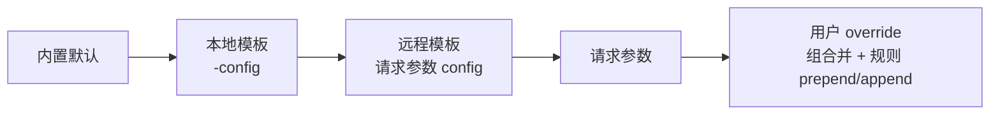
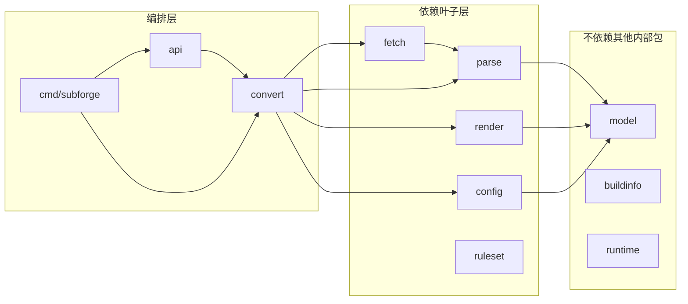

# 系统架构总览

> 本文说明 SubForge 由哪些部分组成、它们如何协作、数据沿哪条路径流动，以及每条关键设计取舍的理由。阅读完本文应能回答："我要改一个行为，应该动哪个包？"
>
> 事实来源：`cmd/subforge/`（入口）、`internal/convert/engine.go`（转换执行体）、`internal/fetch/`（抓取）、`internal/parse/`（解析）、`internal/transform/`（变换）、`internal/render/`（渲染）、`internal/api/`（HTTP 面）、`go.mod`。

---

## 1. 一句话架构

**Go 单二进制 + 嵌入 mihomo 解析库**：协议解析这类"内核擅长的事"全部复用上游，自研代码只做编排层——抓取、合并、变换、渲染、运维面（`docs/design/subforge-design.md:14`、`:258`）。



---

## 2. 入口层

### 2.1 CLI 子命令

命令行入口按子命令分派（`cmd/subforge/main.go:40-67`）：

| 子命令 | 作用 | 源码 |
| --- | --- | --- |
| `version` | 输出版本信息 | `cmd/subforge/main.go:74-81` |
| `doctor` | 环境与运行时自检 | `cmd/subforge/doctor.go` |
| `convert` | 本地把订阅转换成客户端配置 | `cmd/subforge/convert.go` |
| `diff` | 预览覆盖层对模板默认值的改动 | `cmd/subforge/diff.go` |
| `manifest` | 规则工厂 manifest 聚合 | `cmd/subforge/manifest.go` |
| `mrs` | MRS 离线生成 | `cmd/subforge/mrs.go` |
| `subscheck` | 订阅测活（默认关闭，需显式开启） | `cmd/subforge/subscheck.go` |
| `scheduler` | 定时任务与告警 | `cmd/subforge/scheduler.go` |
| `rulebot` | 规则反馈闭环分析 | `cmd/subforge/rulebot.go` |
| `serve` | 启动 HTTP 服务 | `cmd/subforge/serve.go` |

命令写错时打印用法并以退出码 2 结束（`cmd/subforge/main.go:64-67`）；命令执行返回错误时打印 `subforge: <err>` 并以退出码 1 结束（`cmd/subforge/main.go:68-71`）。

**`serve` 的关键默认值**（`cmd/subforge/serve.go:100-108`）：

| 参数 | 默认值 | 说明 |
| --- | --- | --- |
| `-listen` | `127.0.0.1:25500` | 监听地址 |
| `-token` | 空 | 访问令牌，空表示不鉴权 |
| `-cache-dir` | 空 | 上游内容磁盘缓存目录，**默认不缓存** |
| `-data-dir` | 空 | 订阅管理数据目录（SQLite），**默认不启用** |
| `-name` | 空 | 写入产物注释头的配置名 |
| `-config` | 空 | INI 配置文件，改动后自动热重载 |
| `-mixed-port` | `config.DefaultMixedPort` | clash.meta 输出的 mixed-port |
| `-timeout` | `30` | 上游请求与单请求超时秒数 |
| `-shutdown` | `10` | 收到停止信号后的优雅关闭秒数 |

### 2.2 HTTP 面

HTTP 路由按用途分成四组（`internal/api/server.go:119-279`）：



三个转换入口 `/sub`、`/profile`、`/render` 共用同一个处理器（`internal/api/server.go:140-142`），因此它们的参数语义与响应头完全一致。

---

## 3. 转换执行体：Engine

`convert.Engine` 是"拉取 → 解析 → 管线 → 渲染"的执行体，CLI 与 HTTP 共用它，两边都只负责提供参数，避免各写一遍流程（`internal/convert/engine.go:1-3`）。

### 3.1 Engine 的依赖全部注入

```go
// internal/convert/engine.go:31-49（节选）
type Engine struct {
	Fetcher     *fetch.Fetcher
	RendererFor func(target string) (render.Renderer, error)
	Profile     render.Profile
	Now         func() time.Time
	BaseTemplate func() *config.Template
	LoadTemplate func(ctx context.Context, ref string) (*config.Template, error)
	RulesetLoader config.RemoteLoader
}
```

**为什么用注入而不是写死**：`RendererFor` 注入便于替换与测试（`internal/convert/engine.go:34`）；`BaseTemplate` 用函数而不是值，是因为配置文件热重载会替换它，而 `Engine` 在请求之间是共享的（`internal/convert/engine.go:40-42`）。

### 3.2 Run 的执行顺序



**关键顺序约束（三处，都有明确理由）**：

1. **渲染器提前解析**（`internal/convert/engine.go:105-111`）：target 完全由调用方控制，提前查一次能在浪费任何一次上游拉取之前就报"格式没实现"。若放在管线末尾，一个 target 写错的请求会白跑一整轮拉取，然后把本该是 501 的错误报成 502。
2. **target 归一化早于编管线**（`internal/convert/engine.go:102-103`）：分享链接形态的协议收窄要落成类型过滤，节点数统计才能与产物一致。
3. **节点级覆盖早于管线**（`internal/convert/engine.go:178-182`）：去重按指纹、排序键也可能用 `server`，都该看到覆盖后的值。

### 3.3 Result：一次转换的产物

| 字段 | 含义 | 对应响应头 |
| --- | --- | --- |
| `Body` | 渲染结果字节 | 响应体 |
| `Format` | 渲染器名 | `X-Convert-Format` |
| `Nodes` | 管线后的节点数 | `X-Node-Count` |
| `RawNodes` | 拉取解析到的节点总数（管线前） | — |
| `Failures` | 失败来源的原因 | `X-Convert-Warning` |
| `Warnings` | 渲染阶段跳过或降级的项 | `X-Convert-Skipped` |
| `Cached` | 每个来源是否命中磁盘缓存 | `X-Convert-Cache` |
| `Groups` | 生效的代理组数 | — |
| `Rules` | 生效的规则行数 | — |

（字段定义见 `internal/convert/engine.go:51-73`；响应头写入见 `internal/api/handlers.go:73-89`。）

**为什么 Failures 与 Warnings 分开**：前者是"来源失败"，后者是"不影响产物正确性但静默丢弃没人会发现"的项（`internal/convert/engine.go:61-65`）。两者在响应头里也是两个不同的头。

### 3.4 部分失败的处理语义

- 单个 URL 来源失败：记入 `Failures` 并**继续处理其余来源**（`internal/convert/engine.go:142-145`）。
- 全部来源失败：返回错误 `所有来源都失败:\n  <每条原因>`（`internal/convert/engine.go:170-174`）。
- 来源可用但管线后为空：返回 `ErrNoNodes`，提示检查来源内容或放宽筛选条件（`internal/convert/engine.go:27-28`、`188-190`）。
- 没有任何来源：返回 `ErrNoSource`（`internal/convert/engine.go:24-25`）。

---

## 4. 四个阶段

### 4.1 抓取：fetch.Fetcher

**是什么**：并行拉取多个上游订阅，带磁盘缓存、条件请求、重试与体积上限。

**默认行为参数**（`internal/fetch/config.go:24-33`）：

| 参数 | 默认值 | 说明 |
| --- | --- | --- |
| `UserAgent` | `SubForge/0.1 (+https://github.com/tktogether/subforge)` | 请求 UA |
| `Timeout` | 30s | 单次请求上限（含重定向） |
| `Parallel` | 8 | 并发上限 |
| `Retries` | 2 | 失败重试次数（不含首次尝试） |
| `Backoff` | 250ms | 首次重试间隔，随后指数退避并加抖动 |
| `MaxBody` | 64 MiB | 单源响应体积上限 |
| `Redirects` | 5 | 最大重定向次数 |

**缓存机制**：缓存目录由 `serve -cache-dir` 指定，**默认不缓存**（`cmd/subforge/serve.go:102`）。命中缓存时的行为：

- 发请求前带上 `If-None-Match`（ETag）与 `If-Modified-Since`（`internal/fetch/fetcher.go:196-211`）。
- 上游返回 304 时读本地缓存原文并标记 `FromCache=true`（`internal/fetch/fetcher.go:222-230`）。
- **缓存自愈**：若返回 304 但本地原文缺失或损坏，清掉条件标识并报错，下一次重试不再带条件（`internal/fetch/fetcher.go:224-228`）。
- 缓存写入失败不阻断本次结果（`internal/fetch/fetcher.go:253-256`）。

**重试策略**：

- `404` / `410` / `401` / `403` 被判为不可重试的永久错误（`internal/fetch/fetcher.go:231-237`、`53-56`）。
- 退避采用指数增长并封顶 8 秒，再追加最多 25% 抖动以打散多实例的惊群（`internal/fetch/fetcher.go:298-313`）。

**注意**：不设置 `Accept-Encoding`，由 `http.Client` 透明解压 gzip，拿到的始终是解码后的原文（`internal/fetch/fetcher.go:241`）。

### 4.2 解析：parse

**是什么**：把订阅原文（明文链接 / 整体 Base64 / Clash YAML）解析成原始配置 map 列表。详见 [订阅解析与协议支持](订阅解析与协议支持)。

**架构约束**：`parse` 是**唯一** import mihomo 内核的包（`internal/parse/parse.go:1`）。其余包一律不 import 内核，只依赖 map 与自有模型。这条约束的价值是把"上游内部 API 不稳定"的风险收敛到一个包里（`docs/design/subforge-design.md:282`）。

### 4.3 变换：transform.Plan

**是什么**：对节点列表执行 filter → op 管线。详见 [转换流水线原理](转换流水线原理)。

### 4.4 渲染：render

**是什么**：按 target 取渲染器，产出客户端配置文本。详见 [渲染器与输出格式](渲染器与输出格式)。

---

## 5. 支撑层

### 5.1 config：INI 模板与语义

**是什么**：解释 subconverter 风格的 INI 模板，产出结构化语义（`Semantics`）。模板可以声明代理组、规则、`[node_pref]`、`[rename]`、`[emoji]`、`[pipeline:<名>]` 等段落（`internal/config/template.go:167-190`）。

**覆盖优先级链**（`internal/convert/engine.go:87-101`）：



**注意**：`[node_pref]` 段落当前只解释**唯一的那一块**（`internal/config/template.go:337`）；`[common]` 里的 `local` / `remote` / `emoji_type` / `node_order` 等控制键会被拦下，不原样透传成转换参数（`internal/config/template.go:334-347`）。

### 5.2 model：节点模型

**是什么**：定义 `Node`（含原始 map 与四个只读派生字段）、`NodeList`、`Provider`、`RuleProvider`，并提供去重指纹与筛选原语（`internal/model/model.go:19-169`）。

**核心约定**：节点的唯一事实源是原始 Clash 配置 map，`Name` / `Type` / `Server` / `Port` 只是只读派生视图，改配置必须改 `Raw` 再重新派生（`internal/model/model.go:1-7`）。

### 5.3 runtime：配置热重载

**是什么**：并发安全的不可变值快照 + 文件轮询监听。

```go
// internal/runtime/hotreload.go:18-20
type Snapshot[T any] struct {
	val atomic.Pointer[T]
}
```

**为什么用双缓冲**：后台线程解析新配置、整体校验通过后一次性替换指针，前台请求始终拿到一份完整的旧值或新值，不会读到改了一半的配置（`internal/runtime/hotreload.go:16-17`）。

**为什么不用 fsnotify**：Windows 上需要额外依赖，而配置文件很小，轮询开销可以忽略（`internal/runtime/hotreload.go:49-51`）。

**写入中途的防护**：写入方不是原子写（`os.WriteFile` 是 truncate + write），中途读会拿到改到一半的内容；因此变化要在**连续两轮**都读到相同摘要才交付，代价是一个轮询间隔的延迟（`internal/runtime/hotreload.go:53-55`）。`serve` 侧的轮询间隔是 1 秒（`cmd/subforge/serve.go:313`）。

### 5.4 ruleset：规则行解析

**是什么**：解析 Clash 风格规则行（`DOMAIN-SUFFIX,example.com,PROXY`），供渲染器映射到各目标格式。详见 [渲染器与输出格式](渲染器与输出格式)。

---

## 6. 管理面与扩展能力

这些包已实现并通过测试，但**不在转换主链路上**，需要显式启用或调用：

| 包 | 职责 | 接入方式 |
| --- | --- | --- |
| `internal/subforge` | 订阅管理（机场、分组、规则、令牌、脚本的持久化管理器） | `serve -data-dir` 启用 |
| `internal/store` | SQLite 持久化 | 由 `internal/subforge` 使用 |
| `internal/scheduler` | 定时任务与告警推送 | `scheduler` 子命令、`/api/tasks`、`/api/alert-channels` |
| `internal/subscheck` | 订阅测活（默认关闭） | `subscheck` 子命令、`/api/airports/check` |
| `internal/rulebot` | 规则反馈闭环：分析未匹配域名并给出建议 | `rulebot` 子命令、`/api/suggestions` |
| `internal/traffic` | 订阅用量解析与预测 | `/api/traffic/*` |
| `internal/manifest` | 规则工厂 manifest 聚合与回滚 | `manifest` 子命令 |
| `internal/mrs` | MRS 离线生成 | `mrs` 子命令 |

**未接入的功能（如实标注）**：

- `internal/mcp` 包已实现 MCP 相关代码，但**当前没有任何入口引用它**——全仓库检索 `internal/mcp` 的 import 结果为空，CLI 子命令表中也没有对应命令。因此 MCP 能力目前无法从 CLI 或 HTTP 使用。

---

## 7. 依赖方向与工程约束



**三条硬约束**：

1. **只有 `parse` 能 import mihomo 内核**（`internal/parse/parse.go:1-8`）。内核 outbound 适配器没有 `Marshal` 方法，无法从适配器还原配置，因此渲染一律走原始 map 往返（`docs/adr/0001`）。
2. **渲染阶段只读节点**：渲染器接收 `render.Request`，不修改节点内容。
3. **节点事实源是原始 map**：任何改名、改 server/port 都必须写回 `Raw` 再重新派生视图（`internal/model/model.go:1-7`、`internal/transform/transform.go:4-8`）。

**技术栈与版本**（`go.mod:1-12`）：Go 1.26.0；直接依赖 `goja`（JS 沙箱）、`chi/v5`（路由）、`klauspost/compress`、`metacubex/mihomo v1.19.31`（协议解析内核）、`robfig/cron/v3`（定时）、`golang.org/x/crypto`、`gopkg.in/yaml.v3`。

---

## 8. 部署形态与观测面

SubForge **永远不在数据面上**——转换器碰流量会同时带来延迟与隐私问题，这是刻意的设计（`docs/design/subforge-design.md:262`）。因此它对"用户实际访问了什么"没有天然视角，唯一的合法观测通道是 mihomo 的 external controller（`/connections`、`/logs`）。

| 拓扑 | 形态 | 反馈类功能可用性 |
| --- | --- | --- |
| T1 同机/同网（推荐主路径） | SubForge 与 mihomo 同设备或同 LAN | 全功能；域名数据不出内网 |
| T2 远程后端 | SubForge 在公网 VPS，客户端在家庭出口，经 Beacon 上报 | 全功能；默认仅上报规则命中计数与 eTLD+1 聚类 |
| T3 无观测 | 无观测点 | 命中率回流与未匹配闭环自动禁用（UI 明示）；转换主功能不受影响 |

（拓扑表来自 `docs/design/subforge-design.md:264-268`。）

**视角偏差注记**：测活/测速从 SubForge 主机视角发起，T2 部署下延迟数值不等于用户侧体感，只能作相对比较（`docs/design/subforge-design.md:271`）。

---

## 9. 常见问题

| 问题 | 答案 |
| --- | --- |
| 想加一种新的输出格式，改哪里？ | `internal/render/` 下新增渲染器，并在 `internal/render/registry/registry.go` 注册 |
| 想改节点筛选或改名逻辑，改哪里？ | `internal/transform/`；改完记得跑该包的测试 |
| 想支持一种新协议，改哪里？ | 先看 `internal/parse/` 用的内核版本是否支持；渲染侧要逐目标格式补映射 |
| 想改 INI 模板的解析行为，改哪里？ | `internal/config/template.go` 与 `internal/config/pipeline.go` |
| 配置改了要重启吗？ | 用 `serve -config` 指定配置文件时不需要，1 秒轮询自动热重载 |
| 为什么抓取默认不缓存？ | `-cache-dir` 默认为空，属保守默认；显式指定目录后启用 ETag/Last-Modified 条件请求 |
| 上游一个订阅挂了会不会整个失败？ | 不会。单源失败记入 `Failures` 并继续；只有全部来源失败才报错 |

---

## 10. 相关页面

- [项目简介与设计目标](项目简介与设计目标)：SubForge 的定位、目标与边界
- [转换流水线原理](转换流水线原理)：变换阶段的每个机制
- [订阅解析与协议支持](订阅解析与协议支持)：解析阶段与支持的协议
- [渲染器与输出格式](渲染器与输出格式)：渲染阶段与各目标格式
