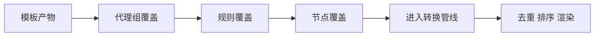
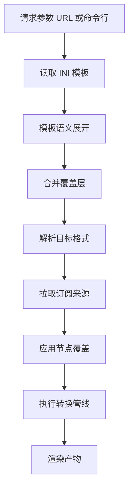

# 覆盖层 Override 详解

覆盖层（Override）是 SubForge 中用于表达"个体差异"的配置层：模板负责"所有人都一样的部分"，
覆盖层负责"只有这一次、只有这一个使用者不一样的部分"。它可以在不修改模板、不重写整份
INI 的前提下，为某次转换追加规则、调整代理组、替换节点地址。本篇说明覆盖层的两种写法、
三类能力、生效时机，以及如何用 `subforge diff` 在真正转换之前预览改动。

---

## 一、覆盖层要解决的问题

### 1.1 是什么

覆盖层是一份**独立的配置文件**，通过 `-override` 参数传给 SubForge 的 `convert` 与
`diff` 子命令，在模板语义之后、转换管线之前与模板结果合并
（`internal/convert/engine.go:87-116`）。

覆盖层的合并语义只有两条（`internal/config/override.go:15-23`）：

- **数组追加**：代理组成员、规则条目按顺序追加，同名项去重。
- **标量替换**：代理组类型、测活地址、节点 `server` / `port` 等单值字段直接替换。

### 1.2 为什么

模板是共享资产：一份 `[clash_proxy_group]` 可能同时服务几十个使用者。若把个人偏好直接
写进模板，模板会迅速膨胀成"每个人一套分支"，任何一次模板更新都要重新协调所有人。

覆盖层把差异从模板中剥离出来，带来三个直接收益：

1. **模板保持稳定**：模板只表达共性，升级模板不会覆盖个人改动。
2. **差异可版本化**：覆盖层是一份小文件，可以单独提交、单独评审。
3. **改动可预览**：`subforge diff` 能在转换之前列出覆盖层究竟改了什么。

### 1.3 怎么用

最小用法是两条命令：先 `diff` 预览，确认无误后再 `convert` 正式转换。

```bash
subforge diff -config base.ini -override local.yaml
subforge convert -file testdata/fixtures/mixed-subscription.txt -config base.ini -override local.yaml -out cfg.yaml
```

### 1.4 注意什么

- `-override` 在 `convert` 与 `diff` 两个子命令上都可用；`serve` 没有这个参数，
  服务端的覆盖层文件由控制台的 `/api/override` 接口读写
  （`internal/api/override_api.go:18`）。
- 覆盖层**不能**新增订阅来源、不能改目标格式，这两件事属于请求参数层。
- 覆盖层里的节点名是**正则表达式**，不是字面量。写 `^HK` 匹配"以 HK 开头"，
  写 `HK` 匹配"包含 HK"。

---

## 二、两种写法

覆盖层支持 YAML 与 INI 两种格式，由文件扩展名决定解析路径：扩展名为 `.ini` 时走
INI 解析，其余扩展名走 YAML 解析（`internal/config/override.go:80-91`）。

### 2.1 YAML 写法

YAML 是覆盖面最完整的写法，支持三个顶层键：

| 顶层键 | 类型 | 默认值 | 说明 |
| --- | --- | --- | --- |
| `groups` | 列表 | 空 | 代理组覆盖项 |
| `rules` | 映射 | 空 | 规则覆盖项，含 `prepend` 与 `append` |
| `proxies` | 列表 | 空 | 节点覆盖项，按名称正则匹配 |

```yaml
groups:
  - name: 自动测速
    type: url-test
    strategy: global
    test: https://www.gstatic.com/generate_204
    lazy: true
    proxies:
      - 手动选择
    use:
      - provider-a
rules:
  prepend:
    - DOMAIN-SUFFIX,openai.com,手动选择
  append:
    - MATCH,自动测速
proxies:
  - name: ^ss-node
    server: ss2.example.com
    port: "8443"
```

### 2.2 INI 写法

INI 写法适合与 INI 模板放在同一套配置仓库里，段落与字段如下
（`internal/config/override.go:107-118`）：

| 段落 | 可用键 | 说明 |
| --- | --- | --- |
| `[override.rules]` | `prepend`、`append` | 只认这两个键，其他键报错 |
| `[override.group:<名>]` | `type`、`strategy`、`test`、`lazy`、`proxy`、`use` | `<名>` 是组名；`proxy` 与 `use` 可重复出现 |
| `[override.proxy:<名>]` | `server`、`port` | `<名>` 是节点名正则；只认这两个键 |

```ini
[override.rules]
prepend = DOMAIN-SUFFIX,openai.com,手动选择
append = MATCH,自动测速

[override.group:自动测速]
strategy = global
proxy = 手动选择
lazy = true

[override.proxy:^ss-node]
server = ss2.example.com
port = 8443
```

### 2.3 两种写法的差异

| 对比项 | YAML | INI |
| --- | --- | --- |
| 扩展名判定 | 除 `.ini` 之外的所有扩展名 | 必须为 `.ini` |
| 重复组 / 重复节点 | 解析期报错 | 同名段落在 INI 层合并，标量后者覆盖前者 |
| 字段覆盖范围 | 与 INI 相同 | 与 YAML 相同 |
| 适合场景 | 结构化改动较多、需要嵌套 | 与 INI 模板同仓维护 |

**注意什么**：INI 写法下同名段落会被合并而不是报错，因此"写了两个
`[override.group:自动测速]`"不会得到提示，最终只有后一个的标量值生效。需要严格校验时
使用 YAML 写法。

---

## 三、三类能力

覆盖层的三类能力相互独立，可以只用其中一类。



### 3.1 代理组合并

**是什么**：按组名匹配模板中已有的代理组，合并字段；组名不存在时直接新增一个组。

**为什么**：模板给出的组通常只有骨架（例如一个 `select` 组），而实际使用需要调整
测活策略、追加成员、或引用外部 provider。

**怎么用**：`groups` 列表里每一项的 `name` 必须与目标组同名。

**注意什么**：数组合并是**追加去重**，不是替换。若想移除模板中已有的成员，覆盖层做不到，
需要在模板里调整（`internal/config/override.go:236-275`）。

### 3.2 规则 prepend / append

**是什么**：`prepend` 的规则插到规则流最前，`append` 的规则追加到最后，模板自身的规则
保持在中间（`internal/config/override.go:278-284`）。

**为什么**：规则匹配是"先命中先生效"。要让个人规则优先于模板规则，就必须 prepend；
要提供兜底规则（例如 `MATCH`），就必须 append。

**怎么用**：

```yaml
rules:
  prepend:
    - DOMAIN-SUFFIX,openai.com,手动选择
  append:
    - MATCH,自动测速
```

**注意什么**：`MATCH` 必须放在 `append` 里。若把 `MATCH` 写进 `prepend`，它之后的规则
永远不会被命中。

### 3.3 节点 server / port 替换

**是什么**：按节点名正则匹配节点，替换其 `server` 与 `port`。

**为什么**：机场给出的域名可能被污染、被限速，或者自建节点换了地址但节点名保持不变。
替换地址比重命名节点更省事，也不会影响引用节点名的规则与代理组。

**怎么用**：

```yaml
proxies:
  - name: ^ss-node
    server: ss2.example.com
    port: "8443"
```

**注意什么**：`port` 建议写成带引号的字符串。YAML 里不加引号的数字也是合法值，但产物中
端口统一以字符串渲染，加引号可以避免阅读时的歧义。

**关键限制**：节点覆盖发生在**管线之前**，此时 `[node_pref]` 的前缀与 `[rename]` 的改名
都还没有应用（`internal/convert/engine.go:178-182`）。因此正则必须匹配**原始节点名**：

```text
override.proxy "^🇭🇰" 未匹配到任何节点
```

上例失败的原因是节点名此时还是 `ss-node`，`🇭🇰` 前缀尚未添加。改成 `^ss-node` 即可匹配。

---

## 四、生效时机

### 4.1 在转换链路中的位置

覆盖层位于"模板语义之后、管线之前"。理解这个位置可以解释两个容易困惑的现象：
去重与排序看到的是覆盖后的最终值；节点级覆盖看不到模板加的前缀。



### 4.2 与模板、参数的优先级

从高到低：请求参数（URL / 命令行）> 覆盖层 > INI 模板 > 内置默认值。

这条链的含义是：覆盖层能改写模板的默认值，但**改不动请求参数**。如果 URL 里显式传了
`include=HK`，覆盖层无法把它改成别的值。

### 4.3 为什么去重看到的是覆盖后的值

去重按"协议类型 + server + port + 凭据"的身份指纹判定
（`internal/transform/op.go:12`）。若两个节点在覆盖层里被改成相同的 server 与 port，
它们在管线中去重时会合并为一条。这是覆盖层的正常后果，不是缺陷。

---

## 五、用 diff 预览改动

### 5.1 是什么

`subforge diff` 在不拉取订阅、不渲染产物的前提下，只比较"模板 + 覆盖层"的合并结果，
把改动打印成人类可读的清单（`cmd/subforge/diff.go`）。

### 5.2 怎么用

```bash
subforge diff -config base.ini -override local.yaml
```

预期输出：

```text
== 代理组 ==
  [改] 自动测速           strategy "" → "global"; proxies +手动选择
== 规则 ==
  +P DOMAIN-SUFFIX,openai.com,手动选择
  +A MATCH,自动测速
  合并后共 2 条（基础 0 + prepend 1 + append 1）
== 节点 ==
  [改] /^ss-node/ server → ss2.example.com; port → 8443
  [改] /^tuic/ server → tuic2.example.com
```

### 5.3 输出怎么读

| 片段 | 含义 |
| --- | --- |
| `== 代理组 ==` | 代理组差异段 |
| `[改] <组名>` | 模板中已存在的组被修改 |
| `[新] <组名>` | 模板中没有该组，覆盖层新增了一个 |
| `+P <规则>` | prepend 规则，插到规则流最前 |
| `+A <规则>` | append 规则，追加到规则流最后 |
| `合并后共 N 条` | 合并后的规则总条数与来源拆分 |
| `[改] /<正则>/ server → <值>` | 节点地址被替换，方括号内是节点名正则 |
| `（覆盖层未增删规则）` | 该类改动为空 |
| `-v` | 额外显示未改动的代理组 |

### 5.4 未匹配节点的告警

覆盖层里的节点正则若没有命中任何节点，`diff` 会照常输出，而 `convert` 会打印一条提示：

```text
提示: 跳过/忽略 1 项
  override.proxy "^NOPE" 未匹配到任何节点
```

**注意什么**：这条提示只出现在标准错误里，转换仍会以退出码 0 成功结束。看到"提示:"字样
就应当检查正则，否则会误以为覆盖层已经生效。

---

## 六、完整示例

以下示例全部使用仓库自带的测试订阅
`testdata/fixtures/mixed-subscription.txt`（12 个节点），可直接复现。

`base.ini`：

```ini
[common]
target = clash.meta
sort = name
udp = 1

[node_pref]
ss = [SS] 

[clash_proxy_group]
name = 手动选择
type = select
proxies = .*
---
name = 自动测速
type = url-test
proxies = .*
url = https://www.gstatic.com/generate_204
interval = 300
tolerance = 50
lazy = true

[ruleset]
DIRECT = []GEOIP,CN
FINAL = []FINAL
```

`local.yaml`：

```yaml
groups:
  - name: 自动测速
    strategy: global
    proxies:
      - 手动选择
rules:
  prepend:
    - DOMAIN-SUFFIX,openai.com,手动选择
  append:
    - MATCH,自动测速
proxies:
  - name: ^ss-node
    server: ss2.example.com
    port: "8443"
  - name: ^tuic
    server: tuic2.example.com
```

第一步，预览改动：

```bash
subforge diff -config base.ini -override local.yaml
```

预期输出：

```text
== 代理组 ==
  [改] 自动测速           strategy "" → "global"; proxies +手动选择
== 规则 ==
  +P DOMAIN-SUFFIX,openai.com,手动选择
  +A MATCH,自动测速
  合并后共 2 条（基础 0 + prepend 1 + append 1）
== 节点 ==
  [改] /^ss-node/ server → ss2.example.com; port → 8443
  [改] /^tuic/ server → tuic2.example.com
```

第二步，正式转换：

```bash
subforge convert -file testdata/fixtures/mixed-subscription.txt -config base.ini -override local.yaml -out cfg.yaml
```

预期输出（标准错误）：

```text
覆盖层: /path/to/local.yaml（1 组 / 2 规则项 / 2 节点项）
配置模板: /path/to/base.ini
管线: 12 -> 12 节点
已写入 cfg.yaml
完成: clash.meta, 4618 字节, 12 节点, 6ms
```

第三步，核对产物。节点地址已被替换：

```yaml
    server: ss2.example.com
    port: "8443"
```

```yaml
    server: tuic2.example.com
    port: "443"
```

代理组带上了覆盖层的策略值，成员列表尾部追加了 `手动选择`：

```yaml
    lazy: true
    strategy: global
    proxies:
      - '[SS] ss-node'
      - '[VM] vmess-node'
      - anytls-node
      - http-node
      - hy1-node
      - hy2-node
      - socks-node
      - ssr-node
      - trojan-node
      - tuic-node
      - vless-reality
      - vless-ws
      - 手动选择
```

规则流的最前与最后分别是 prepend 与 append 的条目：

```yaml
rules:
  - DOMAIN-SUFFIX,openai.com,手动选择
  - MATCH,自动测速
```

---

## 七、在服务端使用覆盖层

`subforge serve` 没有 `-override` 参数。服务端改为把覆盖层文件当作一份**可编辑的资源**，
通过控制台的 `/api/override` 接口读写（`internal/api/override_api.go:18-72`）。

| 方法 | 路径 | 说明 |
| --- | --- | --- |
| `GET` | `/api/override` | 返回 `{"path": "...", "content": "..."}`；路径未配置时返回 404 |
| `PUT` | `/api/override` | 请求体为 `{"content": "..."}`，写入前按扩展名做语法校验 |

```bash
curl -X PUT http://127.0.0.1:25500/api/override \
  -H "Authorization: Bearer <YOUR_TOKEN>" \
  -H "Content-Type: application/json" \
  -d '{"content":"rules:\n  append:\n    - MATCH,自动测速\n"}'
```

预期响应：

```json
{"ok": true}
```

三条必须注意的约束：

1. **需要启用订阅管理**。`/api/override` 依赖 `-data-dir` 指定的 SQLite 数据库来保存
   覆盖层文件路径（`internal/api/override_api.go:74-81`）。未指定 `-data-dir` 时该接口
   返回 503。
2. **路径必须先配置**。覆盖层文件路径存放在设置项 `override.path` 中；未配置时
   `GET` 返回 404、`PUT` 返回 400，错误文本均为 `override 路径未配置`。
3. **写入前会做语法校验**。`PUT` 按扩展名走 `ParseOverrideINI` 或 `ParseOverrideYAML`，
   语法错误返回 400，错误文本形如 `override 语法错误: ...`，文件不会被写入。

---

## 八、常见问题

### 7.1 覆盖层完全没有生效
按顺序排查：

1. 参数名是否正确。子命令上必须写 `-override`，且只能用于 `convert` 与 `diff`。
2. 文件是否被解析。`convert` 的启动日志会打印覆盖层统计，形如
   `覆盖层: local.yaml（1 组 / 2 规则项 / 2 节点项）`。统计全为 0 说明文件内容没有被
   识别，检查段落名或顶层键拼写。
3. 节点正则是匹配原始节点名。模板加的前缀此时尚未生效。

### 7.2 报"未知键"或"未知段落"

INI 覆盖层的段落与键是白名单制，未列出的键会直接报错并终止：

```text
subforge: [override.rules] 未知键 "nope"（只认 prepend/append）
```

```text
subforge: 未知段落 [override.groups]（override 只认 [override.rules] / [override.group:<名>] / [override.proxy:<名>]）
```

段落名是**单数** `[override.group:<名>]` 与 `[override.proxy:<名>]`，写成复数会被判为
未知段落。

### 7.3 报"名称正则非法"

节点名的 `name` 会被当作正则编译，语法错误在解析期就报错
（`internal/config/override.go:51-77`）：

```text
subforge: override.proxy 名称正则 "([" 非法: error parsing regexp: missing closing ]: `[`
```

**注意什么**：正则里的 `.` 是通配符，`^HK` 是锚点。写节点名时若不希望被当作正则解释，
需要转义，例如 `^ss-node\.example\.com$`。

### 7.4 代理组的改动没出现在产物里

`diff` 显示改了，但产物里看不到，通常有三种原因：

1. 组的成员正则没有命中任何节点，组被兜底为 `DIRECT`。
2. 组名与 `[custom]` 的内联组重名，后者整体覆盖了前者。
3. 产物渲染器不支持该组字段，例如某些目标格式不表达 `strategy`。

---

## 相关页面

- [INI 模板配置详解](INI-模板配置详解)
- [快速上手教程](快速上手教程)
- [故障排查与常见问题](故障排查与常见问题)
