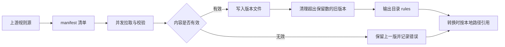
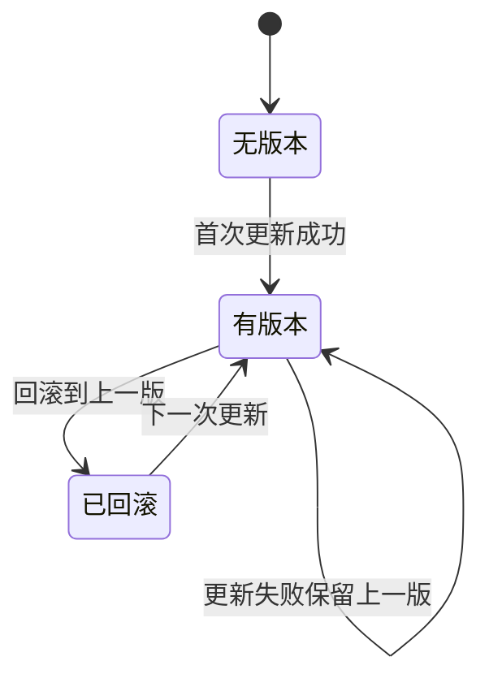
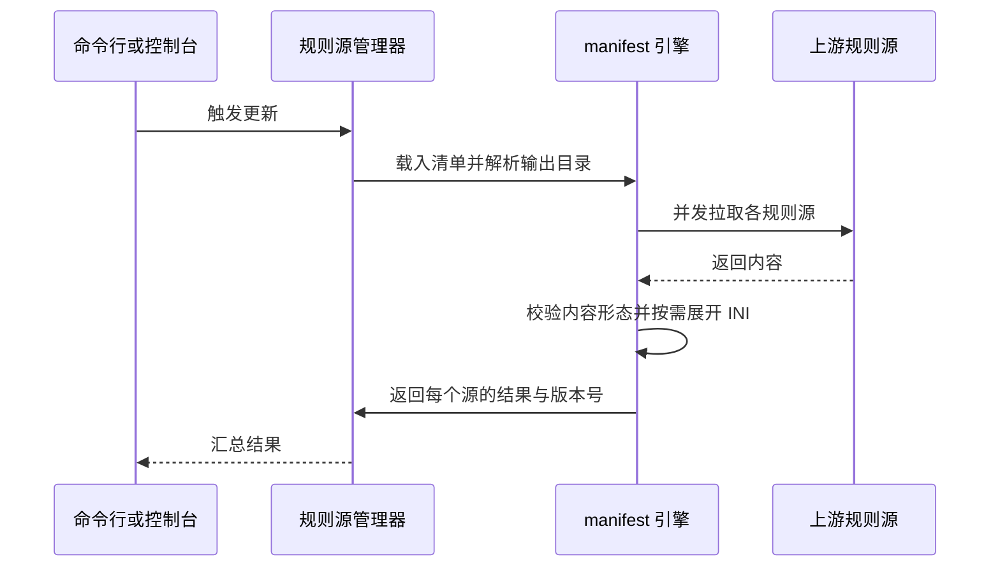

# 规则工厂与规则源

> **规则工厂**是 SubForge 对"多份上游规则集的聚合与版本化管理"的实现：它按一份清单文件并发拉取多个规则源，把结果按时间戳落盘成版本文件，失败时保留上一版，并支持回滚。
> 本文说明清单文件的字段与默认值、版本文件的命名与保留策略、命令行与控制台两条操作路径，以及规则源与转换链路的衔接方式。
> 事实来源：`internal/manifest/manifest.go`、`internal/manifest/save.go`、`internal/subforge/rulesources.go`、`internal/subforge/rulesources_write.go`、`internal/api/rule_sources.go`、`internal/scheduler/jobs.go`、`cmd/subforge/manifest.go`。

---

## 1. 什么是规则工厂

第三方规则集（域名清单、IP 网段清单、GeoSite 数据集）更新频繁，直接把上游地址写进配置会带来两个问题：上游临时不可用时转换会失败，上游内容被改动时无法追溯改了什么。规则工厂把"引用一个地址"变成"维护一份本地版本快照"：清单描述有哪些源，每次更新生成一个新版本文件，旧版本按数量保留，出问题时可以回滚到上一版。

包注释对这一职责的描述是"多上游规则集定时拉取 + 版本管理 + 回滚容错"（`internal/manifest/manifest.go:1-3`）。



**三个术语的区别**：

| 术语 | 含义 | 在本页中的角色 |
| --- | --- | --- |
| 规则源 | 一个上游地址，对应清单里的一条 `sources` 记录 | 被拉取的对象 |
| 规则集 | 一份具体的规则文件内容，可能来自规则源，也可能来自模板内置引用 | 被转换消费的内容 |
| 规则工厂 | 管理全部规则源与版本的机制，含清单、拉取、落盘、回滚 | 本页的主体 |

**状态说明**：规则工厂本身已实现且可从命令行与控制台两条路径使用；定时更新任务已实现并注册，但**只在显式配置了清单路径时才会执行**，详见第 4 节。

---

## 2. 规则源清单

清单是一份 YAML 文件，顶层只有两个键：`sources` 与 `output`（`internal/manifest/manifest.go:25-43`）。

```yaml
sources:
  - name: reject
    url: https://raw.githubusercontent.com/MetaCubeX/meta-rules-dat/meta/geo/geoip/reject.yaml
    format: clash-meta
  - name: private
    url: https://raw.githubusercontent.com/MetaCubeX/meta-rules-dat/meta/geo/geoip/private.yaml
    format: clash-meta
output:
  format: clash-meta
  path: ./rules
```

上面这份内容与内置的默认清单模板逐字一致（`internal/subforge/rulesources.go:107-120`，模板头部还有两行说明注释，此处从略）。

### 2.1 字段与默认值

| 字段 | 类型 | 默认值 | 说明 |
| --- | --- | --- | --- |
| `sources[].name` | 字符串 | URL 末段 | 规则源名称，同时决定版本文件名前缀 |
| `sources[].url` | 字符串 | — | 必填，缺失时报 `source #N 缺少 url` |
| `sources[].type` | 字符串 | `clash` | 目前只在缺省时补默认值，不参与其它逻辑 |
| `sources[].update_interval` | 字符串 | — | 解析层保留，当前不参与更新调度 |
| `sources[].input_format` | 字符串 | 空（等价 `auto`） | `ini` 表示按 INI 规则源展开；`auto` 时嗅探内容 |
| `output.format` | 字符串 | `clash-meta` | 决定版本文件的扩展名，见 3.1 节 |
| `output.path` | 字符串 | `./rules` | 版本文件输出目录，相对清单文件自身所在目录解析 |

默认值由 `applyDefaults` 统一补齐（`internal/manifest/manifest.go:89-105`）。

### 2.2 三个容易踩到的点

1. **`output.path` 是相对清单文件解析的，不是相对进程工作目录。** 载入清单后，相对路径会被拼成绝对路径，这样"更新时写入"与"控制台读取"才会落在同一个目录（`internal/manifest/manifest.go:59-64`）。
2. **每个 source 下的 `format:` 键当前不生效。** `Source` 结构只定义了 `name`、`url`、`type`、`update_interval`、`input_format` 五个 YAML 键（`internal/manifest/manifest.go:31-37`），YAML 反序列化不会因未知键报错，因此模板里的 `format: clash-meta` 会被静默忽略；真正决定落盘扩展名的是 `output.format`。
3. **`update_interval` 不是"每个源各自的更新周期"。** 定时更新由全局 cron 控制，见 4.3 节。

### 2.3 清单路径的解析顺序

| 场景 | 取值来源 | 源码位置 |
| --- | --- | --- |
| 读取清单 | 配置 `rules.manifest_path` → 默认路径 | `internal/subforge/rulesources.go:75-84` |
| 默认路径 | `<数据根目录>` 下的清单文件 | `internal/subforge/rulesources.go:66-72` |
| 数据根目录 | 数据目录（`-data-dir` 或环境变量 `SUBFORGE_DATA_DIR`），为空时取进程当前目录 | `internal/subforge/rulesources.go:56-61` |
| 输出目录 | 配置 `rules.output_dir` → 清单 `output.path` → `<数据根目录>/rules` | `internal/subforge/rulesources.go:87-104` |

数据根目录为空时回落到进程当前目录（`os.Getwd`）。在 `serve` 里这条回落分支通常走不到：管理器只在提供了数据目录时才创建（`cmd/subforge/serve.go:167`），因此清单与版本文件默认落在数据目录下；只有直接调用管理器（测试或嵌入式用法）才可能出现"数据根目录为空"的情况。

默认清单的完整路径形如：

```text
<数据根目录>/manifest.yaml
```

清单文件名固定，改路径请改目录，或通过配置项 `rules.manifest_path` 指向其他文件（`internal/subforge/rulesources.go:75-84`）。

---

## 3. 版本文件与保留策略

### 3.1 命名与扩展名

每次成功更新都会写一个新文件，文件名形如 `<名称>-<版本号>.<扩展名>`，版本号是 UTC 时间戳，格式为 `20060102-150405`（`internal/manifest/manifest.go:171` 起的更新实现）。扩展名由 `output.format` 推导：

| `output.format` | 扩展名 |
| --- | --- |
| `clash-json`、`sing-box`、`json` | `.json` |
| `mrs` | `.mrs` |
| `text`、`txt`、`plain` | `.txt` |
| 其它（含 `clash-meta`、`yaml`） | `.yaml` |

推导逻辑见 `internal/manifest/manifest.go:115-127`；控制台侧的规则源接口用一份等价复刻的实现（`internal/subforge/rulesources.go:31-43`，注释说明原函数未导出）。

**注意**：版本号精确到秒。同一秒内对同一个源连续触发两次更新会命中同一个文件名，后一次直接覆盖前一次。

### 3.2 版本化与回滚状态



### 3.3 保留数量

默认保留最近 5 个版本（`DefaultRetention = 5`，`internal/manifest/manifest.go:22`）。更新成功后按"文件名前缀 = 名称 + `-`、后缀 = `.扩展名`"筛选出该源的全部版本，按字典序排序后删除超出保留数的旧文件（`internal/manifest/manifest.go:283-309`）。由于版本号是定长 UTC 时间戳，字典序与时间序一致。

命令行的 `-retention` 参数可以覆盖这个数量（`cmd/subforge/manifest.go:34`、`:45`）；控制台侧的全量更新固定使用默认值（`internal/subforge/rulesources.go:213`）。

> **注意参数顺序**：`-retention` 必须写在清单路径**之前**，即 `subforge manifest update -retention 10 <清单路径>`。
> 该子命令用 Go 标准库 `flag` 解析参数（`cmd/subforge/manifest.go:35`），而 `flag` 在遇到第一个非选项参数后即停止解析
> （`cmd/subforge/manifest.go:41` 用 `fs.Arg(0)` 取清单路径）。若写成 `manifest update <清单路径> -retention 10`，
> `-retention` 会被当作多余的位置参数丢弃，保留数静默退回默认值 5，命令不报任何错。
> 该顺序差异已实测：磁盘上存在 4 个版本时，`manifest update <清单> -retention 2` 之后仍有 4 个版本，
> 而 `manifest update -retention 2 <清单>` 之后只剩 2 个。此外 `manifest` 的帮助文本（`cmd/subforge/manifest.go:15`）
> 未列出 `-retention`，需要以 `subforge manifest update -h` 查看。

---

## 4. 更新流程

### 4.1 一次全量更新做了什么



关键参数与行为（`internal/manifest/manifest.go:171-273`）：

| 项目 | 取值 | 说明 |
| --- | --- | --- |
| 并发数 | 4 | 每个 source 一个 goroutine |
| 单次超时 | 60 秒 | 上游响应慢不会拖住整批 |
| 重试次数 | 3 | 瞬时失败自动重试 |
| 输出目录 | `MkdirAll` 0755 | 目录不存在时自动创建 |
| 文件权限 | 0644 | 与清单文件一致 |
| 失败策略 | 单源失败不阻断 | 失败源保留上一版，其余源照常落盘 |
| 整体失败 | 全部源失败才报错 | 错误文案为 `所有 N 个 source 更新失败` |

内容校验有一条专门的约定：**只有真正走 INI 展开的源**才容忍"嗅探失败但原文非空"，其它源拿到 200 加一段 HTML 错误页时照旧报错，防止垃圾内容被当成规则落盘（`internal/manifest/manifest.go:205-211`）。

由此可以推出一个容易踩的边界：**规则源必须写成 INI 规则源，或者写成分享链接 / Clash YAML 形态**。直接指向一份裸域名清单
（例如只含 `DOMAIN-SUFFIX,example.com` 的 `.txt`）时，内容嗅探既不认作分享链接也不认作 Clash YAML
（`internal/parse/parse.go:85-105` 的判定顺序是明文链接 → Clash/YAML → 整体 Base64），
`auto` 又判定它不是 INI，于是整源失败并报 `内容形态无法识别（前 64 字节: ...）`。
遇到这种上游，把 `input_format` 显式写成 `ini` 并给内容补上 `[Rule]` 段即可。

### 4.2 命令行用法

```bash
subforge manifest update ./manifest.yaml
subforge manifest update -retention 10 ./manifest.yaml
subforge manifest versions ./rules reject yaml
subforge manifest rollback ./rules reject yaml
```

第二行的 `-retention` 必须位于清单路径之前，原因见 3.3 节的顺序说明。

| 命令 | 参数 | 输出 |
| --- | --- | --- |
| `manifest update <清单路径>` | `-retention` 保留版本数，默认 5，**须写在路径之前** | 每个源一行 `OK <源> -> <路径> (version <版本号>, fromCache=<布尔>)`；失败写标准错误 `FAIL <源>: <原因>` |
| `manifest versions <dir> <name> <ext>` | 三个位置参数 | 每个版本文件名一行，按时间升序 |
| `manifest rollback <dir> <name> <ext>` | 三个位置参数 | 回滚后的文件路径 |

用法与输出格式见 `cmd/subforge/manifest.go:12-83`。`versions` 与 `rollback` 需要显式给出目录、名称、扩展名三段，扩展名不含点号。

### 4.3 定时更新

`serve` 启动时会注册一个名为 `rule-sources` 的定时任务（`cmd/subforge/serve.go:216-227`），其 cron 表达式从配置键 `rules.update_cron` 读取，默认值为 `0 4 * * *`，即每天 04:00（`internal/scheduler/jobs.go:20-29`）。

**注意**：该任务执行前会读取配置 `rules.manifest_path`，**为空时直接跳过本次更新并打印日志**，这不是失败、不会触发重试与告警（`internal/scheduler/jobs.go:104-115`）。因此只把清单放在默认位置、没有显式配置该键时，定时更新不会运行，需要手动执行 `manifest update` 或在控制台点击更新。任务成功后的日志为 `[scheduler] rule-sources: 更新完成，共 N 个规则源`（`internal/scheduler/jobs.go:120`）。

---

## 5. 回滚

回滚的语义是"把上一个版本重新作为可用版本"，实现上返回倒数第二个版本的文件路径，**不删除当前版本**，以便保留审计线索（`internal/manifest/manifest.go:333-343`）。

| 情况 | 行为 |
| --- | --- |
| 该源版本数 ≥ 2 | 返回倒数第二个版本的完整路径 |
| 该源版本数 < 2 | 报错 `source %q 可回滚版本不足（需要至少 2 个版本）` |
| 名称不在清单中 | 报错 `规则源 <名称> 不存在`（`internal/subforge/rulesources.go:235-237`） |
| 名称存在但版本不足 | 报错并带上名称前缀 `回滚规则源 <名称>: ...`（`internal/subforge/rulesources.go:238-241`） |

回滚只切换"当前应使用的版本"，不会自动修改已经引用旧版本的模板。引用方式见第 7 节。

---

## 6. 控制台与 HTTP API

规则源接口在服务端注册了 8 条路由（`internal/api/server.go:242-249`）。所有接口都要求服务端启用了订阅管理数据目录（`-data-dir` 或 `SUBFORGE_DATA_DIR` 任一提供即可），否则统一返回 503 与 `订阅管理未启用`（`internal/api/subscription.go:41-48`）。

| 方法与路径 | 请求体 | 成功响应 | 主要错误 |
| --- | --- | --- | --- |
| `GET /api/rule-sources` | — | 清单路径、默认路径、输出目录、`exists` 标记、源状态数组、清单模板 | 405 `仅支持 GET`；503 未启用 |
| `POST /api/rule-sources/init` | — | `{"path":"...","created":true}`，支持 `?force=1` 覆盖 | 405；503 |
| `POST /api/rule-sources/update` | — | `{"results":[{source,version,path,from_cache,err}]}` | 405；503 |
| `POST /api/rule-sources/rollback` | `{"name":"reject"}` | `{"path":"..."}` | 400 名称为空；404 名称不存在 |
| `POST /api/rule-sources/mrs` | `{"name":"reject","behavior":"domain","format":"mrs"}` | `{"path":"...","bytes":12345}` | 400 无版本或生成失败；404 名称不存在 |
| `POST /api/rule-sources` | `{"name":"my-rules","url":"https://example.com/rules.ini","input_format":"ini"}` | `{"path":"...","created":true}` | 400 url 为空；404 清单不存在；409 名称已存在 |
| `POST /api/rule-sources/remove` | `{"name":"my-rules"}` | `{"ok":true,"path":"..."}` | 400 删空（`至少保留一个规则源`）；404 名称不存在 |
| `POST /api/rule-sources/update-one` | `{"name":"reject"}` | 与全量更新同构的 `results` | 404 名称不存在 |

处理逻辑见 `internal/api/rule_sources.go:16-334`；状态码与错误串的对应关系直接依据错误文本判定，例如"含 `已存在`"映射为 409、"含 `至少保留`"映射为 400（`internal/api/rule_sources.go:238-245`、`:279-282`）。

### 6.1 一份可复制的调用序列

```bash
curl -s -X POST "http://127.0.0.1:25500/api/rule-sources/init" -H "Authorization: Bearer <YOUR_TOKEN>"

curl -s -X POST "http://127.0.0.1:25500/api/rule-sources" -H "Authorization: Bearer <YOUR_TOKEN>" -H "Content-Type: application/json" -d "{\"name\":\"my-rules\",\"url\":\"https://example.com/rules.ini\",\"input_format\":\"ini\"}"

curl -s -X POST "http://127.0.0.1:25500/api/rule-sources/update-one" -H "Authorization: Bearer <YOUR_TOKEN>" -H "Content-Type: application/json" -d "{\"name\":\"my-rules\"}"

curl -s -X POST "http://127.0.0.1:25500/api/rule-sources/mrs" -H "Authorization: Bearer <YOUR_TOKEN>" -H "Content-Type: application/json" -d "{\"name\":\"my-rules\",\"behavior\":\"domain\",\"format\":\"mrs\"}"
```

`init` 在清单不存在时写入默认模板；`?force=1` 会先备份为 `<路径>.bak` 再覆盖（`internal/subforge/rulesources.go:122-146`）。`mrs` 接口把该源最新版本转成 MRS，`behavior` 缺省为 `domain`、`format` 缺省为 `mrs`，输出文件与源文件同目录同名、扩展名换成 `.mrs`（`internal/api/rule_sources.go:190-210`）。

### 6.2 清单的读写路径不同

新增与删除规则源走的是"读原始文件 → 改 → 写回"的路径：`LoadManifestRaw` 只反序列化，不校验、不补默认值、不改写 `output.path`；写回前先备份为 `<路径>.bak`，再以 0644 权限落盘（`internal/manifest/save.go:13-42`）。而更新与列表走的是 `LoadManifest`，会做校验、补默认值并把 `output.path` 解析成绝对路径（`internal/manifest/manifest.go:46-66`）。两条路径的差异是刻意的：编辑清单不应把用户写的相对路径改写成绝对路径。

---

## 7. 规则源与转换链路的衔接

规则工厂的产物是本地文件，转换链路按本地路径引用它。在 INI 模板里，`ruleset=` 的取值段写成文件路径即可，展开逻辑会把它当本地文件读取（`internal/convert/remote_rulesets.go:94-118`）：

```ini
[custom]
ruleset=Reject,clash-classic:./rules/reject-20260101-040000.yaml
ruleset=Private,clash-classic:./rules/private-20260101-040000.yaml
```

三点注意：

1. 路径是相对**服务进程的工作目录**解析的，不是相对模板文件，也不是相对清单文件。生产环境建议填写绝对路径。
2. 版本文件名带时间戳，写死在模板里意味着每次更新后都要改模板。若希望模板稳定，可以让转换引用一个固定名称的文件，再由外部流程把最新版本复制或链接到该名称。
3. 输出格式与消费方必须匹配：`clash-classic` 期望 Clash 经典清单，`domain` 期望一行一个域名。类型不一致时展开器仍会按文件实际内容处理并给出告警（`internal/convert/remote_rulesets.go:198-215`）。

---

## 8. 常见问题

| 现象 | 原因 | 处理 |
| --- | --- | --- |
| 控制台接口返回 503 `订阅管理未启用` | 没有提供数据目录（`-data-dir` 与 `SUBFORGE_DATA_DIR` 都为空） | 用其中任一方式指定数据目录后重启服务 |
| `manifest update` 报 `manifest 至少需要一个 source` | 清单里 `sources` 为空 | 补一条 source 或执行 `init` 生成模板 |
| 定时任务从不执行 | 配置键 `rules.manifest_path` 为空 | 显式配置该键，或改用手动更新 |
| 版本文件写到了意料之外的目录 | `output.path` 是相对清单文件解析的相对路径 | 在清单里写绝对路径 |
| 回滚报"版本不足" | 该源只有 1 个版本 | 先成功更新一次再回滚 |
| 报 `内容形态无法识别（前 64 字节: ...）` | 上游是裸域名清单，既不是 INI 规则源也不是分享链接 / Clash YAML | 把 `input_format` 写成 `ini` 并补 `[Rule]` 段，或改用分享链接 / Clash YAML 形态的上游 |
| 版本文件比预期少 | 默认只保留 5 个 | 用 `-retention` 提高保留数量 |
| `-retention` 写了但没生效 | 参数写在了清单路径之后，被 `flag` 当作多余位置参数丢弃 | 改成 `manifest update -retention N <清单>`，见 3.3 节 |
| 控制台更新结果里 `err` 非空但整体 200 | 单源失败不阻断整批 | 按 `err` 文本排查该源 |

---

## 9. 相关页面

- [分流规则引擎原理](分流规则引擎原理)：规则集的形态、展开与 `/getruleset` 端点
- [数据模型与本地存储](数据模型与本地存储)：规则源状态在 SQLite 中的落点
- [转换流水线原理](转换流水线原理)：规则流进入渲染器之前的完整链路
- [INI-模板配置详解](INI-模板配置详解)：`ruleset=` 与 `[custom]` 段的完整写法
- [HTTP-API-参考](HTTP-API-参考)：控制台接口的统一鉴权与响应约定
- [定时任务与告警](定时任务与告警)：`rules.update_cron` 与其它内置任务
