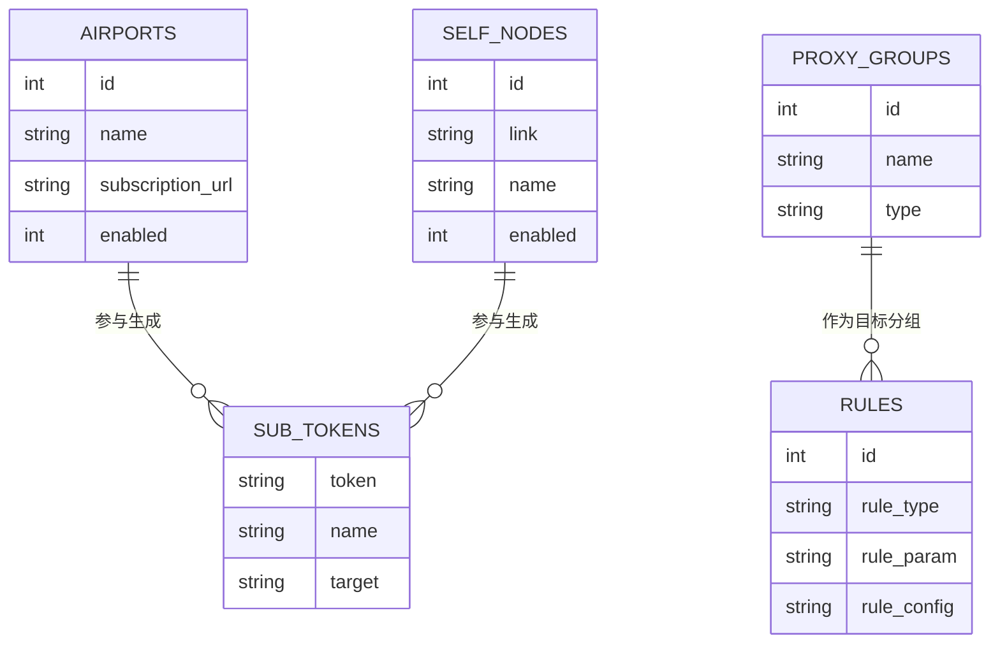
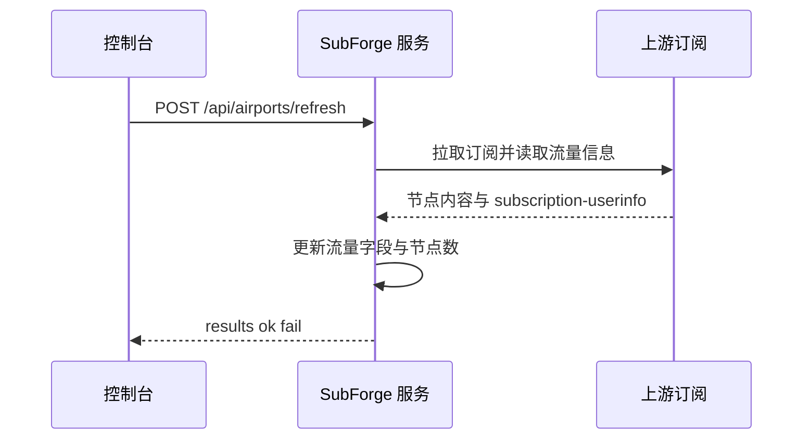
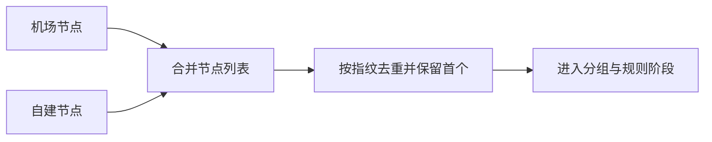
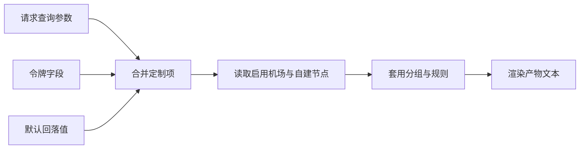

# 订阅与节点管理

SubForge 把「节点从哪来」「节点如何归组」「规则指向哪个组」「客户端用哪条地址拉取」这四件事拆成独立但相互衔接的模块：机场与自建节点提供节点，分组决定策略组结构，规则决定分流，订阅令牌把前三者组合成一条可长期复用的订阅地址。

本页说明这些模块的数据结构、接口语义与相互依赖，适合需要长期维护多来源节点的管理员阅读。所有字段名、状态码与行为均取自源码，并标注来源位置。

## 1. 概念与存储

### 1.1 术语

| 术语 | 含义 |
| --- | --- |
| 机场 | 一条订阅来源，包含订阅地址、流量与节点数等元数据 |
| 订阅地址 | 机场提供的上游 URL，SubForge 从该地址拉取节点 |
| 节点 | 从上游解析出的单条代理配置 |
| 自建节点 | 手工登记的节点，以分享链接形式保存 |
| 分享链接 | `ss://`、`vmess://` 等标准 URI 形式 |
| 分组 | 输出到客户端配置中的策略组 |
| 规则 | 分流条目，其目标指向某个分组 |
| 规则集 | 一组可批量启停的规则集合 |
| 令牌 | 订阅访问凭证，一个令牌对应一条订阅地址 |
| 产物 | 转换后输出的配置文本 |

### 1.2 存储位置与前置条件

订阅管理依赖 SQLite 数据库，只有启动时指定了 `-data-dir` 才会启用（`cmd/subforge/serve.go:158-232`）。未指定时，本页涉及的管理接口统一返回 503 与 `{"error":"订阅管理未启用"}`（`internal/api/subscription.go:42-48`）。

主要数据表在首次启动时自动创建（`internal/store/store.go:440-584`）：



## 2. 机场管理

### 2.1 字段说明

| 字段 | 类型 | 默认值 | 说明 |
| --- | --- | --- | --- |
| `id` | 整数 | 自增 | 机场标识 |
| `name` | 字符串 | — | 机场名称，导入规则时用于生成来源标记 |
| `subscription_url` | 字符串 | — | 订阅地址，为空时该机场不参与订阅生成 |
| `remarks` | 字符串 | 空 | 备注 |
| `enabled` | 布尔 | `true` | 是否启用 |
| `upload` / `download` | 整数 | 0 | 已用上传与下载流量，单位字节 |
| `total` | 整数 | 0 | 总流量，0 表示无限 |
| `expire` | 整数 | 0 | 到期时间，Unix 秒，0 表示未知 |
| `node_count` | 整数 | 0 | 最近一次刷新得到的节点数 |
| `traffic_at` | 整数 | 0 | 最近一次成功刷新流量的时间 |
| `traffic_err` | 字符串 | 空 | 最近一次刷新失败的原因 |

### 2.2 常用操作

新增机场使用 `POST /api/airports`，请求体字段为 `name`、`subscription_url`、`remarks`、`enabled`，成功返回 201 与 `{"airport":{...}}`（`internal/api/subscription.go:71-106`）。列表为 `GET /api/airports`，单项操作为 `GET`、`PUT`、`DELETE /api/airports/{id}`，删除成功返回 `{"ok":true}`。

刷新流量有三种入口：`POST /api/airports/refresh` 刷新全部启用机场，`POST /api/airports/{id}/refresh` 刷新单个机场，`POST /api/airports/refresh?with_rules=1` 在刷新后顺带导入规则（`internal/api/traffic.go:107-174`）。



刷新的写入语义需要特别注意：成功时覆盖流量字段并清空 `traffic_err`；失败时只写入 `traffic_err`，保留上一次成功的流量数据，不会清零（`internal/subforge/subforge.go:149-162`）。

### 2.3 订阅测活

`POST /api/airports/check` 对机场发起测活，请求体可带 `{"ids":[1,2]}` 指定机场；未指定时对「启用且配置了订阅地址」的机场执行（`internal/api/check.go:30-103`）。响应为 `{results, ok, fail, at}`，`GET /api/airports/check/last` 返回最近一次结果。空集合返回 400 与「没有可测活的机场」，指定了不存在的机场返回 400 与「机场 N 不存在」。测活结果保存在进程内存中，服务重启后失效。

### 2.4 从订阅导入规则

`POST /api/airports/{id}/import-rules` 会拉取该机场订阅、解析内容并导入其中的规则与规则集，返回 `{rules_added, rules_skipped, providers_added, warnings}`（`internal/api/import_rules.go:26-90`）。导入的来源标记为 `airport:<机场名称>`，便于后续按来源批量管理。机场不存在返回 404，上游拉取或解析失败返回 502 与「导入失败: …」。

## 3. 自建节点管理

自建节点以分享链接保存，字段为 `link`、`name`、`enabled`（`internal/api/subscription.go:499-543`）。链接为空或仅含空白时返回 400 与「链接不能为空」。

支持的分享链接协议包括 vmess、vless、trojan、ss、ssr、hysteria、hysteria2、tuic、anytls、socks5 与 http；不支持的协议会被跳过并计入产物的跳过计数（`docs/compatibility.md:304-356`）。自建节点与机场节点在转换时合并输出，来源顺序为机场在前、自建节点在后（`internal/convert/engine.go:135-168`），去重按「类型 + 服务器 + 端口 + 协议凭据」的指纹保留首次出现的节点（`internal/model/model.go:60-62`、`:156-161`）。



## 4. 分组管理

### 4.1 字段说明

| 字段 | 类型 | 默认值 | 说明 |
| --- | --- | --- | --- |
| `name` | 字符串 | — | 分组名称，会出现在客户端配置中 |
| `type` | 字符串 | `select` | 分组类型 |
| `regex` | 字符串 | 空 | 成员匹配正则，非空时按正则选出节点 |
| `url` | 字符串 | 空 | 测活地址，仅对测速类分组有意义 |
| `interval` | 整数 | 0 | 测活间隔，单位秒 |
| `sort_order` | 整数 | 0 | 输出顺序 |

接口为 `GET`、`POST /api/groups` 与 `GET`、`PUT`、`DELETE /api/groups/{id}`（`internal/api/subscription.go:154-239`）。

### 4.2 类型支持面

同一份分组配置在不同目标格式下的可用类型并不相同，配置前应确认目标格式：

| 目标格式 | 支持情况 | 来源 |
| --- | --- | --- |
| Clash 系（mihomo） | 仅 `select`、`url-test`、`fallback`、`load-balance`，其他类型直接报错 | `internal/render/clashmeta/clashmeta.go:293-312` |
| sing-box | `select`、`relay`、`direct`、`pass` 映射为 selector，`url-test` 映射为 urltest，`fallback` 退化为 selector 并告警 | `internal/render/singbox/singbox.go:545-563` |
| Surge、Quantumult X、Loon、Surfboard | 无 fallback 类型时返回空并计入告警，`relay`、`balanced`、`sniffer` 无法表达 | `internal/render/lineform/formats.go:63-80` |
| Mellow | `select` 映射为 static，`url-test` 映射为 latency，`fallback` 映射为 fallback | `internal/render/mellow/mellow.go:218-255` |

## 5. 规则与规则集

### 5.1 规则字段

| 字段 | 类型 | 默认值 | 说明 |
| --- | --- | --- | --- |
| `rule_type` | 字符串 | — | 规则类型，例如 `DOMAIN-SUFFIX` |
| `rule_param` | 字符串 | — | 规则参数，例如域名后缀 |
| `rule_config` | 整数 | 0 | 目标分组 ID，0 或指向不存在的分组时目标为 `DIRECT` |
| `resolve_dns` | 布尔 | `true` | 是否附加 `no-resolve` |
| `enabled` | 布尔 | `true` | 是否启用 |
| `source` | 字符串 | 空 | 来源标记，手工新增为空，导入时为 `airport:<名称>` |
| `sort_order` | 整数 | 0 | 输出顺序 |

列表接口 `GET /api/rules` 会在每条规则上附加 `group_name`，由 `rule_config` 映射得到分组名，便于在界面上直接看到目标（`internal/api/subscription.go:243-273`）。订阅生成时，规则的输出形式为 `规则类型,规则参数,目标分组`，`resolve_dns` 为真时追加 `,no-resolve`（`internal/api/subscription.go:676-698`）。

### 5.2 批量操作

`POST /api/rules/bulk` 用于批量启停，请求体为 `{ids, source, enabled}`：`ids` 与 `source` 必须二选一，同时给出或都不给出都会返回 400（`internal/api/rules_bulk.go:11-71`）。按来源批量操作适合在导入规则后统一关闭不需要的条目。

### 5.3 规则集

规则集由 `GET /api/rule-providers` 列出，支持按 `source` 与 `enabled` 过滤；`PUT /api/rule-providers/{id}/enabled` 用于启停，请求体必须是 `{"enabled": true|false}`，否则返回 400（`internal/api/ruleproviders.go:12-76`）。规则集的生成与版本管理见[规则工厂与规则源](规则工厂与规则源)。

## 6. 订阅令牌与订阅地址

### 6.1 令牌字段

| 字段 | 类型 | 默认值 | 说明 |
| --- | --- | --- | --- |
| `token` | 字符串 | 自动生成 | 留空时由服务端生成 16 字节随机数的 32 位十六进制串 |
| `name` | 字符串 | 空 | 令牌名称 |
| `target` | 字符串 | 空 | 目标格式，空表示按请求推断或使用默认值 |
| `pipeline` | 字符串 | 空 | 命名管线 |
| `config` | 字符串 | 空 | 配置模板引用 |
| `include` / `exclude` | 字符串 | 空 | 逗号分隔的包含与排除正则 |

接口为 `GET`、`POST /api/tokens` 与 `GET`、`PUT`、`DELETE /api/tokens/{token}`（`internal/api/subscription.go:346-451`）。更新采用部分更新语义：省略的字段保持原值，显式传空串表示清空（`internal/api/subscription.go:415-451`）。令牌不存在时返回 404 与「令牌 x 不存在」。

### 6.2 订阅地址与参数优先级

订阅地址形如 `http://<主机>/subscribe?token=<令牌>`，控制台按 `origin + '/subscribe?token=' + encodeURIComponent(token)` 拼接（`web/src/api/endpoints.ts:470-472`）。该路由使用订阅令牌自行鉴权，因此不受服务端全局令牌约束（`internal/api/server.go:291-303`）。

生成订阅时的取值优先级为：请求中的显式查询参数 > 令牌字段 > 回落链。其中目标格式回落到 `clash.meta`，管线回落到配置表中的 `subscribe.pipeline`（`internal/api/subscription.go:560-748`）。



### 6.3 生成行为

每次请求都实时读取机场、分组与规则并重新编译，不落盘静态产物（`internal/api/subscription.go:465-471`）。响应类型为 `text/plain; charset=utf-8`，且不写 `Content-Disposition`（`internal/api/subscription.go:747`），与 `/sub` 转换端点不同。若流量策略可用，响应会附带 `Subscription-Userinfo` 头，只统计启用、配置了订阅地址且有过流量刷新的机场。

流量头的聚合方式由流量策略决定，策略保存在配置键 `traffic.strategy` 中，可通过 `GET`、`PUT /api/traffic/strategy` 读写，`GET /api/traffic/preview?strategy=<JSON>` 可在不保存的情况下预览结果（`internal/api/traffic.go:18-49`、`:176-209`）。预设有 sum、min、max、avg、first、last、min_quota、max_quota、weighted 与 off（`internal/traffic/traffic.go:124-148`）。

### 6.4 与 `/sub` 转换端点的差异

两个入口都产出配置文本，但定位不同，不应混用：

| 维度 | `/sub` 转换端点 | `/subscribe` 订阅入口 |
| --- | --- | --- |
| 鉴权方式 | 服务端令牌（未设置令牌时不鉴权） | 订阅令牌 |
| 主要参数 | `target`、`url`、`include`、`exclude` 等转换参数 | `token` 与目标格式等五个定制字段 |
| 目标格式取值 | query 参数，缺省时按 User-Agent 推断 | query 参数 > 令牌字段 > `clash.meta` |
| 产物响应头 | `Content-Disposition`、`X-Convert-Format`、`X-Node-Count` 等 | `Subscription-Userinfo`，不写 `Content-Disposition` |
| 内容类型 | 按目标格式决定 | 固定 `text/plain; charset=utf-8` |
| 适用场景 | 临时转换与调试 | 长期使用的客户端订阅地址 |

`/sub` 的响应头与目标推断细节见 `internal/api/handlers.go:46-109`，`/subscribe` 的取值优先级见 `internal/api/subscription.go:560-748`。

## 7. 操作示例

新增一个机场并刷新：

```bash
curl -X POST http://127.0.0.1:25500/api/airports \
  -H 'Content-Type: application/json' \
  -d '{"name":"示例机场","subscription_url":"https://example.com/sub?token=abc","enabled":true}'

curl -X POST 'http://127.0.0.1:25500/api/airports/refresh?with_rules=1'
```

创建令牌并拉取订阅：

```bash
curl -X POST http://127.0.0.1:25500/api/tokens \
  -H 'Content-Type: application/json' \
  -d '{"name":"客厅路由","target":"clash.meta"}'

curl 'http://127.0.0.1:25500/subscribe?token=<YOUR_TOKEN>'
```

## 8. 注意事项

- 订阅地址中的令牌即访问凭证，泄露后应删除该令牌并重新创建。
- 机场与自建节点都为空时，订阅生成返回 400 与「没有启用的订阅或自建节点」。
- 机场刷新失败不会清空历史流量数据，但界面上的流量可能已经过期，应结合 `traffic_err` 判断。
- 测活结果与最近一次检查时间保存在内存中，服务重启后需要重新执行。
- 分组的类型支持面取决于目标格式，`relay` 等类型在 mihomo 上会直接导致转换失败。
- 规则的 `rule_config` 是分组 ID 而不是分组名称，取值错误会静默落到 `DIRECT`。

## 9. 相关页面

- [数据模型与本地存储](数据模型与本地存储)：数据表与迁移细节。
- [流量策略与用量统计](流量策略与用量统计)：流量聚合与 `Subscription-Userinfo`。
- [订阅解析与协议支持](订阅解析与协议支持)：上游内容如何被解析成节点。
- [分流规则引擎原理](分流规则引擎原理)：规则与分组的匹配语义。
- [HTTP-API-参考](HTTP-API-参考)：本页涉及端点的完整清单。
