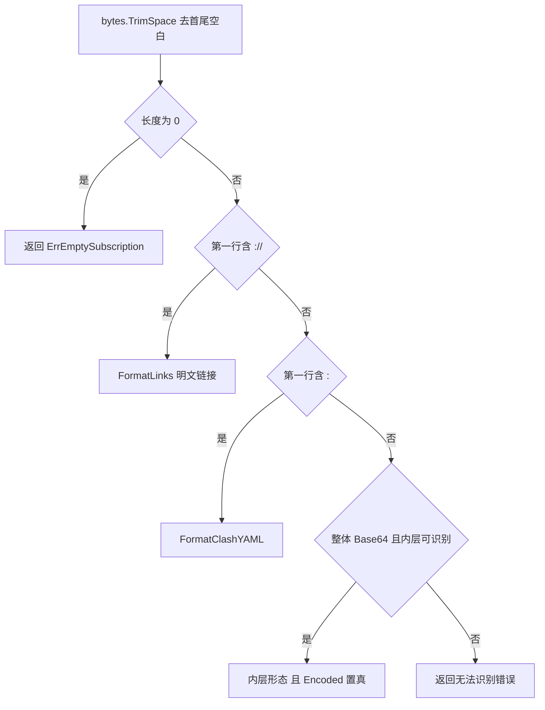
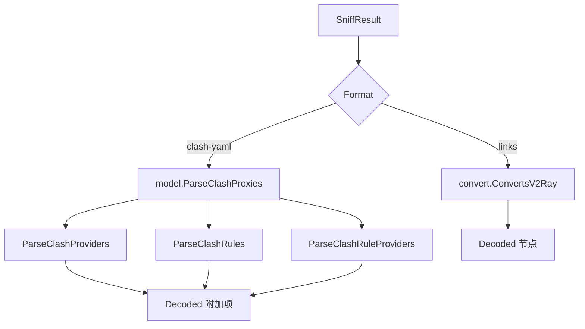
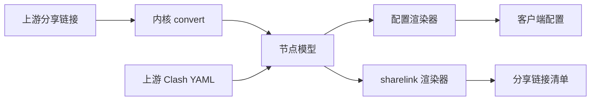

# 订阅解析与协议支持

> 本文讲清"上游那一坨字节，是怎么变成 SubForge 内部统一的节点模型的"，以及"哪些协议进得来、哪些出得去"。所有判定顺序、字段名、错误串均以 `internal/parse/`、`internal/model/`、`internal/render/` 的当前源码为准，行号标注在括号里。

---

## 1. 解析在整个流程里的位置

一次转换里，解析夹在"抓取"和"变换"之间：


- **抓取**负责把字节拿到手（HTTP / 本地文件 / 缓存），它不关心里面是什么（`internal/fetch/fetcher.go:272` 只做一次 `parse.Sniff` 用于记录形态）。
- **解析**负责把字节变成 `[]map[string]any`——内核可以直接消费的原始配置 map。
- **变换**与**渲染**只认这个 map，不认"来源是链接还是 YAML"。

这一步的设计目标是**收敛差异**：不管上游给的是分享链接、Base64 订阅还是 Clash 配置，出了解析层之后只有一种东西——`model.Node`（`internal/model/model.go:19-45`）。

`parse` 包有一条硬约束写在包注释里：它是**唯一** import mihomo 内核的包（`internal/parse/parse.go:1-8`）。其余各层都不直接依赖内核，这样"换内核版本"的影响面被限制在一个包内。

---

## 2. 形态识别：`Sniff` 的三步判定

`Sniff` 的职责只有一件事：**判断这段字节是什么形态，并给出解码后的内容**（`internal/parse/parse.go:85-106`）。



### 2.1 判定顺序为什么不能换

判定顺序是"明文链接 → Clash YAML → 整体 Base64"，三条依据：

1. **`://` 比 `:` 更具体**，先判它不会误伤 YAML。YAML 的第一行通常是 `port: 7890` 这类键值对，含 `:` 但不含 `://`。
2. **`:` 判定放在 Base64 之前**，是因为 Base64 字母表包含 `+`、`/`、`=`，一个纯 Base64 大块里不会出现 `:`；而 YAML 里几乎一定有 `:`。两者互斥，谁先判都不会错，但把 YAML 放前面可以让最常见的两种形态少走一次解码尝试。
3. **Base64 放在最后**，因为它需要真的去解码、再递归识别一次，是三步里唯一有实际开销的一步。

### 2.2 第一行怎么取

```go
line, _, _ := strings.Cut(string(b), "\n")
```

只取第一行（`internal/parse/parse.go:91`），并且用 `bytes.TrimSpace` 去过首尾空白（`internal/parse/parse.go:86`）。含义是：

- 前面有空行、缩进不影响识别；
- 但**只看第一行**，所以"第一行是注释、第二行才是链接"的订阅会被判错。这是刻意的：真实订阅的第一行几乎总是有效内容，而放宽到全文扫描会把"某条链接恰好含 `:`"这种噪声也算进来。

### 2.3 识别失败的错误串

```text
无法识别订阅内容形态（前 64 字节: %q）
```

（`internal/parse/parse.go:105`）`%q` 的内容由 `preview` 提供：超过 64 字节就截断到 64（`internal/parse/parse.go:204-209`）。这条错误串是**故意带样本**的——排查时你不用再去翻日志找原始内容，报错本身就把开头一段字节打出来了。

`Sniff` 的注释还写明了失败时的处理语义：**调用方应终止该来源，而不是带着不可辨认内容继续**（`internal/parse/parse.go:84`）。空内容的错误是复用的 `ErrEmptySubscription`：

```go
var ErrEmptySubscription = errors.New("订阅中未解析出任何节点")
```

（`internal/parse/parse.go:25`）

---

## 3. 整体 Base64：`tryBase64Blob` 的四道闸

机场订阅最常见的形态是"把一串分享链接拼起来、整体做一次 Base64"。SubForge 用一个独立的判定函数处理它（`internal/parse/parse.go:177-192`），**必须同时满足四个条件**才会尝试解码：

| 条件 | 代码依据 | 不满足时的后果 |
| --- | --- | --- |
| 去空白后长度 ≥ 16 字节 | `parse.go:180` | 太短的串不做解码尝试 |
| 不含 `\r` 或 `\n`（单块） | `parse.go:180` | 多行内容直接判定为"不是整体 Base64" |
| 字符全部落在 Base64 字母表 | `parse.go:183`、`isBase64Alphabet` 见 `parse.go:194-202` | 含 `-`、`_` 等 URL-safe 字符的串不识别 |
| `StdEncoding` 或 `RawStdEncoding` 严格解码成功 | `parse.go:186-190` | 解码失败即放弃 |

三条设计要点：

- **"单块、无换行"是防误判的关键。** 注释写得很直接：多行 blob 不识别，避免把链接列表误判为编码内容（`internal/parse/parse.go:179`）。一份明文链接列表里每行都含 `:`，本来就过不了前面的 YAML 分支之外的判定，但万一某份列表被当成 blob 解码，就会得到一堆乱码。
- **字母表校验在解码之前。** 先按字符集快速筛掉，比让 `base64` 包去报错更省，也让"这串到底像不像 Base64"这件事在日志里更可解释。
- **两种编码都试。** `StdEncoding` 带 `=` 填充，`RawStdEncoding` 不带；两种都用 `.Strict()`（`parse.go:187`），即拒绝非零填充位。所以"填充被人为删掉"和"填充正常"的订阅都能吃进来。

解码成功后，`Sniff` **递归调用自己**识别内层（`internal/parse/parse.go:99-104`），并把 `Encoded` 置为 `true`：

```go
if decoded, ok := tryBase64Blob(b); ok {
    if res, err := Sniff(decoded); err == nil {
        res.Encoded = true
        return res, nil
    }
}
```

所以"Base64 套 Base64"也能识别——每一层都会重新走一遍三步判定。最终结果由 `SniffResult` 承载：

```go
type SniffResult struct {
    Encoded bool    // 外层是否为整体 Base64 编码
    Format  Format  // 解码后的内容类型
    Decoded []byte  // 解码后的内容；Encoded=false 时为去空白后的原文
}
```

（`internal/parse/parse.go:72-80`）

`Format` 只有两个取值（`internal/parse/parse.go:50-70`）：

| 常量 | `String()` 输出 | 含义 |
| --- | --- | --- |
| `FormatLinks` | `links` | 明文分享链接，换行分隔 |
| `FormatClashYAML` | `clash-yaml` | Clash/mihomo YAML 配置，含 `proxies` 列表 |

未命中时 `String()` 返回 `unknown`（`internal/parse/parse.go:67-68`）。

---

## 4. 两种形态各自怎么解析

识别出形态后，`DecodeSource` 按形态分流（`internal/parse/parse.go:135-167`）：



### 4.1 分享链接形态

走内核的转换器：

```go
func ConvertSubscription(buf []byte) ([]map[string]any, error) {
    nodes, err := convert.ConvertsV2Ray(buf)
    ...
}
```

（`internal/parse/parse.go:30-39`）

- 失败时包装为 `解析订阅内容: %w`（`parse.go:33`）；
- 成功但**节点数为 0** 时返回 `ErrEmptySubscription`（`parse.go:35-37`）——"能解析但没有节点"和"解析失败"是两种不同的失败，前者说明内容形态对了但内容本身是空的。

> **为什么链接形态拿不到 provider / rules？** 分享链接里根本没有这些概念。`Decoded` 的字段注释写得很清楚：`Providers`、`Rules`、`RuleProviders` 对分享链接来源**恒为空**（`internal/parse/parse.go:112-118`）。

### 4.2 Clash YAML 形态

四条提取路径，**失败语义各不相同**——这是这一节最需要记住的部分：

| 提取项 | 函数 | 源码位置 | 失败时 |
| --- | --- | --- | --- |
| `proxies` | `model.ParseClashProxies` | `internal/model/model.go:215-226` | **致命**：返回 `解析 Clash YAML: %w`，整个来源终止 |
| `proxy-providers` | `model.ParseClashProviders` | `internal/model/model.go:232-256` | 忽略错误（`providers, _ :=`） |
| `rules` | `model.ParseClashRules` | `internal/model/model.go:262-270` | 忽略错误（`rules, _ :=`） |
| `rule-providers` | `model.ParseClashRuleProviders` | `internal/model/model.go:276-300` | 记一条告警，不终止 |

源码里这三行连着写，意图很直白（`internal/parse/parse.go:146-156`）：

```go
providers, _ := model.ParseClashProviders(sniff.Decoded)
rules, _ := model.ParseClashRules(sniff.Decoded)
ruleProviders, err := model.ParseClashRuleProviders(sniff.Decoded)
```

注释给了理由：**节点是主体，provider / rules 只是附加透传项**，附加项解析失败不该拖垮整份订阅。告警文案是：

```text
解析 rule-providers 失败: %v
```

（`internal/parse/parse.go:154`）

`proxies` 为什么必须是致命的？因为 `ParseClashProxies` 在 `proxies` 缺失或为空时直接返回错误：

```go
if len(cfg.Proxies) == 0 {
    return nil, errors.New("配置中不含 proxies")
}
```

（`internal/model/model.go:222-224`）一份没有 `proxies` 的 YAML 对 SubForge 而言就是"没有节点"，继续下去只会产出一份空配置，不如在解析阶段就说清楚。

### 4.3 一个容易忽略的坑：provider 的告警在转换路径上会被丢掉

`DecodeSource` 会把 `解析 rule-providers 失败` 放进 `Decoded.Warnings`，但**转换引擎读的是 `dec.Nodes` 和 `dec.Providers`，没有读 `dec.Warnings`**（`internal/convert/engine.go:146-152`、`161-167`）。也就是说：

- 通过 `/sub`、`/api/convert` 或 CLI 转换时，这条告警**不会**出现在 `X-Convert-Skipped` 响应头里；
- 只有走规则导入路径时才会被收集（`internal/api/import_rules.go:45-47` 明确把 `dec.Warnings` 与导入告警合并）。

这是当前实现的真实行为，不是文档遗漏。排查"rule-providers 明明写错了却没提示"时，请直接检查上游 YAML。

### 4.4 确定性：provider 的排序

`ParseClashProviders` 和 `ParseClashRuleProviders` 都会把名字取出、`sort.Strings` 排一遍再构造切片（`internal/model/model.go:242-246`、`286-290`）。原因写在注释里：**顺序按名字典序固定，保证渲染产物确定性**（`model.go:231`、`model.go:275`）。

因为 YAML 的 map 在 Go 里迭代顺序是随机的，如果直接 `for range` 构造切片，同一份输入两次转换可能得到不同顺序的 provider 段——产物就不再是字节级可复现的。

`Provider` 与 `RuleProvider` 的结构完全同构（`internal/model/model.go:76-91`）：

```go
type Provider struct {
    Name string
    Raw  map[string]any  // 原始配置 map，渲染的唯一事实源
}

type RuleProvider struct {
    Name string
    Raw  map[string]any
}
```

`Raw` 是**原样透传**的：`type` / `behavior` / `url` / `path` / `interval` / `format` / `proxy` 等扩展字段一个不丢（`model.go:84-85`）。这是"渲染只读原始 map"约定的延伸——解析层不做字段归一化，`ParseClashProxies` 的注释也明确写了"该函数不做任何字段归一化"（`model.go:214`）。

---

## 5. 分享链接形态下支持的协议

链接解析完全交给内核的 `common/convert`。`ConvertSubscription` 的注释把支持面列了出来（`internal/parse/parse.go:28-29`）：

> 支持的协议由内核 `common/convert` 决定：`vmess` / `vless`（含 reality） / `hysteria` / `hysteria2` / `tuic` / `trojan` / `ss` / `ssr` / `socks(5)` / `http(s)` / `anytls` / `mierus`。

这份清单可以在 vendored 内核里逐条对上（`vendor/github.com/metacubex/mihomo/common/convert/converter.go`）：

| scheme | 源码行 | 说明 |
| --- | --- | --- |
| `hysteria` | `converter.go:37` | v1 语法 |
| `hysteria2` / `hy2` / `hysteria2+realm` / `hy2+realm` | `converter.go:72` | 四个写法走同一分支 |
| `tuic` | `converter.go:118` | |
| `trojan` | `converter.go:161` | |
| `vless` | `converter.go:222` | 含 reality 参数 |
| `vmess` | `converter.go:245` | 标准 Base64 JSON 形态 |
| `http` / `https` | `converter.go:331` | |
| `ss` | `converter.go:400` | |
| `ssr` | `converter.go:487` | |
| `socks` / `socks5` / `socks5h` | `converter.go:546`、`580` | |
| `anytls` | `converter.go:598` | |
| `mierus` | `converter.go:641` | |

**注意两点：**

1. **`mierus` 是内核的拼写**，不是笔误。写 `mieru` 不会被这个分支接住。
2. **这里的 scheme 名与产物里的 `type` 字段名不是一回事。** 解析后节点 `type` 会被内核归一成规范名（`vmess`、`trojan`、`hysteria2`……）。例如链接写 `hy2://`，产物里是 `type: hysteria2`。

### 5.1 预留的内核校验：`Validate`（当前无调用方）

`Validate` 用内核去真正构造一次 outbound，用来检查单个节点是否被内核接受（`internal/parse/parse.go:43-48`）：

```go
func Validate(mapping map[string]any) error {
    if _, err := mihomoadapter.ParseProxy(mapping); err != nil {
        return fmt.Errorf("节点 %q: %w", NameOf(mapping), err)
    }
    return nil
}
```

注释强调：**不发起网络连接，仅做结构校验与构造**（`parse.go:42`）。错误串会把节点名带出来（`节点 "香港-01": ...`），节点名由 `NameOf` 从原始 map 的 `name` 字段取（`parse.go:170-174`）。

**这里有一个必须知道的事实：`Validate` 目前没有调用方。** 在当前源码里，全仓库对 `parse.Validate` 的引用为零（可用 `grep -rn "parse\.Validate" .` 复核，只命中 `internal/parse/parse.go:43` 的定义本身）。也就是说，一份字段有问题的节点，只要能被内核的转换器解析出来，就会一路走到产物里，而不是在解析阶段被拦下。它是为"需要逐节点把关"的场景预留的能力，尚未接入任何入口。

---

## 6. 出得去的协议：分享链接序列化

解析的反方向是"把节点还原成分享链接"，由 `internal/render/sharelink/` 承担，`target=list`（以及 `sub`、`subscription`）走的就是它。

支持的协议是**显式白名单**，共 14 项（`internal/render/sharelink/sharelink.go:39-46`）：

```text
anytls, hysteria, hysteria2, http, https, shadowsocks, shadowsocksr, socks5, ss, ssr, trojan, tuic, vless, vmess
```

`Render` 的分支与这份清单一一对应（`sharelink.go:49-77`）：

| `type` 取值 | 序列化函数 | 源码行 |
| --- | --- | --- |
| `vmess` | `vmess` | `sharelink.go:52` |
| `vless` | `vless` | `sharelink.go:54` |
| `trojan` | `trojan` | `sharelink.go:56` |
| `ss` / `shadowsocks` | `shadowsocks` | `sharelink.go:58` |
| `ssr` / `shadowsocksr` | `ssr` | `sharelink.go:60` |
| `hysteria` | `hysteria` | `sharelink.go:62` |
| `hysteria2` | `hysteria2` | `sharelink.go:64` |
| `tuic` | `tuic` | `sharelink.go:66` |
| `anytls` | `anytls` | `sharelink.go:68` |
| `socks5` | `socks` | `sharelink.go:70` |
| `http` / `https` | `httpLink` | `sharelink.go:72` |

不在表里时返回：

```go
return "", fmt.Errorf("%w: %q", ErrUnsupportedProtocol, n.Type)
```

（`sharelink.go:75`）错误串本体是 `协议不支持分享链接序列化`（`sharelink.go:26`）。

### 6.1 不支持的节点会被跳过，并且一定会有告警

`RenderAll` 对每个节点调用 `Render`；命中 `ErrUnsupportedProtocol` 时不报错，而是把节点名记进 `Skipped`（`sharelink.go:83-103`，`errors.Is` 判定见 `sharelink.go:89`）：

```go
type Output struct {
    Body    []byte   // 分享链接清单（每行一条，无尾随空行）
    Lines   int      // 成功序列化的条数
    Skipped []string // 无法序列化的节点名（协议不支持），供调用方作为警告上报
}
```

（`sharelink.go:29-36`）渲染器把 `Skipped` 通过 `WarningReporter` 接口交出去（`sharelink.go:155`），最终进入 `X-Convert-Skipped` 响应头与服务日志（`internal/api/handlers.go:80-86`）。

**这条链路是"降级不能静默"约定的具体体现**：产物少了几条节点，你一定能从响应头和日志里看到原因，而不是拿到一份"看起来正常"的短清单。

### 6.2 一个真实的往返例子

下面这条命令把两份节点（vmess + trojan）以整体 Base64 的形式喂进去，再要求输出链接清单。产物是 SubForge 重新序列化出来的结果，不是原文回显：

```bash
# links.txt 里是整体 Base64 编码的订阅内容
subforge convert -file links.txt -list
```

实测输出（本仓库当前源码）：

```text
vmess://eyJhZGQiOiJoay5ub2RlLmV4YW1wbGUuY29tIiwiYWlkIjoiMCIsImhvc3QiOiJoay5ub2RlLmV4YW1wbGUuY29tIiwiaWQiOiIxMTExMTExMS0yMjIyLTMzMzMtNDQ0NC01NTU1NTU1NTU1NTUiLCJuZXQiOiJ3cyIsInBhdGgiOiIvIiwicG9ydCI6IjQ0MyIsInBzIjoi6aaZ5rivLTAxIiwic2N5IjoiYXV0byIsInRscyI6InRscyIsInR5cGUiOiJub25lIiwidiI6IjIifQ==
trojan://password123@sg-node.example.com:443?allowInsecure=0&fp=chrome&sni=sg-node.example.com#新加坡-01
```

对照输入可以发现三件事：

1. **vmess 的 Base64 JSON 被重新生成**：字段按字母序排列（`add`、`aid`、`host`、`id`…），并补齐了输入里没有的 `path`、`type`、`v` 等字段。所以"回显"不等于"原文"，它是**重新序列化**的结果。
2. **trojan 链接被补上了默认查询参数**：`allowInsecure=0` 与 `fp=chrome` 是渲染时补的，输入里只有 `sni`。
3. **中文节点名以 UTF-8 明文出现在 fragment 里**（`#新加坡-01`），没有做百分号编码。

配套的节点配置产物可以直接对照：

```bash
subforge convert -file links.txt -format clash.meta
```

```yaml
proxies:
  - alterId: "0"
    cipher: auto
    name: 香港-01
    network: ws
    port: "443"
    server: hk.node.example.com
    skip-cert-verify: false
    tls: true
    type: vmess
    udp: true
    uuid: 11111111-2222-3333-4444-555555555555
    ws-opts:
      headers:
        Host: hk.node.example.com
      path: /
    xudp: true
```

注意 `port: "443"` 是**字符串**而不是数字，`alterId: "0"` 同样是字符串——这不是笔误，是渲染层刻意保留标量原始类型的做法（见[渲染器与输出格式](渲染器与输出格式)）。mihomo 读端口时依赖这个类型。

---

## 7. 协议支持全貌：三张表

把上面几节合起来，一个协议在 SubForge 里的"通行能力"取决于三张互不相同的表：

| 环节 | 依据 | 决定什么 |
| --- | --- | --- |
| 入：链接解析 | 内核 `common/convert` | 上游订阅里哪些 scheme 能变成节点 |
| 入：YAML 解析 | `model.ParseClashProxies` | 上游 YAML 里 `proxies` 的字段**不做归一化**，原样进模型 |
| 出：配置渲染 | 各渲染器的协议映射 | 节点能不能变成目标客户端认识的出站 |
| 出：链接渲染 | `sharelink` 的 14 项白名单 | 节点能不能还原成分享链接 |



**关键结论：入和出的支持面不重合。**

- 链接解析支持 `mierus`、`socks5h`、`hysteria2+realm` 等写法，但 `sharelink` 的 14 项白名单里没有 `mierus`——所以一个 `mierus` 节点能进来，却**不能**用 `target=list` 还原成链接，只会出现在 `Skipped` 里。
- 配置渲染器各有自己的映射表，覆盖范围与 `sharelink` 也不同（例如 sing-box 渲染器不产出 `mierus` 出站）。各渲染器的具体支持矩阵见[渲染器与输出格式](渲染器与输出格式)。

所以"我的节点为什么少了一个"这类问题，要分两步问：**它在解析阶段进来了吗？它在渲染阶段被目标格式接住了吗？** 后者的答案一定会以告警形式出现在 `X-Convert-Skipped` 或服务日志里。

---

## 8. 操作教程

### 8.1 确认一份上游订阅到底是什么形态

最省事的办法是直接让 SubForge 转一次，看两个地方：

```bash
# 1) 转成链接清单：能出东西说明解析成功，且节点都是可序列化协议
subforge convert -url "https://example.com/sub?token=xxx" -list

# 2) 看服务端/CLI 的行内提示
#    正常会打印类似：管线: 12 -> 12 节点
#    然后：完成: list, 4096 字节, 12 节点, 3ms
```

- `管线: N -> M 节点` 里的 **N 是解析后、进管线前的节点数**，M 是管线跑完的节点数。N 与 M 不等，说明有节点被过滤/去重掉了（见[转换流水线原理](转换流水线原理)）。
- 如果这里报 `无法识别订阅内容形态（前 64 字节: ...）`，说明内容既不是链接、也不是 YAML、也不是整体 Base64。拿报错里的 64 字节去比对原始内容即可。

### 8.2 手工验证"整体 Base64"这一层

把上游返回的内容存成文件，先自己解一层看：

```bash
# Linux / macOS
base64 -d sub.txt | head -5

# Windows PowerShell
[Text.Encoding]::UTF8.GetString([Convert]::FromBase64String((Get-Content sub.txt -Raw).Trim())) -split "`n" | Select-Object -First 5
```

如果解出来是 `ss://`、`vmess://` 开头的行，那么这份订阅属于"Base64 包链接"形态。SubForge 会自动处理这一层，**不需要**你手工解码后再喂进去。

### 8.3 用链接清单做协议体检

`-list` 除了当产物用，还是一个很好用的"体检工具"：

```bash
subforge convert -url "$SUB_URL" -list -out nodes.txt
```

然后统计一下协议分布：

```bash
# Linux / macOS：按 scheme 计数
grep -oE '^[a-z0-9]+://' nodes.txt | sort | uniq -c | sort -rn
```

如果某个协议在原始订阅里有、在 `nodes.txt` 里没有，就去检查两件事：这个协议是否在内核 `common/convert` 的 scheme 列表里（第 5 节），以及 `X-Convert-Skipped` 是否给出了跳过原因。

### 8.4 从 Clash YAML 订阅里只取节点

Clash YAML 订阅（带 `proxies` 的那种）可以直接当来源：

```bash
subforge convert -file upstream.yaml -format clash.meta -out out.yaml
```

行为要点：

- `proxies` 会被完整取出（不做字段归一化），再进管线；
- `proxy-providers` 会**原样透传**到产物里（`use` 引用仍然有效）；
- 上游 YAML 里的 `rules`、`rule-providers` 会被解析进 `Decoded`，但**不会隐式合并**进产物——`Decoded.Rules` 的注释写明它是"供后续 SQLite 持久化导入扫描复用，不在转换路径上隐式合并"（`internal/parse/parse.go:114-116`）。

---

## 9. 常见问题

### 9.1 报"无法识别订阅内容形态"

按三步自查：

1. **内容是不是空的或只有空白？** 这走的是 `ErrEmptySubscription`，不是形态错误。
2. **第一行含 `://` 吗？** 含就是链接形态。注意只看第一行，前面不要放说明文字。
3. **是不是被套了两层以上的 Base64？** 可以套，但每一层都必须是"单块、无换行、纯字母表"的。

如果上游返回的是 HTML 错误页（比如 403 / 502 页面），它的第一行几乎一定含 `:`，于是会被判成 Clash YAML 形态，随后在 `ParseClashProxies` 阶段报：

```text
解析 Clash YAML: 解析 YAML: ...
```

或

```text
解析 Clash YAML: 配置中不含 proxies
```

（两个错误串分别来自 `internal/parse/parse.go:144` 的包装与 `internal/model/model.go:223` 的本体。）**看到这两个错误串时，第一反应应该是"上游是不是给了错误页或空配置"，而不是"我的 YAML 写错了"。**

### 9.2 节点数比预期少

按顺序排除：

| 现象 | 可能原因 | 怎么确认 |
| --- | --- | --- |
| `管线: N -> M` 中 M < N | 被 filter / dedupe 过滤 | 见[转换流水线原理](转换流水线原理) |
| N 本身就偏小 | 部分 scheme 内核不认 | 对照第 5 节 scheme 列表 |
| 产物是 `list` 且条数偏少 | 协议不在 `sharelink` 白名单 | 查 `X-Convert-Skipped` 或日志里的跳过项 |
| Clash YAML 来源节点偏少 | 上游 YAML 的 `proxies` 本身就这么少 | 直接看上游文件 |

### 9.3 去重把两个"看起来不一样"的节点合并了

去重不看名字，看**身份指纹**：`Type|Server|Port` 再拼上凭据字段（`internal/model/model.go:60-71`）。两个节点名字不同、但协议+地址+端口+密码都一样，会被判为同一个节点。详见[转换流水线原理](转换流水线原理)的 Dedupe 一节。

### 9.4 中文节点名在链接里变成乱码

`sharelink` 的 fragment 用 UTF-8 明文输出中文（见 6.2 实测）。如果客户端显示乱码，通常是客户端自己按别的编码解读，或中间某一层做了二次编码。先用 `-format clash.meta` 产出一份 YAML 对比 `name` 字段——YAML 产物里的中文是 UTF-8 原文，可以作为判断基准。

---

## 10. 相关页面

- [转换流水线原理](转换流水线原理)：节点进来之后经历什么
- [渲染器与输出格式](渲染器与输出格式)：节点出去变成什么
- [系统架构总览](系统架构总览)：解析层在整体架构中的位置与依赖方向
- [分流规则引擎原理](分流规则引擎原理)：`rules` / `rule-providers` 的完整语义
