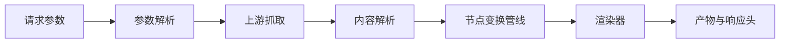
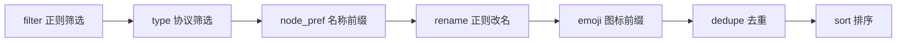
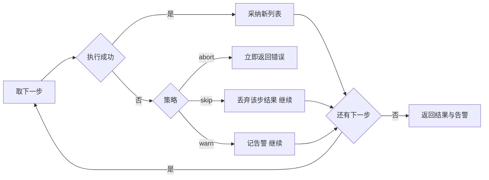

# 转换流水线原理

> 本文说明 SubForge 在拿到订阅内容之后、产出客户端配置之前，对节点数据做了哪些处理、按什么顺序处理、每一步解决什么问题。
>
> 事实来源：`internal/transform/`（变换阶段实现）、`internal/convert/params.go`（默认管线装配）、`internal/model/model.go`（节点模型与指纹）、`internal/convert/`（引擎入口）。文中每个机制均标注了源码位置，便于核对。

---

## 1. 流水线在整体流程中的位置

一次转换请求可以拆成五个阶段：**参数解析 → 上游抓取 → 内容解析 → 节点变换 → 渲染输出**。流水线（pipeline）是其中的第四段，也是唯一一段会"改写节点内容"的阶段。



这条边界的意义在于**职责单一**：渲染阶段只读取节点数据，不再修改节点内容（见 `internal/render/render.go:1-6` 的包注释，以及 ADR 0001）。因此，如果发现产物里的节点名不对、节点重复、顺序不对，问题一定在变换阶段，而不会在渲染器里。

### 1.1 数据在三个阶段里的形态

| 阶段 | 数据形态 | 说明 |
| --- | --- | --- |
| 解析后 | `map[string]any`（原始配置 map） | 节点唯一的事实源，全程不做结构体转换（`internal/parse/parse.go:3-8`） |
| 变换中 | `model.NodeList` | 由原始 map 派生的只读视图加原始 map 引用（`internal/model/model.go:19-45`） |
| 渲染前 | `model.NodeList` | 渲染器读 `Node.Raw` 产出文本（`internal/render/render.go:22-34`） |

### 1.2 为什么改名要写回原始 map

`model.Node` 上的 `Name`、`Type`、`Server`、`Port` 是**派生字段**，改它们不会影响产物。改名必须写回 `Raw["name"]` 再重新派生视图，这一动作统一由 `withName` 完成：

```go
// internal/transform/transform.go:43-49
func withName(n model.Node, name string) model.Node {
	if n.Raw == nil {
		n.Raw = map[string]any{}
	}
	n.Raw["name"] = name
	return model.NodeFromRaw(n.Raw, n.Source)
}
```

**注意**：任何"只改派生字段、不改 `Raw`"的实现都会造成渲染结果与解析产物不一致，这是包注释里明确禁止的写法（`internal/transform/transform.go:4-8`）。

---

## 2. 两段式结构：filter 与 op

SubForge 的管线在语义上对齐 Sub-Store 的 `filter` → `op` 两段式配置（`internal/transform/transform.go:1-2`）：

- **filter（筛选段）**：决定"保留哪些节点"，不改变节点内容。
- **op（操作段）**：决定"留下来的节点长什么样"，包括改名、加前缀、加图标、去重、排序。

所有阶段都实现同一个接口：

```go
// internal/transform/transform.go:20-22
type Stage interface {
	Apply(ns model.NodeList) (model.NodeList, error)
}
```

`Stage` 的契约是**纯变换**：接收一个节点列表，返回一个新的节点列表，不修改入参（`internal/transform/transform.go:5-6`）。这条契约是错误处理策略能够成立的前提，见本文第 6 节。

---

## 3. 默认管线：七个阶段与固定顺序

当请求没有指定命名管线时，SubForge 按固定顺序装配默认管线（`internal/convert/params.go:196-245`）：



其中 `type`、`node_pref`、`rename`、`emoji`、`sort` 是**按需追加**的：只有请求里真的写了对应参数，该阶段才会出现在管线里。`filter` 与 `dedupe` 恒定存在（`internal/convert/params.go:197-201`、`236`）。

| 顺序 | 阶段 | 作用 | 出现条件 |
| --- | --- | --- | --- |
| 1 | `RegexFilter` | 按节点名正则做白名单/黑名单 | 恒定 |
| 2 | `TypeFilter` | 按协议类型筛选 | 写了 `type` 参数 |
| 3 | `NodePref` | 按协议类型给名称加前缀 | 写了 `[node_pref]` 的 `prefix` |
| 4 | `Rename` | 按正则替换名称 | 写了 `rename` 参数或 `[rename]` 段 |
| 5 | `Emoji` | 按正则给名称前置图标 | 写了 `emoji` 参数或 `[emoji]` 段 |
| 6 | `Dedupe` | 按节点身份指纹去重 | 恒定 |
| 7 | `Sort` | 按指定键排序 | 写了 `sort` 参数且值不是 `original` |

### 3.1 为什么 node_pref 必须排在 rename 之前

这是默认管线里唯一一处**顺序不可交换**的约束，源码注释给出了完整理由：

```go
// internal/convert/params.go:218-220
// 前缀必须排在 rename / emoji 前面：它按协议类型加前缀，而 include / exclude
// 是按节点名判定的。先改名会让判定基准漂移，一个本来该加前缀的节点就静默漏掉了；
// 对齐 subconverter 也在改名之前处理前缀。改名之后再动前缀也能被后续规则继续改。
```

具体展开：`node_pref` 支持 `include` / `exclude` 两个按**节点名**判定的限定条件（`internal/transform/op.go:224-232`）。如果先执行 `rename` 把 `HK-香港-01` 改成了 `🇭🇰 香港 01`，那么 `[node_pref]` 里为 `HK` 写的 `include` 正则就再也匹配不上，该节点会被静默跳过——产物看起来正常，但前缀丢了，且没有任何报错。subconverter 同样在改名之前处理前缀，这一顺序也保持了行为一致。

**注意**：`node_pref` 加完前缀之后，`rename` 与 `emoji` 仍然会作用于新名字（因为它们排在后面），因此可以用一条 `rename` 规则统一处理"前缀 + 原名"的整体。

---

## 4. 逐阶段说明

### 4.1 RegexFilter：按名称正则筛选

**是什么**：对节点名做正则匹配，`exclude` 命中的节点被剔除，`include` 非空时只保留命中的节点（`internal/transform/filter.go:11-44`）。

**怎么用**：

```bash
# 只保留名称里含 HK 或 SG 的节点，剔除名称里含"到期"的节点
subforge convert -url https://sub.example.com/api?token=<YOUR_TOKEN> \
  -include '(?i)HK|SG' -exclude '到期'
```

HTTP 方式：

```text
GET /sub?target=clash.meta&url=https://sub.example.com/api?token=<YOUR_TOKEN>&include=(?i)HK|SG&exclude=到期
```

**注意**：

- 判定顺序是"先排除、再白名单"。两项都为空时不过滤，保留全部（`internal/transform/filter.go:32-42`）。
- 正则只在"是否为空"上做 `TrimSpace` 判断，正则本体按原文编译——正则里的空格是有语义的（`internal/transform/transform.go:51-53`）。
- 正则写错会在**参数解析阶段**就报错，不会等到拉完订阅才失败（`internal/convert/params.go:161-171`）。

### 4.2 TypeFilter：按协议类型筛选

**是什么**：按节点的 `type` 字段筛选，类型名大小写不敏感，`exclude` 优先于 `include`（`internal/transform/filter.go:85-131`）。

**为什么需要别名归一**：用户习惯写 `shadowsocks`、`socks5h`、`hy2` 这类常见长名，而 mihomo 内核写进 `type` 字段的是 `ss`、`socks5`、`hysteria2`。如果直接拿用户输入去比对，会一个节点都匹配不上、产出空配置。因此构造期就把别名折到内核真名（`internal/transform/filter.go:96-107`）：

| 用户可能写的 | 归一为内核真名 |
| --- | --- |
| `shadowsocks` | `ss` |
| `shadowsocksr` | `ssr` |
| `socks` / `socks4` / `socks5h` | `socks5` |
| `https` | `http` |
| `hy2` / `hysteria2+realm` | `hysteria2` |
| `mierus` | `mieru` |
| `v2ray` | `vmess` |

**怎么用**：

```bash
# 只保留 vless 与 hysteria2 两种协议
subforge convert -url https://sub.example.com/api?token=<YOUR_TOKEN> \
  -type vless -type hysteria2
```

**注意**：`-type` 参数走的是白名单（`Include`），黑名单由 INI 模板的 `[common]` 段落提供。类型过滤排在正则筛选之后，因此两步的判定都基于**原始节点名**。

### 4.3 NodePref：按协议类型加名称前缀

**是什么**：按节点协议类型给名称加一段固定前缀，用于在客户端里按协议分组显示（`internal/transform/op.go:185-232`）。典型效果是把 `HK-香港-01` 显示成 `[V2Ray]HK-香港-01`。

**怎么用**（INI 模板片段，键就是协议类型）：

```ini
[node_pref]
vmess = [V2Ray]
vless = [VLESS]
hysteria2 = [HY2]
include = (?i)HK|SG
exclude = 到期|剩余
```

**参数表**（`internal/config/template.go:349-375`）：

| 项 | 取值 | 默认值 | 说明 |
| --- | --- | --- | --- |
| `<协议类型>` | 前缀字符串 | — | 键名即协议类型（解释时统一小写化），值原样作为前缀拼接 |
| `include` | 正则列表 | — | 仅对名称匹配这些正则的节点生效 |
| `exclude` | 正则列表 | — | 名称匹配这些正则的节点不生效，**优先于 include** |

`include` / `exclude` / `sort` / `prefix` / `suffix` / `remove` 是 `[node_pref]` 里的**控制键**，不会被当成协议类型（`internal/config/template.go:350-353`）。当前版本只解释 `include` 与 `exclude`，其余控制键会被忽略（`internal/config/template.go:360-368`）。

**注意**：

- 前缀匹配用的是 `strings.ToLower(node.Type)`（`internal/transform/op.go:215`），因此 `VMess` 与 `vmess` 都会命中同一项。
- 只有 `appliesTo` 判定通过的节点才会被加前缀；`exclude` 命中即整节点跳过（`internal/transform/op.go:224-232`）。
- `prefix` 为空时整步直接返回原列表，不做任何遍历（`internal/transform/op.go:208-210`）。

### 4.4 Rename：正则改名

**是什么**：对节点名按顺序做正则替换，规则之间**串行生效**——后一条看到的名字是前一条改完之后的结果（`internal/transform/op.go:49-77`）。

**怎么用**：

```bash
# 把名称里的"香港"替换为 HK，再把 " - 10Gbps" 这段带宽后缀整段删掉
subforge convert -url https://sub.example.com/api?token=<YOUR_TOKEN> \
  -rename '香港,HK' -rename ' - 10Gbps,'
```

**怎么用**（INI 模板片段。subconverter 的段落写法是"一行一条规则"，键是正则、值是替换）：

```ini
[rename]
香港 = HK
" - 10Gbps" =
剩余流量|到期时间|官网.* =
```

**注意**：

- 也支持命令行参数形式：`-rename '正则,替换'`，多条用 `;` 分隔（`internal/convert/params.go:162-166`）；INI 段落里一行带分号时同样按多规则列表处理（`internal/config/template.go:377-381`）。
- 替换走 Go 正则的 `ReplaceAllString`，因此替换串里可以用 `$1`、`${name}` 引用捕获组。
- **正则首尾的空格有语义，参数解析层不对规则整体做 trim**：`rename` / `emoji` 的每一项只以 `strings.TrimSpace` 的结果判空，正则本身按原文保留（`internal/convert/params.go:317-320`）。所以 `rename= - .*` 里的分隔空格不会被吃掉——这一条有专门的回归测试守着（`internal/convert/params_test.go:139-148`）。
- 正则编译失败会在参数解析阶段报错，错误串形如 `重命名 正则 %q 编译失败: ...`（`internal/transform/op.go:42`）。

### 4.5 Emoji：按正则前置图标

**是什么**：按顺序匹配节点名，**第一条命中的规则生效**，把替换文本前置到名称最前面；全部未命中则名称不变（`internal/transform/op.go:79-110`）。

**与 Rename 的关键差异**：

| 维度 | Rename | Emoji |
| --- | --- | --- |
| 多条规则的行为 | 串行叠加，逐条替换 | 命中第一条即停止 |
| 替换方式 | `ReplaceAllString`（替换命中片段） | 前置拼接（`rule.repl + name`） |
| 典型用途 | 删后缀、统一命名 | 加国旗或图标 |

**怎么用**：

```bash
subforge convert -url https://sub.example.com/api?token=<YOUR_TOKEN> \
  -emoji '香港|HK,🇭🇰 ' -emoji '日本|JP,🇯🇵 ' -emoji '新加坡|SG,🇸🇬 '
```

**注意**：因为只取第一条命中，规则顺序即优先级。把范围更窄的规则写在前面，例如 `香港,HK` 这类宽泛写法放在具体的 `HK-香港-01` 之后。

### 4.6 Dedupe：按身份指纹去重

**是什么**：按节点身份指纹去重，保留**首次出现**的节点（`internal/model/model.go:156-169`）。指纹由类型、服务器、端口与协议凭据拼成：

```go
// internal/model/model.go:62-71
func (n Node) Fingerprint() string {
	var b strings.Builder
	fmt.Fprintf(&b, "%s|%s|%s", n.Type, n.Server, n.Port)
	for _, k := range []string{"uuid", "id", "password", "key", "secret"} {
		if v := MapString(n.Raw, k); v != "" {
			fmt.Fprintf(&b, "|%s=%s", k, v)
		}
	}
	return b.String()
}
```

**为什么与名称无关**：同一台服务器在多个订阅里往往挂着不同的显示名（`HK-01`、`香港 01`、`🇭🇰HK`）。若把名称算进指纹，这些重复节点一个都合并不掉。指纹只看"连到哪里、用什么凭据"，与显示名无关，这与 Sub-Store 的 `op.dedupe` 语义一致。

**怎么用**：去重是默认管线里的恒定步骤，无需参数；只要一次请求里包含多个订阅地址，重复节点就会被合并。

```bash
# 两个订阅里有同一台服务器的节点，产物只保留先出现的那一个
subforge convert \
  -url https://sub.example.com/api?token=<YOUR_TOKEN> \
  -url https://sub2.example.com/api?token=<YOUR_TOKEN>
```

**注意**：

- 凭据字段按 `uuid`、`id`、`password`、`key`、`secret` 的顺序探测，只拼入**非空**的那些（`internal/model/model.go:65-69`）。
- 端口统一按字符串归一，`"443"` 与 `443` 都会变成 `"443"`，不会因为类型抖动而漏判（`internal/model/model.go:171-190`）。
- 去重发生在改名与加图标**之后**，但由于指纹与名称无关，改名不会影响去重结果。
- 保留的是首次出现者，因此"哪个订阅先写"决定了保留哪个名称。需要控制保留哪一份时，调整 `-url` 的顺序。

### 4.7 Sort：排序

**是什么**：稳定排序，支持的排序键如下（`internal/transform/op.go:112-166`）：

| 排序键 | 含义 | 同键时的次序 |
| --- | --- | --- |
| `original` | 保持原顺序，不做任何事 | — |
| `name` | 按名称字典序 | — |
| `type` | 按协议类型 | 同类型按名称 |
| `server` | 按服务器地址 | — |
| `port` | 按端口数值 | — |

**怎么用**：

```bash
subforge convert -url https://sub.example.com/api?token=<YOUR_TOKEN> -sort name
```

**注意**：

- `sort` 参数同时兼容布尔写法：`1/true/yes/on` 等价于按名排序（映射到 `name`），`0/false/no/off` 等价于原序（映射到 `original`）（`internal/convert/params.go:140-148`）。这么做的原因是 sub-web 的"高级"模式固定会传 `sort=false`，只认排序键会让整条请求失败（同处注释）。
- 排序键拼错会直接报错：`未知排序键 %q（可选: original/name/type/server/port）`（`internal/transform/op.go:134`）。
- 使用 `sort.SliceStable`，同键元素的相对顺序保持稳定（`internal/transform/op.go:164`）。
- `port` 键通过 `PortInt()` 取整数比较，端口缺失或非法时按 0 参与比较（`internal/transform/op.go:157-162`）。
- 节点数少于 2 或键为 `original` 时整步直接返回，不做排序（`internal/transform/op.go:139-141`）。

### 4.8 补充：Split 名称截断

除默认管线的七个阶段外，`transform` 包还提供按分隔符截断名称的 `Split` 步骤（`internal/transform/op.go:234-258`），用于把 `HK-香港-01 - 10Gbps` 截断成 `HK-香港-01`。

| 项 | 取值 | 默认值 | 说明 |
| --- | --- | --- | --- |
| `Sep` | 字符串 | `" - "` | 分隔符；空值回落为 `" - "` |

**注意**：只有当分隔符出现在**第一个字符之后**时才截断（`idx > 0`），截断结果会再做一次 `TrimSpace`；分隔符出现在开头时名称保持不变（`internal/transform/op.go:248-257`）。该步骤不在默认管线中，需在命名管线里显式引用。

---

## 5. 命名管线：用模板声明自己的步骤

**是什么**：INI 模板里的 `[pipeline:<名>]` 段落可以声明一条命名管线，把常见的 filter/op 组合命名，请求侧用 `pipeline=<name>` 引用，避免在 URL 里堆一长串参数（`internal/config/pipeline.go:12-27`）。

**怎么用**：

```ini
[pipeline:clean]
step = filter.regex include=^HK|^JP
step = op.rename pattern=" - .*$" repl=
step = op.dedupe
on_error = warn
```

```bash
subforge convert -url https://sub.example.com/api?token=<YOUR_TOKEN> \
  -config profiles/homelab.ini -pipeline clean -format clash.meta
```

HTTP 方式：`GET /sub?...&pipeline=clean`。

**step 语法**：`step = <kind> [k=v]...`，值里含空格时用双引号包裹，引号本身会被剥掉，因此正则里的空格（如 `" - .*$"`）能原样保留（`internal/config/pipeline.go:188-242`）。

**可用 kind**（`internal/config/pipeline.go:26-27`）：

| kind | 对应阶段 | 说明 |
| --- | --- | --- |
| `filter.regex` | `RegexFilter` | 按名称正则筛选 |
| `filter.region` | `RegionFilter` | 按地区关键词子串筛选 |
| `filter.type` | `TypeFilter` | 按协议类型筛选 |
| `filter.script` | 脚本过滤 | 需要脚本库支持且已启用 |
| `op.rename` | `Rename` | 正则改名 |
| `op.emoji` | `Emoji` | 前置图标 |
| `op.dedupe` | `Dedupe` | 按指纹去重 |
| `op.split` | `Split` | 按分隔符截断名称 |
| `op.sort` | `Sort` | 排序 |
| `op.script` | 脚本操作 | 需要脚本库支持且已启用 |

**注意**：

- `on_error` 是**段落级**默认策略，单步可以用该步内的 `on_error=...` 覆盖（`internal/config/pipeline.go:24`、`206-208`）。解析后 `on_error` 不会留在普通参数里被误传给 Stage（`internal/config/pipeline_test.go:101-103`）。
- 段落只认 `step` 与 `on_error` 两个键，写其他键会报错：`[%s] 未知键 %q（pipeline 段落只认 step / on_error）`（`internal/config/pipeline.go:180`）。
- 段落名缺管线名会报错：`段落 [%s] 缺少管线名（应为 [pipeline:<名称>]）`（`internal/config/pipeline.go:164`）。
- 同名 `[pipeline:<name>]` 段落在 INI 层已合并，`step` 是**追加**而不是覆盖（`internal/config/pipeline_test.go:181-186`）。
- 命名管线名不存在时报错：`未找到命名管线 %q：模板里没有 [pipeline:%s] 段落，控制台的「管线」页也没有启用的同名管线（GET /api/pipelines 可查现有名称）`（`internal/convert/params.go:255`）。
- 命名管线有两个来源：INI 模板的 `[pipeline:<名称>]` 段落，以及控制台「管线」页维护的数据库记录。引擎通过 `Engine.ExtraPipelines` 把数据库记录并进来，**同名时数据库优先**（`internal/convert/engine.go:363-386`）；控制台里被禁用（`enabled=false`）的管线不参与解析。
- 无论走哪条路径，引擎都只接收一个 `transform.Plan`：指定了 `pipeline` 就用解析到的命名管线，否则把默认管线包成策略为 `abort` 的 `Plan`（`internal/convert/params.go:247-264`）。

---

## 6. 错误处理：abort / skip / warn

**是什么**：每一步都可以指定失败时的处置策略（`internal/transform/pipeline.go:10-36`）：

| 策略 | 行为 | 适用场景 |
| --- | --- | --- |
| `abort` | 中止整条管线并返回错误，**默认策略** | 配置写错应当在请求期暴露，而不是悄悄产出错误产物 |
| `skip` | 丢弃这一步的结果，静默继续 | 某条可选规则坏掉但整体仍要出配置 |
| `warn` | 与 `skip` 相同，但把失败记入 `Result.Warnings` | 同上，且希望失败在日志里可见 |

**为什么默认是 abort**：非法正则、脚本语法错误属于配置问题，越早暴露越好。若默认静默跳过，用户会拿到一份"少了几个节点"的产物却毫不知情。

**执行语义**（`internal/transform/pipeline.go:82-104`）：



**注意**：

- `skip` 与 `warn` 丢弃该步结果时，传给下一步的是**进入该步时**的节点列表。这一语义能成立，正是因为 `Stage` 约定为纯变换、不修改入参（`internal/transform/pipeline.go:79-81`）。
- `abort` 的错误带管线名、步序号与步标签：`管线 %q 第 %d 步（%s）: %w`（`internal/transform/pipeline.go:100`）。
- `warn` 的告警格式为 `管线 %q 第 %d 步（%s）失败，已跳过: %v`（`internal/transform/pipeline.go:96-97`）。
- 策略名写错会报错：`未知 on_error 策略 %q（可选: abort/skip/warn）`（`internal/transform/pipeline.go:34`）。
- 告警最终会汇总到响应的 `X-Convert-Skipped` 头，值只放**计数**——条目可能含 emoji，不是合法的 HTTP 头值（`internal/api/handlers.go:80-86`）。

---

## 7. 完整操作教程

### 7.1 从零组装一条管线

目标：从两个订阅里筛出香港与新加坡节点，统一改名、加国旗、去重、按名称排序，产出 Clash 配置。

```bash
subforge convert \
  -url https://sub.example.com/api?token=<YOUR_TOKEN> \
  -url https://sub2.example.com/api?token=<YOUR_TOKEN> \
  -include '(?i)HK|SG' \
  -exclude '到期|剩余|官网' \
  -type vmess -type vless -type hysteria2 \
  -rename '香港,HK' \
  -emoji 'HK|香港,🇭🇰 ' -emoji 'SG|新加坡,🇸🇬 ' \
  -sort name \
  -format clash.meta \
  -name homelab \
  -out config.yaml
```

逐段含义：

| 参数 | 作用 |
| --- | --- |
| 两个 `-url` | 两个来源的节点会合并到同一份产物，随后由去重阶段合并重复节点 |
| `-include` / `-exclude` | 第一步正则筛选，先排除再白名单 |
| 三个 `-type` | 第二步协议筛选 |
| `-rename` | 第四步把名称里的"香港"统一成 `HK` |
| 两个 `-emoji` | 第五步按顺序匹配，第一条命中即生效 |
| `-sort name` | 第七步按名称字典序稳定排序 |
| `-format` / `-name` / `-out` | 输出格式、产物注释头里的配置名、输出文件路径 |

### 7.2 通过 HTTP 调用同一条管线

```text
GET /sub?target=clash.meta&url=https://sub.example.com/api?token=<YOUR_TOKEN>;https://sub2.example.com/api?token=<YOUR_TOKEN>&include=(?i)HK|SG&exclude=到期&type=vmess,vless,hysteria2&rename=香港,HK&emoji=HK|香港,🇭🇰 &sort=name
```

**注意**：`url` 参数本身是 URL，其值里的 `?` 不能当参数分隔符，否则会丢掉 `?token=...` 这段查询串、还会多出一个 `token=...` 的假来源；多个来源之间用 `;` 或重复传参分隔（`internal/convert/params.go:120-123`）。对照一下：`insert` 参数确实把 `?` 也当作分隔符之一（`params.go:124`），两者的分隔符集合是**故意不同**的。

### 7.3 验证管线效果

| 想确认的事 | 查看方式 |
| --- | --- |
| 管线是否按预期筛选 | 响应头 `X-Node-Count`（产物节点数，`internal/api/handlers.go:76`） |
| 有没有被跳过的项 | 响应头 `X-Convert-Skipped`（计数）与服务的 `X-Convert-Skipped` 日志明细 |
| 参数是否被正确解析 | `GET /inspect` 回显解析后的参数 |
| 用了哪个命名管线 | `GET /api/pipelines` |

---

## 8. 常见误用与排查

| 现象 | 可能原因 | 处理方式 |
| --- | --- | --- |
| 节点一个都没剩下 | `type` 写了内核不认的类型名，或 `include` 正则过于严格 | 先用 `GET /inspect` 确认参数，再放宽正则；类型名参考第 4.2 节的别名表 |
| `node_pref` 前缀没加上 | `include` / `exclude` 是按节点名判定的，而前面的步骤已改名 | 保证 `node_pref` 排在 `rename` 之前；命名管线里不要调换顺序 |
| 重复节点没被合并 | 两台服务器的 `type`、`server`、`port` 或凭据字段有差异 | 去重指纹含凭据，凭据不同即视为不同节点 |
| 排序结果与预期不符 | `sort` 传了布尔值 `1`，等价于按名称排序 | 显式写排序键，如 `sort=server` |
| 某一步失败导致整份产物 502 | 该步策略是默认的 `abort` | 在命名管线里把该步的 `on_error` 改为 `warn`，让失败以告警形式暴露 |
| 告警里看到跳过项但产物正常 | `warn` 策略生效，属预期行为 | 查看日志中的 `X-Convert-Skipped` 明细逐条核对 |

---

## 9. 相关页面

- [系统架构总览](系统架构总览)：各组件在整体中的位置与依赖方向
- [订阅解析与协议支持](订阅解析与协议支持)：管线之前的内容解析阶段
- [渲染器与输出格式](渲染器与输出格式)：管线之后的渲染阶段
- [INI 模板配置详解](INI-模板配置详解)：`[node_pref]`、`[rename]`、`[emoji]`、`[pipeline:<名>]` 的完整写法
