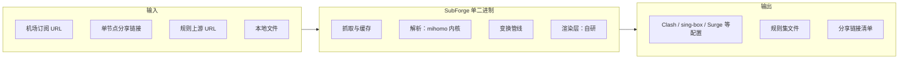
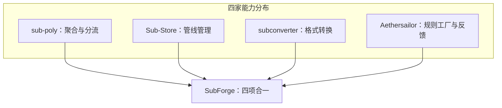

# 项目简介与设计目标

本页说明 SubForge 是什么、为什么要有它、它要达成什么、它明确不做什么。设计目标与取舍来自设计书
`docs/design/subforge-design.md`，实现现状以当前源码为准。

---

## 1. SubForge 是什么

SubForge 是订阅转换与分流规则一体化引擎。它把机场订阅、单节点分享链接、规则上游的内容拉取下来，
经过筛选、改名、排序、分组、规则编译，渲染成各家代理客户端可以直接读取的配置文件，并通过兼容
subconverter 的 HTTP 接口对外提供。

三个核心能力：

| 能力 | 说明 |
| --- | --- |
| 订阅转换 | 输入是订阅与节点，输出是客户端配置。协议解析交给 mihomo 内核，渲染层自研 |
| 分流规则 | 除节点外还管理规则：INI 模板语义兼容、`/getruleset` 六类规则集、MRS 离线生成、规则源清单聚合 |
| 一体化 | 单个 Go 二进制同时提供 CLI 与 HTTP 服务，前端产物通过 `embed.FS` 编入同一个二进制 |

技术形态（`docs/design/subforge-design.md:14`）：Go 单二进制，嵌入 mihomo 解析库。协议解析、测活、
MRS 生成复用上游内核（mihomo 为 MIT 许可），自研代码集中在编排层。



---

## 2. 设计动因：生态缺口

设计书在 2026-10-13 对四家同类项目做了调研，结论是四者功能高度互补，但没有一家同时覆盖服务端
聚合、管线式订阅管理、多目标格式转换与规则工厂（`docs/design/subforge-design.md:13`）：

| 项目 | 主要能力 | 缺口 |
| --- | --- | --- |
| sub-poly | 服务端聚合、自建分流、云端存储 | 已停止维护；无 LICENSE 文件，按保留所有权利处理，代码不可合法复用（`docs/design/subforge-design.md:28`） |
| Sub-Store | 管线式订阅管理（filter → operate 链） | AGPL-3.0，代码不可复用；Node 部署常驻内存约百 MB 级 |
| subconverter | 多目标格式转换的事实标准；INI 模板生态 | C++ 依赖重，协议支持更新慢；GPL-3.0 |
| Aethersailor 生态 | 规则生成工厂、Provider 透传、规则反馈闭环 | 依赖 GitHub Actions 等外部编排 |

SubForge 要补齐的四项能力（`docs/design/subforge-design.md:13`、`:17`）：服务端聚合与自建分流、
管线式订阅管理、多目标格式转换（含 subconverter 参数超集）、规则生成工厂与规则反馈闭环。



生态中存在大量同类仓库（`docs/design/subforge-design.md:178-208`），多数是单点复制。SubForge 的
立足点是把这四件事合并进一个二进制。

---

## 3. 设计目标

### 3.1 目标一：功能合并

设计书用一张功能合并矩阵标注每个功能点的归属（`docs/design/subforge-design.md:133`）：

| 归属 | 含义 |
| --- | --- |
| 直接复用上游 | 例如协议解析、MRS 生成 |
| 借鉴思想重新实现 | 例如管线式 filter/operate、INI 模板语义 |
| 新造（生态空白） | 例如分层覆盖 DSL、条件化输出、IP 质量检测 |
| 舍弃（有明确理由） | 例如 QX/Loon/Surge 内嵌脚本运行模式 |

舍弃项同样经过论证。Sub-Store 的"在 iOS 代理 App 内嵌脚本运行"模式被放弃，原因是需要重写一整套
JS 运行时，与 Go 内核冲突，而单二进制本身已足够轻量；代价是牺牲该场景的用户
（`docs/design/subforge-design.md:174`）。

### 3.2 目标二：资源开销

目标值与验证方法如下（`docs/design/subforge-design.md:383-394`）：

| 指标 | 设计目标 | 验证方法 |
| --- | --- | --- |
| 常驻 RSS（纯转换模式） | 小于 30MB | `/usr/bin/time -v` 配合 24 小时稳定性运行 |
| 常驻 RSS（测活开启，并发 8） | 小于 80MB | 测活周期内峰值 |
| 冷启动到可服务 | 小于 100ms | systemd `Type=notify` 计时 |
| 转换吞吐（1000 节点，规则集已缓存） | P99 小于 50ms / 请求 | `hey` 或 `vegeta` 压测 |
| 规则编译（10 万行规则转 MRS） | 小于 2s | mihomo `convert-ruleset` 同基线对照 |
| 二进制体积 | 15MB 至 25MB | `go build -trimpath -ldflags="-s -w"` |
| 空闲 CPU | 接近 0%（仅定时器） | `pidstat 1h` |

上表为设计目标值。发布前的验证数据见 `docs/reports/` 下的发布验证报告：二进制体积超出上表目标，
规划镜像与磁盘空间时按 40MB 量级预留；常驻 RSS 在目标范围内。逐项测量口径与数据只在验证报告中
记录。

对标参照：Sub-Store 的 Node 常驻约百 MB 级；subconverter 使用 C++，依赖较重
（`docs/design/subforge-design.md:15`）。

选择 Go 而非 C++ 的原因：Go 的内存占用约为 C++ 的 2 至 3 倍，绝对值仍在 30MB 以内；换来的收益是
可以直接 import mihomo，并且能够单二进制交叉编译到 arm 等路由器架构
（`docs/design/subforge-design.md:281`）。

### 3.3 目标三：声明式管线

吸收 Sub-Store 的管线抽象，用单个文件描述一次完整转换（`docs/design/subforge-design.md:293-296`）：

```yaml
# profiles/homelab.yaml：单个文件描述一次完整转换
sources:
  - name: airportA
    url: https://...          # 支持环境变量注入，入库只保存密文哈希
    group: main               # 分组正则来自 sub-poly 的设计
  - name: airportB
```

### 3.4 目标四：定制能力

差异化能力由三项组成（`docs/design/subforge-design.md:17`）：

1. mihomo 内嵌解析，协议跟随不额外投入。
2. 日志驱动的规则反馈闭环，Rule-Bot 内置。
3. 分层覆盖 DSL，作用顺序为全局、模板、订阅、客户端。

设计书调研结论认为，三者的组合在当时的生态中尚无同类实现（`docs/design/subforge-design.md:17`）。

---

## 4. 非目标与边界

### 4.1 SubForge 不进入数据面

这是最重要的架构边界：转换器直接处理流量会同时带来延迟与隐私风险，因此设计上刻意不进入数据面
（`docs/design/subforge-design.md:262`）。

基于这一边界，SubForge 对用户实际访问了哪些站点、命中了哪些规则没有直接观测能力。唯一的观测通道
是 mihomo 的 external controller（`/connections`、`/logs`，REST 与 WebSocket，Clash 生态标准接口）。

按部署拓扑分为三种形态（`docs/design/subforge-design.md:264-268`）：

| 拓扑 | 部署形态 | 采集方式 | 反馈类功能 |
| --- | --- | --- | --- |
| T1 同机或同网（推荐） | SubForge 与 mihomo 位于同一设备或同一局域网，常见于软路由与 NAS | 直连 `http://127.0.0.1:9090` 或局域网地址加 secret，通过 WebSocket 订阅 | 全部可用，域名数据不出内网 |
| T2 远程后端 | SubForge 位于公网 VPS，客户端在家庭出口 | Beacon：约 3MB 的 Go 单文件 agent 部署在 mihomo 旁，本地聚合后 POST `/api/v1/telemetry` | 全部可用；默认只上报规则命中计数与 eTLD+1 聚类，原始域名需显式开启 |
| T3 无观测 | 任意 | 无观测点 | 命中率回流与未匹配闭环自动禁用，控制台明确提示；转换主功能不受影响 |

视角差异（`docs/design/subforge-design.md:271`）：测活与测速从 SubForge 主机发起，T2 部署下的延迟
数值与用户侧体感不同，只能作相对比较；T1 无此问题。Beacon 不执行客户端侧测活，以控制 agent 体积。

### 4.2 明确舍弃的能力

| 舍弃项 | 理由 | 代价 |
| --- | --- | --- |
| QX/Loon/Surge 内嵌脚本运行模式 | 需要重写完整的 JS 运行时，与 Go 内核冲突 | 放弃 iOS 代理 App 内嵌场景，用户可自建后端 |
| 复用 Sub-Store 或 sub-poly 的前端代码 | AGPL 传染或无许可证 | 自研 Vue3 前端 |
| 复制 subconverter、Sub-Store、subs-check 的代码 | GPL-3.0 或 AGPL-3.0 | 只做格式与参数语义兼容 |

（来源：`docs/design/subforge-design.md:174`、`:171-173`、`:412-415`。）

---

## 5. 关键技术决策

| 决策项 | 选择 | 依据 | 代价 |
| --- | --- | --- | --- |
| 主语言 | Go 1.24 及以上（`go.mod` 实际声明 1.26.0） | mihomo 使用 Go 且为 MIT 许可；可单二进制交叉编译 | 内存高于 C++ 约 2 至 3 倍 |
| 协议解析 | 嵌入 MetaCubeX/mihomo 作为库 | MIT 许可允许嵌入；协议跟进成本低 | mihomo 未按库设计，内部 API 无稳定性承诺，因此锁定版本并用适配层隔离 |
| 输出渲染 | 自研渲染层 | mihomo 不含 Surge、QX、Loon 的渲染逻辑 | 自研代码量最大的模块 |
| INI 模板 | 重写解析器，语义级兼容 | 存量模板可以零成本迁移 | 语法边角行为需要对齐 |
| 脚本扩展 | goja（纯 Go 的 ES5.1 沙箱） | 无 cgo，交叉编译不受影响 | 比原生 JS 慢 10 至 50 倍，因此只用于非热路径 |
| 存储 | 单文件 JSON 与 SQLite（纯 Go 驱动） | 零 cgo；路由器场景单文件便于管理 | 比 C 版驱动慢 2 至 4 倍，本场景写入频率极低 |
| HTTP | 标准库 `net/http` 加 chi | 请求量低，瓶颈在上游网络 | 无显著代价 |
| 前端 | 自研 Vue3 与 Vite，通过 `embed.FS` 编入 | 兼容 sub-web 调用协议 | 需要自研前端 |

（来源：`docs/design/subforge-design.md:281-291`。）

三项主要风险与缓解措施（`docs/design/subforge-design.md:16`）：

1. mihomo 未按库设计，内部 API 不稳定。缓解方式是锁定版本并用适配层隔离，当前 `go.mod:9` 锁定
   `github.com/metacubex/mihomo v1.19.31`。
2. Worker 无服务模式无法承载 mihomo。缓解方式是双解析器策略（设计书 §7.2）。
3. 规则数据的 GPL 或 CC-BY-SA 许可具有传染性。缓解方式是运行时拉取，二进制内不静态打包
   （设计书 §9）。

---

## 6. 许可证与合规

| 组件或数据 | 许可证 | 处置 |
| --- | --- | --- |
| MetaCubeX/mihomo | MIT | 可嵌入，保留版权声明 |
| ACL4SSR | CC-BY-SA-4.0 | 运行时拉取；如打包须附署名与同许可 |
| blackmatrix7/ios_rule_script | GPL-2.0 | 仅运行时拉取 |
| Loyalsoldier/clash-rules | GPL-3.0 | 仅运行时拉取 |
| MetaCubeX/meta-rules-dat | GPL-3.0 | 仅运行时拉取 |
| tindy2013/subconverter | GPL-3.0 | 禁止复制代码，仅做格式与参数语义兼容 |
| Sub-Store | AGPL-3.0 | 禁止复制代码，仅借鉴概念 |
| beck-8/subs-check | GPL-3.0 | 禁止复制代码，借鉴架构路线 |
| sub-poly | 无许可证 | 全部功能重写，不接触其代码 |
| 本项目 | 目标为 MIT（代码），规则数据按上表处理 | 见 `LICENSE` |

（来源：`docs/design/subforge-design.md:400-417`。）

"运行时拉取"的合规依据：AGPL 与 GPL 的义务附着于分发行为。发行物包含二进制与 MIT 数据；GPL 规则
由用户在自有机器上配置 URL 触发下载，不构成发行（`docs/design/subforge-design.md:419`）。

代码层的对应实现：`/getruleset` 的注释写明"规则数据一律由调用方给出，本服务不内置任何第三方规则集
（R3）"（`internal/api/handlers.go:118`）。

---

## 7. 实现现状

### 7.1 已实现并可用

| 能力 | 证据 |
| --- | --- |
| CLI 十个子命令 | `cmd/subforge/main.go:18-30`（version、doctor、convert、diff、manifest、mrs、subscheck、scheduler、rulebot、serve） |
| HTTP 服务与兼容 API | `internal/api/server.go:119-279` |
| `/sub`、`/profile`、`/render` 三个入口 | `internal/api/server.go:140-142`，共用同一处理器 |
| `/getruleset` 六类规则集输出 | `internal/api/handlers.go:119` |
| `/subscribe` 纯文本订阅响应 | `internal/api/subscription.go:747`（`text/plain; charset=utf-8`） |
| `/api/metrics` JSON 运行时指标 | `internal/api/pprof.go:113-141`，使用 `writeJSON`，非 Prometheus 暴露格式 |
| 配置热重载 | `internal/runtime/hotreload.go:58`；`cmd/subforge/serve.go:363` 以 1 秒间隔轮询 |
| 磁盘缓存与条件请求 | `internal/fetch/fetcher.go:196-256` |

### 7.2 代码规模

自研代码规模已超过设计书的预估（`docs/design/subforge-design.md:14`、`:288`）。具体文件数与行数
属于过程数据，按写作规范只记录在 `docs/reports/` 的验证报告中，本页不再列出。统计范围包含
`cmd/`、`internal/` 下的非测试 Go 源码与 `web/src` 下的前端源码，不含 `vendor/`。

### 7.3 未接入的功能

| 项 | 现状 | 证据 |
| --- | --- | --- |
| MCP 能力 | `internal/mcp` 包已实现，但仓库内没有任何入口引用，CLI 子命令表中也没有对应命令 | 检索 `internal/mcp` 的 import 结果为空；`cmd/subforge/main.go:40-67` 无 mcp 分支 |

### 7.4 路线图

| 里程碑 | 范围 | 验收标准 |
| --- | --- | --- |
| M1 内核（4 至 6 周） | mihomo 嵌入解析、全 target 渲染、`/sub` 兼容 API、INI 解析器、回归测试集 | subconverter 公开测试集全部通过；内存预算达标 |
| M2 定制化（4 周） | 管线引擎、分层覆盖 DSL、goja 沙箱、Collection 与 Provider 透传、Web 控制台（embed） | Aethersailor 的 8 个模板零修改运行通过；sub-web 可以直连 |
| M3 规则工厂（3 周） | manifest 聚合、MRS 离线生成、定时任务与告警、Rule-Bot 闭环、OpenWrt 与 Docker 交付 | 8 家上游自动跟进；MRS 与 Actions 产出做字节级兼容抽检 |
| M4 打磨（2 周） | 诊断面、性能基准固化、Worker 轻模式 | §8 全部指标纳入 CI |

（来源：`docs/design/subforge-design.md:425-430`。）

版本状态：CLI 用法文本自述"M1 开发中"，`serve` 子命令标注"M1-I5 增量实现"
（`cmd/subforge/main.go:13`、`:28`）。

---

## 8. 上手示例

```bash
# 1. 自检环境
subforge doctor

# 2. 本地把订阅转成 Clash 配置
subforge convert -url https://example.com/sub -target clash.meta -o config.yaml

# 3. 启动 HTTP 服务（默认 127.0.0.1:25500，不鉴权）
subforge serve

# 4. 拉取一份转换结果
curl "http://127.0.0.1:25500/sub?target=clash.meta&url=https://example.com/sub"
```

参数含义与完整清单见 [转换流水线原理](转换流水线原理) 与 [渲染器与输出格式](渲染器与输出格式)；
部署方式见 [安装与部署](安装与部署)。

---

## 9. 常见问题

| 问题 | 答案 |
| --- | --- |
| SubForge 会代理流量吗？ | 不会。它不进入数据面，只产出配置文件 |
| 它能观测用户访问了哪些站点吗？ | 默认不能。按 T1 或 T2 拓扑接入 mihomo external controller 后，才能获取规则命中数据 |
| 它是 subconverter 的复刻吗？ | 接口与参数语义兼容，代码独立实现（受 GPL 约束不得复制），并额外提供规则工厂与反馈闭环 |
| 它能在路由器上运行吗？ | 可以。发布矩阵包含 `linux/arm` 与 `linux/arm64`；mips 与 mipsle 因 `modernc.org/sqlite` 限制已移除，见[安装与部署](安装与部署) |
| 内存目标是否达成？ | 常驻 RSS 在目标范围内；其余指标为设计目标值，验证数据见 `docs/reports/` 下的发布验证报告 |
| 规则数据是否打包在二进制内？ | 不打包。规则一律运行时拉取，二进制内不内置第三方规则集 |

---

## 10. 相关页面

- [系统架构总览](系统架构总览)：分层结构、数据流、依赖方向
- [转换流水线原理](转换流水线原理)：一次转换内部的每个机制
- [订阅解析与协议支持](订阅解析与协议支持)：输入形态与协议矩阵
- [渲染器与输出格式](渲染器与输出格式)：输出目标与各格式细节
