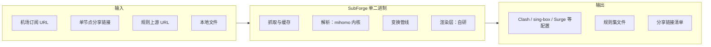
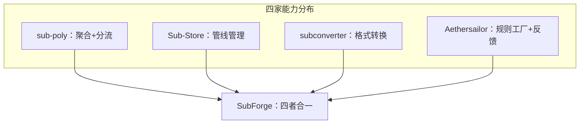

# 项目简介与设计目标

> 本文回答四个问题：SubForge 是什么、为什么要有它、它想达成什么、它明确不做什么。所有设计目标与取舍都来自设计书 `docs/design/subforge-design.md`，实现现状一律以当前源码为准。

---

## 1. SubForge 是什么

**SubForge 是一个"订阅转换 + 分流规则"一体化引擎**：把机场订阅、单节点分享链接、规则上游的内容拉下来，经过筛选、改名、排序、分组、规则编译，渲染成各家代理客户端能直接读取的配置文件，并通过兼容 subconverter 的 HTTP 接口对外提供。

三个关键词：

| 关键词 | 含义 |
| --- | --- |
| **订阅转换** | 输入是订阅与节点，输出是客户端配置。协议解析交给 mihomo 内核，渲染自研 |
| **分流规则** | 不只转节点，还管规则：INI 模板语义兼容、`/getruleset` 六类规则集、MRS 离线生成、规则源 manifest 聚合 |
| **一体化** | 单一 Go 二进制同时提供 CLI 与 HTTP 服务，前端用 `embed.FS` 编进同一个二进制 |

**技术形态**（`docs/design/subforge-design.md:14`）：**Go 单二进制 + 嵌入 mihomo 解析库**。协议解析、测活、MRS 生成全部复用上游内核（mihomo 为 MIT 许可），自研代码只做"编排层"。



---

## 2. 为什么要做：生态缺口

设计书在 2026-10-13 对四家同类项目做了实测调研，结论是**功能高度互补，但没有一家同时做到四件事**（`docs/design/subforge-design.md:13`）：

| 项目 | 它最强的地方 | 它的缺口 |
| --- | --- | --- |
| **sub-poly** | 服务端聚合 + 自建分流 + 云端存储 | 已事实性停更；**无 LICENSE 文件 = 保留所有权利，代码不可合法复用**（`docs/design/subforge-design.md:28`） |
| **Sub-Store** | 管线式订阅管理（filter → operate 链） | AGPL-3.0，代码不可复用；Node 部署常驻内存约百 MB 级 |
| **subconverter** | 多目标格式转换的事实标准；INI 模板生态 | C++ 依赖重、协议追赶慢；GPL-3.0 |
| **Aethersailor 生态** | 规则生成工厂 + Provider 透传 + 规则反馈闭环 | 依赖 GitHub Actions 等外部编排 |

**SubForge 要填的缺口**（`docs/design/subforge-design.md:13`、`:17`）：

- 服务端聚合 + 自建分流 ✅
- 管线式订阅管理 ✅
- 多目标格式转换（含 subconverter 参数超集）✅
- 规则生成工厂 + 规则反馈闭环 ✅



**生态重复度背景**（`docs/design/subforge-design.md:178-208`）：GitHub 上 `subconverter in:name` 有 596 个、`sub-store in:name` 有 799 个结果，同质仓库 1400+，但均为单点复制。SubForge 的立足点不是"再做一个转换器"，而是**把四件事合并进一个二进制**。

---

## 3. 设计目标

### 3.1 目标一：功能合并，而不是功能堆叠

设计书用一张功能合并矩阵把每个功能点标注归属（`docs/design/subforge-design.md:133`）：

| 图例 | 含义 |
| --- | --- |
| 🟢 直接复用上游 | 例如协议解析、MRS 生成 |
| 🟡 借鉴思想重新实现 | 例如管线式 filter/operate、INI 模板语义 |
| 🔴 新造（生态空白） | 例如分层覆盖 DSL、条件化输出、IP 质量检测 |
| ⚪ 舍弃（有明确理由） | 例如 QX/Loon/Surge 内嵌脚本运行模式 |

**"⚪ 舍弃"同样重要**：Sub-Store 的"在 iOS 代理 App 内嵌脚本运行"模式被明确放弃，理由是"需 JS 运行时全套重写，与 Go 内核冲突；单二进制本就轻量，无此必要"，代价是牺牲该场景用户（`docs/design/subforge-design.md:174`）。

### 3.2 目标二：极致开销

目标值与验证方法（`docs/design/subforge-design.md:383-394`）：

| 指标 | 设计目标 | 验证方法 |
| --- | --- | --- |
| 常驻 RSS（纯转换模式） | <30MB | `/usr/bin/time -v` + 24h 稳定性挂测 |
| 常驻 RSS（测活开启，并发 8） | <80MB | 测活周期内峰值 |
| 冷启动到可服务 | <100ms | systemd `Type=notify` 计时 |
| 转换吞吐（1000 节点，规则集已缓存） | <50ms / 请求（P99） | `hey`/`vegeta` 压测 |
| 规则编译（10 万行规则 → MRS） | <2s | mihomo `convert-ruleset` 同基线对照 |
| 二进制体积 | 15~25MB | `go build -trimpath -ldflags="-s -w"` |
| 空闲 CPU | ~0%（仅定时器） | `pidstat 1h` |

> **重要声明**：以上是**设计目标值，不是已实测结果**（`docs/design/subforge-design.md:383` 原文标注"非已实测结果"）。发布前以 CI 基准为准，未达标的模块回炉。
>
> 截至 v0.1.2，两项指标已有实测：**二进制体积超出上表目标**，请按 40MB 量级规划镜像与磁盘；
> **常驻 RSS 仍在目标内**。测量口径与逐项数据见
> [v0.1.2 发布验证报告](../reports/v0.1.2-release-verification.md)。

**对标参照**：Sub-Store 的 Node 常驻约百 MB 级；subconverter 是 C++，依赖重（`docs/design/subforge-design.md:15`）。

**为什么 Go 而不是 C++**：Go 内存约为 C++ 的 2~3 倍，但绝对值仍 <30MB 常驻；换来的是可直接 import mihomo、单二进制跨编译（含 mips/arm 路由器）（`docs/design/subforge-design.md:281`）。

### 3.3 目标三：配置即代码的声明式管线

吸收 Sub-Store 的管线抽象，用单文件描述一次完整转换（`docs/design/subforge-design.md:293-296`）：

```yaml
# profiles/homelab.yaml —— 单文件描述一次完整转换
sources:
  - name: airportA
    url: https://...          # 支持 env 注入，落库只存密文哈希
    group: main               # 分组正则来自 sub-poly 思想
  - name: airportB
```

### 3.4 目标四：超高度定制化

差异化护城河由三件事组成（`docs/design/subforge-design.md:17`）：

1. **mihomo 内嵌解析**（复用上游，协议跟随零成本）
2. **日志驱动的规则反馈闭环**（Rule-Bot 内置化）
3. **分层覆盖 DSL**（全局 → 模板 → 订阅 → 客户端）

> 三者合一的组合，按设计书调研结论，在当时的生态中是空白（`docs/design/subforge-design.md:17`）。

---

## 4. 明确的非目标与边界

### 4.1 SubForge 永远不在数据面上

这是最重要的架构边界：**转换器碰流量 = 延迟与隐私双重灾难，这是刻意的**（`docs/design/subforge-design.md:262`）。

因此它对"用户实际访问了什么、命中了什么规则"**没有天然视角**。唯一合法的观测通道是 mihomo 的 external controller（`/connections`、`/logs`，REST + WebSocket，Clash 生态标准接口）。

按部署拓扑分三种形态（`docs/design/subforge-design.md:264-268`）：

| 拓扑 | 部署形态 | 采集方式 | 反馈类功能可用性 |
| --- | --- | --- | --- |
| **T1 同机/同网**（推荐主路径） | SubForge 与 mihomo 同设备或同 LAN（软路由/NAS 常见形态） | 直连 `http://127.0.0.1:9090` 或 LAN IP + secret，WebSocket 订阅 | ✅ 全功能；域名数据不出内网 |
| **T2 远程后端** | SubForge 在公网 VPS，客户端在家庭出口 | **Beacon**：约 3MB 的 Go 单文件 agent 部署在 mihomo 旁，本地聚合后 POST `/api/v1/telemetry` | ✅ 全功能；默认仅上报规则命中计数 + eTLD+1 聚类，原始域名需 opt-in |
| **T3 无观测** | 任意 | 无观测点 | ⛔ 命中率回流/未匹配闭环自动禁用（UI 明示）；转换主功能不受影响 |

**视角偏差注记**（`docs/design/subforge-design.md:271`）：测活/测速从 SubForge 主机视角发起，T2 部署下延迟数值 ≠ 用户侧体感，只能作相对比较；T1 无此问题。Beacon 不做客户端侧测活（范围控制，防 agent 膨胀）。

### 4.2 明确舍弃的能力

| 舍弃项 | 理由 | 代价 |
| --- | --- | --- |
| QX/Loon/Surge 内嵌脚本运行模式 | 需 JS 运行时全套重写，与 Go 内核冲突 | 牺牲 iOS 代理 App 内嵌场景（用户可自架后端） |
| 复用 Sub-Store / sub-poly 前端代码 | AGPL 传染 / 无许可证 | 自研 Vue3 前端 |
| 复制 subconverter / Sub-Store / subs-check 代码 | GPL-3.0 / AGPL-3.0 | 仅做格式与参数语义兼容 |

（来源：`docs/design/subforge-design.md:174`、`:171-173`、`:412-415`。）

---

## 5. 关键技术决策

| 决策项 | 选择 | 依据 | 代价 |
| --- | --- | --- | --- |
| 主语言 | Go 1.24+（`go.mod` 实为 1.26.0） | mihomo 为 Go 且 MIT；单二进制跨编译 | 内存高于 C++ 约 2~3 倍 |
| 协议解析 | 嵌入 MetaCubeX/mihomo 作为库 | MIT 允许嵌入；跟上新协议 | mihomo 非为库设计，内部 API 无稳定性承诺 → 锁版本 + 适配层隔离 |
| 输出渲染 | 自研渲染层 | mihomo 不含 Surge/QX/Loon 渲染逻辑 | 自研代码量最大的模块 |
| INI 模板 | 重写解析器，语义级兼容 | 存量模板生态迁移零成本 | 语法边角行为需对齐 |
| 脚本扩展 | goja（纯 Go ES5.1+ 沙箱） | 无 cgo，交叉编译不碎 | 比原生 JS 慢 10~50 倍 → 仅用于非热路径 |
| 存储 | 单文件 JSON + SQLite（纯 Go 驱动） | 零 cgo；路由器场景单文件友好 | 比 C 版驱动慢 2~4 倍，本场景写入极低频 |
| HTTP | 标准库 `net/http` + chi | QPS 极低，瓶颈在上游网络 | 无显著代价 |
| 前端 | 自研 Vue3 + Vite，`embed.FS` 编入 | 兼容 sub-web 调用协议 | 自研前端工作量 |

（来源：`docs/design/subforge-design.md:281-291`。）

**三条最大风险与缓解**（`docs/design/subforge-design.md:16`）：

1. **mihomo 未被官方设计为库，内部 API 不稳定** → 锁版本 + 适配层隔离。当前 `go.mod:9` 锁定 `github.com/metacubex/mihomo v1.19.31`。
2. **Worker 无服务模式无法承载 mihomo** → 双解析器策略（设计书 §7.2）。
3. **规则数据 GPL/CC-BY-SA 传染** → 运行时拉取而非静态打包（设计书 §9）。

---

## 6. 许可证与合规立场

| 组件/数据 | 许可证 | 处置 |
| --- | --- | --- |
| MetaCubeX/mihomo | MIT | ✅ 可嵌入可闭源；保留版权声明 |
| ACL4SSR | CC-BY-SA-4.0 | ⚠️ 运行时拉取；如打包须附署名 + 同许可 |
| blackmatrix7/ios_rule_script | GPL-2.0 | ⚠️ 仅运行时拉取 |
| Loyalsoldier/clash-rules | GPL-3.0 | ⚠️ 仅运行时拉取 |
| MetaCubeX/meta-rules-dat | GPL-3.0 | ⚠️ 仅运行时拉取 |
| tindy2013/subconverter | GPL-3.0 | 禁止复制代码；仅格式/参数语义兼容 |
| Sub-Store | AGPL-3.0 | 禁止复制代码；仅概念借鉴 |
| beck-8/subs-check | GPL-3.0 | 禁止复制代码；架构路线借鉴 |
| sub-poly | 无许可证 | 全部功能重写，不接触其代码 |
| **本项目** | 目标 MIT（代码）/ 规则数据按上表 | — |

（来源：`docs/design/subforge-design.md:400-417`。）

**"运行时拉取"的边界论证**：AGPL/GPL 义务附着于"分发"。发行物含二进制 + MIT 数据；GPL 规则在用户机器上由用户配置 URL 触发下载，不构成发行（`docs/design/subforge-design.md:419`）。

**代码层的对应实现**：`/getruleset` 的注释明确写着"规则数据一律由调用方给出，本服务不内置任何第三方规则集（R3）"（`internal/api/handlers.go:118`）。

---

## 7. 实现现状（截至当前源码）

### 7.1 已实现并可用

| 能力 | 证据 |
| --- | --- |
| CLI 十个子命令 | `cmd/subforge/main.go:18-30`（version / doctor / convert / diff / manifest / mrs / subscheck / scheduler / rulebot / serve） |
| HTTP 服务与兼容 API | `internal/api/server.go:119-279` |
| `/sub`、`/profile`、`/render` 三入口 | `internal/api/server.go:140-142`（共用同一处理器） |
| `/getruleset` 六类规则集输出 | `internal/api/handlers.go:119`（**已实现，不是 501**） |
| `/subscribe` 纯文本订阅响应 | `internal/api/subscription.go:747`（`text/plain; charset=utf-8`） |
| `/api/metrics` JSON 运行时指标 | `internal/api/pprof.go:128-154`（`writeJSON`，**不是 Prometheus 暴露格式**） |
| 配置热重载 | `internal/runtime/hotreload.go:58`；`cmd/subforge/serve.go:330` 以 1 秒间隔轮询 |
| 磁盘缓存与条件请求 | `internal/fetch/fetcher.go:196-256` |

### 7.2 代码量现状

| 范围 | 文件数 | 行数 |
| --- | --- | --- |
| `cmd/` + `internal/` 非测试 Go 源码 | 101 | 19,052 |
| `cmd/` + `internal/` 测试代码 | 128 | 30,102 |
| `web/src`（Vue/TS/JS） | 71 | 13,580 |

> 统计口径：`Get-ChildItem -Path cmd,internal -Recurse -File -Filter *.go`，排除 `*_test.go`；前端统计 `web/src` 下 `*.vue,*.ts,*.js`。**不含** `vendor/`（仓库存在 vendor 目录）。
>
> 与设计书预估对比：设计书预计自研代码量 <15k 行（`docs/design/subforge-design.md:14`），前端预估 3~5k 行（`:288`）；当前实测均已超出该预估。

### 7.3 未接入的功能（如实标注）

| 项 | 现状 | 证据 |
| --- | --- | --- |
| **MCP 能力** | `internal/mcp` 包已实现，但**全仓库没有任何入口引用它**，CLI 子命令表中也没有对应命令 | 检索 `internal/mcp` 的 import 结果为空；`cmd/subforge/main.go:40-67` 无 mcp 分支 |

### 7.4 路线图（设计书原文）

| 里程碑 | 范围 | 验收标准 |
| --- | --- | --- |
| M1 内核（4~6 周） | mihomo 嵌入解析 + 全 target 渲染 + `/sub` 兼容 API + INI 解析器 + 金测集 | subconverter 公开测试集全过；内存预算达标 |
| M2 定制化（4 周） | 管线引擎 + 分层覆盖 DSL + goja 沙箱 + Collection/Provider 透传 + Web UI（embed） | Aethersailor 8 模板零修改跑通；sub-web 可直连 |
| M3 规则工厂（3 周） | manifest 聚合 + MRS 离线生成 + 定时任务/告警 + Rule-Bot 闭环 + OpenWrt/Docker 交付 | 8 家上游自动跟进；MRS 与 Actions 产出字节级兼容抽检 |
| M4 打磨（2 周） | 诊断面 + 性能基准固化 + Worker 轻模式 | §8 全指标 CI 化 |

（来源：`docs/design/subforge-design.md:425-430`。）

**版本状态注记**：CLI 用法文本自述"M1 开发中"，`serve` 子命令标注"M1-I5 增量实现"（`cmd/subforge/main.go:13`、`:28`）。

---

## 8. 快速开始

```bash
# 1. 自检环境
subforge doctor

# 2. 本地把订阅转成 Clash 配置
subforge convert -url https://example.com/sub -target clash.meta -o config.yaml

# 3. 起 HTTP 服务（默认 127.0.0.1:25500，不鉴权）
subforge serve

# 4. 拉一份转换结果
curl "http://127.0.0.1:25500/sub?target=clash.meta&url=https://example.com/sub"
```

> 参数含义与完整清单见 [转换流水线原理](转换流水线原理) 与 [渲染器与输出格式](渲染器与输出格式)；部署方式见 [安装与部署](安装与部署)。

---

## 9. 常见问题

| 问题 | 答案 |
| --- | --- |
| SubForge 会代理我的流量吗？ | 不会。它永远不在数据面上，只产出配置文件 |
| 它能看到我访问了哪些网站吗？ | 默认看不到。只有你按 T1/T2 拓扑接入 mihomo external controller 后，才能拿到规则命中数据 |
| 它是 subconverter 的复刻吗？ | 不是。接口与参数语义兼容，代码不复制（GPL 约束），且额外做了规则工厂与反馈闭环 |
| 它能在路由器上跑吗？ | 可以：发布矩阵包含 `linux/arm` 与 `linux/arm64`（mips/mipsle 已移除，见[安装与部署](安装与部署)） |
| 内存目标达标了吗？ | 常驻 RSS 已在目标内；设计书其余指标标注为**目标值非实测**，请以你自己的实测为准 |
| 规则数据是打包在二进制里的吗？ | 不是。规则一律运行时拉取，二进制内不内置第三方规则集 |

---

## 10. 相关页面

- [系统架构总览](系统架构总览)：分层结构、数据流、依赖方向
- [转换流水线原理](转换流水线原理)：一次转换内部的每个机制
- [订阅解析与协议支持](订阅解析与协议支持)：输入形态与协议矩阵
- [渲染器与输出格式](渲染器与输出格式)：输出目标与各格式细节
